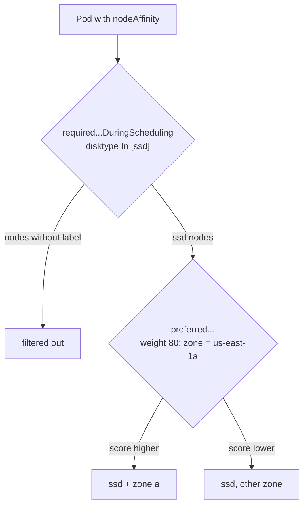

# Day 15/40 - Kubernetes node affinity explained

## Check out the video below for Day12 👇

[](https://youtu.be/5vimzBRnoDk)


## Beyond Node Selectors: Introducing Affinity 🚀

Node Selectors are great for basic pod placement based on node labels. But what if you need more control over where your pods land? Enter **Node Affinity**! This feature offers advanced capabilities to fine-tune pod scheduling in your Kubernetes cluster.

---

## Node Affinity: The Powerhouse 🔥



Node Affinity lets you define complex rules for where your pods can be scheduled based on node labels. Think of it as creating a wishlist for your pod's ideal home!

### Key Features:
- **Flexibility**: Define precise conditions for pod placement.
- **Control**: Decide where your pods can and cannot go with greater granularity.
- **Adaptability**: Allow pods to stay on their nodes even if the labels change after scheduling.

---

## Properties in Node Affinity
- requiredDuringSchedulingIgnoredDuringExecution
- preferredDuringSchedulingIgnoredDuringExecution

## Required During Scheduling, Ignored During Execution 🛠️

This is the strictest type of Node Affinity. Here's how it works:

1. **Specify Node Labels**: Define a list of required node labels (e.g., `disktype=ssd`) in your pod spec.
2. **Exact Match Requirement**: The scheduler only places the pod on nodes with those exact labels.
3. **Execution Consistency**: Once scheduled, the pod remains on the node even if the label changes.

### Example: Targeting SSD Nodes 💾

Suppose your pod needs high-speed storage. You can create a deployment with a Node Affinity rule that targets nodes labeled `disktype=ssd`.

**YAML Configuration:**
```yaml
apiVersion: v1
kind: Pod
metadata:
  creationTimestamp: null
  labels:
    run: redis
  name: redis-3
spec:
  containers:
  - image: redis
    name: redis
    resources: {}
  dnsPolicy: ClusterFirst
  restartPolicy: Always
  affinity:
    nodeAffinity:
      requiredDuringSchedulingIgnoredDuringExecution:
          nodeSelectorTerms:
          - matchExpressions:
              - key: disktype
                operator: In
                values:
                - ssd
```


