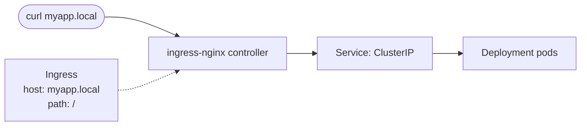

# Day 33: Kubernetes - Learning Ingress

Guide to deploy a hello world application in a pod, create a service for it and expose it to external world using Ingress. 

## Build the Docker Image using the Dockerfile

```bash
docker build -t hello-world .
```

## Push the Docker Image to Docker Hub

```bash
docker tag hello-world <dockerhub-username>/hello-world
docker push <dockerhub-username>/hello-world
```

## Create a Deployment

```bash
kubectl apply -f k8s/deployment.yaml
```

## Create service for the Deployment

```bash
kubectl apply -f k8s/service.yaml
```

## Create Ingress



```bash
kubectl apply -f k8s/ingress.yaml
```


