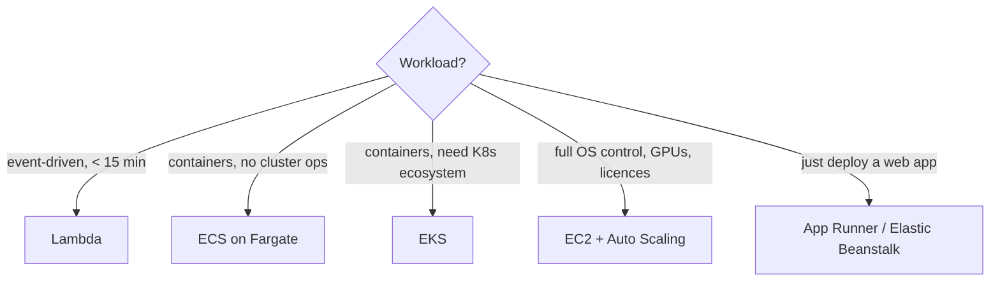

# AWS Compute — EC2, Auto Scaling, Lambda, ECS, EKS, Beanstalk — Complete Notes

> Part of [AWS hub](./aws.md).

---

## 1. EC2 (Elastic Compute Cloud)

### Instance families (naming: `m7g.large` = family **m**, generation **7**, attribute **g**=Graviton, size **large**)
| Family | Optimized for | Examples |
|---|---|---|
| **T** | Burstable general purpose (CPU credits; unlimited mode) | t3, t4g — dev, small web |
| **M** | General purpose balanced | m7i, m7g |
| **C** | Compute (CPU-heavy) | c7g, c7i — web servers, batch, media |
| **R / X / z** | Memory | r7g, x2idn — DBs, caches, in-memory analytics |
| **I / D / H** | Storage (local NVMe, high IOPS) | i4i — NoSQL, OLTP |
| **P / G / Inf / Trn** | Accelerated (GPU/ML chips) | p5, g6, inf2, trn1 |
| **HPC** | HPC | hpc7g |
Suffixes: `g` = Graviton (Arm, ~20–40% better price-performance), `a` = AMD, `i` = Intel, `d` = local NVMe, `n` = network optimized, `e` = extra memory/storage.

### Purchasing options
| Option | Discount | Commitment | Use |
|---|---|---|---|
| **On-Demand** | 0 | None, per-second billing (Linux) | Unpredictable/short |
| **Savings Plans** (Compute / EC2 Instance / SageMaker) | up to ~72% | $/hour for 1 or 3 yrs | Steady baseline — **Compute SP is flexible** across family/region/OS and also covers Fargate & Lambda |
| **Reserved Instances** (Standard / Convertible) | up to ~72% | Specific instance attributes 1/3 yrs | Legacy; also RDS/ElastiCache/Redshift reservations |
| **Spot** | up to ~90% | None; 2-min interruption notice | Fault-tolerant: batch, CI, stateless, big data, containers |
| **Dedicated Hosts** | — | Physical server for you | BYOL per-socket/core licenses, compliance |
| **Dedicated Instances** | — | Single-tenant hardware | Compliance |
| **Capacity Reservations** (On-Demand / Capacity Blocks for ML) | — | Reserve capacity in an AZ | Guarantee capacity for events/DR |

### Key concepts
- **AMI** — image (root volume snapshot + launch permissions + block device mapping). Golden AMIs built with **EC2 Image Builder** / Packer. AMIs are regional (copy to other regions).
- **User data** — bootstrap script at first boot (cloud-init). **Instance metadata (IMDS)** at `169.254.169.254` — **enforce IMDSv2** (session tokens; mitigates SSRF credential theft).
- **Instance profile** — attaches an IAM role to EC2 so apps get temporary credentials (never store keys on instances).
- **Key pairs** for SSH — better: **SSM Session Manager** (no inbound 22, IAM-controlled, logged).
- **Placement groups**: **cluster** (same rack, low latency, HPC), **spread** (different hardware, max 7 per AZ per group, critical instances), **partition** (groups of racks for Hadoop/Kafka/Cassandra).
- **Stop vs terminate vs hibernate**: *stop* — EBS root kept, instance store lost, no compute charge (EBS still charged), may move to new host (new public IP unless EIP); *terminate* — deleted, EBS root deleted by default (`DeleteOnTermination`), use **termination protection**; *hibernate* — RAM saved to EBS, fast resume.
- **Elastic IP** — static public IPv4 (charged; AWS also charges for all public IPv4 addresses since 2024).
- **Status checks**: system (AWS host) and instance (OS) — auto-recover via CloudWatch alarm action.
- **Nitro System** — hypervisor offload → near bare-metal performance, enhanced networking (ENA, EFA for HPC).

### EC2 security best practices
IMDSv2 required; least-privilege instance roles; no SSH from 0.0.0.0/0 (use SSM); private subnets; patch with SSM Patch Manager; EBS encryption by default; Inspector scanning; hardened golden AMIs; CloudWatch agent for logs; termination protection for critical instances; backups via AWS Backup.

### Troubleshooting an unreachable instance
Instance state & status checks → security group (inbound port from your IP) → NACL (inbound + outbound ephemeral 1024–65535) → route table (IGW for public subnet / NAT for private) → public IP/EIP present → OS firewall/sshd running → correct key & username (`ec2-user`, `ubuntu`) → disk full/kernel panic (view **EC2 serial console** / get system log / screenshot) → use SSM Session Manager or attach root volume to a rescue instance.

---

## 2. Auto Scaling (EC2 Auto Scaling Groups)
- **Launch template** (AMI, type, SG, user data, IAM profile; versioned) + **ASG** (min/desired/max, subnets across AZs, health checks).
- **Scaling policies**: **target tracking** (e.g. CPU 50%, ALB RequestCountPerTarget), **step**, **simple**, **scheduled**, **predictive** (ML forecast from history).
- **Health checks**: EC2 status (default) or **ELB health check** (replace instances failing app health) — enable ELB checks when behind a load balancer.
- **Lifecycle hooks**: run actions on launch/terminate (drain connections, push logs, deregister from external systems).
- **Instance refresh** — rolling replacement for new AMI/launch template; **warm pools** — pre-initialized instances for faster scale-out.
- **Mixed instances policy** — combine On-Demand base + Spot across multiple instance types/AZs; `capacity-optimized` Spot allocation.
- **Cooldown / warm-up** prevents thrashing. **Termination policies** choose which instance goes first (oldest launch template, AZ balance).

---

## 3. AWS Lambda (serverless functions)
- Runtimes: Node.js, Python, Java, .NET, Ruby, custom runtime/**container images** (up to 10 GB).
- Limits: timeout **max 15 min**, memory **128 MB–10 GB** (CPU scales with memory), `/tmp` up to 10 GB, payload 6 MB sync / 256 KB async (event).
- Triggers: API Gateway / Function URLs / ALB (sync), S3, SNS, EventBridge (async), SQS / Kinesis / DynamoDB Streams / MSK (event source mappings — poll-based), Step Functions.
- **Concurrency**: each concurrent request uses one execution environment. Account default **1,000 concurrent executions per region** (soft limit). **Reserved concurrency** = guarantee and cap for a function; **provisioned concurrency** = pre-initialized environments (no cold start, costs money). Burst scaling adds environments quickly up to the account limit; excess → throttling (429) for sync, retries for async.
- **Cold starts**: init time when a new environment is created. Mitigate: provisioned concurrency, **SnapStart** (Java/Python/.NET), smaller packages, initialize SDK clients outside the handler, more memory (= more CPU). Attaching a function to a VPC no longer adds a big cold-start penalty (shared Hyperplane ENIs).
- **Error handling**: async → 2 retries + **destinations / DLQ**; SQS → visibility timeout + redrive to DLQ, **partial batch response**; streams → bisect batch, max retry age, on-failure destination.
- **Execution role** (what the function can do) vs **resource-based policy** (who can invoke it).
- **Layers** (shared libs), **environment variables** (encrypt with KMS; prefer Secrets Manager + caching extension), **versions & aliases** (weighted alias for canary via CodeDeploy).
- **EC2 vs Lambda**: Lambda — no servers, event-driven, auto scale to zero, pay per ms, 15-min cap, limited control. EC2 — full OS control, long-running, steady load cheaper, any software, you manage patching/scaling.
- Example automation: EventBridge schedule → Lambda (boto3) that stops untagged dev instances nightly / rotates snapshots / S3 upload → resize image → write metadata to DynamoDB.

```python
import boto3
ec2 = boto3.client("ec2")
def handler(event, context):
    ids = [i["InstanceId"] for r in ec2.describe_instances(Filters=[
        {"Name": "tag:env", "Values": ["dev"]},
        {"Name": "instance-state-name", "Values": ["running"]}])["Reservations"] for i in r["Instances"]]
    if ids:
        ec2.stop_instances(InstanceIds=ids)
    return {"stopped": ids}
```

---

## 4. Containers: ECS, Fargate, EKS, ECR
| | **ECS** | **EKS** |
|---|---|---|
| Orchestrator | AWS-native, simpler | Upstream Kubernetes (CNCF conformant) |
| Concepts | Cluster, **task definition**, task, **service**, capacity providers | Pods, Deployments, Services, Helm, etc. |
| Control plane cost | Free | ~$0.10/hr per cluster (standard support) |
| Portability / ecosystem | AWS-only | Portable, huge ecosystem |
| Best when | AWS-centric teams wanting low ops | K8s skills/standardization, multi-cloud, complex platforms |

- **Launch types / capacity**: EC2 (you manage instances, cheaper at scale, GPUs, daemon tasks) vs **Fargate** (serverless: per-task vCPU/memory billing, no nodes to patch, Fargate Spot).
- **ECS IAM**: *task execution role* (pull from ECR, write logs, fetch secrets) vs *task role* (app's AWS permissions).
- **ECS deployments**: rolling (minimumHealthyPercent/maximumPercent, circuit breaker with rollback), blue/green via CodeDeploy or native ECS blue/green.
- **EKS**: AWS manages control plane (multi-AZ API servers, etcd, upgrades on request); you manage worker nodes (or use **managed node groups**, **Fargate profiles**, **Karpenter**, or **EKS Auto Mode** where AWS manages nodes, networking and storage add-ons too), add-ons (VPC CNI, CoreDNS, kube-proxy, EBS CSI), version upgrades, workloads. Pod IAM via **IRSA** or **EKS Pod Identity**. Access via **EKS access entries** (replacing aws-auth ConfigMap). Ingress via **AWS Load Balancer Controller** (ALB for Ingress, NLB for Service type LoadBalancer).
- **ECR**: private registry, image scanning (basic/enhanced with Inspector), lifecycle policies, replication, immutable tags, pull-through cache.

---

## 5. PaaS-style options
- **Elastic Beanstalk**: upload code (Java, .NET, Node, Python, PHP, Go, Docker); Beanstalk provisions EC2, ASG, ELB, monitoring. Deployment policies: all-at-once, rolling, rolling with additional batch, immutable, traffic splitting, blue/green (CNAME swap). Config via `.ebextensions`/platform hooks. Good for simple web apps; less control than ECS/EKS. Auto-deploy on commit: CodePipeline (GitHub source) → Beanstalk deploy action.
- **Beanstalk vs CloudFormation**: Beanstalk = opinionated app platform (manages the infra for you); CloudFormation = general IaC defining any resources (Beanstalk itself uses CloudFormation underneath).
- **Beanstalk vs EKS**: Beanstalk for quick, standard web apps with small teams; EKS for microservices at scale needing Kubernetes features and portability.
- **App Runner**: source/image → HTTPS service with autoscaling, simplest container web hosting.
- **Lightsail**: simple VPS bundles for small sites.
- **AWS Batch**: managed batch job queues on EC2/Spot/Fargate.

## 6. Choosing compute (decision guide)



Full OS control/legacy → **EC2**; event-driven short tasks → **Lambda**; containers with low ops → **ECS on Fargate**; Kubernetes standard → **EKS**; quick web app → **Beanstalk/App Runner**; batch/HPC → **Batch / ParallelCluster**; ML → **SageMaker**.
