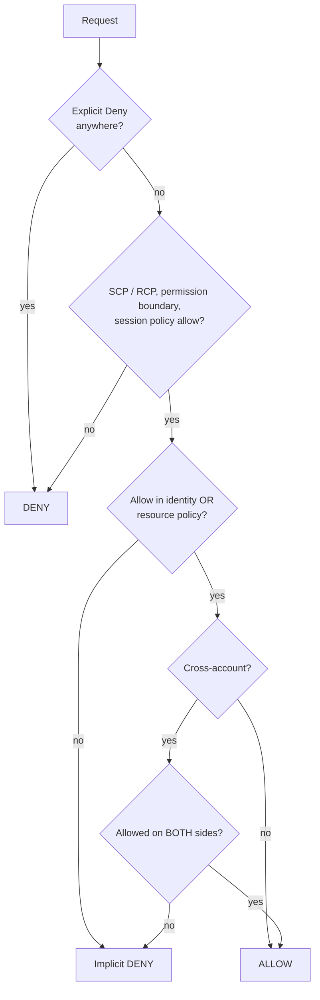
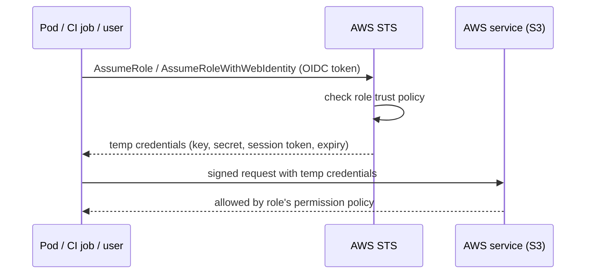

# AWS IAM & Security — Complete Notes

> Part of [AWS hub](./aws.md). Cross-cloud: [Cloud Security & IAM](../Fundamentals/03-cloud-security-and-iam.md).

---

## 1. IAM identities
| Identity | What | Credentials | Use |
|---|---|---|---|
| **Root user** | Account owner, unrestricted | Email + password | Lock away with MFA; almost never use |
| **IAM user** | Long-lived identity | Password and/or access keys | Avoid for humans (use Identity Center); only for legacy/3rd-party needing keys |
| **IAM group** | Collection of users | — | Attach policies to groups, not users |
| **IAM role** | Assumable identity, **no long-term credentials**; temporary creds from **STS** | Trust policy defines who may assume | EC2 instance profiles, Lambda/ECS task roles, cross-account access, federation, CI/CD via OIDC |
| **Service-linked role** | Predefined role owned by an AWS service | — | e.g. AWSServiceRoleForAutoScaling |

**IAM role vs IAM user**: user = permanent identity with permanent credentials for one person/app; role = temporary credentials assumed by anyone trusted (users, services, other accounts, federated identities). Roles are preferred everywhere.

**IAM Identity Center** (successor to AWS SSO): central workforce access to all org accounts via **permission sets**, integrated with Entra ID/Okta/Google (SAML + SCIM), short-lived CLI credentials (`aws configure sso`).

## 2. Policies
```json
{
  "Version": "2012-10-17",
  "Statement": [{
    "Sid": "ReadOwnTeamBucket",
    "Effect": "Allow",
    "Action": ["s3:GetObject", "s3:ListBucket"],
    "Resource": ["arn:aws:s3:::team-data", "arn:aws:s3:::team-data/*"],
    "Condition": {"StringEquals": {"aws:PrincipalTag/team": "data"}}
  }]
}
```
| Policy type | Attached to | Effect |
|---|---|---|
| **Identity-based** (AWS managed / customer managed / inline) | Users, groups, roles | Grants permissions |
| **Resource-based** | Resources (S3 bucket, SQS, KMS key, Lambda, role trust policy) | Grants access to principals incl. cross-account |
| **Permission boundary** | User/role | **Max** permissions the identity can ever have (delegated admin: devs can create roles but only within boundary) |
| **SCP** (Organizations) | OU/account | Max permissions for principals in accounts (doesn't grant; affects even account root, not management account) |
| **RCP** (Organizations) | OU/account | Max permissions on **resources** in accounts (e.g. deny access from outside org) |
| **Session policy** | AssumeRole session | Further restrict a session |
| **ACLs** | S3/legacy | Avoid |

**Managed policies examples**: `AdministratorAccess`, **`PowerUserAccess`** (full access to all services **except IAM/Organizations management** — users can't manage users/roles), `ReadOnlyAccess`, `ViewOnlyAccess`, job-function policies.

### Policy evaluation logic



1. Everything starts as **implicit deny**.
2. Any **explicit Deny** in any applicable policy → **Deny** (always wins).
3. **SCPs/RCPs** must allow (if present); **permission boundary** must allow; **session policy** must allow.
4. Then an **Allow** in identity-based **or** resource-based policy → Allow (same account).
5. **Cross-account**: need Allow in **both** the caller's identity policy **and** the resource policy (or role trust).
Effective permission = intersection of guardrails ∩ union of grants, minus explicit denies.

### Conditions & ABAC
Global keys: `aws:SourceIp`, `aws:SourceVpce`, `aws:PrincipalOrgID`, `aws:RequestedRegion`, `aws:MultiFactorAuthPresent`, `aws:SecureTransport`, `aws:PrincipalTag/*`, `aws:ResourceTag/*`, `aws:CalledVia`. ABAC = match principal tags to resource tags → fewer policies at scale.

## 3. STS (Security Token Service)



| API | Use |
|---|---|
| `AssumeRole` | Cross-account access, switching roles, CI/CD into accounts |
| `AssumeRoleWithWebIdentity` | OIDC federation — **GitHub Actions/GitLab OIDC**, EKS IRSA, Cognito |
| `AssumeRoleWithSAML` | Enterprise SAML IdP federation |
| `GetSessionToken` | MFA-protected temporary creds for IAM user |
| `GetCallerIdentity` | Who am I (never denied) |
Credentials: access key ID + secret + **session token**, 15 min – 12 h. Trust policy example (GitHub OIDC):
```json
{"Effect":"Allow","Principal":{"Federated":"arn:aws:iam::111122223333:oidc-provider/token.actions.githubusercontent.com"},
 "Action":"sts:AssumeRoleWithWebIdentity",
 "Condition":{"StringEquals":{"token.actions.githubusercontent.com:aud":"sts.amazonaws.com"},
              "StringLike":{"token.actions.githubusercontent.com:sub":"repo:my-org/my-repo:ref:refs/heads/main"}}}
```

## 4. Least privilege in practice
- Start with AWS managed job policies only for bootstrap → generate fine-grained policies with **IAM Access Analyzer policy generation** (from CloudTrail activity) → remove unused with **last accessed info** and **unused access findings**.
- **Access Analyzer** external access findings (resources shared outside zone of trust), policy validation & custom policy checks in CI.
- Permission boundaries for delegated role creation; SCP guardrails (deny leaving org, deny disabling CloudTrail/GuardDuty, region restriction, deny root usage).
- MFA for all humans; no access keys for root; rotate/remove unused keys; credential report.

## 5. Encryption & secrets
- **KMS**: AWS managed keys vs **customer managed keys** (key policy + grants, automatic yearly rotation, multi-region keys, import key material, **External Key Store**); symmetric/asymmetric/HMAC; every use logged in CloudTrail; envelope encryption via `GenerateDataKey`. **CloudHSM** for single-tenant FIPS 140-3 Level 3 HSMs.
- **Secrets Manager**: store DB creds/API keys, **automatic rotation** (Lambda; native for RDS/Aurora/Redshift/DocumentDB), cross-region replication, resource policies, versioning (AWSCURRENT/AWSPREVIOUS); ~$0.40/secret/month.
- **SSM Parameter Store**: hierarchical config, SecureString (KMS), free standard tier, no built-in rotation — good for config + non-rotating secrets.
- **ACM**: free public TLS certs for ELB/CloudFront/API GW with auto-renewal; private CA for internal mTLS.
- Handling secrets in apps: Secrets Manager/Parameter Store + IAM role; ECS/EKS inject secrets (ECS `secrets`, EKS via External Secrets Operator / Secrets Store CSI); Lambda via Parameters & Secrets extension; never in env files committed to Git, AMIs, or Terraform state in plaintext (state contains secrets → encrypted S3 backend + restricted access).

## 6. Detection, audit & compliance services
| Service | What |
|---|---|
| **CloudTrail** | Records every API call (who, what, when, from where). Management events (default 90-day Event history) + data events (S3 object/Lambda invoke, extra cost) + Insights. Create an **organization trail** → S3 in log-archive account with log file validation, KMS, Object Lock |
| **AWS Config** | Inventory & configuration history of resources; **Config rules** (managed/custom) for compliance (e.g. `s3-bucket-public-read-prohibited`), conformance packs, auto-remediation via SSM |
| **GuardDuty** | Threat detection from CloudTrail, VPC Flow Logs, DNS logs, EKS audit, S3, RDS login, Lambda, runtime monitoring — e.g. crypto-mining, credential exfiltration, recon |
| **Security Hub** | CSPM: aggregates findings, runs standards (AWS Foundational Security Best Practices, CIS, PCI), org-wide |
| **Inspector** | Vulnerability scanning of EC2, ECR images, Lambda; network reachability |
| **Macie** | Discovers sensitive data (PII) in S3 |
| **Detective** | Investigation graphs for security findings |
| **IAM Access Analyzer** | External/unused access, policy validation |
| **Audit Manager** | Continuous evidence collection for audits |
| **Artifact** | Download AWS compliance reports (SOC, PCI, ISO) and agreements (BAA) |
| **WAF / Shield / Firewall Manager / Network Firewall** | Edge & network protection (see networking notes) |
| **Cognito** | Customer identity (user pools: sign-up/sign-in, JWT; identity pools: temporary AWS creds for app users) |
| **Verified Access** | Zero-trust app access without VPN |

**CloudWatch vs CloudTrail**: CloudWatch = performance monitoring (metrics, logs, alarms — "how is it running?"); CloudTrail = audit of API activity ("who did what?"). Config = "what does it look like now and how did it change?".

## 7. AWS security best-practice checklist (interview answer)
1. Multi-account with Organizations + Control Tower; SCP guardrails.
2. Identity Center SSO + MFA; no IAM users/long-lived keys; roles everywhere; OIDC for CI.
3. Org-wide CloudTrail, Config, GuardDuty, Security Hub, Access Analyzer → central security account; alerts to SIEM/on-call.
4. Network: private subnets, SGs least privilege, no 0.0.0.0/0 on 22/3389 (SSM instead), VPC endpoints, WAF + Shield at edge.
5. Data: encryption at rest (KMS CMKs for sensitive), TLS everywhere, S3 Block Public Access, Macie, backups with Vault Lock.
6. Compute: IMDSv2, patched golden AMIs, Inspector, minimal container images.
7. Secrets in Secrets Manager with rotation.
8. IaC with policy-as-code scanning (cfn-guard, Checkov), drift detection.
9. Incident response runbooks + automated remediation (EventBridge → Lambda/SSM).
10. Regular access reviews, game days, Well-Architected security pillar reviews.
