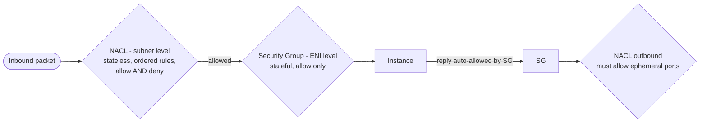
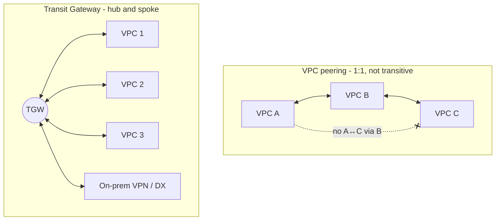

# AWS Networking — VPC, ELB, Route 53, CloudFront, Hybrid — Complete Notes

> Part of [AWS hub](./aws.md). Long-form guide with Terraform: [Cloud Networking for DevOps](../Cloud-Networking-for-DevOps.md).

---

## 1. VPC building blocks
| Component | What it does |
|---|---|
| **VPC** | Logically isolated network in a region; primary IPv4 CIDR /16–/28 (+ secondary CIDRs, IPv6) |
| **Subnet** | CIDR slice in **one AZ**. AWS reserves 5 IPs per subnet (network, router, DNS, future, broadcast) |
| **Route table** | Rules `destination → target`; each subnet associated with one; `local` route for VPC CIDR always present |
| **Internet Gateway (IGW)** | Horizontally scaled, HA gateway for IPv4/IPv6 internet; a subnet is **public** if its route table has `0.0.0.0/0 → igw` |
| **NAT Gateway** | Lets **private** subnets reach internet outbound only (no inbound); deploy one **per AZ** (AZ-scoped) in public subnets; charged per hour + per GB processed |
| **Egress-only IGW** | Outbound-only for IPv6 |
| **Elastic IP** | Static public IPv4 |
| **ENI** | Virtual network interface (private IP, SGs, MAC) |
| **DHCP options / DNS** | `enableDnsSupport`, `enableDnsHostnames`; Route 53 Resolver at VPC+2 |

**Why can't a private subnet just use the IGW?** Instances there have no public IPs; IGW does 1:1 NAT only for instances *with* public IPs. NAT gateway translates many private IPs to its EIP for outbound, keeping instances unreachable from the internet.

### Typical layout (per AZ ×3)
```
VPC 10.0.0.0/16
 ├─ public-a  10.0.0.0/24   → ALB, NAT GW-a       (rt: 0.0.0.0/0 → IGW)
 ├─ private-a 10.0.10.0/24  → app instances/pods  (rt: 0.0.0.0/0 → NAT GW-a)
 └─ db-a      10.0.20.0/24  → RDS                 (rt: local only)
```
Plan CIDRs to avoid overlap with on-prem and other VPCs (needed for peering/TGW). For EKS give large subnets (pods take VPC IPs) or use prefix delegation / secondary CIDRs.

## 2. Security Groups vs NACLs



| | **Security Group** | **Network ACL** |
|---|---|---|
| Level | ENI/instance | Subnet |
| State | **Stateful** (return traffic auto-allowed) | **Stateless** (allow return traffic explicitly — ephemeral ports 1024–65535) |
| Rules | **Allow only** | Allow **and Deny** |
| Evaluation | All rules evaluated | Numbered, lowest first, first match wins |
| Default | Deny inbound, allow outbound | Default NACL allows all; custom NACL denies all |
| References | Can reference other SGs (e.g. DB SG allows from app SG) | CIDRs only |
Use SGs as the main control; NACLs for coarse subnet-level blocks (e.g. deny a malicious CIDR).

## 3. Private access to AWS services: VPC endpoints
- **Gateway endpoints** (S3, DynamoDB): route-table targets, **free**.
- **Interface endpoints (PrivateLink)**: ENIs with private IPs for most services (ECR, STS, SSM, Secrets Manager, KMS, CloudWatch…); hourly + per GB; private DNS.
- **Endpoint policies** restrict what can be accessed through them (data perimeter). Saves NAT costs and keeps traffic off the internet.

## 4. Connecting VPCs



| Option | What | Notes |
|---|---|---|
| **VPC Peering** | 1:1 private connection (same/cross account/region) | **Non-transitive**, no overlapping CIDRs, mesh gets messy past a few VPCs |
| **Transit Gateway** | Regional hub router for many VPCs + VPN + Direct Connect | Transitive, route tables for segmentation, inter-region peering, per-attachment + per-GB cost |
| **PrivateLink (endpoint services)** | Expose one service (behind NLB/GWLB) privately to consumer VPCs | One-way, overlapping CIDRs OK, great for SaaS/shared services |
| **VPC Lattice** | Application-layer service network (service-to-service with auth policies) | Cross-VPC/account service connectivity without managing routing |
| **Cloud WAN** | Global WAN with central policy | Large multi-region networks |

## 5. Hybrid connectivity
- **Site-to-Site VPN**: IPsec over internet, 2 tunnels per connection for HA, to VGW or TGW; quick to set up, ~1.25 Gbps per tunnel.
- **Direct Connect (DX)**: dedicated private fiber (1/10/100 Gbps dedicated, or hosted), consistent latency, lower egress cost; **not encrypted by default** (use MACsec or VPN over DX); HA = two DX connections at two locations; **DX Gateway** to reach VPCs in many regions.
- **Client VPN**: OpenVPN-based remote user access.
- Answer to "connect data center to AWS?": VPN for quick/backup, Direct Connect for production bandwidth/latency, with VPN as failover; BGP routing via TGW; hybrid DNS via **Route 53 Resolver inbound/outbound endpoints**.

## 6. Elastic Load Balancing
| | **ALB** | **NLB** | **GWLB** | CLB |
|---|---|---|---|---|
| Layer | 7 (HTTP/HTTPS/gRPC/WebSocket) | 4 (TCP/UDP/TLS) | 3 (IP packets, GENEVE 6081) | 4/7 legacy |
| Routing | Host/path/header/query/method rules, weighted target groups, redirects, fixed responses | Port-based, ultra-low latency, millions of req/s | Transparently inserts 3rd-party appliances (firewalls, IDS) | Basic |
| Targets | Instances, IPs, Lambda, (ALB→containers) | Instances, IPs, ALB | Appliance instances | Instances |
| Static IP | No (DNS name) — put Global Accelerator in front | **Yes, one per AZ / EIP** | — | No |
| TLS | Terminates, SNI multiple certs (ACM), auth (OIDC/Cognito) | TLS termination or passthrough | — | — |
| Client IP | `X-Forwarded-For` | Preserved | Preserved | XFF |
| WAF | **Yes** | No | — | No |

- **Target groups** with health checks (path, interval, thresholds, success codes).
- **Connection draining = deregistration delay** (default 300 s): LB stops sending new requests to a deregistering target but lets in-flight requests finish; tune lower for short requests.
- **Cross-zone load balancing**: ALB on by default; NLB off by default (cross-AZ data charges).
- **Sticky sessions** (cookies) on ALB — prefer stateless apps.
- **ALB vs NLB vs CloudFront**: ALB = regional L7 routing to app; NLB = L4, static IPs, extreme performance, non-HTTP (TCP/UDP like SIP, gaming, IoT); CloudFront = global CDN edge caching + TLS + WAF + Shield in front of ALB/S3.
- ASG health check vs ALB target health check can disagree: ASG uses EC2 status by default (instance alive) while ALB checks app path — enable ELB health checks on the ASG so unhealthy-but-running instances get replaced.

## 7. Route 53 (DNS + health checks)
- **Hosted zones**: public (internet) and private (associated VPCs). Records: A, AAAA, CNAME, MX, TXT, NS, SOA, SRV, CAA, **Alias** (AWS extension: points to AWS resources — ELB, CloudFront, S3 website, API GW — **works at zone apex**, free queries, auto-tracks IP changes; CNAME can't be at apex).
- **Routing policies**: simple, **weighted** (canary/AB), **latency-based**, **failover** (active-passive with health checks), **geolocation** (by user country/continent — compliance/localization), **geoproximity** (bias by distance, traffic flow), **multivalue answer** (up to 8 healthy records), **IP-based** (by client CIDR).
- **Health checks**: endpoint (HTTP/HTTPS/TCP, string match), calculated (combine), CloudWatch alarm-based (for private resources). Failover DNS TTL low (60 s).
- HA & low latency come from: global anycast network of authoritative DNS servers (100% SLA), latency routing to nearest region, health-checked failover.
- **Route 53 Resolver**: VPC DNS, inbound/outbound endpoints and forwarding rules for hybrid DNS; **DNS Firewall**. Domain registration; DNSSEC signing.
- Traffic to Kubernetes: ExternalDNS creates Route 53 records → points (Alias) to the ALB/NLB created by the AWS Load Balancer Controller.

## 8. CloudFront & Global Accelerator
- **CloudFront** CDN: origins (S3 with **Origin Access Control**, ALB, custom HTTP), cache behaviors per path, cache/origin request policies, TTLs, invalidations, signed URLs/cookies, field-level encryption, geo restriction, **CloudFront Functions** (lightweight JS at edge) / **Lambda@Edge**, origin failover groups, WAF + Shield integrated, HTTP/3, managed TLS via ACM (us-east-1).
- **Global Accelerator**: 2 static anycast IPs → AWS backbone → regional endpoints (ALB/NLB/EC2); fast failover (non-DNS), TCP/UDP, good for gaming/VoIP/IoT and static IP requirements; no caching.

## 9. Network security & monitoring
**AWS WAF** (managed rule groups, rate-based rules, bot control) on CloudFront/ALB/API GW/AppSync/Cognito; **Shield Standard** (free L3/4 DDoS) / **Shield Advanced** (DRT, cost protection, L7); **Network Firewall** (stateful, Suricata rules, domain filtering) in inspection VPC; **Firewall Manager** (org-wide policies); **VPC Flow Logs** (ACCEPT/REJECT records to CloudWatch/S3); **Reachability Analyzer** (path analysis — great for "why can't A reach B"); **Network Access Analyzer**; Traffic Mirroring.

### DDoS mitigation answer
Shield Standard automatically; Shield Advanced for critical apps; CloudFront + Route 53 (edge absorbs volumetric attacks); WAF rate-based rules for L7 floods; ALB/NLB scale; Auto Scaling; minimize attack surface (private subnets, SGs).
