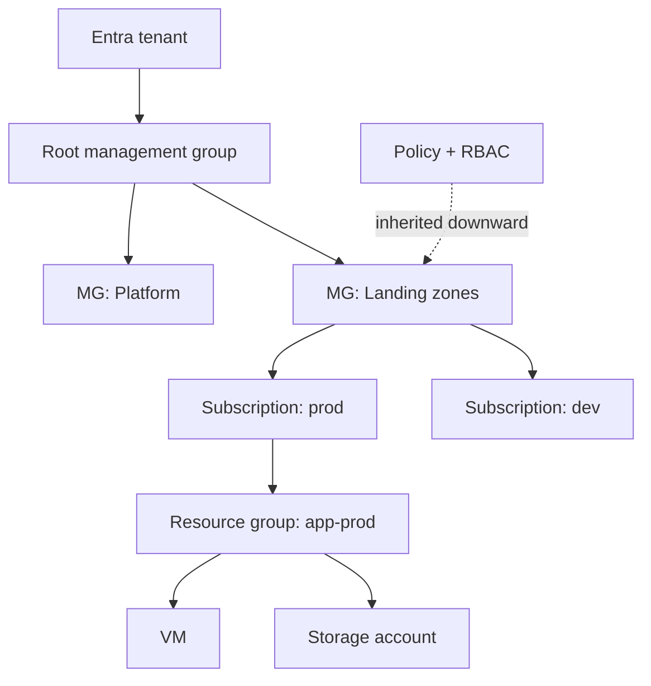

# Azure Core Architecture, Management & Governance — Complete Notes

> Part of the [Azure overview](./azure.md). Maps to AZ-900 domains "Azure architecture" and "Management & governance".

---

## 1. Core architectural components
- **Datacenters** → grouped into **regions** (60+). **Region pairs** (e.g. East US ↔ West US, Central India ↔ South India): same geography, ≥300 miles apart where possible, sequential platform updates, prioritized recovery, some services auto-replicate (GRS). Newer regions may be **non-paired** (rely on AZs).
- **Sovereign regions**: Azure Government (US), Azure China (operated by 21Vianet) — isolated instances for compliance.
- **Availability Zones**: ≥3 physically separate DCs in AZ-enabled regions. Services are **zonal** (pinned to a zone: VM, disk, IP), **zone-redundant** (spread automatically: ZRS storage, zone-redundant SQL/App Service/AKS control plane), or **non-regional/global** (Entra ID, Front Door, Traffic Manager).

### Resource hierarchy



```
Microsoft Entra tenant
 └─ Root management group
     └─ Management groups (nested up to 6 levels deep)    ← Policy/RBAC at scale (e.g. Platform, Landing Zones, Sandbox)
         └─ Subscriptions                                  ← billing + quota + access boundary
             └─ Resource groups                            ← lifecycle container
                 └─ Resources (VM, storage account, ...)
```
- **Resource**: any manageable item. **Resource group (RG)**: logical container; every resource in exactly one RG; RG has a region (for metadata) but can hold resources from any region; **deleting an RG deletes everything in it**; group by lifecycle (things deployed/deleted together); RBAC & policy inherited.
- **Subscription**: billing boundary (invoices, cost reports) + access control boundary + **quotas/limits**; linked to one Entra tenant. Use multiple subscriptions to separate environments, departments, or hit limits.
- **Management groups**: apply Policy/RBAC across many subscriptions; up to 10,000 MGs per tenant.
- **Azure Resource Manager (ARM)**: the single deployment & management layer — every portal/CLI/PowerShell/SDK/IaC request goes through ARM (authN via Entra, authZ via RBAC, policy evaluation, then resource providers like `Microsoft.Compute`). Benefits: declarative templates, consistent management, tagging, locks, RBAC, dependency handling.

### Compared with AWS/GCP
| Azure | AWS | GCP |
|---|---|---|
| Tenant | Organization (identity side ≈ Identity Center) | Organization |
| Management group | OU | Folder |
| Subscription | Account | Project (billing via billing account) |
| Resource group | (Tags / CloudFormation stack) — no direct equivalent | (Labels) — no direct equivalent |

## 2. Tools to manage & deploy
| Tool | Notes |
|---|---|
| **Azure portal** | Web UI, dashboards |
| **Azure Cloud Shell** | Browser shell (Bash/PowerShell) with az/Az module/Terraform pre-installed, persistent storage via file share |
| **Azure CLI** (`az`) | Cross-platform, Bash-friendly |
| **Azure PowerShell** (`Az` module) | PowerShell cmdlets (`New-AzVM`) |
| **ARM templates** | JSON declarative IaC, idempotent, incremental/complete modes |
| **Bicep** | DSL that compiles to ARM, cleaner syntax, modules, day-0 resource support, `what-if` |
| **Terraform (azurerm/azapi)** | Multi-cloud IaC, remote state in Storage Account with blob lease locking |
| **Template Specs / Deployment Stacks** | Versioned, shareable templates; stacks manage a set of resources as one unit with deny settings — successors to **Azure Blueprints** (retired 2026) |
| **Azure Arc** | Extends ARM management (Policy, RBAC, Defender, Monitor, GitOps) to **on-prem/other-cloud servers, Kubernetes clusters, SQL servers** — single control plane for hybrid/multi-cloud |

```bash
az login
az account set --subscription "Prod"
az group create -n rg-app-prod -l centralindia
az deployment group create -g rg-app-prod -f main.bicep -p env=prod
az deployment group what-if -g rg-app-prod -f main.bicep      # preview changes
```
```bicep
param location string = resourceGroup().location
resource sa 'Microsoft.Storage/storageAccounts@2023-05-01' = {
  name: 'stapp${uniqueString(resourceGroup().id)}'
  location: location
  sku: { name: 'Standard_ZRS' }
  kind: 'StorageV2'
  properties: { minimumTlsVersion: 'TLS1_2', allowBlobPublicAccess: false, supportsHttpsTrafficOnly: true }
}
```

## 3. Governance & compliance
### Azure Policy
Evaluates resource properties against rules at create/update time and continuously; produces compliance state.
- **Policy definition** (JSON rule) → grouped into **initiatives** (policy sets, e.g. "CIS", "ISO 27001", regulatory compliance) → **assigned** at MG/subscription/RG scope with parameters and exclusions.
- **Effects**: `Deny` (block), `Audit` (flag), `Append`, `Modify` (e.g. add tags), `AuditIfNotExists`, `DeployIfNotExists` (auto-deploy e.g. diagnostic settings/agents — uses a managed identity + **remediation tasks**), `DenyAction` (block deletes), `Disabled`.
- Examples: allowed locations, allowed VM SKUs, require tag `costCenter`, inherit tag from RG, deny public IPs, require private endpoints, enforce HTTPS on storage, deploy Log Analytics agent/diagnostics.
- **Policy vs RBAC**: RBAC = *who* can do actions; Policy = *what* resources/configs are allowed regardless of who. Both apply.

### Resource locks
`CanNotDelete` (read/modify allowed, no delete) or `ReadOnly` (no changes — can break operations like listing storage keys). Inherited by child scopes; override RBAC (even Owners must remove the lock first). Protect prod RGs, ExpressRoute circuits, DNS zones.

### Tags
Name/value metadata (e.g. `env`, `owner`, `costCenter`, `app`) for cost allocation, automation, organization. **Not inherited automatically** — use Policy `Modify` effect to inherit from RG/subscription. Up to 50 tags per resource.

### Microsoft Purview
Unified data governance & compliance: data map/catalog across Azure, on-prem, multi-cloud, SaaS; classification & sensitivity labels; data lineage; information protection, DLP, eDiscovery, audit, Compliance Manager.

### Cloud Adoption Framework & landing zones
**CAF** methodology: Strategy → Plan → Ready (landing zone) → Adopt (migrate/innovate) → Govern → Manage → Secure. **Azure landing zones**: MG hierarchy (Platform: identity/management/connectivity; Landing zones: corp/online; Sandbox; Decommissioned) with policy-driven guardrails, deployed via Bicep/Terraform accelerators.

## 4. Cost management
- **Cost factors**: resource type & SKU, consumption, region, **bandwidth (egress, inter-region, inter-AZ)**, reservations/savings plans, licensing (Azure Hybrid Benefit), marketplace, support plan.
- **Pricing Calculator** (estimate new workloads) & **TCO Calculator** (on-prem vs Azure).
- **Microsoft Cost Management + Billing**: cost analysis (by tag/RG/service), **budgets** with alerts & action groups, anomaly alerts, exports to storage, cost allocation rules, recommendations from **Azure Advisor**.
- Savings: **Reservations** (1/3-yr VMs, SQL, Cosmos, etc.), **Azure Savings Plan for compute**, **Spot VMs**, **Azure Hybrid Benefit** (reuse Windows Server/SQL licenses), dev/test pricing, auto-shutdown, rightsizing, storage tiering, B-series burstable.

## 5. Monitoring & operational tools (overview)
| Tool | Purpose |
|---|---|
| **Azure Advisor** | Personalized recommendations: Reliability, Security, Performance, Cost, Operational Excellence (score) |
| **Azure Service Health** | Service issues, planned maintenance, health advisories affecting *your* subscriptions/regions; alerts. Includes **Azure Status** (global) and **Resource Health** (your specific resource) |
| **Azure Monitor** | Metrics, logs (**Log Analytics** + KQL), **alerts** (metric/log/activity log) with **action groups**, workbooks, **Application Insights** (APM) |
Details: [Monitoring, DevOps & DR](./azure-monitoring-devops-and-dr.md).
