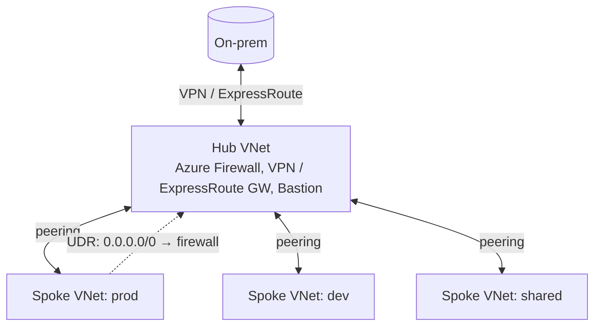
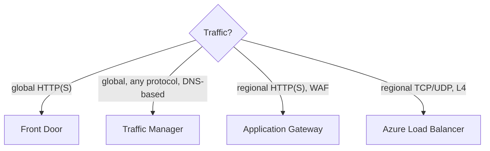

# Azure Networking — VNet, NSG, Firewall, Private Endpoints, VPN, ExpressRoute, Load Balancing — Complete Notes

> Part of the [Azure overview](./azure.md).

---

## 1. Virtual Network (VNet) basics
- **VNet**: isolated private network in **one region** (and one subscription), address space(s) in CIDR; spans all AZs of the region. **Subnets** subdivide it (Azure reserves **5 IPs per subnet**). Some services need **dedicated/delegated subnets** (GatewaySubnet, AzureFirewallSubnet, AzureBastionSubnet, App Service integration, Container Apps).
- Resources talk within a VNet by default; outbound internet via **default outbound access** (being retired for new VNets — use **NAT Gateway**, LB outbound rules, or Firewall explicitly).
- **System routes** + **User-Defined Routes (UDRs)** in route tables (e.g. force `0.0.0.0/0` to Azure Firewall = "forced tunneling"). **BGP** routes from VPN/ExpressRoute.
- **Azure DNS**: public DNS zones (host your domains; **alias records** to Azure resources incl. apex), **Private DNS zones** (name resolution inside linked VNets, auto-registration of VMs), **DNS Private Resolver** (hybrid DNS forwarding inbound/outbound).
- **Public IPs**: Standard SKU (zone-redundant, secure by default — closed unless NSG allows); Basic SKU retired (Sept 2025).

## 2. Traffic filtering
| Control | Level | Notes |
|---|---|---|
| **NSG** (Network Security Group) | Subnet and/or NIC | **Stateful**, allow/deny rules with **priority** 100–4096 (lower = first), 5-tuple + **service tags** (`Internet`, `VirtualNetwork`, `AzureLoadBalancer`, `Storage.WestEurope`) + **ASGs**. Default rules: allow VNet inbound, allow AzureLoadBalancer inbound, deny all inbound; allow outbound |
| **ASG** (Application Security Group) | Group NICs logically ("web", "db") | Write NSG rules like "allow web → db on 1433" without IPs |
| **Azure Firewall** | Central, hub VNet | Managed stateful L3–L7 firewall: network & application (FQDN) rules, DNAT, threat intelligence, **Premium**: TLS inspection, IDPS, URL filtering; **Firewall Manager** policies |
| **WAF** | On Application Gateway / Front Door | OWASP core rule sets, bot protection, custom/rate-limit rules |
| **DDoS Protection** | VNet | Infrastructure protection always on; **DDoS Network/IP Protection** tiers add adaptive tuning, telemetry, cost protection, rapid response |
| **Azure Bastion** | Managed jump host | RDP/SSH via browser/native client over TLS, no public IPs on VMs |
| **NVA** | 3rd-party virtual appliances | Palo Alto, Fortinet, etc. via UDRs / Gateway LB |

## 3. Private access to PaaS: service endpoints vs private endpoints
| | **Service endpoint** | **Private endpoint (Private Link)** |
|---|---|---|
| How | Extends VNet identity to the service over Azure backbone; service still has **public IP** | Puts a **private IP (NIC) from your subnet** on the PaaS resource |
| Access from on-prem | No | **Yes** (via VPN/ExpressRoute) |
| Public endpoint | Remains (restrict via firewall to subnet) | Can disable public network access entirely |
| DNS | No change | Needs **Private DNS zone** (`privatelink.blob.core.windows.net`) |
| Cost | Free | Hourly + per GB |
| Recommendation | Simple cases | **Default for production / zero-trust** |
**Public vs private endpoints** (AZ-900): public endpoint = reachable over internet (IP/firewall restricted); private endpoint = only reachable via private IP in your network. **Private Link service** lets you expose *your own* service behind a Standard LB privately to consumers.

## 4. Connecting networks

| Option | What | Notes |
|---|---|---|
| **VNet peering** | Connect VNets (same region = regional; cross-region = global) over backbone, low latency | **Non-transitive**; no overlapping address spaces; **gateway transit** lets spokes use hub's VPN/ER gateway |
| **Hub-and-spoke** | Hub VNet (Firewall, gateways, Bastion, DNS) + peered spoke VNets per workload | Standard enterprise topology; spoke-to-spoke via Firewall/NVA in hub |
| **Azure Virtual WAN** | Microsoft-managed hubs with built-in routing (any-to-any), VPN, ER, SD-WAN, secured hub (Firewall) | Large/global networks |
| **VPN Gateway** | IPsec/IKE encrypted tunnels over internet: **site-to-site** (on-prem ↔ Azure), **point-to-site** (users — OpenVPN/IKEv2/SSTP with Entra auth), VNet-to-VNet | In **GatewaySubnet**; SKUs VpnGw1–5 (AZ variants); active-active for HA; BGP optional |
| **ExpressRoute** | **Private dedicated connection** via connectivity provider, **does not traverse the public internet** — predictable latency, up to 100 Gbps (ExpressRoute Direct), SLA | Private peering (VNets) + Microsoft peering (M365/PaaS public endpoints); **Global Reach** (connect on-prem sites through Microsoft backbone); **FastPath**; not encrypted by default — **MACsec** (Direct) or IPsec over ER; HA = two circuits in two peering locations, VPN as backup |

## 5. Load balancing & traffic distribution (decision tree)

| Service | Layer | Scope | Use |
|---|---|---|---|
| **Azure Load Balancer** | L4 (TCP/UDP) | Regional (+ **cross-region/global tier**) | Internal or public; HA ports for NVAs; outbound rules; zone-redundant; ultra-low latency; non-HTTP (Basic SKU retired) |
| **Application Gateway** (v2) | L7 HTTP/HTTPS | Regional | Path/host routing, TLS termination/end-to-end TLS, **WAF**, autoscaling, cookie affinity, rewrite, private frontends; **App Gateway for Containers** for AKS |
| **Azure Front Door** (Standard/Premium) | L7, global anycast | Global | Global HTTP(S) entry: CDN caching, **WAF**, SSL offload, path routing, health-probe failover across regions, **Private Link to origins** (Premium), custom domains with managed certs |
| **Traffic Manager** | DNS-based | Global | Routes by DNS (priority/failover, weighted, performance, geographic, multivalue, subnet); any protocol; client connects directly to endpoint (no proxy) — failover speed bound by DNS TTL |
| **Gateway Load Balancer** | L3/4 | Regional | Transparent insertion of NVAs |

Decision: **HTTP(S) + global → Front Door**; **HTTP(S) regional (+WAF, private) → Application Gateway**; **non-HTTP global → Traffic Manager (DNS) or cross-region LB**; **non-HTTP regional → Load Balancer**. Common combo: Front Door → App Gateway (WAF/private) → AKS/VMs; or Traffic Manager → regional App Gateways.

## 6. Monitoring & troubleshooting
**Network Watcher**: IP flow verify (is an NSG blocking?), **next hop** (routing), **connection troubleshoot**, effective security rules/effective routes on NIC, packet capture, VPN diagnostics, **VNet flow logs** + Traffic Analytics, Connection Monitor. Classic "VM can't connect" path: effective NSG rules (subnet + NIC both must allow) → UDRs/forced tunneling → Firewall rules → DNS (private DNS zone linked?) → OS firewall.

## 7. Hybrid environment: connecting on-prem Active Directory to Azure (scenario)
1. **Network**: ExpressRoute (primary) + site-to-site VPN (backup) into a hub VNet (gateway transit to spokes); hybrid DNS via DNS Private Resolver ↔ on-prem DNS conditional forwarders.
2. **Identity**: **Microsoft Entra Connect Sync** (or lighter **Entra Cloud Sync**) syncs users/groups from AD DS to Entra ID; sign-in via **Password Hash Sync** (recommended, also leaked-credential detection), **Pass-through Authentication**, or **federation (AD FS)**; **Seamless SSO**; hybrid-joined devices; Conditional Access + MFA.
3. **Legacy apps needing Kerberos/LDAP in Azure**: extend AD DS by deploying **domain controllers as Azure VMs** (in identity subscription, availability zones) or use **Microsoft Entra Domain Services** (managed domain, no DC management).
4. **Management**: **Azure Arc** for on-prem servers (Policy, Defender, Update Manager, Monitor); Azure Backup / Site Recovery for on-prem → Azure DR.
5. Security: Defender for Identity (monitors on-prem AD), PIM for admin roles, tiered admin model.
