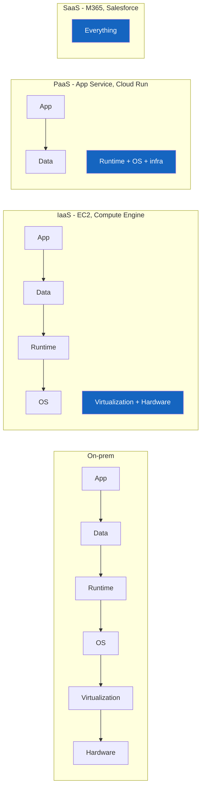
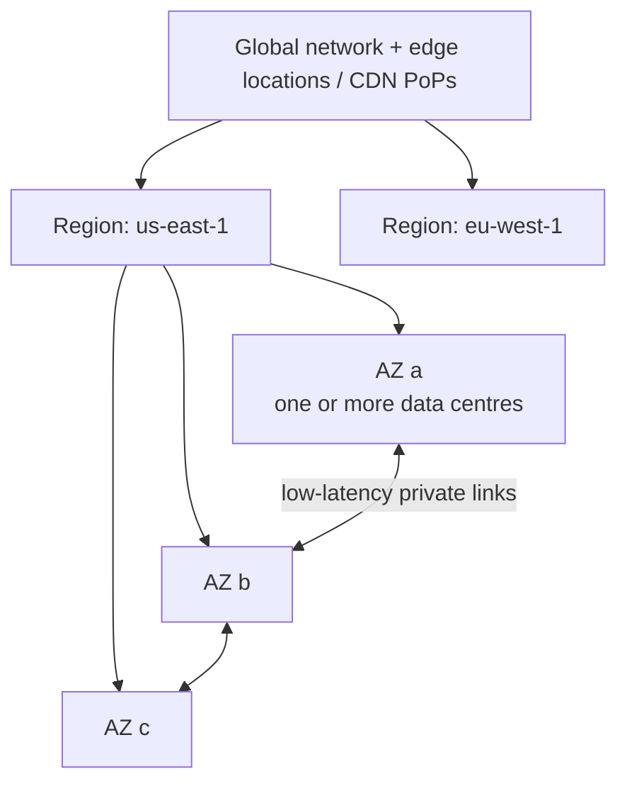
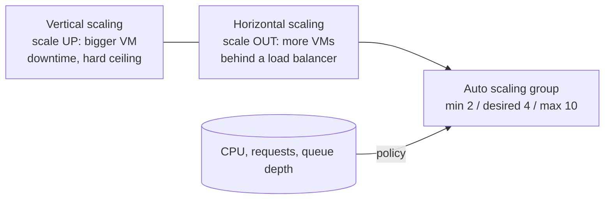
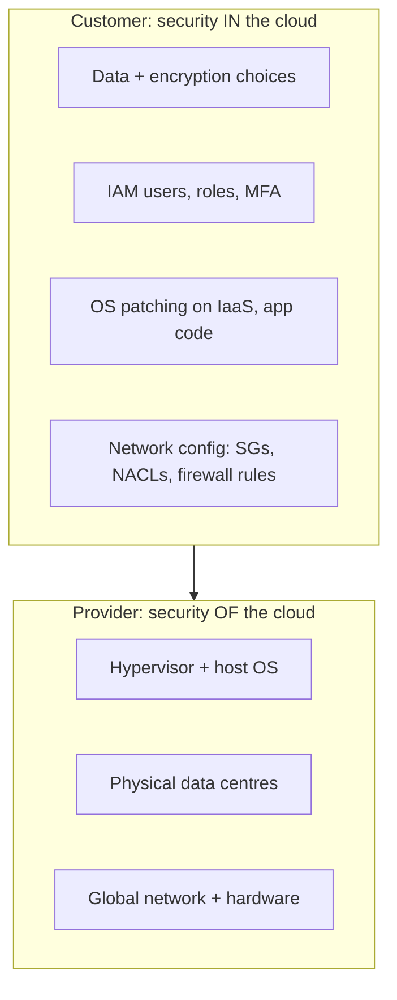

# Cloud Computing Fundamentals — Complete Notes

> Part of the [Cloud hub](../README.md). Next: [Storage & Databases](./02-cloud-storage-and-databases.md) · [Security & IAM](./03-cloud-security-and-iam.md) · [HA, DR & Backup](./04-high-availability-dr-backup.md) · [Cost Optimization](./05-cloud-cost-optimization.md) · [Migration](./06-cloud-migration.md) · [Observability](./07-cloud-observability.md) · [Architecture Patterns](./08-cloud-architecture-patterns.md). Interview Q&A: [Cloud Fundamentals Q&A](../../Interview%20Questions/23-cloud-fundamentals-cross-cloud-qna.md).

---

## 1. What is cloud computing?

**Cloud computing** is on-demand delivery of IT resources (compute, storage, networking, databases, analytics, AI) over the internet with **pay-as-you-go** pricing. You rent capacity from a provider instead of buying and running data centers.

### NIST's 5 essential characteristics (the textbook definition)
| Characteristic | Meaning | Example |
|---|---|---|
| **On-demand self-service** | Provision resources yourself, no human ticket | `aws ec2 run-instances`, portal click |
| **Broad network access** | Accessible over the network from any client | Console, CLI, SDK, API |
| **Resource pooling** | Provider's hardware is shared by many customers (**multi-tenancy**), location-independent | One physical host runs VMs from many customers |
| **Rapid elasticity** | Scale out/in quickly, often automatically | Auto Scaling Group adds 10 instances in minutes |
| **Measured service** | Usage is metered and billed | Per-second EC2 billing, per-GB storage |

### Benefits (why companies move)
- **CapEx → OpEx**: no upfront hardware; pay for what you use (consumption-based model).
- **Elasticity/scalability**: match capacity to demand; no over-provisioning "for peak".
- **Speed/agility**: new environments in minutes, experiment cheaply.
- **Global reach**: deploy close to users in many regions.
- **Reliability**: multiple AZs/regions, managed backups, SLAs.
- **Security & compliance**: provider-certified physical security, compliance programs (SOC 2, ISO 27001, PCI, HIPAA), built-in encryption.
- **Manageability**: managed services remove patching/ops toil; IaC, monitoring, automation.
- **Economies of scale**: provider buys hardware at massive scale → lower unit prices.

### Challenges / risks
Vendor lock-in, cost sprawl (bill surprises), shared-responsibility misunderstandings (misconfiguration is the #1 cause of cloud breaches), data residency/compliance, egress costs, outage dependency on the provider, skills gap, network latency for hybrid setups.

### Key vocabulary
| Term | Meaning |
|---|---|
| **Multi-tenancy** | Many customers share the same physical infrastructure with logical isolation |
| **Cloud provider / CSP** | AWS, Azure, GCP, Oracle Cloud, IBM Cloud, Alibaba Cloud |
| **Cloud broker** | Third party that helps select/integrate/manage services across providers (aggregation, integration, customization) |
| **Cloud bursting** | App runs in private DC/cloud and "bursts" overflow load into public cloud at peaks |
| **Cloud-native** | Apps built for the cloud: containers, microservices, dynamic orchestration, managed services, immutable infra, CI/CD (CNCF definition) |
| **Edge computing / edge cloud** | Compute close to users/devices (CDN POPs, AWS Local Zones/Wavelength/Outposts, Azure Edge Zones, Google Distributed Cloud) for low latency |
| **Cloud ecosystem** | Provider + marketplace + partners + ISVs + integrations around a platform |
| **Service catalog** | Curated, pre-approved list of deployable services/templates (AWS Service Catalog, Azure Managed Apps / Template Specs) |
| **XaaS** | Anything-as-a-service: BaaS (Backup), DBaaS, DRaaS, STaaS, etc. |

---

## 2. Service models: IaaS, PaaS, SaaS (+ CaaS, FaaS)

Who manages what: the higher the model, the more the provider runs for you.

**Pizza analogy:** make at home (on-prem) → take-and-bake (IaaS) → delivery (PaaS) → dine out (SaaS).

| Layer you manage → | On-prem | **IaaS** | **CaaS** | **PaaS** | **FaaS** (serverless) | **SaaS** |
|---|---|---|---|---|---|---|
| Application & data | You | You | You | You | You (functions) | Provider (you manage data/users) |
| Runtime / middleware | You | You | You (in container) | Provider | Provider | Provider |
| OS | You | **You** | Provider (nodes may be yours) | Provider | Provider | Provider |
| Virtualization / servers / storage / network | You | Provider | Provider | Provider | Provider | Provider |
| **AWS** | — | EC2, EBS, VPC | ECS, EKS, Fargate | Elastic Beanstalk, App Runner, RDS | Lambda | WorkMail, Chime, QuickSight |
| **Azure** | — | VMs, Managed Disks, VNet | AKS, Container Apps, ACI | App Service, Azure SQL | Azure Functions | Microsoft 365, Dynamics 365 |
| **GCP** | — | Compute Engine | GKE, Cloud Run | App Engine, Cloud SQL | Cloud Run functions | Google Workspace |

**Use cases**
- **IaaS**: lift-and-shift legacy apps, full OS control, custom software, licensing tied to VMs.
- **PaaS**: web apps/APIs where teams just want to deploy code; managed DBs.
- **SaaS**: commodity business software (email, CRM, collaboration).
- **FaaS**: event-driven glue, spiky/low traffic APIs, scheduled jobs, file processing.
- **CaaS**: microservices that need container portability and orchestration.

---

## 3. Deployment models

| Model | What | Pros | Cons | Typical use |
|---|---|---|---|---|
| **Public cloud** | Provider-owned, shared infra, accessed over internet | No CapEx, elastic, global, managed services | Less control, compliance concerns, lock-in | Most new workloads, startups |
| **Private cloud** | Dedicated to one org (on-prem VMware/OpenStack, or hosted private) | Control, compliance, predictable perf | CapEx, you operate it, limited elasticity | Regulated/sensitive, steady workloads |
| **Hybrid cloud** | Private/on-prem + public, connected and managed together | Keep sensitive data on-prem, burst to cloud, gradual migration | Network/identity integration complexity | Banks, healthcare, migrations in progress |
| **Community cloud** | Shared by orgs with common concerns (e.g. government, healthcare) | Shared compliance cost | Limited | GovCloud-style, research consortia |
| **Multi-cloud** | Two+ public providers | Best-of-breed services, negotiating leverage, resilience, regulatory needs | Skills, tooling, networking, egress cost, lowest-common-denominator risk | Large enterprises, M&A, data/AI on GCP + core on AWS |

Hybrid tooling: **AWS Outposts / EKS Anywhere / Storage Gateway / Direct Connect**, **Azure Arc / Azure Local (formerly Stack HCI) / ExpressRoute**, **GCP Anthos (GKE Enterprise) / Google Distributed Cloud / Interconnect**.

---

## 4. Global infrastructure: regions, zones, fault domains, edge

| Concept | Meaning | AWS | Azure | GCP |
|---|---|---|---|---|
| **Region** | Geographic area with multiple data centers | `us-east-1` | `eastus` (with **region pairs** for DR, + sovereign regions like Azure Government/China) | `us-central1` |
| **Availability Zone** | Physically separate DC(s) in a region with independent power/cooling/network, low-latency links | `us-east-1a` (≥3 AZs per region) | Availability Zones 1/2/3 (in AZ-enabled regions) | Zones `us-central1-a` |
| **Fault domain** | Group of hardware sharing a single point of failure (rack/power) | Placement groups (spread/partition) | **Availability Sets**: fault domains (up to 3) + update domains (up to 20) | Spread placement policies |
| **Edge locations** | POPs for CDN/DNS/edge compute | CloudFront, Route 53, Global Accelerator, Local Zones, Wavelength | Front Door/CDN POPs, Edge Zones | Cloud CDN/Media CDN POPs |
| **Global vs regional resources** | Some services are global | IAM, Route 53, CloudFront are global; VPC is regional | Entra ID is global; VNet is regional | **VPC is global** (subnets regional); IAM global |

**Why it matters:** an AZ failure should not take you down → deploy across ≥2 (better 3) AZs. A region failure needs multi-region DR. Data residency laws decide which regions you may use. Choose a region by: **compliance/data residency, latency to users, service availability, price**.

---

## 5. Scaling & elasticity

| | **Vertical scaling (scale up)** | **Horizontal scaling (scale out)** |
|---|---|---|
| How | Bigger instance (more CPU/RAM) | More instances behind a load balancer |
| Limit | Max instance size | Practically unlimited |
| Downtime | Usually restart | None (add/remove nodes) |
| App requirement | None | **Stateless** app (sessions in Redis/DB), idempotent work |
| HA | Single point of failure remains | Improves availability |
| Examples | Resize EC2/RDS instance | ASG, VMSS, MIG, K8s HPA |

- **Scalability** = *ability* to handle growth (manually or automatically).
- **Elasticity** = *automatic, real-time* scaling out **and in** with demand (pay only for what's used).
- **Autoscaling policies**: target tracking (keep CPU at 60%), step/simple (thresholds), scheduled (known peaks), predictive (ML forecast), queue-based (scale on backlog per instance).
- Handling **traffic spikes**: autoscaling + load balancer + CDN caching + queues to absorb bursts + DB read replicas/caching + pre-warming/scheduled scaling for known events + rate limiting.

---

## 6. Virtualization, containers, orchestration, serverless

### Virtualization
A **hypervisor** lets one physical machine run many isolated **virtual machines**, each with its own OS.
- **Type 1 (bare-metal)**: runs directly on hardware — ESXi, Hyper-V, KVM, Xen, **AWS Nitro**. Used by clouds.
- **Type 2 (hosted)**: runs on a host OS — VirtualBox, VMware Workstation. Dev laptops.
- Enables multi-tenancy, consolidation, snapshots, live migration — the foundation of IaaS.

### VMs vs containers
| | VM | Container |
|---|---|---|
| Isolation | Full guest OS per VM (hardware-level) | Shares host kernel (namespaces + cgroups) |
| Size / boot | GBs / minutes | MBs / seconds |
| Density | Lower | Higher |
| Portability | Image per hypervisor | "Build once, run anywhere" OCI image |
| Security boundary | Stronger | Weaker by default (gVisor/Kata/Firecracker for stronger) |

### Orchestration
**Kubernetes** schedules containers across a cluster, self-heals, scales (HPA), does service discovery/load balancing, rolling updates, config/secrets. Managed: **EKS / AKS / GKE**. Simpler alternatives: ECS, Azure Container Apps, Cloud Run. Deep dive: [`Kubernetes/`](../../Kubernetes).

### Serverless
You deploy code/containers; the provider handles servers, scaling (to zero), patching, HA. Billing per request/duration.
- **FaaS**: Lambda, Azure Functions, Cloud Run functions. **Serverless containers**: Fargate, Container Apps, Cloud Run. **Serverless data**: DynamoDB, S3, BigQuery, Aurora Serverless, Cosmos DB serverless.
- **Great for**: event-driven processing, spiky/unpredictable traffic, APIs with low/medium traffic, scheduled jobs, glue between services, prototypes.
- **Avoid / think twice when**: long-running jobs (Lambda max 15 min), steady high throughput (cheaper on containers/VMs), ultra-low latency needs (cold starts), heavy local state or large in-memory data, special hardware/kernel needs, strict portability requirements, when debugging/observability tooling is immature for your team, or when per-invocation cost at massive scale exceeds a reserved fleet.
- Cold start mitigation: provisioned concurrency / SnapStart (Lambda), Premium/Flex plans with always-ready instances (Functions), min instances (Cloud Run).

### Microservices & cloud-native
- **Microservices**: small, independently deployable services owning their data, communicating over APIs/events. Pros: independent scaling/deploys, team autonomy, fault isolation. Cons: distributed complexity, observability, data consistency, network latency.
- **12-factor app** principles: config in env, stateless processes, backing services as attached resources, disposability, dev/prod parity, logs as event streams.
- **API**: everything in cloud is API-driven — console, CLI, SDK, IaC all call the provider's REST APIs. Secure APIs with API gateways, authN (OAuth2/OIDC/JWT, IAM SigV4), throttling, WAF, TLS.
- **Stateless vs stateful**: stateless services keep no client data between requests → scale horizontally easily. Stateful (DBs, queues) need replication, persistent storage, careful failover.

---

## 7. Shared responsibility model

"Security **of** the cloud" (provider) vs "security **in** the cloud" (customer). The split shifts with service model:

| Responsibility | IaaS | PaaS | SaaS |
|---|---|---|---|
| Physical DC, hardware, hypervisor, global network | Provider | Provider | Provider |
| OS patching | **Customer** | Provider | Provider |
| Network controls (SG/NSG/firewall rules) | Customer | Shared | Provider |
| Application code & config | Customer | Customer | Provider |
| Identity & access (IAM, MFA) | **Customer** | **Customer** | **Customer** |
| Data classification, encryption choices, backups | **Customer** | **Customer** | **Customer** |

Always the customer: **identities, data, access configuration**. Most breaches = customer misconfiguration (public buckets, leaked keys, over-permissive IAM, open SG ports).

---

## 8. SLAs, SLOs, SLIs

- **SLA** — contractual availability commitment with credits if missed (e.g. 99.99% for multi-AZ EC2/VM).
- **SLO** — internal target (e.g. 99.9% of requests < 300 ms over 30 days).
- **SLI** — the measured metric (success ratio, latency percentile).

**Availability → allowed downtime**
| Availability | Per year | Per month |
|---|---|---|
| 99% | 3.65 days | 7.3 h |
| 99.9% | 8.76 h | 43.8 min |
| 99.95% | 4.38 h | 21.9 min |
| 99.99% | 52.6 min | 4.38 min |
| 99.999% | 5.26 min | 26.3 s |

**Composite SLA math**
- Services in **series** (app depends on all): multiply. App Service 99.95% × SQL DB 99.99% = **99.94%**.
- **Redundant/parallel** copies: `1 − (1 − A)ⁿ`. Two independent regions at 99.9% each → `1 − 0.001² = 99.9999%` (ignoring failover mechanism availability).
- Lesson: every extra hard dependency *lowers* availability; redundancy *raises* it.

---

## 9. How you access & manage cloud
Console (web), CLI (`aws`, `az`, `gcloud`), SDKs (boto3, Azure SDK, google-cloud), REST APIs, Cloud Shell (browser shell with CLI pre-authenticated), **Infrastructure as Code** (Terraform/OpenTofu, CloudFormation/CDK, Bicep/ARM, Pulumi, GCP Infrastructure Manager), config management (Ansible), GitOps for Kubernetes.

**IaC benefits**: repeatable environments, code review, versioning/rollback, drift detection, documentation-as-code, faster DR (rebuild from code). See [`Terraform and CF/`](../../Terraform%20and%20CF).

---

## 10. Pricing models (all three clouds)
| Model | AWS | Azure | GCP | When |
|---|---|---|---|---|
| Pay-as-you-go / on-demand | On-Demand | Pay-as-you-go | On-demand | Unpredictable, short-term |
| Commitment discount | **Savings Plans**, Reserved Instances (1/3 yr) | **Reservations**, Savings Plan for compute | **Committed Use Discounts** (resource/spend-based) | Steady baseline |
| Automatic usage discount | — | — | **Sustained Use Discounts** (certain VM families) | Long-running VMs |
| Spare capacity | **Spot** (up to ~90% off, 2-min notice) | **Spot VMs** (30-s eviction notice) | **Spot VMs** (up to ~91% off, 30-s notice) | Fault-tolerant, batch, CI, stateless |
| License reuse | BYOL, Dedicated Hosts | **Azure Hybrid Benefit** (Windows/SQL) | BYOL, sole-tenant nodes | Existing licenses |
| Free tier | 12-month + always-free | 12-month + always-free + $ credit | $300 credit + always-free | Learning |

Costs typically come from: compute hours, storage GB-month + requests, **data transfer out (egress)** and cross-AZ/region traffic, managed service units (RCU/WCU, RU/s, slots), support plans, licenses. Tools: pricing calculators (AWS Pricing Calculator, Azure Pricing Calculator, GCP Pricing Calculator), TCO calculators. Deep dive: [Cost Optimization](./05-cloud-cost-optimization.md).
