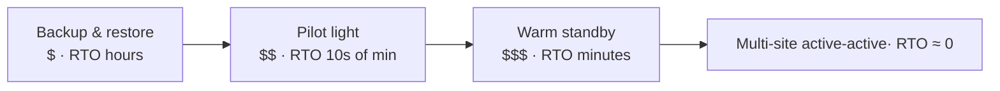

# High Availability, Disaster Recovery & Backup in the Cloud — Complete Notes

> Part of the [Cloud hub](../README.md). Deeper material: [`Backup and Disaster Recovery/`](../../Backup%20and%20Disaster%20Recovery). Related: [Architecture Patterns](./08-cloud-architecture-patterns.md).

---

## 1. Definitions

| Term | Meaning |
|---|---|
| **High availability (HA)** | System keeps serving through component failures (instance, AZ) — automatic, seconds to minutes |
| **Fault tolerance** | Zero interruption even when components fail (active redundancy, no failover gap) |
| **Disaster recovery (DR)** | Restoring service after a major event (region loss, data corruption, ransomware, human error) |
| **Business continuity (BC)** | Org-wide plan to keep the business running (people, process, comms + DR) |
| **RTO** | Recovery Time Objective — max acceptable downtime |
| **RPO** | Recovery Point Objective — max acceptable data loss (time) |
| **Backup** | Point-in-time copy to restore from; protects against deletion/corruption (replication alone does **not** — it replicates the mistake) |

---

## 2. HA design principles
- **Eliminate single points of failure**: ≥2 of everything across **≥2–3 AZs** (instances, NAT gateways per AZ, DB standby).
- **Load balancer + health checks + autoscaling** to replace failed nodes automatically (ASG / VMSS / MIG / K8s ReplicaSets).
- **Stateless app tier**: sessions in Redis/DB, files in object storage.
- **Managed multi-AZ data**: RDS/Aurora Multi-AZ, Azure SQL zone-redundant, Cloud SQL HA (regional), DynamoDB/Cosmos/Spanner are replicated by design.
- **Decoupling**: queues (SQS, Service Bus, Pub/Sub) absorb spikes and survive downstream outages.
- **Graceful degradation**: circuit breakers, timeouts, retries with exponential backoff + jitter, bulkheads, fallbacks/cached responses.
- **Static stability**: pre-provision enough capacity in remaining AZs so an AZ loss doesn't depend on scaling (control plane may be impaired during an event).
- **DNS & global LB health-based failover**: Route 53 failover/latency, Azure Front Door/Traffic Manager, GCP global external Application LB.
- **Chaos engineering / game days** to prove it (AWS FIS, Azure Chaos Studio, Chaos Mesh/Gremlin).

---

## 3. DR strategies (cost ↔ RTO/RPO)

The four strategies trade cost for faster recovery:

| Strategy | How | RTO | RPO | Cost |
|---|---|---|---|---|
| **Backup & restore** | Backups/snapshots copied to another region; rebuild infra with IaC when needed | Hours–day | Hours (last backup) | $ |
| **Pilot light** | Core data replicated live in DR region (DB replica); compute off/minimal; scale up on disaster | 10s of min–hours | Minutes | $$ |
| **Warm standby** | Scaled-down but fully functional copy running in DR region; scale up and switch traffic | Minutes | Seconds–minutes | $$$ |
| **Multi-site active-active** | Full capacity in ≥2 regions serving traffic simultaneously | Near zero | Near zero (depends on replication) | $$$$ |

Choose per workload tier by business impact (Tier 0 payments vs internal wiki). Data replication is the hard part: synchronous cross-region = latency; asynchronous = some data loss; multi-writer = conflict resolution.

### Provider building blocks
| Need | AWS | Azure | GCP |
|---|---|---|---|
| Centralized backup | **AWS Backup** (cross-region/cross-account copies, Vault Lock) | **Azure Backup** (Recovery Services/Backup vaults, immutable vaults, soft delete) | **Backup and DR Service**, snapshots |
| VM replication / failover | **AWS Elastic Disaster Recovery (DRS)** | **Azure Site Recovery (ASR)** | Backup and DR, MIG templates + snapshots |
| Cross-region DB | Aurora Global Database, RDS cross-region read replica, DynamoDB global tables | SQL **auto-failover groups**, geo-replication, Cosmos DB multi-region | Cloud SQL cross-region replicas, **Spanner multi-region**, AlloyDB secondary clusters |
| Object replication | S3 CRR/SRR | GRS/RA-GRS/GZRS | Dual/multi-region buckets |
| Traffic failover | Route 53 health checks, Global Accelerator, ARC | Front Door, Traffic Manager | Global LB, Cloud DNS routing policies |
| Paired/sister regions | — | **Region pairs** (sequential updates, prioritized recovery) | — |

---

## 4. Backup strategy
- **3-2-1(-1-0) rule**: 3 copies, 2 media/storage types, 1 off-site (other region/account), 1 immutable/air-gapped, 0 errors in restore tests.
- **Immutability vs ransomware**: S3 Object Lock / AWS Backup Vault Lock, Azure immutable blob + immutable vault, GCS Bucket Lock / retention policies. Backups in a **separate account/subscription/project** with separate credentials.
- **Types**: full, incremental, differential; snapshots (crash-consistent vs application-consistent); **PITR** (point-in-time restore via transaction logs) for DBs.
- **Retention policy**: driven by compliance (e.g. 7 years financial), lifecycle to archive tiers.
- **Recovering a deleted file**: object versioning (S3/Blob/GCS) or soft delete → restore previous version; snapshots for disks; PITR for DBs; recycle bins (EBS snapshots/AMIs recycle bin).
- **Test restores regularly** — an untested backup is a hope, not a plan. Measure actual RTO.

---

## 5. DR plan checklist
1. Business impact analysis → RTO/RPO per app.
2. Inventory dependencies (DNS, IdP, secrets, certificates, container registry, CI/CD, third-party APIs) — all must be available in DR.
3. IaC for the full stack so DR environment is reproducible.
4. Data replication/backups across region + account.
5. Runbooks: who declares disaster, failover steps, comms, failback.
6. Capacity reservations / quotas in DR region (quota limits bite during regional events).
7. Regular DR drills (tabletop + real failover), track gaps.
8. Monitoring of replication lag and backup job success.
