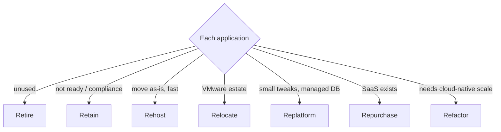
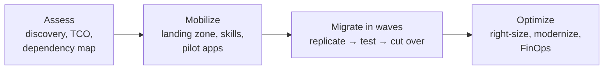

# Cloud Migration — Complete Notes

> Part of the [Cloud hub](../README.md).

---

## 1. Migration strategies — the "7 Rs"

| R | What | Effort | Example |
|---|---|---|---|
| **Retire** | Decommission unused apps | None | Old reporting tool nobody uses |
| **Retain** | Keep on-prem (for now) | None | Mainframe, recently upgraded hardware, compliance blockers |
| **Rehost** ("lift & shift") | Move VMs as-is to IaaS | Low | VM → EC2 with AWS MGN / Azure Migrate / Migrate to Virtual Machines |
| **Relocate** | Move hypervisor-level (VMware) without changes | Low | VMware → VMware Cloud on AWS / Azure VMware Solution / Google Cloud VMware Engine |
| **Replatform** ("lift, tinker & shift") | Small optimizations, same architecture | Medium | Self-managed MySQL → RDS/Cloud SQL; app → containers on ECS |
| **Repurchase** ("drop & shop") | Move to SaaS | Medium | On-prem CRM → Salesforce; Exchange → Microsoft 365 |
| **Refactor / re-architect** | Redesign cloud-native | High | Monolith → microservices + serverless + managed DBs |

Choose per application from discovery data: business value, technical fit, dependencies, licensing, compliance, team skills, timeline.

## 2. Migration phases

1. **Assess / discover** — inventory servers, apps, dependencies (AWS Application Discovery Service / Migration Evaluator, **Azure Migrate**, GCP Migration Center), utilization for rightsizing, TCO business case, readiness assessment.
2. **Mobilize / plan** — **landing zone** first (accounts/subscriptions/projects structure, identity/SSO, networking hub-spoke + hybrid connectivity, logging, security guardrails, tagging, budgets) — AWS Control Tower, Azure Landing Zones (Cloud Adoption Framework), GCP Cloud Foundation / Fabric FAST. Define migration waves (group tightly-coupled apps), pilot app, skills training.
3. **Migrate & modernize** — replicate servers (block-level replication), migrate DBs (DMS with CDC for minimal downtime), data transfer (online or appliance), test in cloud, **cutover** (freeze → final sync → DNS switch → validate), rollback plan.
4. **Operate & optimize** — monitoring, backups, cost optimization, then modernize (containers, managed services).

Frameworks: **AWS Cloud Adoption Framework (CAF) + MAP**, **Microsoft Cloud Adoption Framework** (Strategy, Plan, Ready, Adopt, Govern, Manage, Secure), **Google Cloud Adoption Framework**.

## 3. Key considerations
- **Dependencies & latency**: apps that talk constantly to on-prem DBs must move together (wave planning) or need low-latency hybrid links.
- **Data migration**: size vs bandwidth → online (DataSync, AzCopy, Storage Transfer) or offline (Snowball, Data Box, Transfer Appliance); DB **CDC** replication for near-zero downtime.
- **Licensing**: BYOL rules, Windows/SQL Server (Azure Hybrid Benefit), Oracle constraints.
- **Security & compliance**: data residency, encryption, IAM mapping from AD (Entra Connect / federation).
- **Networking**: IP addressing plan (no overlaps!), DNS (hybrid resolution), VPN → Direct Connect/ExpressRoute/Interconnect.
- **Operations**: monitoring, backup, patching, incident processes updated for cloud.
- **Cost**: dual-running costs during migration, egress, rightsizing after migration.
- **People**: training, cloud center of excellence (CCoE), change management.

## 4. Legacy app migration challenges & answers
| Challenge | Approach |
|---|---|
| Hard-coded IPs / hostnames | DNS aliases, config externalization before move |
| Unsupported OS (old Windows/RHEL) | Upgrade first, or extended support, or replatform |
| Licensing tied to hardware | Dedicated hosts / sole-tenant nodes, renegotiate |
| Stateful, session-sticky app | Sticky sessions temporarily, then externalize session state |
| Huge DB with low downtime tolerance | CDC-based replication (DMS), cutover in small window |
| Unknown dependencies | Dependency mapping tools, network flow analysis |
| Performance surprises | Load test in cloud before cutover, right instance family (storage IOPS!) |

## 5. Monolith → containers (modernization path)
1. Containerize the monolith as-is (Dockerfile, externalize config/secrets, logs to stdout, stateless).
2. Run on a managed platform (ECS/Fargate, Azure Container Apps/App Service, Cloud Run/GKE) with CI/CD + IaC.
3. **Strangler fig pattern**: route specific paths (via API gateway/LB) to new microservices one by one; extract bounded contexts with their own data.
4. Add observability (tracing), async messaging, and only then split further. Don't do a "big bang" rewrite.
