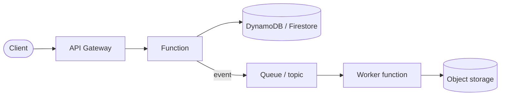
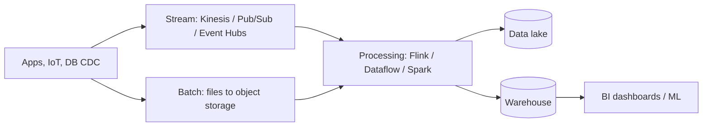

# Cloud Architecture Patterns & Reference Designs (AWS / Azure / GCP) — Complete Notes

> Part of the [Cloud hub](../README.md). Interview practice: [Cloud Architecture Scenarios Q&A](../../Interview%20Questions/27-cloud-architecture-scenarios-qna.md).

---

## 1. Well-Architected frameworks
| AWS Well-Architected (6 pillars) | Azure Well-Architected (5 pillars) | Google Cloud Well-Architected Framework |
|---|---|---|
| Operational Excellence | Operational Excellence | Operational excellence |
| Security | Security | Security, privacy & compliance |
| Reliability | Reliability | Reliability |
| Performance Efficiency | Performance Efficiency | Performance optimization |
| Cost Optimization | Cost Optimization | Cost optimization |
| **Sustainability** | — | Sustainability (+ system design perspective) |

Tools: AWS Well-Architected Tool & Lenses; Azure Well-Architected Review / Advisor; Google Cloud Architecture Center. Use them as a checklist in design reviews.

**Core design principles**: design for failure, automate everything (IaC, CI/CD), loose coupling, scale horizontally, use managed services, security at every layer, measure and iterate, cost-aware design.

---

## 2. Reference architectures (with service picks per cloud)

### A. Highly available 3-tier web app
```
Route 53 / Azure DNS / Cloud DNS
  → CDN + WAF (CloudFront+WAF / Front Door+WAF / Cloud CDN+Cloud Armor)
  → L7 LB (ALB / Application Gateway or Front Door / Global external Application LB)
  → App tier autoscaled across 3 AZs (ASG or ECS/EKS / VMSS, App Service, AKS / MIG, Cloud Run, GKE)
  → Cache (ElastiCache / Azure Managed Redis / Memorystore)
  → DB Multi-AZ (Aurora/RDS Multi-AZ / Azure SQL zone-redundant / Cloud SQL HA or AlloyDB)
  → Object storage for static/user files (S3 / Blob / GCS)
```
Private subnets for app/DB, NAT for egress, secrets manager, central logging, autoscaling on CPU/RPS, backups + cross-region copies.

### B. Scalable multi-tenant SaaS
- Tenancy models: **silo** (account/DB per tenant — strong isolation, costly), **pool** (shared infra, tenant_id everywhere — efficient, noisy-neighbour risk), **bridge/hybrid** (shared app, per-tenant DB or premium tier silos).
- Identity: Cognito / Entra External ID / Identity Platform with tenant claim in JWT; enforce tenant isolation in data layer (row-level security, partition key = tenant, IAM ABAC on tenant tag).
- Containers on EKS / AKS / GKE or serverless (Lambda+API Gateway / Container Apps / Cloud Run), per-tenant metering for billing, rate limits/quotas per tenant, custom domains via CDN with managed certs.
- CI/CD + IaC, feature flags, per-tenant observability dimensions, cost per tenant.

### C. Serverless API / event-driven



- **AWS**: API Gateway → Lambda → DynamoDB; S3 events → Lambda; EventBridge for routing; SQS for buffering; Step Functions for orchestration; Cognito auth.
- **Azure**: API Management → Functions (Flex Consumption) / Container Apps → Cosmos DB; Event Grid; Service Bus; Durable Functions / Logic Apps.
- **GCP**: API Gateway / Apigee → Cloud Run → Firestore; Eventarc; Pub/Sub; Workflows; Cloud Tasks; Cloud Scheduler.

### D. Data pipeline (batch + streaming)



| Stage | AWS | Azure | GCP |
|---|---|---|---|
| Ingest (stream) | Kinesis Data Streams / MSK / Firehose | Event Hubs | **Pub/Sub** |
| Process | Glue / EMR / Managed Flink / Lambda | Data Factory, Databricks, Stream Analytics, Fabric | **Dataflow** (Apache Beam), Dataproc (Spark) |
| Store (lake) | S3 (+ Glue Catalog, Lake Formation) | ADLS Gen2 / OneLake | Cloud Storage / BigLake |
| Warehouse | Redshift / Athena | Synapse / Fabric Warehouse | **BigQuery** |
| Orchestrate | MWAA (Airflow), Step Functions | Data Factory pipelines | **Cloud Composer** (Airflow) |
| BI | QuickSight | Power BI | **Looker** / Looker Studio |

### E. CI/CD pipeline
Source (GitHub/GitLab/Azure Repos) → build & test (GitHub Actions, CodeBuild, Azure Pipelines, Cloud Build) → security scans (SAST, SCA, image scan) → push image (ECR / ACR / Artifact Registry) → deploy IaC (Terraform/CDK/Bicep) → deploy app (CodeDeploy/ECS rolling/blue-green, Argo CD for K8s, Azure Pipelines deployments/App Service slots, Cloud Deploy/Cloud Run revisions) → canary + automated rollback on alarms. Auth to cloud from CI via **OIDC federation** (no stored keys).

### F. Multi-region active-active
Global routing (Route 53 latency + health / Global Accelerator; Front Door; global external Application LB) → stateless app stacks per region → globally replicated data (DynamoDB global tables, Aurora Global Database (single writer), Cosmos DB multi-region writes, Spanner multi-region) → conflict strategy (single-writer region per entity, last-writer-wins, CRDTs) → regional isolation of failures (cell-based architecture).

### G. Hybrid connectivity
On-prem ↔ cloud via site-to-site VPN (quick, internet) or dedicated links (**Direct Connect / ExpressRoute / Cloud Interconnect**) with BGP (Transit Gateway / Virtual WAN or hub VNet / Cloud Router + Network Connectivity Center); hybrid DNS (Route 53 Resolver endpoints / Azure DNS Private Resolver / Cloud DNS forwarding); identity sync (Entra Connect) / federation.

---

## 3. Cloud design patterns cheat sheet
| Pattern | Problem solved |
|---|---|
| Queue-based load leveling | Absorb bursts, protect downstream |
| Pub/sub fan-out | One event → many consumers |
| Competing consumers | Parallel processing from a queue |
| Circuit breaker / retry with backoff + jitter | Fail fast, avoid retry storms |
| Bulkhead | Isolate failures per pool/tenant |
| Cache-aside | Reduce DB load/latency |
| CQRS / event sourcing | Separate read/write models, audit trail |
| Saga | Distributed transactions with compensations |
| Strangler fig | Incremental migration from monolith |
| Sidecar / ambassador | Cross-cutting concerns next to app (mesh proxies) |
| Gateway aggregation / BFF | One API per client type |
| Static content hosting + CDN | Offload static assets |
| Valet key (presigned/SAS/signed URLs) | Direct client upload/download without proxying |
| Cell-based architecture | Limit blast radius at large scale |
| Sharding | Scale data horizontally |

## 4. Vendor lock-in — how to reason about it
Lock-in isn't always bad: managed services give speed. Mitigate where it matters: containers/Kubernetes, Terraform, OpenTelemetry, open data formats (Parquet/Iceberg), standard protocols (Postgres, S3 API, Kafka), abstraction only at boundaries, documented exit strategy for critical systems. Avoid "lowest common denominator" multi-cloud without a business reason (regulation, M&A, best-of-breed, negotiating leverage, resilience).
