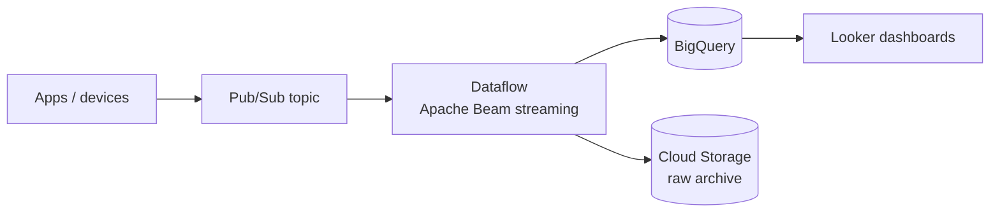

# GCP Data, DevOps & Operations — Pub/Sub, Dataflow, BigQuery pipelines, Cloud Build, Cloud Deploy, Cloud Operations, Cost — Complete Notes

> Part of the [GCP overview](./gcp.md).

---

## 1. Pub/Sub (global messaging)
- **Topics** ← publishers; **subscriptions** → subscribers. Each subscription gets every message (fan-out); multiple subscribers on one subscription share the load (competing consumers). Global service, auto-scaling, no partitions to manage.
- **Delivery semantics**: **at-least-once** by default — a message is redelivered until **acknowledged** within the **ack deadline** (10 s default, up to 600 s; client libraries extend leases). Consumers must be **idempotent** (duplicates possible).
- **Exactly-once delivery**: opt-in for **pull** subscriptions (same region) — no redelivery after successful ack; publisher-side duplicates still possible → keep idempotency; adds latency.
- **Ordering**: opt-in with **ordering keys** (messages with same key delivered in publish order, in one region); lowers throughput per key.
- **Retries**: immediate redelivery or **exponential backoff retry policy** (min/max backoff); **dead-letter topics** after max delivery attempts (5–100) — monitor DLQ + reprocess.
- **Subscription types**: **pull** (StreamingPull — subscriber controls rate, highest throughput), **push** (Pub/Sub POSTs to HTTPS endpoint, e.g. Cloud Run, with OIDC auth; flow control via response codes), **export subscriptions** (write directly to **BigQuery** or **Cloud Storage**, no code).
- Retention: unacked messages up to 7 days (default) / 31 days (topic retention); **seek** to timestamp/snapshot for replay. Message size ≤ 10 MB. Filtering on attributes. Schemas (Avro/Protobuf). Single Message Transforms (UDFs).
- **Pub/Sub vs other messaging**: vs Kafka — no partitions/brokers to manage, global, per-message ack (not offsets), less control over ordering/retention (use **Managed Service for Apache Kafka** for Kafka API needs); vs **Cloud Tasks** (explicit delivery to one handler with rate limits, scheduling, dedup — task queue); **Cloud Scheduler** (cron); **Eventarc** (event routing from 100+ sources to Cloud Run/Workflows using CloudEvents). Pub/Sub Lite was retired (2026).
- **In large distributed systems**: decouple services, absorb spikes, fan-out events (order created → billing, email, analytics), streaming ingestion into Dataflow/BigQuery, async workflows, cross-region event distribution.
```bash
gcloud pubsub topics create orders
gcloud pubsub topics create orders-dlq
gcloud pubsub subscriptions create orders-worker --topic=orders --ack-deadline=60 \
  --dead-letter-topic=orders-dlq --max-delivery-attempts=10 --min-retry-delay=10s --max-retry-delay=600s --enable-message-ordering
gcloud pubsub topics publish orders --message='{"id":42}' --ordering-key=customer-7
```

## 2. Data processing & analytics services
| Service | What | Notes |
|---|---|---|
| **Dataflow** | Fully managed **Apache Beam** runner — unified **batch + streaming** | Autoscaling workers, exactly-once processing, **windowing** (fixed/sliding/session), **watermarks & triggers** for late data, Flex Templates, Streaming Engine, Dataflow Prime |
| **Dataproc** | Managed **Spark/Hadoop/Hive/Presto** clusters (and Dataproc Serverless for Spark) | Lift existing Spark jobs, ephemeral clusters per job, preemptible secondary workers |
| **Cloud Composer** | Managed **Apache Airflow** | Orchestrate multi-step pipelines (DAGs) across GCP & external systems; scheduling, retries, dependencies |
| **Workflows** | Serverless state machine (YAML/JSON) | Orchestrate API calls/services with retries & error handling — lighter than Composer |
| **Data Fusion** | Visual ETL (CDAP) | Low-code pipelines |
| **Dataform** | SQL transformations in BigQuery (ELT, dbt-like) | Version-controlled SQL workflows |
| **Dataplex / Data Catalog** | Data governance: discovery, metadata catalog (**Dataplex Universal Catalog**, successor to Data Catalog), lineage, data quality, policy tags | Data governance & search |
| **Looker / Looker Studio** | Enterprise BI with semantic model (LookML) / free dashboards | Visualization |
| **Vertex AI** | ML platform: Gemini & Model Garden, training, pipelines, endpoints, Feature Store, Vector Search, Agent Builder | AI/ML integration |
| **BigQuery ML** | Train/predict with SQL | ML without moving data |

**Dataflow vs Dataproc**: Dataflow = serverless, Beam programming model, best for new streaming/batch pipelines with autoscaling and no cluster ops. Dataproc = you choose cluster config, best for existing Spark/Hadoop code/ecosystem (notebooks, MLlib) and fine control; Dataproc Serverless narrows the gap.

### Streaming data pipeline: Pub/Sub → Dataflow → BigQuery → Looker



1. **Ingest**: producers (apps, IoT via MQTT bridge, Datastream CDC) publish JSON/Avro to **Pub/Sub** (schema enforced, DLQ).
2. **Process**: **Dataflow** streaming job (Beam) parses, validates (bad records → dead-letter GCS/BigQuery table), enriches (side inputs/lookup), deduplicates (by event ID), applies **event-time windowing** with **watermarks/allowed lateness** for late data, aggregates.
3. **Store**: write to **BigQuery** (Storage Write API, exactly-once) into **partitioned & clustered** tables; raw copy to GCS (cheap replay/archive, lifecycle to Coldline).
4. **Serve**: **Looker** semantic layer / Looker Studio dashboards; BI Engine for speed; BigQuery ML for predictions.
5. **Orchestrate & govern**: Composer/Dataform for batch transformations, Dataplex for quality/lineage, policy tags for PII, VPC-SC around data projects.
6. **Ops**: Dataflow job metrics (system lag, data freshness, backlog), Pub/Sub oldest-unacked-message-age alerts, cost via BigQuery slots/editions, CI/CD for pipelines (Flex Templates).
(Simplest alternative: Pub/Sub **BigQuery subscription** for direct ingestion without transformation.)

## 3. DevOps on GCP
| Service | What |
|---|---|
| **Cloud Build** | Managed CI: container-based build steps in `cloudbuild.yaml`, triggers (GitHub/GitLab/Bitbucket, Pub/Sub, manual, webhooks), private pools (VPC), SLSA build provenance, approvals |
| **Artifact Registry** | Containers + language packages (Maven, npm, Python, Go, apt/yum); vulnerability scanning; remote & virtual repos; **replaces Container Registry (gcr.io — writes stopped March 2025)** |
| **Cloud Deploy** | Managed continuous delivery to GKE/Cloud Run/GKE Enterprise: **delivery pipelines** with targets (dev→staging→prod), promotions, approvals, **canary & blue-green** strategies, rollbacks, deploy verification, Skaffold-based rendering |
| **Infrastructure Manager** | Managed Terraform runs (state, previews, audit). **Deployment Manager** reached end of support (March 31, 2026) — migrate templates to Terraform/Infra Manager (import live resources into state, confirm no-change plan, then retire) |
| **Config Connector / Config Sync** | Manage GCP resources as K8s objects / GitOps for GKE fleets |
| **Cloud Workstations / Gemini Code Assist** | Managed dev environments / AI coding |

```yaml
# cloudbuild.yaml — test, build, scan, push, release via Cloud Deploy
steps:
- name: python:3.12
  entrypoint: bash
  args: ['-c', 'pip install -r requirements.txt && pytest -q']
- name: gcr.io/cloud-builders/docker
  args: ['build', '-t', 'asia-south1-docker.pkg.dev/$PROJECT_ID/apps/web:$SHORT_SHA', '.']
- name: gcr.io/cloud-builders/docker
  args: ['push', 'asia-south1-docker.pkg.dev/$PROJECT_ID/apps/web:$SHORT_SHA']
- name: gcr.io/google.com/cloudsdktool/cloud-sdk
  entrypoint: gcloud
  args: ['deploy', 'releases', 'create', 'rel-$SHORT_SHA', '--delivery-pipeline=web', '--region=asia-south1',
         '--images=web=asia-south1-docker.pkg.dev/$PROJECT_ID/apps/web:$SHORT_SHA']
options:
  logging: CLOUD_LOGGING_ONLY
```
**CI/CD on GCP (answer)**: GitHub → Cloud Build trigger (or GitHub Actions with **WIF**) → unit tests + SAST → build image → Artifact Registry (vuln scan) → Binary Authorization attestation → Cloud Deploy pipeline (dev → staging canary → prod with approval) to GKE/Cloud Run → deploy verification & automated rollback → Terraform (Infra Manager) for infra in a separate pipeline with plan review → Cloud Monitoring alerts tied to releases.

### Terraform on GCP — version control & state
Remote state in a **GCS bucket** (versioning on, uniform access, CMEK optional; native state locking), separate state per env/component, modules (Cloud Foundation Fabric / terraform-google-modules), `google` + `google-beta` providers pinned, CI with `plan` on PR and `apply` after approval using a deployer SA via WIF, `gcloud`-free reproducibility, drift detection with scheduled plans, `terraform import`/import blocks for existing resources.

## 4. Cloud Operations suite (formerly Stackdriver)
| Product | Use |
|---|---|
| **Cloud Monitoring** | Metrics (GCP services, Ops Agent on VMs, custom/OpenTelemetry, **Managed Service for Prometheus**), dashboards, **alerting policies** (metric, log-based, PromQL) → notification channels (email, PagerDuty, Slack, Pub/Sub, webhooks), **uptime checks**, **SLO monitoring** with burn-rate alerts, synthetic monitors |
| **Cloud Logging** | Log ingestion (auto for GCP services, Ops Agent for VMs, GKE stdout), **Log Router** with **sinks** (to log buckets, BigQuery, GCS, Pub/Sub, other projects) & exclusion filters, log buckets with custom retention & **Log Analytics** (SQL), **log-based metrics** (bridge logs → alerts), Logs Explorer queries |
| **Cloud Trace** | Distributed tracing, latency analysis |
| **Cloud Profiler** | Continuous CPU/heap profiling in production |
| **Error Reporting** | Groups application errors/stack traces |
| **Personalized Service Health** | GCP incidents affecting you |
```bash
gcloud logging read 'resource.type="cloud_run_revision" AND severity>=ERROR' --limit=50 --freshness=1h
gcloud logging sinks create audit-to-bq bigquery.googleapis.com/projects/sec-proj/datasets/audit_logs --organization=123456 --include-children --log-filter='logName:"cloudaudit.googleapis.com"'
```
**Key metrics to watch**: request count/latency/5xx (LB, Cloud Run), CPU/memory/disk (Ops Agent), GKE pod restarts/pending pods/node pressure, Cloud SQL CPU/connections/replication lag/disk, Pub/Sub `oldest_unacked_message_age` & backlog, Dataflow system lag/data freshness, BigQuery slot usage, quota usage, error budget burn.

## 5. Cost optimization on GCP
1. **Visibility**: billing export to BigQuery + Looker Studio dashboards, **labels** (team/env/app) enforced, budgets & alerts (Pub/Sub → automation), cost anomaly detection, FinOps hub.
2. **Rightsize**: **Recommender** (idle VMs, idle disks/IPs, rightsizing machine types, idle Cloud SQL), custom machine types, E2/Tau/Axion Arm instances.
3. **Discounts**: **Sustained Use Discounts** (automatic), **Committed Use Discounts** (resource- or spend-based, after rightsizing baseline), **Spot VMs** for fault-tolerant work; GKE: Autopilot per-pod billing, Spot node pools, cluster autoscaler/NAP, request tuning (GKE cost insights).
4. **Serverless scale-to-zero**: Cloud Run, functions, Autopilot; App Engine standard.
5. **Storage**: lifecycle rules, Autoclass, delete old snapshots/versions, right disk type (pd-balanced vs ssd), BigQuery long-term storage, partition expiration.
6. **BigQuery**: on-demand vs editions/reservations, query best practices, max bytes billed, slot autoscaling.
7. **Network**: Standard tier where acceptable, keep traffic in-region/zone, Cloud CDN, Private Google Access instead of NAT for API traffic, watch inter-region egress.
8. **Governance**: org policies restricting expensive resources/regions, quotas, scheduled VM start/stop, auto-delete dev projects, monthly FinOps reviews. Don't cut reliability (keep regional HA for prod).

## 6. Migrating to GCP
**Migration Center** (discovery, assessment, TCO), **Migrate to Virtual Machines** (lift-and-shift VMs from VMware/AWS/Azure), **Migrate to Containers** (VM → container artifacts for GKE/Cloud Run), **Database Migration Service**, **Storage Transfer Service** / **Transfer Appliance**, **BigQuery Migration Service** (Teradata/Redshift/Snowflake → BigQuery SQL translation), Google Cloud VMware Engine (relocate). Approach: landing zone first → rehost / replatform / refactor per app → waves → cutover → optimize. Hybrid: Interconnect/HA VPN, GKE Enterprise across on-prem & cloud, Apigee hybrid.
