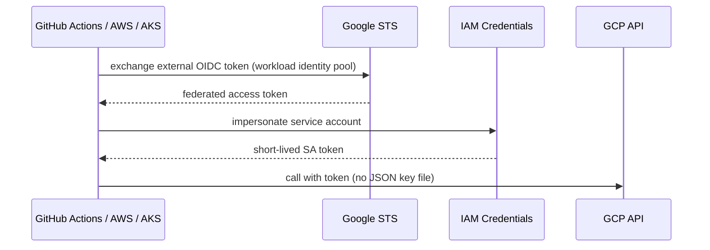

# GCP IAM, Security & Governance — Complete Notes

> Part of the [GCP overview](./gcp.md). Cross-cloud: [Cloud Security & IAM](../Fundamentals/03-cloud-security-and-iam.md).

---

## 1. Resource hierarchy
```
Organization (company.com — tied to Cloud Identity / Workspace domain)
 └─ Folders (departments / environments / teams — nestable up to 10 levels)
     └─ Projects (unique project ID + number; billing linked; APIs enabled per project)
         └─ Resources (VMs, buckets, datasets, ...)
```
- **Project** = the core boundary for **resources, IAM, billing, quotas, enabled APIs**. Everything lives in exactly one project.
- IAM policies and **Organization Policies inherit downward**; effective policy = union of allows from all ancestors (you can't remove an inherited allow lower down — use **deny policies** or restructure).
- **Billing account** pays for linked projects; budgets/alerts at billing account or project; **billing export to BigQuery**.
- Large-org structure: folders per business unit → environment (prod/non-prod) → projects per app/env; **Shared VPC host projects** in a networking folder; security/logging projects; guardrails (org policies) at folder level; Cloud Foundation / Fabric FAST / Cloud Foundation Toolkit for landing zones.

## 2. Cloud IAM
- **Allow policy** on a resource = list of **bindings**: `member(s)` + `role` (+ optional **condition**). Members (principals): Google account (user), **service account**, Google group, Workspace/Cloud Identity domain, `allUsers`/`allAuthenticatedUsers` (public — dangerous), **principal sets** from workload identity pools.
- **Role types**:
| Type | Examples | Guidance |
|---|---|---|
| **Basic** (primitive) | Owner, Editor, Viewer | Too broad — **avoid in production** (Editor can modify almost everything) |
| **Predefined** | `roles/storage.objectViewer`, `roles/compute.instanceAdmin.v1`, `roles/run.invoker` | Default choice; Google-maintained, service-specific |
| **Custom** | Your permission set | Only when predefined too broad; you maintain them (org or project level) |
- **IAM Conditions** (CEL expressions): time-bound access (`request.time < timestamp("2026-12-31T00:00:00Z")`), resource name prefix (`resource.name.startsWith("projects/_/buckets/logs-")`), resource tags. Not every service/attribute supported.
- **IAM deny policies**: explicit denies that override allows (e.g. deny deleting projects except for a break-glass group).
- **Principal Access Boundary (PAB)**: limit which resources a principal can ever access.
- **IAM Recommender / Policy Intelligence**: removes excess permissions based on 90-day usage; Policy Analyzer ("who can access what"); Policy Troubleshooter ("why was this denied").
- **Privileged Access Manager (PAM)**: just-in-time, approved, temporary role grants.
```bash
gcloud projects add-iam-policy-binding my-proj --member="group:devs@company.com" --role="roles/viewer"
gcloud projects get-iam-policy my-proj --format=json
gcloud storage buckets add-iam-policy-binding gs://my-bucket --member="serviceAccount:app@my-proj.iam.gserviceaccount.com" --role="roles/storage.objectViewer"
```

## 3. Service accounts (workload identities)
- Identity for **workloads, not people**: `name@project.iam.gserviceaccount.com`. A service account is also a **resource** (who can *use/impersonate* it — `roles/iam.serviceAccountUser`, `roles/iam.serviceAccountTokenCreator`).
- Types: user-managed; **default service accounts** (Compute Engine default SA has Editor by default in older setups — **don't use it**; org policy can disable automatic grants); Google-managed **service agents**.
- Attach SAs to VMs, Cloud Run, Functions, GKE nodes; the metadata server provides short-lived tokens automatically — **no keys needed**.
- **Service account keys** (JSON) are long-lived secrets — avoid; disable creation with org policy `iam.disableServiceAccountKeyCreation`; if unavoidable, rotate & store in Secret Manager.
- **Impersonation** for humans/CI: `gcloud --impersonate-service-account=deployer@...` (short-lived tokens, audited).

### Workload Identity Federation (WIF)



Lets **external workloads** (AWS, Azure, GitHub Actions, GitLab, on-prem OIDC/SAML, Kubernetes clusters) exchange their own identity token for **short-lived Google credentials** via **STS** — no exported keys.
- **Workload identity pool** + **provider** (OIDC/AWS/SAML) with **attribute mapping** & **attribute conditions** (e.g. only `repo:org/app` on `main`), then grant roles to the federated principal (or let it impersonate a SA).
- **Why preferred over SA keys**: no long-lived secret to leak/rotate, scoped by attributes, short TTL, full audit trail.
- **Workload Identity Federation for GKE**: Kubernetes service accounts get IAM identities directly (`principal://iam.googleapis.com/projects/NUM/locations/global/workloadIdentityPools/PROJECT.svc.id.goog/subject/ns/NAMESPACE/sa/KSA`) — the GKE metadata server exchanges the K8s token for a federated token; grant IAM roles directly to that principal (or bind KSA to a GSA).
```yaml
# GitHub Actions → GCP with WIF
- uses: google-github-actions/auth@v2
  with:
    workload_identity_provider: projects/123456/locations/global/workloadIdentityPools/github/providers/my-repo
    service_account: deployer@my-proj.iam.gserviceaccount.com
```

## 4. Organization Policy Service (guardrails)
Constraints on **what configurations are allowed** (vs IAM = who can act), set at org/folder/project, inherited:
| Constraint | Effect |
|---|---|
| `iam.disableServiceAccountKeyCreation` | No SA keys |
| `iam.allowedPolicyMemberDomains` (Domain restricted sharing) | Only your domain identities in IAM |
| `gcp.resourceLocations` | Data residency — allowed regions |
| `compute.vmExternalIpAccess` | Block public IPs on VMs |
| `storage.uniformBucketLevelAccess` / `storage.publicAccessPrevention` | No ACLs / no public buckets |
| `compute.requireOsLogin` | OS Login for SSH (IAM-based) |
| `sql.restrictPublicIp`, `run.allowedIngress` | Private DBs, internal-only Cloud Run |
Custom constraints (CEL) for resource fields. **Org policy vs IAM**: org policy says *what may exist/how configured*; IAM says *who can do what*. Both needed.

## 5. Data protection & perimeter
- **Encryption at rest**: default Google-managed keys (AES-256, envelope encryption) → **CMEK** with **Cloud KMS** (key rings → keys → versions; rotation schedules; IAM per key; per-service CMEK support) → **Cloud HSM** (FIPS 140-2 L3) → **Cloud EKM** (keys in external HSM, key access justifications) → CSEK for GCS/PD.
- **Envelope encryption**: data encrypted with DEK; DEK wrapped by KEK in KMS; KEK never leaves KMS; rotation re-wraps small DEKs only.
- **In transit**: TLS by default to Google APIs; Google encrypts traffic between data centers; use HTTPS LBs with Google-managed certs (Certificate Manager), mTLS, Private Service Connect.
- **Secret Manager**: secrets with **versions** (pin in prod: `projects/p/secrets/db-pass/versions/5`), per-secret IAM (`roles/secretmanager.secretAccessor`), automatic/user-managed replication, rotation schedules (Pub/Sub notification → your rotator), CMEK, audit logs. Cloud Run/GKE mount secrets as env vars or volumes. Better still: avoid secrets via IAM DB auth / WIF.
```bash
printf 's3cr3t' | gcloud secrets create db-pass --data-file=- --replication-policy=automatic
gcloud secrets versions access latest --secret=db-pass
```
- **VPC Service Controls**: define **service perimeters** around projects so Google-managed services (BigQuery, GCS, etc.) can only be accessed from inside the perimeter / allowed access levels — defends against **data exfiltration** even with stolen valid credentials or misconfigured IAM (e.g. copying data to an attacker's bucket). Dry-run mode first; ingress/egress rules; Access Context Manager access levels (IP, device).
- **Sensitive Data Protection (Cloud DLP)**: discover/classify/de-identify (mask, tokenize, redact) PII in BigQuery, GCS, Datastore, or via API in pipelines; integrate into ingest pipelines & data catalog/Dataplex for governance.

## 6. Access & zero trust
- **Identity-Aware Proxy (IAP)**: verifies user identity + context (BeyondCorp **zero trust**) before requests reach apps behind HTTPS LB/App Engine/Cloud Run — no VPN; **IAP TCP forwarding** for SSH/RDP to VMs without public IPs (`gcloud compute ssh vm --tunnel-through-iap`).
- **OS Login**: SSH access controlled by IAM roles (`roles/compute.osLogin`/`osAdminLogin`) + 2FA.
- **Chrome Enterprise Premium / BeyondCorp** for context-aware access (device posture).
- Zero Trust principles on GCP: identity-centric access (IAP, IAM Conditions), no implicit network trust, VPC-SC perimeters, mTLS between services (Cloud Service Mesh), Binary Authorization for workloads, continuous monitoring (SCC).

## 7. Detection, audit & compliance
- **Cloud Audit Logs**: **Admin Activity** (config changes — always on, free, 400 days), **Data Access** (reads/writes of data — **off by default** except BigQuery; enable per service, can be voluminous), **System Event**, **Policy Denied**. Export with **Log Router sinks** at **org level** (aggregated sink) to a locked log bucket / BigQuery / Pub/Sub → SIEM; bucket locks for immutability.
- **Security Command Center (SCC)**: asset inventory, misconfiguration findings (Security Health Analytics), vulnerability findings (Web Security Scanner, VM/container vulnerabilities), threat detection (Event Threat Detection, Container Threat Detection, VM Threat Detection), compliance reports (CIS, PCI, NIST), attack path simulation (Premium/Enterprise).
- **Cloud Armor**: WAF + DDoS for external LBs (see networking).
- **Binary Authorization**: only signed/attested images deploy to GKE/Cloud Run.
- **Assured Workloads**: compliance regimes (FedRAMP, EU sovereignty) with data residency & personnel controls.
- **Access Transparency / Access Approval**: logs and approval for Google staff access.

## 8. Enterprise security architecture on GCP (answer outline)
1. Org hierarchy with folders, landing zone via Terraform; separate prod/non-prod; central logging & security projects.
2. Identity: Cloud Identity/Workspace federated with corporate IdP, MFA/security keys, groups-based IAM, predefined roles, no basic roles, PAM for elevation.
3. Workloads: dedicated SAs per service, no SA keys (org policy), WIF for CI/CD and multi-cloud.
4. Org policies: domain-restricted sharing, resource locations, no external IPs, uniform bucket access, public access prevention, OS Login.
5. Network: Shared VPC, private GKE/Cloud SQL, Private Google Access/PSC, hierarchical firewall policies, Cloud NAT, IAP for admin, Cloud Armor at edge.
6. Data: CMEK for regulated data, VPC-SC perimeters around sensitive projects, DLP scanning, BigQuery column-level security/row access policies.
7. Detection: org-level audit log sinks, SCC Premium, alerts to SOC (Google SecOps/SIEM), incident runbooks.
8. Supply chain: Artifact Registry + vulnerability scanning, Binary Authorization, signed builds (Cloud Build SLSA provenance).
