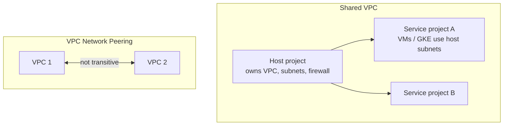

# GCP Networking — VPC, Firewall, NAT, Private Access, Shared VPC, Hybrid, Load Balancing, CDN, DNS, Armor — Complete Notes

> Part of the [GCP overview](./gcp.md).

---

## 1. VPC fundamentals (what's different on GCP)
- A **VPC network is global**; **subnets are regional** (span all zones in a region). One VPC can have subnets in every region — instances in different regions talk over Google's backbone with internal IPs, no peering needed.
- **Auto mode** (one subnet per region, predefined /20 ranges — fine for experiments) vs **custom mode** (you define subnets/CIDRs — **use in production**). Subnets can be expanded (not shrunk); secondary ranges (alias IPs for GKE pods/services).
- Routes: system-generated (default internet route via default internet gateway, subnet routes), custom static routes, dynamic routes via **Cloud Router (BGP)**; routing mode regional vs global.
- **Network Service Tiers**: **Premium** (default — traffic enters/exits Google's global backbone at the edge nearest the user; required for global LB) vs **Standard** (traffic travels over public internet to/from the region; cheaper, regional only).
- Reserved IPs: static external (regional/global) and internal.

### Provisioning a VPC
```bash
gcloud compute networks create prod-vpc --subnet-mode=custom --bgp-routing-mode=global
gcloud compute networks subnets create app-asia --network=prod-vpc --region=asia-south1 --range=10.10.0.0/20 \
  --secondary-range=pods=10.20.0.0/14,services=10.24.0.0/20 --enable-private-ip-google-access --enable-flow-logs
```

## 2. Firewall rules & policies
- **VPC firewall rules**: **stateful**, apply to the whole VPC, direction (ingress/egress), priority **0–65535** (lower wins), action allow/deny, targets = all instances / **network tags** / **service accounts** (better — can't be changed by someone editing tags), sources (CIDR, tags, SAs).
- **Implied rules**: deny all ingress, allow all egress (priority 65535). Default network ships with permissive rules (`default-allow-ssh/rdp/icmp/internal`) — delete in prod.
- **Hierarchical firewall policies** (org/folder level, `goto_next` to delegate) and **global/regional network firewall policies** (with secure tags, FQDN/geo/threat-intel objects in **Cloud NGFW** Standard/Enterprise with IPS).
- Firewall Rules Logging; **Firewall Insights** (shadowed/unused rules).
```bash
gcloud compute firewall-rules create allow-https-web --network=prod-vpc --direction=INGRESS --action=ALLOW --rules=tcp:443 \
  --source-ranges=130.211.0.0/22,35.191.0.0/16 --target-service-accounts=web-sa@my-proj.iam.gserviceaccount.com   # LB + health check ranges
gcloud compute firewall-rules create allow-iap-ssh --network=prod-vpc --rules=tcp:22 --source-ranges=35.235.240.0/20 --target-tags=ssh
```

## 3. Private connectivity & egress
| Feature | What it does |
|---|---|
| **Cloud NAT** | Managed, software-defined NAT (no VM/gateway) for **outbound-only** internet from instances/GKE nodes/Cloud Run (Direct VPC egress) **without external IPs**; per region via Cloud Router; static or auto IPs; logging |
| **Private Google Access (PGA)** | Lets VMs **without external IPs** reach **Google APIs** (GCS, BigQuery, etc.) via internal routing — enabled **per subnet**. Different from Cloud NAT (NAT = general internet; PGA = Google APIs only). `private.googleapis.com` / `restricted.googleapis.com` (VPC-SC) VIPs |
| **Private Service Connect (PSC)** | Private endpoints (internal IP in your VPC) for Google APIs, Google-managed services (Cloud SQL, etc.), or **producer services** published by other orgs/projects — overlapping CIDRs OK, consumer/producer model |
| **Private services access** | VPC peering to Google-managed service networks (legacy pattern for Cloud SQL, Memorystore) |
| **Serverless VPC Access / Direct VPC egress** | Let Cloud Run/functions reach VPC resources |

## 4. Connecting VPCs: Peering vs Shared VPC



| | **VPC Network Peering** | **Shared VPC** |
|---|---|---|
| Model | Two separate VPCs (same/different orgs) exchange routes | **Host project** owns one VPC; **service projects** deploy resources into its subnets |
| Administration | Each side administers its own network & firewall | **Central network team** controls network/firewall; app teams get `compute.networkUser` on specific subnets |
| Transitivity | **Non-transitive** (A↔B, B↔C ≠ A↔C); no overlapping CIDRs; limits on peerings | One network, no transitivity problem |
| Use | Connect separate orgs/partners, few VPCs | Standard enterprise pattern — central control with team project isolation, billing per service project |
Large estates: Shared VPC per environment + **Network Connectivity Center** (hub-and-spoke with VPC spokes, transitive via NCC) or HA VPN between VPCs.

## 5. Hybrid connectivity
| Option | Notes |
|---|---|
| **HA VPN** | IPsec over internet, 2 interfaces/2 external IPs → **99.99% SLA** when configured with 2 tunnels; BGP via **Cloud Router**; up to 3 Gbps per tunnel |
| Classic VPN | Legacy, 99.9%, static routing possible |
| **Dedicated Interconnect** | Direct physical 10/100 Gbps (also 400G) links at colocation facilities; private (RFC1918) traffic, lower egress pricing, steady latency; 99.9% or **99.99%** topology (redundant connections in 2 metros) |
| **Partner Interconnect** | Via service provider, 50 Mbps–50 Gbps, when you can't reach a colocation facility |
| **Cross-Cloud Interconnect** | Dedicated links to AWS/Azure/Oracle/Alibaba |
| **Cloud Router** | Managed BGP speaker exchanging routes dynamically for VPN/Interconnect/NCC |
| **MACsec / HA VPN over Interconnect** | Encryption for Interconnect (not encrypted by default) |
Hybrid DNS: Cloud DNS **forwarding zones** (to on-prem DNS) + **inbound server policy** (on-prem resolves GCP private zones). Interconnect use cases: high-volume data transfer, latency-sensitive hybrid apps, SAP/HPC, regulatory private paths.

## 6. Cloud Load Balancing
Families (choose by **layer**, **external vs internal**, **global vs regional**, **proxy vs passthrough**):
| Load balancer | Layer | Scope | Notes |
|---|---|---|---|
| **Global external Application LB** | L7 HTTP(S)/HTTP2/gRPC | **Global, single anycast IP** | URL maps (host/path), backends in many regions (MIGs, NEGs: GKE, Cloud Run, Cloud Functions, internet/hybrid), **Cloud CDN**, **Cloud Armor**, IAP, Google-managed certs, traffic splitting; cross-region failover automatically |
| Regional external Application LB | L7 | Regional | Envoy-based, Standard tier, data residency |
| **Internal Application LB** (regional / cross-region) | L7 | Internal | Microservices, private APIs |
| **External proxy Network LB** | L4 TCP/SSL proxy | Global/regional | Non-HTTP TCP with SSL offload; terminates connections |
| **External passthrough Network LB** | L4 TCP/UDP/ESP/ICMP | Regional | **Preserves client IP**, very high performance, UDP (gaming, VoIP) |
| **Internal passthrough Network LB** | L4 | Regional | Internal TCP/UDP, next hop for appliances |
- **Proxy LBs** terminate client connections and open new ones to backends (client IP via headers/PROXY protocol); **passthrough LBs** forward packets (backend sees client IP, responds directly — DSR).
- **Health checks** from Google ranges `35.191.0.0/16`, `130.211.0.0/22` — allow in firewall.
- **Global LB distinction**: one global anycast IP, users routed to the nearest healthy backend via Google's edge (Premium tier) — unlike AWS/Azure where global routing usually needs DNS (Route 53/Traffic Manager) or a separate global service (Global Accelerator/Front Door).

## 7. Cloud CDN, Cloud DNS, Cloud Armor
- **Cloud CDN**: caches content at Google edge for **backends of the global external Application LB** (MIGs, buckets, Cloud Run, custom origins); cache modes (CACHE_ALL_STATIC, USE_ORIGIN_HEADERS, FORCE_CACHE_ALL), cache keys, signed URLs/cookies, negative caching, invalidations. **Media CDN** for large-scale streaming.
- **Cloud DNS**: managed authoritative DNS, 100% SLA, **public and private zones**, forwarding zones, peering zones, DNSSEC, **routing policies** (weighted round robin, geolocation, failover with health checks), response policies.
- **Cloud Armor**: **WAF + DDoS** protection attached via **security policies** to external LBs (and some internal): IP/geo allow/deny lists, custom rules in CEL (`request.headers['user-agent'].contains('bot')`), **preconfigured WAF rules** (OWASP ModSecurity CRS: SQLi, XSS, LFI, RCE), **rate limiting / rate-based bans**, bot management (reCAPTCHA Enterprise), **Adaptive Protection** (ML L7 DDoS detection), Threat Intelligence lists, edge security policies for CDN. Only protects traffic through supported LBs.
```bash
gcloud compute security-policies create edge-waf
gcloud compute security-policies rules create 1000 --security-policy=edge-waf --expression="evaluatePreconfiguredWaf('sqli-v33-stable')" --action=deny-403
gcloud compute security-policies rules create 2000 --security-policy=edge-waf --src-ip-ranges='*' --action=rate-based-ban \
  --rate-limit-threshold-count=100 --rate-limit-threshold-interval-sec=60 --ban-duration-sec=600 --conform-action=allow --exceed-action=deny-429 --enforce-on-key=IP
gcloud compute backend-services update web-backend --security-policy=edge-waf --global
```

## 8. Troubleshooting network latency / connectivity
**Connectivity Tests** (Network Intelligence Center — simulates path: firewall, routes, peering), Performance Dashboard (inter-zone/region latency & loss), **VPC Flow Logs**, Firewall Rules Logging/Insights, LB logs (latency breakdown, backend status), Cloud Trace for app latency, `mtr`/`iperf` from VMs. Common causes of latency: cross-region calls, Standard tier routing, NAT port exhaustion (Cloud NAT logs, increase min ports per VM), undersized VM network bandwidth, DNS issues, cold starts (Cloud Run min instances).

## 9. Large-enterprise networking best practices
Custom-mode VPCs, IP address plan with no overlaps (incl. on-prem/other clouds, GKE ranges), **Shared VPC** per environment managed by a network team, hierarchical firewall policies for org-wide baselines (block risky ports, allow health checks/IAP), service-account-based rules, no external IPs (org policy) + Cloud NAT + IAP, Private Google Access/PSC, VPC-SC for sensitive data, HA VPN/redundant Interconnect with Cloud Router, central DNS (Cloud DNS + forwarding), NCC hub for multi-VPC/hybrid, flow logs to central logging, Terraform-managed networking (Cloud Foundation Fabric).
