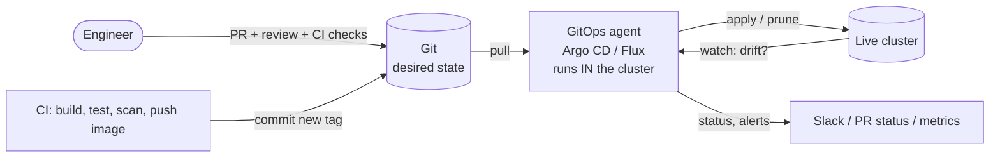
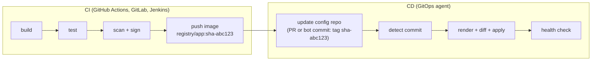
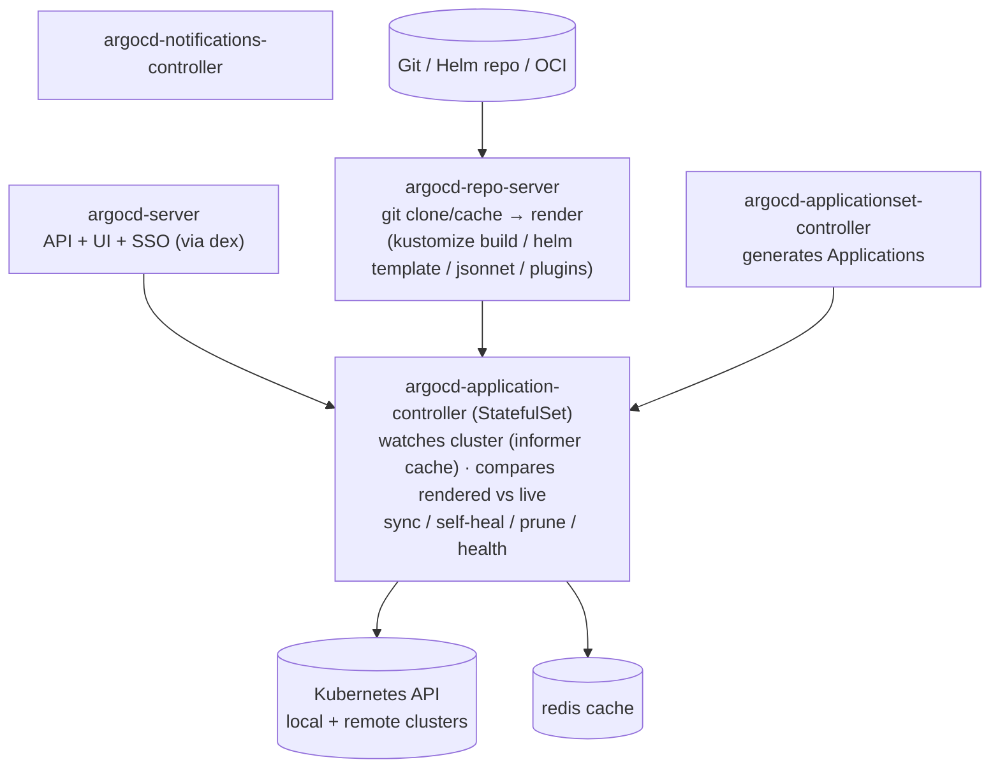

# GitOps: Principles, Internals, Patterns & Operations

> **How this was verified:** every behaviour marked *(lab)* was run on a v1.37 minikube cluster with **Argo CD v3.5.5** and **Flux** (source-controller v1.9.6, kustomize-controller v1.9.6, helm-controller v1.6.5), both pulling from a writable in-cluster Git server (Gitea) so real commits could be pushed. Hands-on install tutorials: [Argo CD](./Continuous%20Delivery/ArgoCD/Argo-cd.md) · [Argo CD + Helm](./Continuous%20Delivery/ArgoCD/argo-cd-integration-helm.md) · [Argo CD local setup](./Continuous%20Delivery/ArgoCD/tutorial/local-setup.md) · [Flux](./CNCF/flux/flux.md). Related: [Helm in production](./Helm/helm-in-production.md), [Kubernetes hub](./Kubernetes/README.md), [Terraform CI/CD](./Terraform%20and%20CF/terraform-environments-and-cicd.md).

## Contents
1. [What GitOps is (and isn't)](#1-what-gitops-is-and-isnt)
2. [The four OpenGitOps principles](#2-the-four-opengitops-principles)
3. [Push vs pull, and where CI ends](#3-push-vs-pull-and-where-ci-ends)
4. [How Argo CD works inside](#4-how-argo-cd-works-inside)
5. [How Flux works inside](#5-how-flux-works-inside)
6. [Argo CD vs Flux](#6-argo-cd-vs-flux)
7. [Repository structure](#7-repository-structure)
8. [Environments and promotion](#8-environments-and-promotion)
9. [Sync ordering: waves, hooks, dependencies](#9-sync-ordering-waves-hooks-dependencies)
10. [Drift, self-heal, prune and diffing](#10-drift-self-heal-prune-and-diffing)
11. [Scaling out: ApplicationSets, app-of-apps, multi-cluster](#11-scaling-out-applicationsets-app-of-apps-multi-cluster)
12. [Secrets in GitOps](#12-secrets-in-gitops)
13. [Image updates and progressive delivery](#13-image-updates-and-progressive-delivery)
14. [Security and multi-tenancy](#14-security-and-multi-tenancy)
15. [GitOps beyond Kubernetes apps](#15-gitops-beyond-kubernetes-apps)
16. [Rollback and disaster recovery](#16-rollback-and-disaster-recovery)
17. [Troubleshooting](#17-troubleshooting)
18. [Anti-patterns](#18-anti-patterns)
19. [Production checklist](#19-production-checklist)
20. [Interview rapid-fire](#20-interview-rapid-fire)

---

## 1. What GitOps is (and isn't)

**GitOps = desired state declared in Git + software agents that continuously pull that state and reconcile the live system toward it.** Every change is a commit (reviewed through a PR). Every rollback is a commit. Nobody runs `kubectl apply` against production.



| GitOps is... | GitOps is not... |
|---|---|
| A reconciliation *model* (desired vs live, continuously) | "Using Git" (every team uses Git) |
| Declarative manifests (YAML, Helm, Kustomize, Jsonnet, CRDs) | Imperative scripts kept in Git |
| An agent that pulls and keeps correcting | A CI job that runs `kubectl apply` once (that's push-based CD) |
| Git as the source of truth for *ops* | A replacement for CI (you still build, test and scan in CI) |

How it evolved: manual changes (ssh, ClickOps) → Infrastructure as Code (scripts and Terraform, run by humans or CI) → **GitOps** (declarative state in Git, agents continuously reconcile).

---

## 2. The four OpenGitOps principles

The CNCF OpenGitOps project defines GitOps by four principles:

| # | Principle | What it means in practice |
|---|---|---|
| 1 | **Declarative** | The *whole* desired system state is expressed declaratively (Deployments, not "run these commands") |
| 2 | **Versioned and immutable** | Stored in a way that keeps full history and can't be rewritten (Git commits, OCI artifacts by digest). Pin revisions. Protect branches |
| 3 | **Pulled automatically** | Agents fetch the desired state themselves. Nothing *pushes* credentials into the cluster |
| 4 | **Continuously reconciled** | Agents keep comparing live against desired and correct drift, not just on commit |

A pipeline that runs `helm upgrade` on merge satisfies 1 and 2, but not 3 and 4. Manual changes then persist undetected until the next deploy.

---

## 3. Push vs pull, and where CI ends

| | Push (CI deploys) | Pull (GitOps agent) |
|---|---|---|
| Who talks to the cluster API | CI runner (needs cluster-admin-ish creds **outside** the cluster) | Agent **inside** the cluster (credentials never leave it) |
| Drift | Undetected until the next pipeline run | Detected continuously, optionally auto-corrected |
| Cluster behind a firewall | CI needs network access in | Only outbound to Git or the registry |
| Many clusters | N pipelines × N credentials | Each cluster pulls its own config |
| Rollback | Re-run an old pipeline | `git revert` |
| Audit | CI logs | Git history (+ agent events) |

**The split of responsibilities:**

CI **never** touches the cluster. It produces an immutable artifact and a **commit to the config repo**. That keeps one audit trail, and gives you rollback by `git revert`.

---

## 4. How Argo CD works inside


Real pods *(lab)*: `argocd-application-controller-0`, `argocd-applicationset-controller`, `argocd-dex-server`, `argocd-notifications-controller`, `argocd-redis`, `argocd-repo-server`, `argocd-server`.

### The Application CRD
```yaml
apiVersion: argoproj.io/v1alpha1
kind: Application
metadata:
  name: web-prod
  namespace: argocd
  finalizers: [resources-finalizer.argocd.argoproj.io]   # delete app → delete its resources (cascade)
spec:
  project: web-team
  source:
    repoURL: https://git.example.com/platform-config.git
    targetRevision: main                # branch, tag or commit SHA
    path: apps/web/overlays/prod        # Kustomize auto-detected (also Helm, Jsonnet, plain dir, plugins)
  destination:
    server: https://kubernetes.default.svc
    namespace: web-prod
  syncPolicy:
    automated: { prune: true, selfHeal: true }
    syncOptions: [ServerSideApply=true, PruneLast=true]
    retry: { limit: 3, backoff: { duration: 5s, factor: 2, maxDuration: 1m } }
```
Also: `sources:` (multiple sources, e.g. a Helm chart from one repo plus values from another via `$values`), and `ignoreDifferences:` (§10).

### The two status axes
| Sync status | Meaning | Health status | Meaning |
|---|---|---|---|
| `Synced` | Live matches the rendered Git state | `Healthy` | Resources report ready (Deployment available, Job complete...) |
| `OutOfSync` | They differ | `Progressing` | Rolling out |
| `Unknown` | Comparison failed (see the `ComparisonError` in §17) | `Degraded` | Failed (crashloop, progress deadline exceeded) |
| | | `Missing` / `Suspended` | Not created / paused (Rollouts, CronJobs) |

Sync and health are **independent**. `Synced` + `Degraded` means "we applied exactly what Git says, and what Git says is broken".

### When Argo CD notices changes *(lab)*
- **Git:** it polls every `timeout.reconciliation` (default **120 s**, plus up to 60 s jitter). In the lab, a pushed commit was picked up after **128 s** with no webhook. With a webhook (or a manual refresh, `argocd.argoproj.io/refresh=normal`), the same kind of change synced in **13 s**. **Configure Git webhooks** to `/api/webhook`.
- **Cluster:** watched live through informers, so drift is seen almost immediately (see §10).

---

## 5. How Flux works inside

Flux is a set of independent controllers (the "GitOps Toolkit"), each with its own CRDs:

| Controller *(lab image)* | CRDs | Job |
|---|---|---|
| source-controller v1.9.6 | `GitRepository`, `OCIRepository`, `HelmRepository`, `HelmChart`, `Bucket` | Fetch, verify (signatures), package artifacts |
| kustomize-controller v1.9.6 | `Kustomization` (Flux's, not Kustomize's) | Build, apply (SSA), prune, health-check, SOPS decrypt |
| helm-controller v1.6.5 | `HelmRelease` | Helm install/upgrade/test/rollback, with drift detection |
| notification-controller v1.9.4 | `Provider`, `Alert`, `Receiver` | Outbound alerts, inbound webhooks |
| image-reflector / image-automation v1.2.5 | `ImageRepository`, `ImagePolicy`, `ImageUpdateAutomation` | Scan registries, commit new tags back to Git |
| source-watcher v2.2.4 | — | Newer component that watches source changes |

```yaml
apiVersion: source.toolkit.fluxcd.io/v1
kind: GitRepository
metadata: { name: platform-config, namespace: flux-system }
spec:
  interval: 1m                         # how often to check Git
  url: https://git.example.com/platform-config.git
  ref: { branch: main }
  secretRef: { name: gitea-auth }
  ignore: |                            # only package what this cluster needs
    /*
    !/infra/flux-demo-ns
    !/apps/flux-demo
---
apiVersion: kustomize.toolkit.fluxcd.io/v1
kind: Kustomization
metadata: { name: flux-demo, namespace: flux-system }
spec:
  dependsOn: [{ name: flux-demo-ns }]  # ordering between Kustomizations
  interval: 1m                         # how often to re-apply (= drift correction cadence)
  retryInterval: 30s
  timeout: 3m
  path: ./apps/flux-demo
  prune: true                          # garbage-collect removed objects
  wait: true                           # health-check everything applied
  sourceRef: { kind: GitRepository, name: platform-config }
```
Real status and events *(lab)*:
```text
gitrepository/platform-config  READY True  stored artifact for revision 'main@sha1:e50e37b3...'
kustomization/flux-demo-ns     READY True  Applied revision: main@sha1:e50e37b3...
kustomization/flux-demo        READY True  Applied revision: main@sha1:e50e37b3...
Progressing: Deployment/flux-demo/hello created
Progressing: Health check passed in 5.03s
ReconciliationSucceeded: Reconciliation finished in 5.25s, next run in 1m0s
```
**Inventory:** Flux records what it applied (`status.inventory`: `flux-demo_hello_apps_Deployment`) and labels the objects (`kustomize.toolkit.fluxcd.io/name: flux-demo`). That's how prune knows what's safe to delete.

---

## 6. Argo CD vs Flux

| | **Argo CD** | **Flux** |
|---|---|---|
| Shape | One app with a **UI**, API, SSO, RBAC | Composable controllers, CLI-first (UIs: Weave GitOps, Capacitor, Headlamp plugin) |
| Unit | `Application` (+ `ApplicationSet`, `AppProject`) | `Kustomization` / `HelmRelease` + Sources |
| Drift correction | **Event-driven** (informers). Self-heal reverted a manual scale in about **1 s** *(lab)* | **Interval-driven**: re-applies every `interval`. Reverted a manual scale after about **47 s** with `interval: 1m` *(lab)* |
| Helm | Renders with `helm template` and applies as plain manifests (no Helm release, so no `helm ls`) | Real Helm releases (`helm ls` works, Helm hooks and tests run natively) |
| Multi-cluster | Central Argo CD manages many clusters (hub and spoke) | Usually Flux per cluster (each pulls its own config). Hub mode also possible |
| Multi-tenancy | AppProjects + RBAC + SSO | Kubernetes RBAC, service-account impersonation per Kustomization |
| Image automation | Argo CD Image Updater (separate project) | Built in (`ImageUpdateAutomation`) |
| Secrets | Plugins / ESO / Sealed Secrets | **Native SOPS decryption** in kustomize-controller, plus ESO/Sealed |
| OCI artifacts | Helm OCI, OCI sources | First-class `OCIRepository`, with cosign/notation verification |
| Ordering | Sync waves + hooks inside an app | `dependsOn` between Kustomizations/HelmReleases + health checks |
| Pause | Disable auto-sync | `suspend: true` (verified: manual drift stayed while suspended) *(lab)* |

**Choose Argo CD** when you want a UI for developers, central multi-cluster management and SSO/RBAC out of the box. **Choose Flux** for lightweight per-cluster agents, native Helm releases, SOPS and OCI-first supply chains. Both are CNCF graduated, and teams sometimes run both (Flux for platform add-ons, Argo CD for app teams).

---

## 7. Repository structure

### Separate app source from config
```text
app-repo (code)                 config-repo (desired state, what agents watch)
  src/  Dockerfile  tests/        apps/web/base/
  .github/workflows/ci.yml  ───►  apps/web/overlays/{dev,staging,prod}/
       (builds, pushes image,     infra/{cert-manager,ingress,monitoring}/
        opens PR bumping tag)     clusters/{dev,prod-eu,prod-us}/   ← what each cluster syncs
```
Keeping them separate means app commits don't trigger cluster syncs, config access can be locked down separately, and the config repo history is a clean deployment log. A monorepo of config (one repo, directory per environment) is the most common layout. Per-team config repos scale better organisationally.

### The lab layout (Kustomize)
```text
platform-config/
├── apps/web/base/                 namespace.yaml (wave -1) · config.yaml (wave 0) · deployment.yaml (+Service, wave 1) · migrate-job.yaml (PreSync hook) · kustomization.yaml
├── apps/web/overlays/dev/         kustomization.yaml → namespace web-dev, image 1.27
├── apps/web/overlays/prod/        kustomization.yaml → namespace web-prod, 2 replicas, image 1.26→1.27
├── infra/flux-demo-ns/            (Flux)
└── apps/flux-demo/                (Flux)
```
```yaml
# apps/web/overlays/prod/kustomization.yaml
apiVersion: kustomize.config.k8s.io/v1beta1
kind: Kustomization
resources: [../../base]
namespace: web-prod
patches:
  - target: { kind: Deployment, name: web }
    patch: |
      - op: replace
        path: /spec/replicas
        value: 2
images:
  - name: nginx
    newTag: 1.27-alpine      # ← the line CI / promotion changes
```
Helm equivalent: one chart, plus `values-<env>.yaml` per environment (Argo CD `helm.valueFiles`, or a Flux `HelmRelease` with `valuesFrom`). **Render in CI** (`kustomize build`, `helm template`) and diff the output on the PR, so reviewers see the real manifests.

---

## 8. Environments and promotion

| Strategy | How | Verdict |
|---|---|---|
| **Directory per environment** (lab) | `overlays/dev`, `overlays/prod` on one branch. Promote = PR changing prod's tag | ✅ Recommended: everything visible in one tree, diffs are obvious |
| Branch per environment | `dev`, `staging`, `prod` branches, promote = merge | ❌ Anti-pattern: merge conflicts, env-specific commits drift, no single view of all environments |
| Repo per environment | Separate repos | OK for strict separation (regulated prod), but adds overhead |
| Pinned revisions | prod's Application `targetRevision: v1.42.0` (tag) | ✅ Good for strict release control |

Promotion is a **commit**. Real run *(lab)*:
```text
$ sed -i 's/newTag: 1.26-alpine/newTag: 1.27-alpine/' apps/web/overlays/prod/kustomization.yaml
$ git commit -am "promote web to 1.27 in prod" && git push          → 36b3c0d
Argo CD synced new commit after 128s (polling, no webhook)
image=nginx:1.27-alpine
history id=0 rev=0b7e4869...   history id=1 rev=36b3c0dc...      ← each sync to a new revision is recorded
```
Automate promotion with: CI opening promotion PRs (dev → staging after tests pass), **Kargo** (promotion pipelines with stages and verification), Argo CD Image Updater / Flux image automation for dev, and Renovate for chart and image version PRs.

---

## 9. Sync ordering: waves, hooks, dependencies

### Argo CD: phases → waves → kinds
```yaml
metadata:
  annotations:
    argocd.argoproj.io/sync-wave: "-1"     # lower first; default 0; negatives allowed
    argocd.argoproj.io/hook: PreSync       # PreSync | Sync | PostSync | SyncFail | PostDelete | Skip
    argocd.argoproj.io/hook-delete-policy: BeforeHookCreation   # | HookSucceeded | HookFailed
```
Real sync result *(lab)*:
```text
phase: Succeeded | successfully synced (all tasks run)
  PreSync   Namespace   web-prod     -        Synced   namespace/web-prod serverside-applied   ← wave -1, applied even before PreSync hooks
  PreSync   Job         db-migrate   PreSync  Synced   Reached expected number of succeeded pods
  Sync      ConfigMap   web-config   -        Synced   (wave 0)
  Sync      Service     web          -        Synced   (wave 1)
  Sync      Deployment  web          -        Synced   (wave 1)
$ kubectl logs job/db-migrate → running migrations ... done
```
Order: **PreSync hooks → Sync (by wave, then by kind: Namespaces, CRDs, ... Deployments) → PostSync hooks**. Argo CD waits for each wave to be **healthy** before starting the next (with a small delay between waves). A failing hook fails the sync and runs `SyncFail` hooks.

**Gotcha (lab): Kustomize rejects `generateName`.** The common hook pattern `metadata.generateName: db-migrate-` fails with:
```text
accumulating resources from 'migrate-job.yaml': missing metadata.name in object {{batch/v1 Job} ...}
```
Use a fixed `name` plus `hook-delete-policy: BeforeHookCreation`, so each sync deletes and recreates the Job.

**Gotcha (lab): self-heal syncs skip hooks.** Controller logs showed the commit-triggered sync running with `skipHooks:false` (the migration ran), followed by a self-heal sync with `skipHooks:true` that only touched the drifted resources. `status.operationState` shows **only the latest operation**, so it can look as if the hook never ran. Check the Job itself, or the controller logs.

### Flux: `dependsOn` and health
Flux orders whole Kustomizations/HelmReleases with `dependsOn` *(lab: `flux-demo` waited for `flux-demo-ns`)*. With `wait: true` or `healthChecks`, a dependency must be **Ready** (applied and healthy) before its dependents reconcile. A typical chain is `crds → infra (cert-manager, ingress) → configs (ClusterIssuers) → apps`. Inside one Kustomization, kustomize-controller applies namespaces and CRDs first.

---

## 10. Drift, self-heal, prune and diffing

### What gets reverted, and what doesn't *(lab, Argo CD self-heal on)*
| Manual change | Result |
|---|---|
| `kubectl scale deploy web --replicas=5` (field in Git) | **Reverted to 2 within about 1 s** |
| `kubectl set image ... nginx:1.25` (field in Git) | **Reverted** to the Git image |
| `kubectl annotate deploy web team-note=...` and `label hotfix=true` (fields **not** in Git) | **Kept**. App stays `Synced` |
| Disable `selfHeal` by patching a *generated* Application | **Undone by the ApplicationSet controller** (it owns the spec) |

Argo CD (with server-side apply, or its 3-way diff) compares **only the fields your manifests set**. Fields that other controllers add (HPA replicas, mutating webhooks, defaults) aren't drift unless you also set them in Git. **To change a generated Application, change the ApplicationSet template.**

Flux: drift is corrected on the next `interval` (about 47 s in the lab with a 1 m interval). helm-controller has opt-in drift detection (`driftDetection.mode: enabled`).

### Fighting another controller: `ignoreDifferences`
```yaml
spec:
  ignoreDifferences:
    - group: apps
      kind: Deployment
      jsonPointers: [/spec/replicas]                          # HPA owns replicas
    - group: admissionregistration.k8s.io
      kind: MutatingWebhookConfiguration
      jqPathExpressions: [".webhooks[]?.clientConfig.caBundle"]   # injected by cert-manager
  syncPolicy:
    syncOptions: [RespectIgnoreDifferences=true]              # don't overwrite those fields on sync either
```
Better: **don't put `replicas` in Git for HPA-managed Deployments**. Then there's nothing to fight over.

### Prune *(lab)*
Removing the Service from Git → after sync: `Error from server (NotFound): services "web" not found`. Prune deletes objects that are in the app's tracked set but no longer in Git.
- Protect objects with `argocd.argoproj.io/sync-options: Prune=false` (Argo CD) or `kustomize.toolkit.fluxcd.io/prune: disabled` (Flux).
- `PruneLast=true` deletes old resources only after the new ones are healthy.
- **Deleting an Application** with the `resources-finalizer` deletes *everything it manages*. Remove the finalizer (or use non-cascading delete) to orphan the resources instead.

### Useful sync options
`ServerSideApply=true` (large CRDs, field ownership) · `CreateNamespace=true` · `ApplyOutOfSyncOnly=true` (big apps) · `Replace=true` (immutable-field resources, dangerous) · `Validate=false` · `SkipDryRunOnMissingResource=true` (CRs whose CRD is created in the same sync) · `FailOnSharedResource=true` (stops two apps fighting over one object).

---

## 11. Scaling out: ApplicationSets, app-of-apps, multi-cluster

### ApplicationSet (verified: generated `web-dev` and `web-prod` from directories)
```yaml
apiVersion: argoproj.io/v1alpha1
kind: ApplicationSet
metadata: { name: web, namespace: argocd }
spec:
  goTemplate: true
  goTemplateOptions: ["missingkey=error"]
  generators:
    - git:
        repoURL: https://git.example.com/platform-config.git
        revision: main
        directories: [{ path: apps/web/overlays/* }]
  template:
    metadata: { name: 'web-{{.path.basename}}', labels: { env: '{{.path.basename}}' } }
    spec:
      project: web-team
      source: { repoURL: https://git.example.com/platform-config.git, targetRevision: main, path: '{{.path.path}}' }
      destination: { server: https://kubernetes.default.svc, namespace: 'web-{{.path.basename}}' }
      syncPolicy: { automated: { prune: true, selfHeal: true }, syncOptions: [ServerSideApply=true] }
```
```text
web-dev    Synced   Healthy   0b7e4869...
web-prod   Synced   Healthy   0b7e4869...
ErrorOccurred=False  ParametersGenerated=True  ResourcesUpToDate=True
```
Generators: `list`, `clusters` (every registered cluster, filtered by label), `git` (directories or files), `matrix`/`merge` (combine), `scmProvider` (every repo in a GitHub org), `pullRequest` (**preview environments per PR**), `clusterDecisionResource`, `plugin`. Add `syncPolicy.preserveResourcesOnDeletion: true` so that deleting the ApplicationSet doesn't cascade-delete everything. Use `strategy: RollingSync` to progress environments in steps.

### App of apps
A root Application points at a directory of Application manifests. It's simple and explicit, and good for bootstrapping a cluster's add-ons. ApplicationSets replace it when the list is generated rather than hand-written.

### Multi-cluster topologies
| Topology | How | Trade-off |
|---|---|---|
| **Hub and spoke** (Argo CD) | One Argo CD, clusters registered as Secrets (`argocd.argoproj.io/secret-type: cluster`) | Single pane of glass. The hub holds credentials to every cluster (protect it hard), and its outage stops all syncs |
| **Agent per cluster** (Flux, or Argo CD per cluster) | Each cluster pulls `clusters/<name>/` | No central credentials. You need fleet-level visibility separately |
| Argo CD "agent" mode / managed control planes | Hub UI with agents doing the pulling | Combines both |

Bootstrap pattern: Terraform creates the cluster and installs the GitOps agent once, then **everything else comes from Git** (including the agent's own config). That's `flux bootstrap`, or Argo CD managing itself.

---

## 12. Secrets in GitOps

Git must never hold plaintext secrets. The options:

| Approach | In Git | Decrypted by | Notes |
|---|---|---|---|
| **External Secrets Operator** | `ExternalSecret` (a pointer) | ESO, from AWS SM, Vault, GCP SM, Azure KV | ✅ Most common. Rotation lives in the secret store |
| **SOPS** (age/KMS/PGP) | Encrypted YAML (values encrypted, keys readable) | Flux kustomize-controller natively. Argo CD via plugins | ✅ Great with Flux. Diffs show which keys changed |
| **Sealed Secrets** | `SealedSecret` (encrypted with the cluster's public key) | sealed-secrets controller | Simple. Ciphertext is per cluster, so re-seal for each one |
| Vault Agent / CSI driver | Annotations or volumes | Vault, at runtime | The secret never becomes a K8s Secret (CSI) |
| Argo CD Vault Plugin | Placeholders `<path:...>` | Substituted at render time | The rendered secret passes through the repo-server cache |

```yaml
# Flux + SOPS
apiVersion: kustomize.toolkit.fluxcd.io/v1
kind: Kustomization
spec:
  decryption:
    provider: sops
    secretRef: { name: sops-age }      # age private key in the cluster
```
Also protect the **repo credentials** the agent uses (read-only deploy keys, scoped to the config repos only) and the **cluster Secrets** in a hub Argo CD.

---

## 13. Image updates and progressive delivery

### Getting new images into Git
| Method | Flow |
|---|---|
| **CI commits the tag** (recommended for prod) | CI builds `app:sha-abc123`, then opens a PR or commits a change to `newTag` in the config repo |
| **Flux image automation** | `ImageRepository` scans the registry → `ImagePolicy` (semver/regex) picks the latest → `ImageUpdateAutomation` commits the change to the marked field (`# {"$imagepolicy": "flux-system:web"}`) |
| **Argo CD Image Updater** | Watches the registry and writes back to Git (or to Application parameters) |
| Renovate/Dependabot | PRs for image tags and chart versions, on a schedule |

Never deploy `:latest`. Git would stop describing what's running. Use immutable tags or digests.

### Progressive delivery
GitOps applies the new spec, and **Argo Rollouts** or **Flagger** decide *how fast* traffic moves:
```yaml
apiVersion: argoproj.io/v1alpha1
kind: Rollout
spec:
  strategy:
    canary:
      steps:
        - setWeight: 10
        - pause: { duration: 5m }
        - analysis: { templates: [{ templateName: success-rate }] }   # Prometheus query; failure → automatic rollback
        - setWeight: 50
        - pause: { duration: 10m }
```
On a failed analysis, the Rollout aborts and shifts traffic back, while **Git still says the new version**. The app then shows `Degraded`. Revert the commit to bring Git and reality back together. Flagger (with Flux) does the same with `Canary` CRDs, driven by a mesh or ingress (Istio, Linkerd, NGINX, Gateway API).

---

## 14. Security and multi-tenancy

- **AppProjects** restrict what an app may deploy: allowed source repos, destination clusters/namespaces, cluster-scoped kinds (whitelist), namespaced kinds (blacklist), and sync windows. The lab project allowed only `web-*` namespaces, only `Namespace` as a cluster-scoped kind, and blocked `ResourceQuota`.
- **Argo CD RBAC** (`argocd-rbac-cm`) plus SSO groups: `p, role:web-dev, applications, sync, web-team/*, allow`. Disable the `admin` account after SSO is set up.
- **Flux multi-tenancy:** each tenant's Kustomization uses `serviceAccountName` (impersonation), so it can only apply what that SA's RBAC allows. Lock it down with `--no-cross-namespace-refs` and `--default-service-account`.
- **Git is now your production control plane:** branch protection, required reviews (CODEOWNERS per environment directory), signed commits (Flux can verify GPG/SSH signatures on `GitRepository`), and no force-push.
- **Supply chain:** Flux `OCIRepository` with `verify: { provider: cosign }`, plus admission policies (Kyverno/VAP) that only allow signed images ([Kubernetes security](./Kubernetes/deep-dive/12-security-hardening.md#6-supply-chain-what-runs-in-your-cluster)).
- The agent itself is effectively **cluster-admin**. Scope its permissions where possible (namespaced Argo CD installs, per-tenant SAs), patch it promptly (Argo CD has had serious CVEs), and don't expose the UI publicly.
- **Break-glass:** document how a human makes an emergency change (suspend auto-sync, apply, then commit the change to Git immediately). Otherwise people quietly disable GitOps during incidents and forget to turn it back on.

---

## 15. GitOps beyond Kubernetes apps

| What | How |
|---|---|
| Cloud infrastructure from Kubernetes | **Crossplane** (managed resources and compositions as CRDs), **AWS Controllers for Kubernetes (ACK)**, Google Config Connector, Azure Service Operator, all reconciled by Argo CD/Flux |
| Terraform under GitOps | Flux **tofu-controller** (Terraform/OpenTofu as a CRD), Atlantis (PR-driven, closer to push), Terraform Cloud VCS workflows ([Terraform CI/CD](./Terraform%20and%20CF/terraform-environments-and-cicd.md)) |
| Cluster lifecycle | **Cluster API** manifests in Git, reconciled by a management cluster |
| Policies, RBAC, quotas | Just more manifests (Kyverno policies, namespaces, quotas) |
| Non-K8s config | Ansible pull, `aws cloudformation` Git sync ([CloudFormation tooling](./Terraform%20and%20CF/cloudformation-tooling-cicd-and-troubleshooting.md#7-cicd)), Pulumi Deployments |

---

## 16. Rollback and disaster recovery

### Rollback = `git revert` *(lab)*
```text
76720c5 remove web Service          → Service pruned
510e706 Revert "remove web Service" → Service recreated
svc back: web 10.110.82.54           ← NOTE: new ClusterIP (was 10.97.19.175)
```
GitOps rollback **recreates** resources from the old manifests. It **doesn't restore data or identities**. A recreated Service gets a new ClusterIP, a recreated PVC gets a new, empty volume, and recreated LoadBalancers get new addresses. Protect stateful and identity-bearing objects with `Prune=false`, retain policies, and backups (Velero).

Avoid `argocd app rollback` (or disabling automation and syncing an old revision) in production. It makes the cluster diverge from Git. Revert in Git instead, so history stays the truth.

### Disaster recovery
- A new cluster plus the agent bootstrapped against the same repo **recreates every declarative object**. That's GitOps' biggest DR win. Practise it: rebuild a cluster from scratch on a schedule.
- What Git doesn't hold: PV data, secrets held only in the secret store, runtime state (CR status, Argo Rollouts progress), and the agent's own state. Back those up separately (Velero, secret store replication). Argo CD's own config (Applications, Projects, repos, clusters) should *also* be in Git (Argo CD managing itself).
- Hub outage: running workloads keep running, but nothing syncs and drift goes uncorrected until it's back.

---

## 17. Troubleshooting

### Broken commit *(lab)*
A manifest with an unknown field (`bogusField: true`) **passed `kustomize build`**, because Kustomize doesn't validate schemas. In Argo CD:
```text
sync=Unknown health=Healthy
ComparisonError: Failed to compare desired state to live state: failed to calculate diff:
  error calculating structured merge diff: ... .spec.template.spec.containers[name="nginx"].bogusField: field not declared in schema
still serving image=nginx:1.27-alpine ready=2      ← live app untouched: last good state keeps running
```
**Prevent it in CI:** run `kustomize build | kubeconform -strict` (or `kubectl apply --dry-run=server`) on every PR to the config repo.

| Symptom | Likely cause | Fix |
|---|---|---|
| Change not deploying for ~3 min | Polling interval, no webhook | Configure Git webhooks (Argo CD `/api/webhook`, Flux `Receiver`) |
| `ComparisonError` / `sync: Unknown` | Invalid manifest, unknown field, or a CRD missing | Validate in CI. Install CRDs earlier (wave or `dependsOn`), `SkipDryRunOnMissingResource=true` |
| App flips `OutOfSync` ↔ `Synced` forever | Another controller rewrites a field you set (HPA replicas, defaulted fields, injected caBundle) | Remove the field from Git, `ignoreDifferences` + `RespectIgnoreDifferences`, or SSA |
| `OutOfSync` but nothing to sync | Normalisation differences (resource quantities like `1000m` vs `1`, or ordering) | Write canonical values, or diff customisations |
| Synced but `Degraded` | Git is applied and the app is broken (crashloop, progress deadline) | App problem. `git revert` |
| Sync stuck `Running` | A hook Job never finishes, or a resource never becomes healthy | Check hook logs. Set `activeDeadlineSeconds`. Use a custom health check for CRDs |
| `the server could not find the requested resource` on CRs | CRD not installed yet | Order CRDs first |
| `namespace ... is not permitted in project` / `resource ... is not permitted` | AppProject restrictions | Fix the destination or update the project |
| Manual patch to an Application keeps disappearing *(lab)* | It's generated by an ApplicationSet | Change the ApplicationSet template |
| Application stuck deleting | `resources-finalizer` waiting on resources that can't be deleted | Fix those resources. Remove the finalizer only if you accept orphans |
| Flux `Kustomization` not Ready: `dependency 'x' is not ready` | Upstream Kustomization failing | Fix the dependency first (`flux get kustomizations`) |
| Flux `GitRepository` auth errors | Deploy key or token, known_hosts | `flux create secret git ...`, check `status.conditions` |
| Hook didn't run *(lab)* | You're looking at a later self-heal operation (`skipHooks:true`) | Check the hook Job and the controller logs |
| Two apps fighting over one object | The same resource in two apps | `FailOnSharedResource=true`, single ownership |

Tools: `argocd app get/diff/history/sync --dry-run`, the UI's diff view, `argocd admin settings`, `flux get all -A`, `flux tree kustomization <name>`, `flux events`, `flux diff kustomization`, and `flux reconcile ... --with-source` (force now).

---

## 18. Anti-patterns

| Anti-pattern | Why it hurts | Instead |
|---|---|---|
| Branch per environment | Merge drift, unclear what runs where | Directory per environment |
| CI runs `kubectl apply` *and* an agent syncs | Two writers, flapping | CI commits to Git, the agent applies |
| `:latest` or mutable tags | Git doesn't describe reality, and rollback is meaningless | Immutable tags or digests |
| `replicas` in Git with an HPA | Constant fighting | Drop the field |
| Plaintext secrets "just for dev" | Leaked forever in history | ESO/SOPS/Sealed Secrets everywhere |
| Huge single Application (thousands of resources) | Slow diffs, a wide blast radius | Split by component (ApplicationSet) |
| Disabling self-heal "temporarily" and forgetting | Drift builds up silently | Alert on auto-sync disabled. Use sync windows |
| Rolling back from the UI instead of Git | Git ≠ reality | `git revert` |
| Rendering Helm with secrets in values | Secrets in the repo-server cache and in Git | External secrets |
| No CI validation of the config repo | Broken commits reach the agent (`ComparisonError`) | `kubeconform`, policy checks, rendered diffs on PRs |

---

## 19. Production checklist

- [ ] Separate config repo (or protected directories), with branch protection, CODEOWNERS per environment, signed commits
- [ ] CI builds, scans and signs images, then **commits a tag bump** (never touches the cluster)
- [ ] Config-repo CI: `kustomize build`/`helm template` → `kubeconform -strict` → policy (Kyverno CLI/Conftest) → rendered diff in the PR
- [ ] Webhooks from Git to the agent (no 2–3 minute polling delay)
- [ ] Directory-per-environment promotion through PRs. Prod pinned or gated
- [ ] Automated sync with `selfHeal` + `prune`, plus `Prune=false` on stateful and identity resources
- [ ] Ordering: CRDs → infra → apps (waves / `dependsOn`), and hook Jobs with fixed names + `BeforeHookCreation`
- [ ] `ignoreDifferences` only where another controller legitimately owns a field (prefer removing the field)
- [ ] Secrets via ESO or SOPS. Agent repo credentials read-only and scoped
- [ ] AppProjects / Flux impersonation per team. SSO + RBAC. Admin disabled
- [ ] Notifications on sync failure, degraded health, and auto-sync disabled
- [ ] Progressive delivery (Argo Rollouts/Flagger) for critical services
- [ ] Argo CD/Flux config itself in Git. Regular rebuild-a-cluster-from-Git drill. Velero for state
- [ ] A documented break-glass procedure

---

## 20. Interview rapid-fire

1. **The four OpenGitOps principles?** Declarative, versioned & immutable, pulled automatically, continuously reconciled.
2. **Why is pull more secure than push?** Cluster credentials never leave the cluster. CI only needs write access to Git.
3. **How does a GitOps rollback work, and what can't it restore?** `git revert`, and the agent re-applies. It can't bring back data or identities (new ClusterIPs, empty PVCs).
4. **Argo CD noticed a commit after two minutes. Why, and how do you fix it?** It polls (`timeout.reconciliation`, 120 s plus jitter). Configure Git webhooks.
5. **Self-heal is on, but a manual annotation persisted. Why?** Argo CD only compares fields that Git manages.
6. **HPA and Argo CD fight over replicas. Fix?** Remove `replicas` from Git, or `ignoreDifferences` + `RespectIgnoreDifferences`.
7. **Sync waves vs hooks?** Waves order resources within a phase. Hooks are separate resources run in PreSync/Sync/PostSync/SyncFail phases.
8. **Why does a Kustomize-rendered hook Job with `generateName` fail?** Kustomize requires `metadata.name`. Use a fixed name + `BeforeHookCreation`.
9. **Argo CD vs Flux drift correction?** Argo CD is event-driven (seconds). Flux is interval-driven (next `interval`).
10. **Branch-per-environment: why not?** Merge drift and no single view. Use directories per environment.
11. **How do you keep secrets in GitOps?** External Secrets Operator, SOPS or Sealed Secrets. Never plaintext.
12. **You edited a generated Application and the change vanished. Why?** The ApplicationSet controller owns it. Edit the template.
13. **`Synced` but `Degraded`?** Git was applied exactly, and the desired state itself is broken. Revert or fix forward in Git.
14. **What does GitOps *not* replace?** CI (build/test/scan), backups for stateful data, and secret stores.
