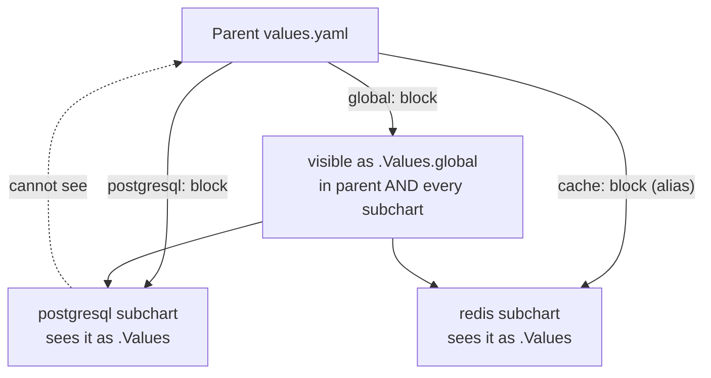
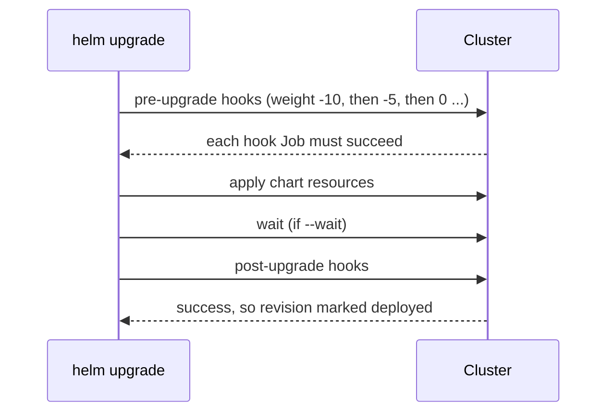

# Advanced Helm: Dependencies, Library Charts, Hooks, CRDs, Post-Renderers, Plugins, Secrets & Signing

> Part of the [Helm notes](./README.md). Previous: [Creating a Chart](./creating-helm-chart.md). Next: [Helm in Production](./helm-in-production.md).

---

## Dependencies and subcharts

A chart can depend on other charts. Declare them in `Chart.yaml`, then fetch with `helm dependency update` (which writes `Chart.lock` and downloads `.tgz` files into `charts/`).

```yaml
# Chart.yaml (parent: "shop")
dependencies:
  - name: postgresql
    version: "16.x.x"
    repository: oci://registry-1.docker.io/bitnamicharts
    condition: postgresql.enabled
  - name: redis
    version: "~20.1.0"
    repository: oci://registry-1.docker.io/bitnamicharts
    alias: cache                 # refer to it as "cache" in values
    tags: [backing-services]
  - name: common-lib
    version: "1.2.0"
    repository: file://../common-lib   # local chart (monorepo)
```

### How values flow between parent and subcharts



```yaml
# parent values.yaml
global:
  imageRegistry: registry.corp      # every chart that supports global.imageRegistry uses it
  storageClass: gp3

postgresql:
  enabled: true                      # the "condition" in Chart.yaml
  auth:
    existingSecret: shop-db          # values passed INTO the subchart
  primary:
    persistence: { size: 50Gi }

cache:                               # alias for redis
  architecture: standalone

tags:
  backing-services: true             # turn tagged dependencies on/off as a group
```

Rules:
- The parent can **override** any subchart value by putting it under the subchart's name (or alias).
- A subchart **can't read the parent's values**, only its own block and `global`.
- `condition` beats `tags`. If neither is set, the dependency is always installed.
- All subcharts are part of the **same release**: one install, one history, one rollback.
- Named templates are global, so subchart helpers can clash with yours. That's another reason to prefix `define` names with the chart name.

### `import-values` and `exports`
Pull values *up* from a child into the parent:
```yaml
# child values.yaml
exports:
  defaults:
    port: 5432
# parent Chart.yaml
dependencies:
  - name: child
    import-values: [defaults]     # parent gets .Values.port = 5432
```

### Version ranges and reproducibility
`~1.2.0` allows patch updates (>=1.2.0 <1.3.0), `^1.2.0` allows minor updates (>=1.2.0 <2.0.0), `1.2.x` is a wildcard. The ranges are resolved **once** by `helm dependency update` and pinned in `Chart.lock`. In CI, run `helm dependency build`, which uses the lock file exactly, so builds are reproducible. Commit `Chart.lock`. Whether to commit `charts/*.tgz` is a choice: committing gives offline builds, not committing keeps the repo small.

### Should you use subcharts for databases?
For dev and demo environments, it's convenient. In production, usually **not**: databases have a different lifecycle (backups, upgrades, never "rolled back" with the app) and are better as a separate release, an operator (CloudNativePG, Strimzi), or a managed service (RDS). A subchart database also gets **deleted with `helm uninstall`** of the app, apart from its PVCs.

---

## Library charts

A library chart (`type: library`) contains **only named templates**, and renders nothing by itself. A platform team publishes one, and every service chart depends on it, so 100 services share one well-tested Deployment and Service definition.

```yaml
# common-lib/Chart.yaml
apiVersion: v2
name: common-lib
type: library
version: 1.2.0
```
```yaml
# common-lib/templates/_deployment.tpl
{{- define "common-lib.deployment" -}}
apiVersion: apps/v1
kind: Deployment
metadata:
  name: {{ .Release.Name }}
  labels:
    app.kubernetes.io/name: {{ .Chart.Name }}
    app.kubernetes.io/instance: {{ .Release.Name }}
spec:
  replicas: {{ .Values.replicaCount | default 2 }}
  selector:
    matchLabels:
      app.kubernetes.io/instance: {{ .Release.Name }}
  template:
    metadata:
      labels:
        app.kubernetes.io/instance: {{ .Release.Name }}
    spec:
      securityContext: { runAsNonRoot: true, seccompProfile: { type: RuntimeDefault } }
      containers:
        - name: app
          image: "{{ .Values.image.repository }}:{{ .Values.image.tag }}"
          ports: [{ name: http, containerPort: {{ .Values.port | default 8080 }} }]
          resources: {{- toYaml (.Values.resources | default dict) | nindent 12 }}
{{- end }}
```
```yaml
# payments/Chart.yaml
apiVersion: v2
name: payments
version: 0.3.0
dependencies:
  - name: common-lib
    version: 1.2.0
    repository: oci://registry.corp/charts
```
```yaml
# payments/templates/deployment.yaml: the whole file
{{ include "common-lib.deployment" . }}
```
To let services customise the output, libraries often accept an override template and merge it with `mergeOverwrite` (the pattern used by Bitnami's `common` chart). Version the library with SemVer and roll changes out service by service.

---

## Hooks

Hooks are normal manifests (usually Jobs) with a `helm.sh/hook` annotation, run at a specific point in the release lifecycle.

| Hook | Runs |
|---|---|
| `pre-install` | After templates render, before any resources are created |
| `post-install` | After all resources are created (and ready, with `--wait`) |
| `pre-upgrade` / `post-upgrade` | Before / after the upgrade's resources are applied |
| `pre-rollback` / `post-rollback` | Around a rollback |
| `pre-delete` / `post-delete` | Around `helm uninstall` |
| `test` | Only on `helm test` |



```yaml
metadata:
  name: {{ .Release.Name }}-migrate
  annotations:
    "helm.sh/hook": pre-upgrade,pre-install
    "helm.sh/hook-weight": "-5"        # lower runs first (strings, can be negative)
    "helm.sh/hook-delete-policy": before-hook-creation,hook-succeeded
```

**Delete policies:**
- `before-hook-creation` (the default if none is set): delete the previous hook object before creating the new one. That avoids "already exists" errors on the next upgrade.
- `hook-succeeded`: delete after success.
- `hook-failed`: delete after failure. Usually **don't** set this, because you want to keep failed Jobs to read their logs.

**Things to know:**
- Helm **waits** for Job and Pod hooks to complete. For other kinds, it only waits until they're created.
- A failing hook **fails the release**. With auto-rollback the release is rolled back, but anything the hook already did (like a DB migration) is **not undone**.
- Hook resources are **not managed as part of the release**: `helm uninstall` doesn't delete them (use delete policies), and they don't show in `helm get manifest` (use `helm get hooks`).
- Typical uses: DB migrations (pre-upgrade), seeding config (post-install), backups before delete (pre-delete), cache warm-up and notifications (post-upgrade).
- **Argo CD** translates Helm hooks into its own hooks (PreSync, PostSync), mostly with the same behaviour. Install-vs-upgrade differences are lost, because Argo CD always does a "sync".

---

## Chart tests

Covered in [Chart Structure](./chart-structure.md#templatestests-chart-tests). Run `helm test REL --logs` after deploys in CI as a smoke test. Keep tests fast and read-only (curl the health endpoint, check a DB connection). They're not a replacement for real integration tests.

---

## CRDs

There are three ways to ship CRDs, and each has trade-offs:

| Approach | Install | Upgrade | Delete | Used by |
|---|---|---|---|---|
| `crds/` directory | Yes, first install only | **Never** | **Never** | Simple charts |
| CRDs in `templates/` behind a flag (`crds.enabled`) | Yes | **Yes** | Yes on uninstall, unless annotated `helm.sh/resource-policy: keep` | cert-manager, kube-prometheus-stack |
| Separate CRD chart or `kubectl apply` step | Separately | Separately | Separately | Karpenter, Istio, platform teams |

- Why Helm won't upgrade `crds/`: a bad CRD change can break or **delete** every custom resource of that type cluster-wide, and CRDs are cluster-scoped while releases are per namespace.
- In production, platform teams usually manage CRDs **separately** (their own chart, or `kubectl apply --server-side` in the pipeline before the app chart), so app teams can't break them.
- Templates that create custom resources need the CRD to exist first. With `crds/` that's guaranteed. Otherwise use a separate release, or sync waves in Argo CD.

---

## Keeping resources on uninstall

```yaml
metadata:
  annotations:
    "helm.sh/resource-policy": keep
```
Helm skips this resource on `helm uninstall` (and on upgrades that remove it from the chart). Use it for PVCs, Secrets holding generated passwords, and CRDs. The resource is then **orphaned**: a reinstall fails with "resource already exists" unless the new release adopts it (next section).

---

## Adopting existing resources

Helm refuses to touch objects it didn't create:
```text
Error: rendered manifests contain a resource that already exists. Unable to continue with install:
ConfigMap "web-config" in namespace "prod" exists and cannot be imported into the current release:
invalid ownership metadata; label validation error: missing key "app.kubernetes.io/managed-by": must be set to "Helm"
```
To bring an existing object under a release, add Helm's ownership metadata, then install:
```bash
kubectl -n prod label configmap web-config app.kubernetes.io/managed-by=Helm
kubectl -n prod annotate configmap web-config meta.helm.sh/release-name=web meta.helm.sh/release-namespace=prod
helm upgrade --install web ./web -n prod
```
Newer Helm versions can do this for you with `--take-ownership`.

---

## Post-renderers

A post-renderer is a program that receives the fully rendered manifests on stdin and returns modified manifests on stdout, **before** Helm applies them. It lets you patch third-party charts without forking them: add labels, sidecars, tolerations, or swap image registries.

```bash
#!/usr/bin/env bash
# kustomize-post-render.sh
cat > base/all.yaml          # Helm's output
kustomize build overlay       # overlay/kustomization.yaml: resources: [../base], plus patches
```
```yaml
# overlay/kustomization.yaml
resources: [../base]
labels:
  - pairs: { cost-center: payments }
patches:
  - target: { kind: Deployment }
    patch: |-
      - op: add
        path: /spec/template/spec/tolerations
        value: [{ key: dedicated, operator: Equal, value: payments, effect: NoSchedule }]
```
```bash
# Helm 3: pass the script path
helm upgrade --install mon prometheus-community/kube-prometheus-stack --post-renderer ./kustomize-post-render.sh
# Helm 4: --post-renderer takes the NAME of an installed post-renderer plugin (+ --post-renderer-args)
helm upgrade --install mon prometheus-community/kube-prometheus-stack --post-renderer kustomize-pr
```
In **Helm 4**, post-renderers are **plugins** of type postrenderer, so package the script as a plugin before using it. Argo CD and Flux offer the same idea natively (Helm + Kustomize together). Patches don't show up in `helm get values`, so document them.

---

## Plugins

Plugins add subcommands. The essential ones:

| Plugin | What it gives you |
|---|---|
| [helm-diff](https://github.com/databus23/helm-diff) | `helm diff upgrade` shows exactly what will change. Put it in every PR pipeline |
| [helm-secrets](https://github.com/jkroepke/helm-secrets) | Encrypted values files (SOPS with KMS, age or PGP), decrypted on the fly during install |
| [helm-unittest](https://github.com/helm-unittest/helm-unittest) | Unit tests for templates (YAML test suites) |
| [helm-schema](https://github.com/dadav/helm-schema) | Generates `values.schema.json` from annotated values |
| [helm-mapkubeapis](https://github.com/helm/helm-mapkubeapis) | Rewrites deprecated or removed API versions inside **stored release records**, so upgrades work after a cluster upgrade removed an API |
| helm-git, helm-s3 | Use Git or S3 as chart repositories |

```bash
helm plugin install https://github.com/databus23/helm-diff --version v3.9.11
helm diff upgrade payments ./payments -n prod -f values-prod.yaml --context 3
```
Helm 4 adds a new plugin system, including **WebAssembly** plugins that run sandboxed. Classic exec plugins still work. Check each plugin's Helm 4 support before upgrading CI.

---

## Secrets with Helm

Never commit plaintext secrets in values files. The options, from simplest to most robust:

1. **`existingSecret` pattern**: the chart takes a Secret's *name*, and the Secret is created outside Helm (by Vault, External Secrets Operator, or a sealed secret). The most common and recommended approach. Most good charts support it.
   ```yaml
   database:
     existingSecret: payments-db       # the chart only references it
     existingSecretPasswordKey: password
   ```
2. **External Secrets Operator** (ESO): the chart creates an `ExternalSecret` CR that syncs from AWS Secrets Manager, Vault or Azure Key Vault into a Kubernetes Secret. Works perfectly with GitOps.
3. **helm-secrets + SOPS**: `secrets.prod.yaml` is encrypted in Git (values readable, secrets encrypted with KMS), and decrypted at deploy time: `helm secrets upgrade ... -f secrets.prod.yaml`.
4. **Sealed Secrets**: commit a `SealedSecret` that only the in-cluster controller can decrypt.

Remember: anything rendered by Helm ends up **in the release Secret** (`sh.helm.release.v1...`), and `helm get values` shows it to anyone who can read Secrets in that namespace. That's one more reason to keep secret *values* out of Helm entirely.

---

## Signing and provenance

**PGP provenance (classic repos):**
```bash
helm package ./web --sign --key 'Platform Team' --keyring ~/.gnupg/secring.gpg   # creates web-1.0.0.tgz.prov
helm verify web-1.0.0.tgz --keyring public.gpg
helm install web corp/web --verify --keyring public.gpg
```
**OCI charts:** sign the chart artifact in the registry with **cosign** (Sigstore), the same as container images, and verify in CI or with an admission policy:
```bash
helm push web-1.0.0.tgz oci://ghcr.io/corp/charts        # prints the digest
cosign sign ghcr.io/corp/charts/web@sha256:<digest>
cosign verify ghcr.io/corp/charts/web@sha256:<digest> --certificate-identity-regexp '...' --certificate-oidc-issuer https://token.actions.githubusercontent.com
```
For supply-chain policy: only install charts from your internal registry (mirror vetted third-party charts), pin versions (or digests), and scan rendered manifests (`helm template | trivy config -` or Checkov) as well as the images they reference.

---

## Starters

`helm create --starter <name>` scaffolds from your own template instead of the default nginx one. Put a company starter (labels, security context, probes, PDB, NetworkPolicy, ServiceMonitor already wired in) under `$HELM_DATA_HOME/starters/`, so every new chart starts compliant. A library chart is the better long-term option, because a starter is copied once and then drifts.

---

## Helmfile: managing many releases

[Helmfile](https://github.com/helmfile/helmfile) describes **all releases for an environment** declaratively: one file listing charts, versions, values and order. It's useful when you aren't using Argo CD or Flux:

```yaml
# helmfile.yaml
repositories:
  - name: jetstack
    url: https://charts.jetstack.io
  - name: prometheus-community
    url: https://prometheus-community.github.io/helm-charts

environments:
  dev:  { values: [env/dev.yaml] }
  prod: { values: [env/prod.yaml] }

releases:
  - name: cert-manager
    namespace: cert-manager
    chart: jetstack/cert-manager
    version: v1.16.1
    values: [{ crds: { enabled: true } }]
  - name: monitoring
    namespace: monitoring
    chart: prometheus-community/kube-prometheus-stack
    version: 65.1.0
    needs: [cert-manager/cert-manager]           # ordering
    values: [values/monitoring.yaml.gotmpl]
  - name: payments
    namespace: payments
    chart: oci://registry.corp/charts/payments
    version: 1.4.2
    values:
      - values/payments.yaml
      - values/payments-{{ .Environment.Name }}.yaml
    secrets: [secrets/payments-{{ .Environment.Name }}.yaml]   # via helm-secrets
```
```bash
helmfile -e prod diff        # helm diff for every release
helmfile -e prod apply       # apply only releases that changed
helmfile -e prod sync        # apply everything
helmfile -e prod destroy
```

---

## Release storage limits and housekeeping

- Each revision is a Secret, and a Kubernetes Secret is capped at about **1 MB**. Huge charts (lots of embedded dashboards or files) can fail with `Secret "sh.helm.release.v1..." is invalid: data: Too long`. Fix: slim the chart (move dashboards to ConfigMaps from separate releases), or switch `HELM_DRIVER=sql` (Postgres backend).
- Keep history bounded with `--history-max` (default 10), because old revisions pile up as Secrets.
- When a cluster upgrade removes an API that an old release used (e.g. `policy/v1beta1` PDB), upgrades fail with `unable to build kubernetes objects from current release manifest`. Fix with the **helm-mapkubeapis** plugin, which rewrites the stored manifest to the new API.

**Next:** [Helm in Production](./helm-in-production.md).
