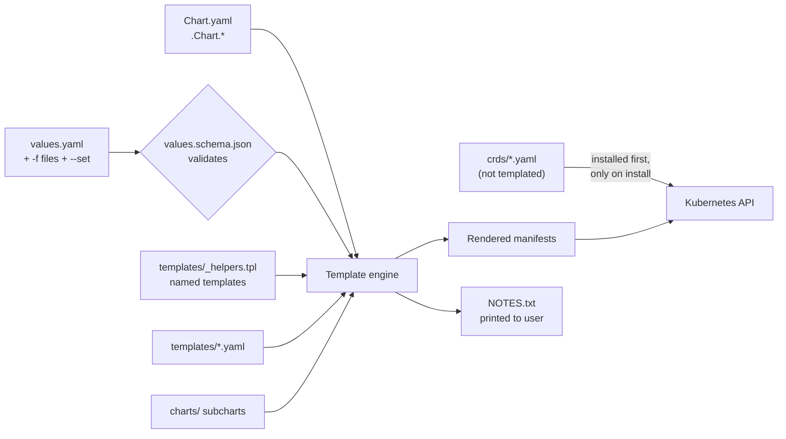
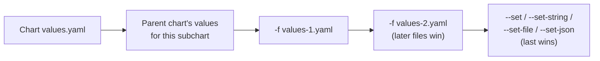

# Helm Chart Structure: Every File Explained

> Part of the [Helm notes](./README.md). Previous: [Fundamentals](./helm.md). Next: [Templating](./templating.md).

---

## The full layout

`helm create web` gives you the skeleton below. The files marked *(optional)* aren't generated but are part of the chart format.

```plaintext
web/
├── Chart.yaml              # REQUIRED: chart metadata (name, version, dependencies)
├── Chart.lock              # generated by `helm dependency update`: pinned dependency versions
├── values.yaml             # default configuration values
├── values.schema.json      # (optional) JSON Schema that validates values
├── .helmignore             # files to leave out of the packaged chart
├── README.md               # (optional) docs, shown on Artifact Hub
├── LICENSE                 # (optional)
├── charts/                 # dependency charts (subcharts), as .tgz or folders
├── crds/                   # (optional) CustomResourceDefinitions, plain YAML, NOT templated
└── templates/              # Go-templated Kubernetes manifests
    ├── _helpers.tpl        # named templates (no output on its own; leading _ = not a manifest)
    ├── NOTES.txt           # message printed after install/upgrade (templated)
    ├── deployment.yaml
    ├── service.yaml
    ├── serviceaccount.yaml
    ├── ingress.yaml
    ├── hpa.yaml
    ├── httproute.yaml      # (newer helm create versions may include Gateway API route)
    └── tests/
        └── test-connection.yaml   # `helm test` pod (hook: test)
```

How the pieces fit together:



---

## `Chart.yaml`: chart metadata

```yaml
apiVersion: v2                 # v2 = Helm 3+ chart. (v1 = Helm 2, used requirements.yaml)
name: web                      # must match the folder name; lowercase, dashes allowed
description: Company standard web service chart
type: application              # application (installable) | library (only helpers, see advanced notes)
version: 1.4.2                 # CHART version, SemVer 2. Bump on ANY chart change.
appVersion: "2.7.0"            # version of the app inside (informational, often the default image tag). Quote it.
kubeVersion: ">=1.29.0-0"      # refuse to install on older clusters (-0 allows pre-release like EKS "-eks-xxx")
keywords: [web, http]
home: https://git.corp/platform/charts
sources: [https://git.corp/platform/charts/tree/main/web]
maintainers:
  - name: Platform Team
    email: platform@corp.com
icon: https://corp.com/logo.png
deprecated: false
annotations:                   # free-form; Artifact Hub reads artifacthub.io/* keys
  artifacthub.io/changes: |
    - kind: added
      description: HTTPRoute support
dependencies:                  # subcharts (replaces Helm 2's requirements.yaml)
  - name: redis
    version: "~20.1.0"         # SemVer range: ~ = patch updates, ^ = minor updates
    repository: oci://registry-1.docker.io/bitnamicharts   # or https://... or "file://../redis"
    condition: redis.enabled   # install only if .Values.redis.enabled is true
    tags: [cache]              # enable/disable groups via .Values.tags.cache
    alias: cache               # use the chart under a different name (values key becomes cache:)
    import-values:             # pull child values up into the parent
      - child: exports.data
        parent: redisData
```

**Version rules to remember:**
- `version` is **required** and must be valid SemVer. You can't push the same `name:version` twice to most registries, so bump it every time.
- Changing only `values.yaml` defaults is still a chart change, so bump `version`.
- `appVersion` doesn't affect installs unless your templates use it (`image.tag | default .Chart.AppVersion`, which is the common pattern).

---

## `values.yaml`: default configuration

The defaults for every knob your templates expose. Treat it as the chart's **public API**: document every key, keep names stable, and provide safe defaults.

```yaml
# -- Number of pods (ignored when autoscaling.enabled=true)
replicaCount: 2

image:
  repository: registry.corp/web
  # -- Overrides the image tag. Defaults to .Chart.AppVersion
  tag: ""
  pullPolicy: IfNotPresent

imagePullSecrets: []
nameOverride: ""
fullnameOverride: ""

serviceAccount:
  create: true
  annotations: {}            # e.g. eks.amazonaws.com/role-arn for IRSA
  name: ""

podAnnotations: {}
podSecurityContext:
  runAsNonRoot: true
  seccompProfile: { type: RuntimeDefault }
securityContext:
  allowPrivilegeEscalation: false
  readOnlyRootFilesystem: true
  capabilities: { drop: [ALL] }

service:
  type: ClusterIP
  port: 80
  targetPort: 8080

ingress:
  enabled: false
  className: ""
  annotations: {}
  hosts:
    - host: web.example.com
      paths: [{ path: /, pathType: Prefix }]
  tls: []

resources:
  requests: { cpu: 100m, memory: 128Mi }
  limits:   { memory: 256Mi }

autoscaling:
  enabled: false
  minReplicas: 2
  maxReplicas: 10
  targetCPUUtilizationPercentage: 70

env: {}                      # map of plain env vars
nodeSelector: {}
tolerations: []
affinity: {}

redis:
  enabled: false             # toggles the redis dependency (condition in Chart.yaml)

global: {}                   # values visible to this chart AND all subcharts as .Values.global
```

Good practice:
- **camelCase keys**, nested by feature (`ingress.enabled`, `ingress.hosts`).
- **Prefer maps over lists** for things people override per environment. Lists are replaced entirely when overridden, maps are merged key by key.
- Comment each key. The `# --` style is what [helm-docs](https://github.com/norwoodj/helm-docs) uses to generate the README table.
- Never put real secrets in `values.yaml` defaults.

### Value precedence (lowest → highest)



Maps are **deep-merged** at each step; lists and scalars are **replaced**. To delete a default key, set it to `null` (`--set ingress.annotations.foo=null`).

---

## `values.schema.json`: validating values

If present, Helm validates the merged values against this JSON Schema on `install`, `upgrade`, `lint` and `template`, and fails with a clear error before anything touches the cluster.

```json
{
  "$schema": "https://json-schema.org/draft-07/schema#",
  "type": "object",
  "required": ["image", "service"],
  "properties": {
    "replicaCount": { "type": "integer", "minimum": 1 },
    "image": {
      "type": "object",
      "required": ["repository"],
      "properties": {
        "repository": { "type": "string", "pattern": "^registry\\.corp/" },
        "tag": { "type": "string" },
        "pullPolicy": { "enum": ["Always", "IfNotPresent", "Never"] }
      }
    },
    "service": {
      "type": "object",
      "properties": {
        "type": { "enum": ["ClusterIP", "NodePort", "LoadBalancer"] },
        "port": { "type": "integer", "minimum": 1, "maximum": 65535 }
      }
    }
  }
}
```
```text
$ helm install web ./web --set replicaCount=zero
Error: values don't meet the specifications of the schema(s) in the following chart(s):
web:
- at '/replicaCount': got string, want integer
```
(That's Helm 4's message. Helm 3 says `replicaCount: Invalid type. Expected: integer, given: string`.)
Use it to enforce company policy too (e.g. images only from `registry.corp`). Generate it from `values.yaml` with the `helm-schema` plugin and then tighten it by hand.

---

## `templates/`: the manifests

- Every file in `templates/` is rendered with the Go template engine and sent to the cluster, **except**:
  - files starting with `_` (like `_helpers.tpl`), which only hold named templates;
  - `NOTES.txt`, which is printed to the user instead.
- A file can render to **nothing** (e.g. wrapped in `{{- if .Values.ingress.enabled }}`), and Helm skips empty output.
- One file can hold several resources separated by `---`.
- File names are free-form, but convention is one resource kind per file, named after the kind (`deployment.yaml`, `service.yaml`).
- See [Templating](./templating.md) for the syntax.

A typical `templates/deployment.yaml`:

```yaml
apiVersion: apps/v1
kind: Deployment
metadata:
  name: {{ include "web.fullname" . }}
  labels:
    {{- include "web.labels" . | nindent 4 }}
spec:
  {{- if not .Values.autoscaling.enabled }}
  replicas: {{ .Values.replicaCount }}
  {{- end }}
  selector:
    matchLabels:
      {{- include "web.selectorLabels" . | nindent 6 }}
  template:
    metadata:
      {{- with .Values.podAnnotations }}
      annotations:
        {{- toYaml . | nindent 8 }}
      {{- end }}
      labels:
        {{- include "web.selectorLabels" . | nindent 8 }}
    spec:
      serviceAccountName: {{ include "web.serviceAccountName" . }}
      securityContext:
        {{- toYaml .Values.podSecurityContext | nindent 8 }}
      containers:
        - name: {{ .Chart.Name }}
          image: "{{ .Values.image.repository }}:{{ .Values.image.tag | default .Chart.AppVersion }}"
          imagePullPolicy: {{ .Values.image.pullPolicy }}
          ports:
            - name: http
              containerPort: {{ .Values.service.targetPort }}
          {{- with .Values.env }}
          env:
            {{- range $k, $v := . }}
            - name: {{ $k }}
              value: {{ $v | quote }}
            {{- end }}
          {{- end }}
          readinessProbe:
            httpGet: { path: /healthz, port: http }
          resources:
            {{- toYaml .Values.resources | nindent 12 }}
          securityContext:
            {{- toYaml .Values.securityContext | nindent 12 }}
```

---

## `templates/_helpers.tpl`: named templates

Reusable snippets, defined with `define` and used with `include`. Names are **global across the chart and all its subcharts**, so always prefix them with the chart name.

```yaml
{{/* Chart name, overridable */}}
{{- define "web.name" -}}
{{- default .Chart.Name .Values.nameOverride | trunc 63 | trimSuffix "-" }}
{{- end }}

{{/*
Full name: release-chart, max 63 chars (DNS label limit).
If the release name already contains the chart name, don't repeat it.
*/}}
{{- define "web.fullname" -}}
{{- if .Values.fullnameOverride }}
{{- .Values.fullnameOverride | trunc 63 | trimSuffix "-" }}
{{- else }}
{{- $name := default .Chart.Name .Values.nameOverride }}
{{- if contains $name .Release.Name }}
{{- .Release.Name | trunc 63 | trimSuffix "-" }}
{{- else }}
{{- printf "%s-%s" .Release.Name $name | trunc 63 | trimSuffix "-" }}
{{- end }}
{{- end }}
{{- end }}

{{- define "web.chart" -}}
{{- printf "%s-%s" .Chart.Name .Chart.Version | replace "+" "_" | trunc 63 | trimSuffix "-" }}
{{- end }}

{{/* Standard labels: put on every resource */}}
{{- define "web.labels" -}}
helm.sh/chart: {{ include "web.chart" . }}
{{ include "web.selectorLabels" . }}
app.kubernetes.io/version: {{ .Values.image.tag | default .Chart.AppVersion | quote }}
app.kubernetes.io/managed-by: {{ .Release.Service }}
{{- end }}

{{/* Selector labels: must NEVER change after first install (selectors are immutable) */}}
{{- define "web.selectorLabels" -}}
app.kubernetes.io/name: {{ include "web.name" . }}
app.kubernetes.io/instance: {{ .Release.Name }}
{{- end }}

{{- define "web.serviceAccountName" -}}
{{- if .Values.serviceAccount.create }}
{{- default (include "web.fullname" .) .Values.serviceAccount.name }}
{{- else }}
{{- default "default" .Values.serviceAccount.name }}
{{- end }}
{{- end }}
```

> **Why `trunc 63`?** Kubernetes object names and label values must fit a DNS label (63 characters max). Long release names would otherwise break installs.
>
> **Why are selector labels separate?** A Deployment's `spec.selector` is immutable. If a label inside it changes (e.g. you put the chart version in the selector), every upgrade fails with `field is immutable`. Keep only stable labels in selectors.

---

## `templates/NOTES.txt`

Printed after `install`/`upgrade` (and by `helm status`). It's templated, so tell users how to reach what they just installed:

```text
{{- if .Values.ingress.enabled }}
Your app is available at:
{{- range .Values.ingress.hosts }}
  http{{ if $.Values.ingress.tls }}s{{ end }}://{{ .host }}
{{- end }}
{{- else }}
Port-forward to test:
  kubectl -n {{ .Release.Namespace }} port-forward svc/{{ include "web.fullname" . }} 8080:{{ .Values.service.port }}
  curl http://localhost:8080
{{- end }}
```

---

## `templates/tests/`: chart tests

Pods (or Jobs) with the `helm.sh/hook: test` annotation. They only run on `helm test <release>` and must exit 0 for success.

```yaml
apiVersion: v1
kind: Pod
metadata:
  name: "{{ include "web.fullname" . }}-test-connection"
  annotations:
    "helm.sh/hook": test
    "helm.sh/hook-delete-policy": before-hook-creation,hook-succeeded
spec:
  restartPolicy: Never
  containers:
    - name: curl
      image: curlimages/curl:8.10.1
      command: ["curl", "-fsS", "http://{{ include "web.fullname" . }}:{{ .Values.service.port }}/healthz"]
```

---

## `charts/`: subcharts

Holds the chart's **dependencies**, either as packaged `.tgz` files (downloaded by `helm dependency update` from the `dependencies:` list in Chart.yaml) or as unpacked folders you maintain yourself. Each subchart:
- gets its values from the parent's `values.yaml` under a key named after the subchart (or its `alias`);
- can't see the parent's values, except `global:`;
- is rendered and installed as part of the **same release**.
Details in [Advanced Helm → Dependencies](./advanced-helm.md#dependencies-and-subcharts).

---

## `crds/`: CustomResourceDefinitions

Plain YAML (**not templated**). Helm installs everything in `crds/` **before** the rest of the chart, and only on **first install**:
- Helm **never upgrades** or **deletes** CRDs in `crds/`, because deleting a CRD deletes every custom resource of that type in the cluster.
- `--skip-crds` skips them (e.g. when a platform team manages CRDs separately).
- Because of these limits, many charts (cert-manager, kube-prometheus-stack, Karpenter) instead put CRDs in `templates/` behind a flag (`crds.enabled`), or ship a separate CRD chart, so upgrades can update the CRDs. See [Advanced Helm → CRDs](./advanced-helm.md#crds).

---

## `.helmignore`

Like `.gitignore`: patterns for files to exclude when running `helm package`, which keeps tests, CI files and secrets out of the published `.tgz`.

```plaintext
.git/
.github/
*.swp
*.tmp
.DS_Store
ci/
*.md.gotmpl
values-*.yaml        # environment value files live elsewhere
tests/unit/          # helm-unittest files
```

---

## `Chart.lock`

Written by `helm dependency update`: the **exact** dependency versions (and a digest) that the ranges in Chart.yaml resolved to. Commit it. `helm dependency build` rebuilds `charts/` from the lock file exactly, which gives reproducible builds in CI.

```yaml
dependencies:
- name: redis
  repository: oci://registry-1.docker.io/bitnamicharts
  version: 20.1.7
digest: sha256:3f1c...
generated: "2026-10-18T09:12:44Z"
```

---

## Built-in objects available in templates

| Object | Examples | Notes |
|---|---|---|
| `.Values` | `.Values.image.tag` | Merged values |
| `.Release` | `.Release.Name`, `.Release.Namespace`, `.Release.Revision`, `.Release.IsInstall`, `.Release.IsUpgrade`, `.Release.Service` (= "Helm") | Info about this release |
| `.Chart` | `.Chart.Name`, `.Chart.Version`, `.Chart.AppVersion`, `.Chart.Annotations` | Contents of Chart.yaml (capitalised keys) |
| `.Capabilities` | `.Capabilities.KubeVersion.Version`, `.Capabilities.APIVersions.Has "networking.k8s.io/v1/Ingress"` | What the target cluster supports. With `helm template` it's a default unless you pass `--kube-version` / `--api-versions` |
| `.Template` | `.Template.Name`, `.Template.BasePath` | Current template file |
| `.Files` | `.Files.Get "config/app.conf"`, `.Files.Glob "config/*"`, `.Files.AsConfig`, `.Files.AsSecrets`, `.Files.Lines` | Non-template files in the chart (not in `templates/`, not ignored) |
| `.Subcharts` | `.Subcharts.redis.Values` | Access to subcharts' scope |

---

## A complete minimal chart you can copy

```plaintext
hello/
├── Chart.yaml
├── values.yaml
└── templates/
    ├── _helpers.tpl
    ├── deployment.yaml
    └── service.yaml
```
```yaml
# Chart.yaml
apiVersion: v2
name: hello
version: 0.1.0
appVersion: "1.27"
```
```yaml
# values.yaml
replicaCount: 1
image: { repository: nginx, tag: "" }
service: { port: 80 }
```
```yaml
# templates/_helpers.tpl
{{- define "hello.fullname" -}}{{ printf "%s-%s" .Release.Name .Chart.Name | trunc 63 | trimSuffix "-" }}{{- end }}
{{- define "hello.selectorLabels" -}}
app.kubernetes.io/name: {{ .Chart.Name }}
app.kubernetes.io/instance: {{ .Release.Name }}
{{- end }}
```
```yaml
# templates/deployment.yaml
apiVersion: apps/v1
kind: Deployment
metadata: { name: {{ include "hello.fullname" . }} }
spec:
  replicas: {{ .Values.replicaCount }}
  selector:
    matchLabels: {{- include "hello.selectorLabels" . | nindent 6 }}
  template:
    metadata:
      labels: {{- include "hello.selectorLabels" . | nindent 8 }}
    spec:
      containers:
        - name: web
          image: "{{ .Values.image.repository }}:{{ .Values.image.tag | default .Chart.AppVersion }}"
          ports: [{ containerPort: 80 }]
```
```yaml
# templates/service.yaml
apiVersion: v1
kind: Service
metadata: { name: {{ include "hello.fullname" . }} }
spec:
  selector: {{- include "hello.selectorLabels" . | nindent 4 }}
  ports: [{ port: {{ .Values.service.port }}, targetPort: 80 }]
```
```bash
helm lint ./hello && helm template demo ./hello && helm install demo ./hello
```

**Next:** [Templating](./templating.md).
