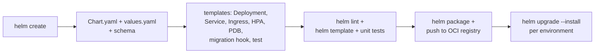
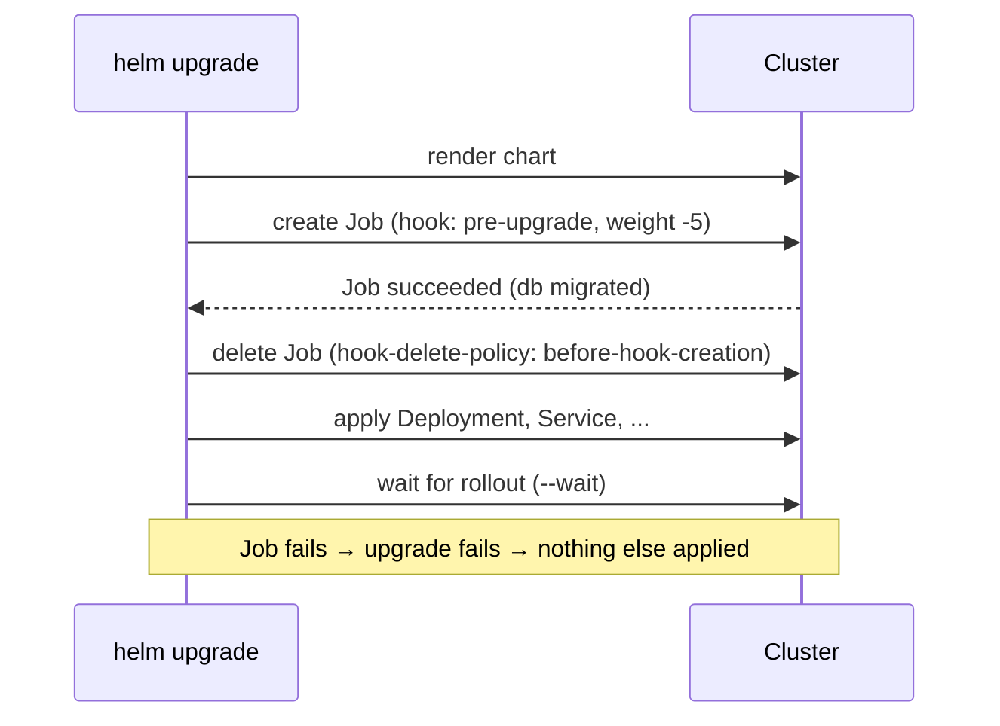

# Creating a Helm Chart from Scratch (Hands-On)

> Part of the [Helm notes](./README.md). Previous: [Commands](./helm-commands.md). Next: [Advanced Helm](./advanced-helm.md).
>
> Video walkthrough: https://www.youtube.com/watch?v=jUYNS90nq8U

We'll build a production-style chart for an `orders` API: Deployment, Service, ConfigMap, optional Ingress, HPA and PDB, a DB-migration hook, a test, values per environment, schema validation, unit tests, and finally package and publish it to an OCI registry.

You'll need: a cluster (`kind create cluster` or minikube is fine), `kubectl`, and Helm 3.14+ or Helm 4.

---

## Step 1: Scaffold

Where this walkthrough is heading:



```bash
helm create orders
cd orders
tree
```
`helm create` generates a working nginx chart with helpers, Deployment, Service, Ingress, HPA, ServiceAccount, NOTES and a test. Read it once, because it shows the conventions. Then remove what you don't need:

```bash
rm templates/hpa.yaml templates/ingress.yaml templates/serviceaccount.yaml
rm -f templates/httproute.yaml     # only in newer versions
```
We'll write our own versions so every line is understood.

## Step 2: Chart.yaml

```yaml
apiVersion: v2
name: orders
description: Orders API
type: application
version: 0.1.0          # chart version
appVersion: "1.0.0"     # default image tag
kubeVersion: ">=1.29.0-0"
maintainers:
  - name: Platform Team
    email: platform@corp.com
```

## Step 3: values.yaml (the chart's API)

```yaml
replicaCount: 2

image:
  repository: ghcr.io/stefanprodan/podinfo   # stand-in app that serves HTTP on 9898
  tag: "6.7.1"
  pullPolicy: IfNotPresent

containerPort: 9898

service:
  type: ClusterIP
  port: 80

config:                       # rendered into a ConfigMap and mounted as env
  LOG_LEVEL: info
  FEATURE_NEW_CHECKOUT: "false"

ingress:
  enabled: false
  className: nginx
  host: orders.local
  tls: false

autoscaling:
  enabled: false
  minReplicas: 2
  maxReplicas: 6
  targetCPU: 70

pdb:
  enabled: true
  minAvailable: 1

migration:
  enabled: false
  image: busybox:1.36
  command: ["sh", "-c", "echo running migrations && sleep 5"]

resources:
  requests: { cpu: 50m, memory: 64Mi }
  limits:   { memory: 128Mi }

podSecurityContext:
  runAsNonRoot: true
  runAsUser: 10001
  seccompProfile: { type: RuntimeDefault }
securityContext:
  allowPrivilegeEscalation: false
  readOnlyRootFilesystem: true
  capabilities: { drop: [ALL] }
```

## Step 4: Helpers

`templates/_helpers.tpl` (simplified from the generated one):

```yaml
{{- define "orders.fullname" -}}
{{- if contains .Chart.Name .Release.Name }}
{{- .Release.Name | trunc 63 | trimSuffix "-" }}
{{- else }}
{{- printf "%s-%s" .Release.Name .Chart.Name | trunc 63 | trimSuffix "-" }}
{{- end }}
{{- end }}

{{- define "orders.selectorLabels" -}}
app.kubernetes.io/name: {{ .Chart.Name }}
app.kubernetes.io/instance: {{ .Release.Name }}
{{- end }}

{{- define "orders.labels" -}}
{{ include "orders.selectorLabels" . }}
helm.sh/chart: {{ printf "%s-%s" .Chart.Name .Chart.Version }}
app.kubernetes.io/version: {{ .Values.image.tag | default .Chart.AppVersion | quote }}
app.kubernetes.io/managed-by: {{ .Release.Service }}
{{- end }}
```

## Step 5: ConfigMap

`templates/configmap.yaml`:
```yaml
apiVersion: v1
kind: ConfigMap
metadata:
  name: {{ include "orders.fullname" . }}
  labels: {{- include "orders.labels" . | nindent 4 }}
data:
  {{- range $k, $v := .Values.config }}
  {{ $k }}: {{ $v | quote }}
  {{- end }}
```

## Step 6: Deployment

`templates/deployment.yaml`:
```yaml
apiVersion: apps/v1
kind: Deployment
metadata:
  name: {{ include "orders.fullname" . }}
  labels: {{- include "orders.labels" . | nindent 4 }}
spec:
  {{- if not .Values.autoscaling.enabled }}
  replicas: {{ .Values.replicaCount }}
  {{- end }}
  selector:
    matchLabels: {{- include "orders.selectorLabels" . | nindent 6 }}
  template:
    metadata:
      labels: {{- include "orders.selectorLabels" . | nindent 8 }}
      annotations:
        checksum/config: {{ include (print $.Template.BasePath "/configmap.yaml") . | sha256sum }}
    spec:
      securityContext: {{- toYaml .Values.podSecurityContext | nindent 8 }}
      containers:
        - name: app
          image: "{{ .Values.image.repository }}:{{ .Values.image.tag | default .Chart.AppVersion }}"
          imagePullPolicy: {{ .Values.image.pullPolicy }}
          ports:
            - name: http
              containerPort: {{ .Values.containerPort }}
          envFrom:
            - configMapRef:
                name: {{ include "orders.fullname" . }}
          readinessProbe:
            httpGet: { path: /readyz, port: http }
          livenessProbe:
            httpGet: { path: /healthz, port: http }
          resources: {{- toYaml .Values.resources | nindent 12 }}
          securityContext: {{- toYaml .Values.securityContext | nindent 12 }}
          volumeMounts:
            - { name: tmp, mountPath: /tmp }    # writable dir, since the root fs is read-only
      volumes:
        - { name: tmp, emptyDir: {} }
```

## Step 7: Service, Ingress, HPA, PDB

`templates/service.yaml`:
```yaml
apiVersion: v1
kind: Service
metadata:
  name: {{ include "orders.fullname" . }}
  labels: {{- include "orders.labels" . | nindent 4 }}
spec:
  type: {{ .Values.service.type }}
  selector: {{- include "orders.selectorLabels" . | nindent 4 }}
  ports:
    - name: http
      port: {{ .Values.service.port }}
      targetPort: http
```

`templates/ingress.yaml`:
```yaml
{{- if .Values.ingress.enabled }}
apiVersion: networking.k8s.io/v1
kind: Ingress
metadata:
  name: {{ include "orders.fullname" . }}
  labels: {{- include "orders.labels" . | nindent 4 }}
spec:
  ingressClassName: {{ .Values.ingress.className }}
  {{- if .Values.ingress.tls }}
  tls:
    - hosts: [{{ .Values.ingress.host | quote }}]
      secretName: {{ include "orders.fullname" . }}-tls
  {{- end }}
  rules:
    - host: {{ .Values.ingress.host | quote }}
      http:
        paths:
          - path: /
            pathType: Prefix
            backend:
              service:
                name: {{ include "orders.fullname" . }}
                port: { name: http }
{{- end }}
```

`templates/hpa.yaml`:
```yaml
{{- if .Values.autoscaling.enabled }}
apiVersion: autoscaling/v2
kind: HorizontalPodAutoscaler
metadata:
  name: {{ include "orders.fullname" . }}
spec:
  scaleTargetRef:
    apiVersion: apps/v1
    kind: Deployment
    name: {{ include "orders.fullname" . }}
  minReplicas: {{ .Values.autoscaling.minReplicas }}
  maxReplicas: {{ .Values.autoscaling.maxReplicas }}
  metrics:
    - type: Resource
      resource:
        name: cpu
        target: { type: Utilization, averageUtilization: {{ .Values.autoscaling.targetCPU }} }
{{- end }}
```

`templates/pdb.yaml`:
```yaml
{{- if .Values.pdb.enabled }}
apiVersion: policy/v1
kind: PodDisruptionBudget
metadata:
  name: {{ include "orders.fullname" . }}
spec:
  minAvailable: {{ .Values.pdb.minAvailable }}
  selector:
    matchLabels: {{- include "orders.selectorLabels" . | nindent 6 }}
{{- end }}
```

## Step 8: A pre-upgrade migration hook



`templates/migration-job.yaml`:
```yaml
{{- if .Values.migration.enabled }}
apiVersion: batch/v1
kind: Job
metadata:
  name: {{ include "orders.fullname" . }}-migrate-{{ .Release.Revision }}
  annotations:
    "helm.sh/hook": pre-install,pre-upgrade
    "helm.sh/hook-weight": "-5"
    "helm.sh/hook-delete-policy": before-hook-creation,hook-succeeded
spec:
  backoffLimit: 1
  template:
    spec:
      restartPolicy: Never
      containers:
        - name: migrate
          image: {{ .Values.migration.image }}
          command: {{- toJson .Values.migration.command | nindent 12 }}
{{- end }}
```
If the Job fails, the upgrade fails *before* any app pods change. With `--rollback-on-failure` (Helm 3: `--atomic`) the release is rolled back. (Hooks in detail: [Advanced Helm](./advanced-helm.md#hooks).)

## Step 9: Test and NOTES

`templates/tests/test-connection.yaml`:
```yaml
apiVersion: v1
kind: Pod
metadata:
  name: {{ include "orders.fullname" . }}-test
  annotations:
    "helm.sh/hook": test
    "helm.sh/hook-delete-policy": before-hook-creation,hook-succeeded
spec:
  restartPolicy: Never
  containers:
    - name: curl
      image: curlimages/curl:8.10.1
      command: ["curl", "-fsS", "http://{{ include "orders.fullname" . }}:{{ .Values.service.port }}/healthz"]
```

`templates/NOTES.txt`:
```text
orders {{ .Values.image.tag | default .Chart.AppVersion }} deployed as release "{{ .Release.Name }}" (revision {{ .Release.Revision }}).

Try it:
  kubectl -n {{ .Release.Namespace }} port-forward svc/{{ include "orders.fullname" . }} 8080:{{ .Values.service.port }}
  curl localhost:8080
```

## Step 10: Validate values with a schema

`values.schema.json`:
```json
{
  "$schema": "https://json-schema.org/draft-07/schema#",
  "type": "object",
  "required": ["image", "service"],
  "properties": {
    "replicaCount": { "type": "integer", "minimum": 1 },
    "image": {
      "type": "object",
      "required": ["repository"],
      "properties": { "repository": { "type": "string", "minLength": 1 }, "tag": { "type": "string" } }
    },
    "service": {
      "type": "object",
      "properties": { "port": { "type": "integer", "minimum": 1, "maximum": 65535 } }
    },
    "autoscaling": {
      "type": "object",
      "properties": {
        "minReplicas": { "type": "integer", "minimum": 1 },
        "maxReplicas": { "type": "integer", "minimum": 1 }
      }
    }
  }
}
```

## Step 11: Lint and render

```bash
cd ..
helm lint ./orders --strict
helm template demo ./orders | less
helm template demo ./orders --set ingress.enabled=true -s templates/ingress.yaml
helm template demo ./orders --set replicaCount=zero      # schema error, as expected
```
Optionally validate rendered output against Kubernetes schemas:
```bash
helm template demo ./orders | kubeconform -strict -summary -kubernetes-version 1.33.0
```

## Step 12: Install, upgrade, test, roll back

```bash
helm install demo ./orders -n orders --create-namespace --wait
helm test demo -n orders --logs

# change config: the checksum changes, so pods roll automatically
helm upgrade demo ./orders -n orders --set config.LOG_LEVEL=debug --wait
helm history demo -n orders

# deliberately break it: a bad image, with auto-rollback
helm upgrade demo ./orders -n orders --set image.tag=does-not-exist --wait --timeout 90s --rollback-on-failure   # Helm 3: --atomic
helm history demo -n orders        # failed revision, then automatic rollback revision

helm rollback demo 1 -n orders     # manual rollback works too
```

## Step 13: Environment values files

Keep environment files **outside** the chart (in the deploy repo), so the chart stays generic:

```plaintext
deploy/
├── values.yaml            # shared across environments
├── values-dev.yaml
├── values-uat.yaml
└── values-prod.yaml
```
```yaml
# values-prod.yaml
replicaCount: 4
autoscaling: { enabled: true, minReplicas: 4, maxReplicas: 20 }
ingress: { enabled: true, host: orders.corp.com, tls: true }
config: { LOG_LEVEL: warn }
resources:
  requests: { cpu: 250m, memory: 256Mi }
  limits:   { memory: 512Mi }
migration: { enabled: true }
```
```bash
helm upgrade --install orders ./orders -n prod -f deploy/values.yaml -f deploy/values-prod.yaml --wait --rollback-on-failure
```

## Step 14: Unit-test the templates

With the [helm-unittest](https://github.com/helm-unittest/helm-unittest) plugin, add `orders/tests/deployment_test.yaml` (and list `tests/` in `.helmignore`):

```yaml
suite: deployment
templates: [templates/deployment.yaml, templates/configmap.yaml]
tests:
  - it: uses appVersion when tag is empty
    template: templates/deployment.yaml
    set: { image.tag: "" }
    asserts:
      - equal: { path: spec.template.spec.containers[0].image, value: "ghcr.io/stefanprodan/podinfo:1.0.0" }
  - it: drops replicas when autoscaling is on
    template: templates/deployment.yaml
    set: { autoscaling.enabled: true }
    asserts:
      - notExists: { path: spec.replicas }
  - it: runs as non-root
    template: templates/deployment.yaml
    asserts:
      - equal: { path: spec.template.spec.securityContext.runAsNonRoot, value: true }
```
```bash
helm plugin install https://github.com/helm-unittest/helm-unittest
helm unittest ./orders
```

## Step 15: Package and publish

```bash
# bump version first (chart changes ⇒ new chart version)
sed -i '' 's/^version: .*/version: 0.2.0/' orders/Chart.yaml     # GNU sed: sed -i 's/...//'

helm package ./orders                         # → orders-0.2.0.tgz

# OCI registry (recommended)
helm registry login ghcr.io -u "$GH_USER" --password-stdin <<< "$GH_TOKEN"
helm push orders-0.2.0.tgz oci://ghcr.io/corp/charts
helm install orders oci://ghcr.io/corp/charts/orders --version 0.2.0 -n orders

# or a classic HTTP repo (e.g. GitHub Pages / S3)
mkdir -p repo && mv orders-0.2.0.tgz repo/
helm repo index repo --url https://charts.corp.com
# upload repo/ (index.yaml + .tgz), then:
helm repo add corp https://charts.corp.com && helm install orders corp/orders --version 0.2.0
```

## Step 16: Automate it in CI

```yaml
# .github/workflows/chart.yml
name: chart
on:
  pull_request: { paths: ["charts/**"] }
  push: { branches: [main], paths: ["charts/**"] }
permissions: { contents: read, packages: write }
jobs:
  test-and-release:
    runs-on: ubuntu-latest
    steps:
      - uses: actions/checkout@v4
      - uses: azure/setup-helm@v4
        with: { version: v4.2.3 }         # pin the Helm version
      - run: helm plugin install https://github.com/helm-unittest/helm-unittest
      - run: helm lint charts/orders --strict
      - run: helm unittest charts/orders
      - run: helm template t charts/orders -f deploy/values-prod.yaml > /tmp/out.yaml
      - if: github.event_name == 'push'
        run: |
          helm package charts/orders
          echo "${{ secrets.GITHUB_TOKEN }}" | helm registry login ghcr.io -u "${{ github.actor }}" --password-stdin
          helm push orders-*.tgz oci://ghcr.io/${{ github.repository_owner }}/charts
```
A PR that changes a chart without bumping `version` should fail. The [chart-testing](https://github.com/helm/chart-testing) tool (`ct lint`) checks this, and `ct install` installs changed charts into a kind cluster.

---

## Checklist for a good chart

- [ ] `helm lint --strict` passes; `values.schema.json` validates the important values.
- [ ] Names go through `fullname` with `trunc 63`; standard `app.kubernetes.io/*` labels everywhere; selector labels never change.
- [ ] Image tag defaults to `.Chart.AppVersion`; no `latest`.
- [ ] Resources, probes, security context (non-root, read-only FS, dropped capabilities) on by default.
- [ ] Optional features (`ingress`, `autoscaling`, `pdb`) behind `enabled` flags; `replicas` left out when HPA is on.
- [ ] Config checksum annotation so config changes roll pods.
- [ ] No secrets in `values.yaml`; support `existingSecret` for credentials.
- [ ] README with a values table (helm-docs); NOTES.txt explains how to reach the app.
- [ ] Unit tests and a `helm test` hook; CI lints, tests and publishes with a version bump.

**Next:** [Advanced Helm](./advanced-helm.md).
