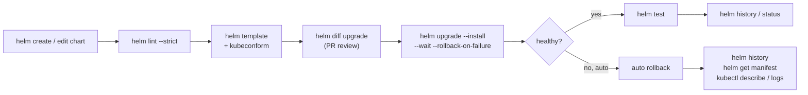

# Helm Commands: Complete Reference

> Part of the [Helm notes](./README.md). Previous: [Templating](./templating.md). Next: [Creating a Chart](./creating-helm-chart.md).

Flags common to almost every command: `-n/--namespace`, `--kube-context`, `--kubeconfig`, `--debug` (verbose output), `-o/--output table|json|yaml`. Run `helm <command> --help` for the full list in your installed version.

> **Helm 3 vs Helm 4 flags** (checked against Helm v4.2):
> - `--atomic` → **`--rollback-on-failure`**, and `--force` → **`--force-replace`**. The old names still work but print a deprecation warning.
> - `--wait` now takes a **strategy**: `--wait` alone means `watcher` (kstatus-based readiness), `--wait=legacy` is the Helm 3 behaviour, and when you **omit** it the default is `hookOnly` (only hooks are waited for, so the release is "deployed" as soon as the API accepts the objects).
> - `--server-side true|false|auto` (default `auto`: new releases use server-side apply, existing ones keep the method they were installed with), plus `--force-conflicts` to take over fields owned by another manager.
> - `helm status --show-resources` and `helm template --validate` no longer exist. Use `helm get manifest` and `--dry-run=server` instead.
>
> The examples use the Helm 4 names, with Helm 3 equivalents noted where they differ.

---

## Cheat sheet

| Task | Command |
|---|---|
| Add / update repos | `helm repo add NAME URL` · `helm repo update` |
| Find a chart | `helm search repo KEYWORD` · `helm search hub KEYWORD` |
| See chart defaults | `helm show values REPO/CHART` |
| Install | `helm install REL CHART -n NS --create-namespace -f values.yaml` |
| Install **or** upgrade (CI) | `helm upgrade --install REL CHART -n NS -f values.yaml --wait --rollback-on-failure --timeout 10m` (Helm 3: `--atomic`) |
| Render locally | `helm template REL CHART -f values.yaml` |
| Lint a chart | `helm lint ./chart -f values.yaml` |
| List releases | `helm list -A` |
| Release info | `helm status REL` · `helm get values REL` · `helm get manifest REL` |
| History / rollback | `helm history REL` · `helm rollback REL REVISION` |
| Uninstall | `helm uninstall REL -n NS` |
| Package / publish | `helm package ./chart` · `helm push chart-1.0.0.tgz oci://REGISTRY/charts` |
| Dependencies | `helm dependency update ./chart` · `helm dependency build ./chart` |
| Run chart tests | `helm test REL` |

---

## Repositories

```bash
helm repo add prometheus-community https://prometheus-community.github.io/helm-charts
helm repo add jetstack https://charts.jetstack.io
helm repo add private https://charts.corp.com --username "$USER" --password "$TOKEN"   # basic auth
helm repo list
helm repo update                 # refresh all repo indexes (like apt update)
helm repo update jetstack        # just one
helm repo remove jetstack
helm repo index ./public --url https://charts.corp.com   # generate index.yaml for your own HTTP repo
```
Repos are stored in `$HELM_CONFIG_HOME/repositories.yaml`, and their cached indexes in `$HELM_CACHE_HOME/repository/`.

## OCI registries

```bash
helm registry login 123456789012.dkr.ecr.ap-south-1.amazonaws.com --username AWS \
  --password "$(aws ecr get-login-password --region ap-south-1)"
helm registry login ghcr.io -u USER --password-stdin <<< "$GITHUB_TOKEN"
helm push web-1.4.2.tgz oci://123456789012.dkr.ecr.ap-south-1.amazonaws.com/charts   # → .../charts/web:1.4.2
helm pull oci://ghcr.io/stefanprodan/charts/podinfo --version 6.7.1
helm show values oci://ghcr.io/stefanprodan/charts/podinfo --version 6.7.1
helm install demo oci://ghcr.io/stefanprodan/charts/podinfo --version 6.7.1
helm registry logout ghcr.io
```
No `helm repo add` is needed for OCI: you reference the full `oci://` URL. The chart's `name` becomes the repository name, and `version` becomes the tag. You can also pin by digest: `--version 6.7.1@sha256:...`.

---

## Searching and inspecting charts

```bash
helm search hub cert-manager                     # Artifact Hub
helm search repo jetstack/cert-manager --versions | head   # all versions in an added repo
helm search repo web --devel                     # include pre-releases

helm show chart jetstack/cert-manager            # Chart.yaml
helm show values jetstack/cert-manager > defaults.yaml   # ALWAYS read this before installing
helm show readme jetstack/cert-manager
helm show crds jetstack/cert-manager
helm show all jetstack/cert-manager

helm pull jetstack/cert-manager --version v1.16.1               # download .tgz
helm pull jetstack/cert-manager --version v1.16.1 --untar --untardir ./vendor   # download and unpack to inspect
```

---

## Installing

```bash
helm install cert-manager jetstack/cert-manager \
  --namespace cert-manager --create-namespace \
  --version v1.16.1 \
  --set crds.enabled=true \
  -f values-cert-manager.yaml \
  --wait --timeout 5m
```

Important `install`/`upgrade` flags:

| Flag | What it does |
|---|---|
| `--version` | Chart version (**always pin it**; otherwise you get the latest) |
| `-f, --values FILE` | Values file (repeatable; later files win). Can be a URL. |
| `--set k=v` | Set a value. Nested: `a.b=c`. Lists: `list[0]=x`, `list={a,b}`. Escape dots: `annotations."eks\.amazonaws\.com/role-arn"=...` |
| `--set-string k=v` | Force string type (e.g. a tag like `1.10`, which `--set` would make a float `1.1`) |
| `--set-file k=path` | Value from file contents (certs, scripts) |
| `--set-json 'k={"a":1}'` | Set JSON / complex values |
| `--create-namespace` | Create the namespace if missing |
| `--wait[=watcher\|legacy\|hookOnly]` | Wait until resources are ready (pods ready, PVCs bound, Services have IPs). Helm 4: bare `--wait` = `watcher`; omitted = `hookOnly` |
| `--wait-for-jobs` | Also wait for Jobs to complete |
| `--timeout 10m` | How long to wait (default 5m) |
| `--rollback-on-failure` (Helm 3: `--atomic`) | On failure: install → uninstall, upgrade → roll back to the last good revision. Turns on `--wait=watcher` |
| `--dry-run=client\|server` | Render without applying. `client` needs no cluster; `server` validates against the real API (and lets `lookup` work). Add `--hide-secret` to keep Secrets out of the output |
| `--generate-name` | Let Helm pick a release name |
| `--description "..."` | Note stored with the revision (shows in `helm history`) |
| `--skip-crds` | Don't install `crds/` |
| `--no-hooks` | Skip hooks |
| `--post-renderer` | Pipe rendered manifests through a program or plugin (e.g. Kustomize) before applying |
| `--take-ownership` | Adopt existing resources not created by Helm (Helm 3.17+) |
| `--hide-notes` | Don't print NOTES.txt |
| `--devel` | Allow pre-release chart versions |
| `--render-subchart-notes` | Also print subcharts' NOTES.txt |
| `--labels k=v` | Labels on the release record itself |

### Value type gotchas with `--set`

```bash
--set image.tag=1.10              # becomes float 1.1   → use --set-string image.tag=1.10
--set replicas=3                  # int 3
--set enabled=true                # bool true
--set-string enabled=true         # string "true"
--set hosts={a.com,b.com}         # list
--set hosts[1]=b.com              # set one list element (replaces whole list in merge!)
--set env.API_URL="https://x\,y"  # escape commas
--set 'podAnnotations.prometheus\.io/scrape=true'   # escape dots in keys
```
Prefer **values files** over long `--set` chains: they're reviewable, versioned in Git, and avoid type surprises.

---

## Upgrading

```bash
# The idiomatic CI/CD command: install if missing, upgrade if present
helm upgrade --install payments ./charts/payments \
  -n prod --create-namespace \
  -f values.yaml -f values-prod.yaml \
  --set-string image.tag="$GIT_SHA" \
  --wait --rollback-on-failure --timeout 10m \
  --history-max 10 \
  --description "deploy $GIT_SHA by $CI_PIPELINE_ID"
```

| Upgrade-specific flag | Meaning |
|---|---|
| `--install` / `-i` | Install if the release doesn't exist |
| `--reuse-values` | Start from the **last release's** values and merge your new `--set`/`-f` on top. **Ignores new defaults** in the chart's values.yaml (can hide new required values) |
| `--reset-values` | Ignore previous values, use chart defaults plus what you pass now |
| `--reset-then-reuse-values` | Use the new chart defaults, then apply the last release's overrides, then yours (Helm 3.14+) |
| `--history-max N` | Keep only N revisions (default 10; 0 = unlimited). Each is a Secret |
| `--cleanup-on-fail` | Delete new resources created in a failed upgrade |
| `--force-replace` (Helm 3: `--force`) | Delete and recreate resources that can't be patched. **Causes downtime**; last resort for immutable field errors |
| `--server-side true\|false\|auto` | Helm 4: apply on the server. `auto` (default) keeps the release's previous method |
| `--force-conflicts` | Helm 4: with server-side apply, overwrite fields owned by another field manager |

> **Best practice in pipelines:** pass the **full** set of values every time (`-f values.yaml -f values-prod.yaml --set-string image.tag=...`) and don't use `--reuse-values`. Each deploy is then fully described by Git, and new chart defaults are always picked up.

---

## Inspecting releases

```bash
helm list -n prod                       # releases in a namespace
helm list -A                            # all namespaces
helm list -A --failed                   # only failed (also --pending, --deployed, --uninstalled with --all)
helm list -A -o json | jq -r '.[] | "\(.namespace)/\(.name) \(.chart) \(.status)"'

helm status payments -n prod            # status, last deployed, NOTES
helm status payments -n prod --revision 7       # status of an older revision

helm get values payments -n prod        # values YOU supplied (user overrides only)
helm get values payments -n prod --all  # fully merged values (defaults included)
helm get values payments -n prod --revision 3
helm get manifest payments -n prod      # the rendered YAML that was applied
helm get notes payments -n prod
helm get hooks payments -n prod
helm get metadata payments -n prod      # chart, version, app version, revision, status
helm get all payments -n prod
```
`helm get manifest` is very useful for debugging: it's exactly what Helm thinks it deployed, which you can diff against the live cluster.

---

## History and rollback

```bash
helm history payments -n prod
# REVISION  UPDATED                  STATUS      CHART           APP VERSION  DESCRIPTION
# 7         Sat Oct 17 10:02:11 2026 superseded  payments-1.4.1  2.6.0        Upgrade complete
# 8         Sun Oct 18 09:14:45 2026 failed      payments-1.4.2  2.7.0        Upgrade "payments" failed: timed out
# 9         Sun Oct 18 09:20:03 2026 deployed    payments-1.4.1  2.6.0        Rollback to 7

helm rollback payments 7 -n prod --wait --timeout 5m --cleanup-on-fail
helm rollback payments -n prod          # no revision = previous one
```
- A rollback **creates a new revision** (9 above) that's a copy of the target revision. History is never rewritten.
- Rollback restores Kubernetes **objects**, not **data**. If an upgrade ran a DB migration, rolling back the Deployment doesn't undo the schema change. Design migrations to be backward-compatible (expand/contract).
- In GitOps setups, roll back by reverting Git instead, or the GitOps tool will re-apply the newer version.

---

## Uninstalling

```bash
helm uninstall payments -n prod
helm uninstall payments -n prod --keep-history   # keep release records (lets you `helm rollback` after uninstall)
helm uninstall payments -n prod --wait           # wait until resources are deleted
helm uninstall payments -n prod --cascade foreground   # wait for dependents (pods) to be deleted
helm uninstall payments -n prod --dry-run
```
What isn't removed: **CRDs** from `crds/`, **PVCs** created by StatefulSet `volumeClaimTemplates`, resources annotated with `helm.sh/resource-policy: keep`, and the namespace (even if `--create-namespace` made it).

---

## Developing charts

```bash
helm create web                          # scaffold a chart
helm lint ./web                          # check structure and best practices
helm lint ./web -f values-prod.yaml --strict   # with real values; warnings become errors

helm template demo ./web -f values-prod.yaml > rendered.yaml   # render locally
helm template demo ./web -s templates/deployment.yaml          # only one template
helm template demo ./web --kube-version 1.33 --api-versions gateway.networking.k8s.io/v1   # simulate cluster capabilities
helm template demo ./web --debug                                # show the raw output on YAML errors
helm template demo ./web --output-dir ./out                      # one file per template, easy to diff
helm template demo ./web --include-crds --skip-tests

helm install demo ./web --dry-run=server --debug   # full server-side validation without applying (replaces Helm 3's template --validate)

helm package ./web                                  # → web-1.4.2.tgz
helm package ./web -u                               # run `dependency update` first
helm package ./web --version 1.4.3 --app-version 2.7.1   # override versions at package time (CI)
helm package ./web --sign --key 'Platform Team' --keyring ~/.gnupg/secring.gpg   # sign → .prov file
helm verify web-1.4.3.tgz                           # verify signature
```

## Dependencies

```bash
helm dependency list ./web          # status of each dependency (ok / missing / wrong version)
helm dependency update ./web        # resolve ranges, download into charts/, write Chart.lock
helm dependency build ./web         # rebuild charts/ exactly from Chart.lock (use in CI)
```

## Tests

```bash
helm test payments -n prod                 # run pods with hook "test"; non-zero exit = fail
helm test payments -n prod --logs          # print test pod logs
helm test payments -n prod --filter name=payments-test-connection
```

## Plugins

```bash
helm plugin list
helm plugin install https://github.com/databus23/helm-diff
helm plugin install https://github.com/jkroepke/helm-secrets
helm plugin install https://github.com/helm-unittest/helm-unittest
helm plugin update diff
helm plugin uninstall diff

helm diff upgrade payments ./charts/payments -n prod -f values-prod.yaml   # what would change
helm diff revision payments 7 9 -n prod                                     # compare two revisions
helm secrets upgrade --install payments ./charts/payments -f secrets.prod.yaml   # decrypt SOPS values on the fly
helm unittest ./charts/payments                                             # run template unit tests
```

## Environment and housekeeping

```bash
helm version
helm env                                  # paths and settings
helm completion bash > /etc/bash_completion.d/helm
export HELM_NAMESPACE=prod                # default namespace for every command
export HELM_KUBECONTEXT=prod-cluster
export HELM_DRIVER=secret                 # release storage: secret (default) | configmap | sql | memory
export HELM_MAX_HISTORY=10
```

---

## Command flow for a typical day



**Next:** [Creating a Chart](./creating-helm-chart.md).
