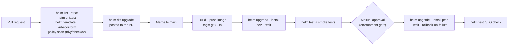

# Helm in Production: CI/CD, GitOps, Security, Troubleshooting & Best Practices

> Part of the [Helm notes](./README.md). Previous: [Advanced Helm](./advanced-helm.md). See also [Argo CD + Helm Integration](../Continuous%20Delivery/ArgoCD/argo-cd-integration-helm.md) and the Helm interview questions in [33 Q37–42](../Interview%20Questions/33-platform-engineering-deep-dive-qna.md#helm-advanced).

---

## Repository layout

Two common layouts:

**1. Chart next to the app (one service, one team)**
```plaintext
payments-service/
├── src/ ...
├── Dockerfile
└── chart/                 # versioned and released with the app
    ├── Chart.yaml
    ├── values.yaml
    └── templates/
```

**2. Separate charts repo + deploy (environment) repo (platform teams, GitOps)**
```plaintext
platform-charts/           # charts, published to OCI with SemVer
└── charts/
    ├── common-lib/        # library chart
    ├── web-service/       # generic chart used by many services
    └── worker/

deploy-config/             # what runs where; Argo CD / Flux watches this
├── apps/
│   └── payments/
│       ├── values.yaml            # shared
│       ├── values-dev.yaml
│       ├── values-uat.yaml
│       └── values-prod.yaml       # image tag bumped here by CI (PR for prod)
└── clusters/
    ├── prod-ap-south-1/
    └── dev-ap-south-1/
```
Layout 2 separates **"how to deploy a kind of thing"** (the chart, owned by the platform team) from **"what version runs where"** (the values, changed by CI and reviewed in PRs). The deploy repo's history becomes the audit trail of every production change.

---

## CI/CD with plain Helm (push-based)



A GitHub Actions deploy job:
```yaml
deploy-prod:
  needs: [build, deploy-dev]
  runs-on: ubuntu-latest
  environment: production           # required reviewers configured on the environment
  concurrency: { group: deploy-payments-prod, cancel-in-progress: false }
  permissions: { id-token: write, contents: read }
  steps:
    - uses: actions/checkout@v4
    - uses: azure/setup-helm@v4
      with: { version: v4.2.3 }
    - uses: aws-actions/configure-aws-credentials@v4
      with: { role-to-assume: arn:aws:iam::111111111111:role/gha-deploy-prod, aws-region: ap-south-1 }
    - run: aws eks update-kubeconfig --name prod-cluster
    - name: Diff
      run: |
        helm plugin install https://github.com/databus23/helm-diff || true
        helm diff upgrade payments ./chart -n payments -f deploy/values.yaml -f deploy/values-prod.yaml \
          --set-string image.tag=${{ github.sha }} --allow-unreleased
    - name: Deploy
      run: |
        helm upgrade --install payments ./chart -n payments --create-namespace \
          -f deploy/values.yaml -f deploy/values-prod.yaml \
          --set-string image.tag=${{ github.sha }} \
          --wait --rollback-on-failure --timeout 10m --history-max 10 \
          --description "sha=${{ github.sha }} run=${{ github.run_id }}"
    - run: helm test payments -n payments --logs
```

Pipeline rules that prevent most incidents:
- **Pin everything**: Helm CLI version, chart version (`--version`), dependency versions (`Chart.lock`), image by tag *and* ideally digest.
- **Pass the full set of values on every deploy**, never `--reuse-values`.
- Always `--wait` plus auto-rollback, and give the CI job a timeout **longer** than Helm's `--timeout`. If the CI job is killed first, the release is left `pending-upgrade` (see troubleshooting).
- One release per service per environment. Don't deploy many unrelated services as one release.
- Use `concurrency` or locks so two pipelines can't upgrade the same release at once.

---

## GitOps with Argo CD and Flux (pull-based)

In GitOps, **you don't run `helm install` in the pipeline**. The GitOps controller in the cluster renders the chart and applies it. CI only changes values (the image tag) in Git.

### Argo CD

Argo CD runs `helm template` and then applies the output itself. Consequences:
- The app **does not show up in `helm list`**: there's no Helm release Secret, because Argo CD tracks the resources itself. History and rollback live in Argo CD and Git.
- Helm hooks are mapped to Argo CD hooks; `lookup` returns nothing; `.Release.IsInstall/IsUpgrade` don't behave as they would with Helm.

```yaml
apiVersion: argoproj.io/v1alpha1
kind: Application
metadata: { name: payments-prod, namespace: argocd }
spec:
  project: payments
  destination: { server: https://kubernetes.default.svc, namespace: payments }
  sources:                                   # multi-source: chart from OCI, values from the deploy repo
    - repoURL: registry.corp/charts          # OCI registry (no oci:// prefix in Argo CD)
      chart: web-service
      targetRevision: 2.3.1
      helm:
        releaseName: payments
        valueFiles:
          - $values/apps/payments/values.yaml
          - $values/apps/payments/values-prod.yaml
        parameters:
          - { name: podAnnotations.team, value: payments }
    - repoURL: https://git.corp/platform/deploy-config.git
      targetRevision: main
      ref: values                            # exposes this repo as $values
  syncPolicy:
    automated: { prune: true, selfHeal: true }
    syncOptions: [CreateNamespace=true, ServerSideApply=true]
```
More in [Argo CD + Helm Integration](../Continuous%20Delivery/ArgoCD/argo-cd-integration-helm.md) and [33 Q29–36](../Interview%20Questions/33-platform-engineering-deep-dive-qna.md#argo-cd--gitops-internals).

### Flux

Flux's helm-controller **does run real Helm** (installs, upgrades, rollbacks, `helm list` works), driven by CRDs:
```yaml
apiVersion: source.toolkit.fluxcd.io/v1
kind: OCIRepository
metadata: { name: web-service, namespace: flux-system }
spec:
  interval: 10m
  url: oci://registry.corp/charts/web-service
  ref: { semver: "2.3.x" }
---
apiVersion: helm.toolkit.fluxcd.io/v2
kind: HelmRelease
metadata: { name: payments, namespace: payments }
spec:
  interval: 10m
  chartRef: { kind: OCIRepository, name: web-service, namespace: flux-system }
  values:
    image: { tag: "a1b2c3d" }
  valuesFrom:
    - kind: ConfigMap
      name: payments-values-prod
  install: { remediation: { retries: 3 } }
  upgrade:
    remediation: { retries: 3, remediateLastFailure: true }   # automatic rollback
  test: { enable: true }
```

| | Plain Helm in CI | Argo CD | Flux |
|---|---|---|---|
| Who applies | CI runner (needs cluster creds) | In-cluster controller | In-cluster controller |
| `helm list` / release history | Yes | **No** (Argo CD's own history) | Yes |
| Drift correction | No | Yes (selfHeal) | Yes (drift detection) |
| Hooks | Native | Mapped to Argo hooks | Native |
| Rollback | `helm rollback` | Git revert / Argo rollback | Git revert / automatic remediation |
| UI | No | Yes | Via add-ons |

---

## Security for Helm deployments

- **Least-privilege deployer.** Helm can do whatever its credentials allow. Give CI a ServiceAccount or IAM role bound to a **namespace-scoped Role** for app releases, and keep cluster-scoped permissions (CRDs, ClusterRoles) to the platform pipeline only.
- **Release Secrets contain your values.** Anyone who can `get secrets` in the namespace can read every value and rendered manifest (`helm get values`). Restrict Secret read access, and keep secret values out of Helm (`existingSecret`, External Secrets Operator).
- **Trusted sources only**: mirror third-party charts into your internal OCI registry after review, pin versions, verify signatures (cosign or `--verify`), and read `helm show values` before installing.
- **Scan rendered output, not just charts**: `helm template ... | trivy config -`, Checkov or Kyverno CLI in CI, plus admission policies in the cluster (no privileged pods, images only from your registry).
- **Audit trail**: `--description` with commit and pipeline ID, kept Git history for values, and Kubernetes audit logs for what the deployer identity did.

---

## Troubleshooting: common errors and fixes

| Error | Cause | Fix |
|---|---|---|
| `Error: UPGRADE FAILED: another operation (install/upgrade/rollback) is in progress` | A previous run was killed and left the release `pending-upgrade`/`pending-install` | `helm history REL` → `helm rollback REL <last-good>`; as a last resort delete the stuck `sh.helm.release.v1.REL.vN` Secret. Prevent: CI timeout > Helm timeout |
| `cannot re-use a name that is still in use` | `helm install` on an existing release | Use `helm upgrade --install` |
| `rendered manifests contain a resource that already exists ... invalid ownership metadata` | Object exists, created by kubectl or another release | Add Helm's ownership label and annotations, or `--take-ownership`, or rename |
| `field is immutable` (Deployment selector, Service clusterIP, Job template, StatefulSet volumeClaimTemplates) | Chart changed an immutable field | Revert that change; or `--force-replace` (downtime); or rename the resource; for StatefulSet PVC changes, `kubectl delete sts --cascade=orphan` then upgrade |
| `timed out waiting for the condition` / `context deadline exceeded` | `--wait` timeout: pods never got Ready | Not a Helm bug. `kubectl get pods`, `describe`, `logs`: image pull errors, failing probes, Pending pods (resources, PVC), crash loops. Raise `--timeout` only if startup is genuinely slow |
| `UPGRADE FAILED: ... has no deployed releases` | Every revision failed (the first install never succeeded) | `helm uninstall REL` and install again, or `helm upgrade --install` with fixed values |
| `unable to build kubernetes objects from current release manifest: ... no matches for kind "PodDisruptionBudget" in version "policy/v1beta1"` | Cluster upgrade removed an API that the stored release used | `helm mapkubeapis REL -n NS`, then upgrade with a chart using current APIs |
| `Error: INSTALLATION FAILED: ... is invalid: ... spec.template.spec.containers[0].image: Required value` | Missing value | Add `required` in the template and a schema; pass the value |
| YAML parse errors (`did not find expected key`, `mapping values are not allowed`) | Template indentation | `helm template --debug`, fix `nindent` |
| `Error: chart requires kubeVersion: >=1.29.0-0 which is incompatible` | `kubeVersion` constraint, or a provider suffix like `-eks-` | Add `-0` to the constraint to allow pre-release suffixes |
| `Secret "sh.helm.release.v1..." is invalid: data: Too long` | Release over ~1 MB | Slim the chart, move large files out, or use the SQL storage driver |
| `401 Unauthorized` / `not found` on OCI pull | Not logged in, or wrong path/tag | `helm registry login`; check `oci://host/path/chart` and `--version` |
| `Error: no repository definition for ...` | Dependency repo not added | `helm repo add` for each dependency repo, or use OCI/`file://` |
| Upgrade succeeded but nothing changed in pods | Only a ConfigMap changed | Add the checksum annotation pattern, or a reloader |
| Values ignored | Wrong key path, `--reuse-values` hiding changes, or a subchart key at the wrong level | `helm get values REL --all`, `helm template` with the same flags, check the subchart's key name/alias |
| Server-side apply conflict (Helm 4): `conflict with "kubectl"` / another manager | Another field manager (kubectl, HPA, an operator) owns that field | Stop managing that field in the chart (e.g. drop `replicas` when an HPA is used), or `--force-conflicts` deliberately |

### A debugging routine

```bash
helm status REL -n NS                       # status and last error
helm history REL -n NS                      # which revision failed, and why (DESCRIPTION)
helm get values REL -n NS --all             # the values it actually used
helm get manifest REL -n NS | kubectl diff -f -    # live drift vs what Helm applied
helm template REL ./chart -f values.yaml --debug   # reproduce rendering locally
kubectl get events -n NS --sort-by=.lastTimestamp | tail -20
kubectl get pods -n NS -l app.kubernetes.io/instance=REL
```

---

## Upgrading from Helm 3 to Helm 4

1. Read the Helm 4 release notes and check your plugins (helm-diff, helm-secrets, unittest) support Helm 4.
2. Update CI scripts: `--atomic` → `--rollback-on-failure`, `--force` → `--force-replace`, script-path `--post-renderer` → a post-renderer plugin, and remove `helm template --validate` / `helm status --show-resources`.
3. Remember that omitting `--wait` now means `hookOnly`. Make sure deploy jobs pass `--wait` explicitly.
4. Existing releases keep client-side apply (`--server-side=auto`). New releases use server-side apply, so test for field-ownership conflicts (HPAs, operators that edit your objects, earlier `kubectl apply` users).
5. Test charts with `helm lint`, `helm template` and a real install/upgrade/rollback in a non-prod cluster, then roll out the new CLI version to pipelines one at a time.
6. Release records are compatible: Helm 4 can read and upgrade releases created by Helm 3.

---

## Best practices summary

**Chart design**
- Charts are an API: stable, documented, camelCase values; schema-validated; sensible secure defaults.
- Standard `app.kubernetes.io/*` labels; never change selector labels; names via `fullname` with `trunc 63`.
- Optional features behind `enabled` flags; no `replicas` when an HPA is on; config checksum annotations.
- Support `existingSecret`; no secrets in defaults; no randomness in templates.
- Keep logic out of templates. If you need loops of loops and complex conditionals, use a library chart, an operator, or a different tool.

**Versioning**
- Bump the chart `version` on every change (SemVer: breaking value changes are a major bump); `appVersion` tracks the app.
- Publish to an OCI registry; keep a CHANGELOG (or `artifacthub.io/changes`).

**Delivery**
- `helm upgrade --install` with `--wait` and auto-rollback, pinned versions, full values on every run.
- `helm diff` in PRs; lint, unit tests and policy scans in CI; `helm test` after deploys.
- Prefer GitOps (Argo CD / Flux) for production, so Git is the source of truth and drift is corrected.

**Operations**
- `--history-max` to bound release Secrets; `helm-mapkubeapis` before or after cluster upgrades that remove APIs.
- Protect stateful resources with `helm.sh/resource-policy: keep`; keep databases out of app releases.
- Least-privilege deploy credentials, and restrict who can read release Secrets.
