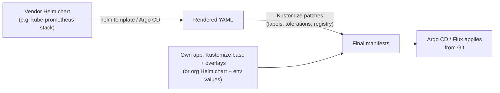

# Helm vs Kustomize

> Part of the [Helm notes](./README.md). Both tools manage Kubernetes YAML for different environments, but they take opposite approaches. Many teams use **both**.

---

## The core difference

| | **Helm** | **Kustomize** |
|---|---|---|
| Approach | **Templating**: YAML with `{{ }}` placeholders, filled from values | **Patching / overlays**: plain YAML base, plus patches per environment. No templates |
| Unit | Chart (packaged, versioned, published) | Kustomization directory (`kustomization.yaml`) |
| Config input | `values.yaml`, `-f`, `--set` | Overlays, patches, generators, transformers |
| Release tracking | **Yes**: revisions, history, `helm rollback` | **No**: it only produces YAML; `kubectl apply` or GitOps applies it |
| Lifecycle hooks | Yes (pre/post install/upgrade/delete, tests) | No |
| Dependencies | Yes (subcharts) | Remote bases/components (Git URLs), no versioned package system |
| Distribution | Charts in repos / OCI registries, Artifact Hub | Git repos |
| Built into kubectl | No (separate CLI) | **Yes**: `kubectl apply -k` / `kubectl kustomize` |
| Learning curve | Go templates, Helm concepts | Small: it's just YAML |
| Typical use | **Third-party apps**, shared org charts, distributing software | **Your own apps**' per-environment differences, patching others' YAML |

---

## The same change, both ways

Goal: an app with 1 replica in dev and 3 in prod, plus a prod-only label.

### Helm
```yaml
# templates/deployment.yaml
apiVersion: apps/v1
kind: Deployment
metadata:
  name: web
  labels:
    app: web
    {{- with .Values.extraLabels }}
    {{- toYaml . | nindent 4 }}
    {{- end }}
spec:
  replicas: {{ .Values.replicaCount }}
  selector: { matchLabels: { app: web } }
  template:
    metadata: { labels: { app: web } }
    spec:
      containers:
        - name: web
          image: "nginx:{{ .Values.image.tag }}"
```
```yaml
# values-dev.yaml
replicaCount: 1
image: { tag: "1.27" }
```
```yaml
# values-prod.yaml
replicaCount: 3
image: { tag: "1.27" }
extraLabels: { tier: critical }
```
```bash
helm upgrade --install web ./chart -f values-prod.yaml
```

### Kustomize
```plaintext
web/
├── base/
│   ├── kustomization.yaml
│   └── deployment.yaml          # plain, valid YAML; you can kubectl apply it directly
└── overlays/
    ├── dev/kustomization.yaml
    └── prod/
        ├── kustomization.yaml
        └── replicas-patch.yaml
```
```yaml
# base/deployment.yaml
apiVersion: apps/v1
kind: Deployment
metadata: { name: web, labels: { app: web } }
spec:
  replicas: 1
  selector: { matchLabels: { app: web } }
  template:
    metadata: { labels: { app: web } }
    spec:
      containers:
        - name: web
          image: nginx:1.27
```
```yaml
# base/kustomization.yaml
resources: [deployment.yaml]
```
```yaml
# overlays/prod/kustomization.yaml
resources: [../../base]
namespace: web-prod
labels:
  - pairs: { tier: critical }
    includeSelectors: false        # don't touch the immutable selector
images:
  - name: nginx
    newTag: "1.27"
patches:
  - path: replicas-patch.yaml
```
```yaml
# overlays/prod/replicas-patch.yaml (strategic merge patch: only the fields that change)
apiVersion: apps/v1
kind: Deployment
metadata: { name: web }
spec:
  replicas: 3
```
```bash
kubectl kustomize overlays/prod          # render
kubectl apply -k overlays/prod           # apply
```

---

## Kustomize features worth knowing

- **Patches**: strategic merge patches (partial YAML, as above) or JSON 6902 patches (`op: replace, path: /spec/replicas`), targeted by kind, name or label selector.
- **`images`**: change image name, tag or digest without touching YAML (`kustomize edit set image nginx=nginx:1.28`, which is how CI bumps tags in GitOps repos).
- **Generators**: `configMapGenerator` and `secretGenerator` create ConfigMaps and Secrets from files or literals with a **content hash in the name** (`app-config-7g8h9`). References are rewritten automatically, so a config change rolls the pods (Helm needs the checksum annotation for this).
- **`namespace`, `namePrefix`/`nameSuffix`, `labels`, `commonAnnotations`**: apply to every resource.
- **Components**: reusable optional bundles of patches (e.g. "add monitoring sidecar") that overlays opt into.
- **`replacements`**: copy a field from one resource into others.
- **`helmCharts`**: Kustomize can **inflate a Helm chart** and then patch it (`kustomize build --enable-helm`).

---

## Pros and cons

**Helm: strengths**
- Huge ecosystem: nearly every vendor ships an official chart.
- Real packaging: versioned charts, dependencies, OCI distribution.
- Release history and one-command rollback; hooks for migrations and tests.
- Values are a clean, documented interface for consumers who don't want to read YAML.

**Helm: weaknesses**
- Templates are harder to read and debug (indentation, `nindent`, scope); charts drift toward "a values key for every field".
- You can't see the real YAML without rendering it.
- Release Secrets hold your values; `lookup` and hooks behave differently under GitOps.

**Kustomize: strengths**
- Plain YAML everywhere: what you read is what gets applied (mostly).
- Built into kubectl; nothing to install, no release state to manage.
- Easy to patch YAML you don't own (vendor manifests, rendered charts).
- Hash-suffixed generated ConfigMaps give automatic rollouts.

**Kustomize: weaknesses**
- No packaging, versioning or release history; rollback is "apply the old commit".
- Many environments × many tweaks means lots of patch files.
- Not suited to distributing configurable software to others (no values API).

---

## How teams combine them



1. **Helm for third-party, Kustomize for your own apps**: the most common split.
2. **Helm + Kustomize post-render**: patch a vendor chart without forking it ([post-renderers](./advanced-helm.md#post-renderers), Argo CD's Helm + Kustomize, Flux `postRenderers`).
3. **Kustomize inflating Helm** (`helmCharts:` in kustomization.yaml): one Kustomize tree that includes vendor charts.
4. **An org-wide Helm chart for all services** with per-environment values in a GitOps repo: common when a platform team wants one standard for 100+ services.

---

## Which should I use? (decision guide)

- Installing someone else's software → **Helm** (use their chart).
- Publishing software for other teams or customers to install with their own config → **Helm**.
- Need hooks (migrations) or release rollback history without GitOps → **Helm**.
- Your own service, a few environment differences, GitOps → **Kustomize** (or a shared Helm chart, if the org standardises on one).
- Need to tweak a vendor chart's output → **Helm + Kustomize** post-render.

**Interview one-liner:** *"Helm is a package manager with templating and release management; Kustomize is template-free patching of plain YAML. I use Helm for third-party and shared charts, Kustomize for environment overlays, and often combine them through Argo CD."*
