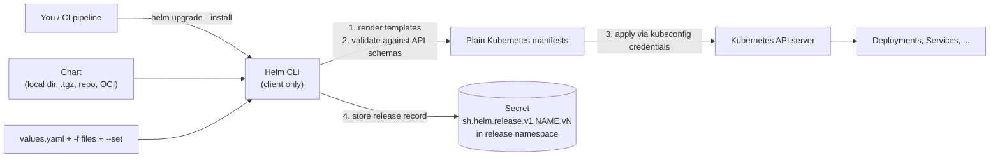
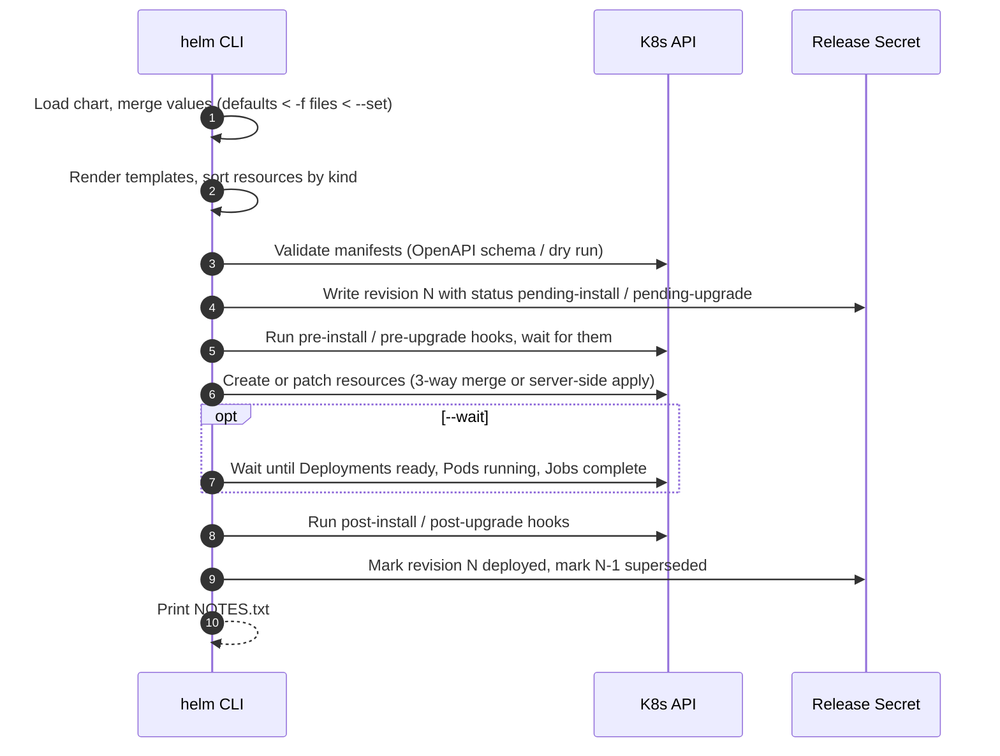

# Helm: Fundamentals & Architecture

> Part of the [Helm notes](./README.md). Next: [Chart Structure](./chart-structure.md) → [Templating](./templating.md) → [Commands](./helm-commands.md).

### Video Help
- Helm explained: https://www.youtube.com/watch?v=w51lDVuRWuk
- Creating your own chart: https://www.youtube.com/watch?v=jUYNS90nq8U

---

## What is Helm?

Helm is the **package manager for Kubernetes**, and a graduated CNCF project. It plays the role `apt`, `yum` or Homebrew play for an OS:

| OS package manager | Helm |
|---|---|
| Package (`.deb`, `.rpm`) | **Chart** (`.tgz`) |
| Repository (apt repo) | **Chart repository** or **OCI registry** |
| Installed package | **Release** |
| `apt install nginx` | `helm install web bitnami/nginx` |
| Package config in `/etc` | **Values** |
| `apt upgrade`, downgrade | `helm upgrade`, `helm rollback` |


### What problem does it solve?
A real application isn't one YAML file. A typical service has a Deployment, Service, Ingress, ConfigMap, Secret, ServiceAccount, RBAC, HPA, PDB and NetworkPolicy, and you need slightly different versions of all of them for dev, staging and prod. Without Helm you either:
- copy the YAML per environment and let the copies drift apart, or
- hand-edit values with `sed` in pipelines.

Helm gives you:
1. **Templating**: one set of manifests with placeholders, and a `values.yaml` per environment.
2. **Packaging and sharing**: a versioned chart you can publish and reuse (thousands are on [Artifact Hub](https://artifacthub.io)).
3. **Release management**: Helm tracks every install and upgrade as a numbered **revision**, so you can see history and **roll back** with one command.
4. **Lifecycle hooks**: run Jobs before or after install and upgrade (DB migrations, smoke tests).
5. **Dependency management**: a chart can pull in other charts (your app plus a Redis subchart).

---

## Core Concepts

| Concept | What it is |
|---|---|
| **Chart** | A package: a folder (or `.tgz`) of templates, default values and metadata that describes a Kubernetes application. |
| **Values** | The configuration you feed a chart. Defaults live in the chart's `values.yaml`; you override them with `-f file.yaml` or `--set key=val`. |
| **Template** | A Kubernetes manifest written in Go template syntax, e.g. `replicas: {{ .Values.replicaCount }}`. |
| **Release** | One installed instance of a chart in a cluster, with a name. Install the same chart twice and you get two releases (`web-blue`, `web-green`). |
| **Revision** | A numbered version of a release. Every `install`, `upgrade` and `rollback` creates a new one: 1, 2, 3... |
| **Repository** | Where charts are published: a classic HTTP repo with an `index.yaml`, or an **OCI registry** (ECR, ACR, GHCR, Harbor, Docker Hub). |
| **Chart version vs app version** | `version` in Chart.yaml is the chart's **own** SemVer (bump it when templates change). `appVersion` is the version of the **software inside** (e.g. nginx 1.27). They change independently. |

---

## Architecture: how Helm talks to the cluster




Key points:
- **Helm 3+ is client-only.** The CLI renders templates locally and talks to the Kubernetes API using **your kubeconfig credentials**. It can do exactly what your RBAC allows, nothing more.
- **Release state lives in the cluster**, as a Secret per revision in the release's namespace (type `helm.sh/release.v1`), holding the rendered manifest, values and chart metadata, gzipped and base64-encoded. That's why anyone with access can run `helm list` or `helm rollback`, with no server component.
- You can change the storage backend with `HELM_DRIVER=secret|configmap|sql|memory`. The default is `secret`.

```bash
kubectl get secrets -n prod -l owner=helm
# NAME                             TYPE                 DATA   AGE
# sh.helm.release.v1.payments.v1   helm.sh/release.v1   1      30d
# sh.helm.release.v1.payments.v2   helm.sh/release.v1   1      2d
```

---

## What happens during `helm install` / `helm upgrade`



- **Install order**: Helm applies resources in a fixed **kind order** (Namespace → NetworkPolicy → ResourceQuota → LimitRange → ServiceAccount → Secret → ConfigMap → StorageClass → PV/PVC → CRD → ClusterRole → Role → bindings → Service → DaemonSet → Pod → ReplicaSet → Deployment → StatefulSet → Job → CronJob → Ingress → APIService ...), and uninstalls in reverse.
- **Without `--wait`, "deployed" only means the API accepted the objects**, not that the pods are healthy. In CI always use `--wait` plus auto-rollback (`--rollback-on-failure` in Helm 4, `--atomic` in Helm 3) so a broken release fails the pipeline.

### Three-way merge (Helm 3)
On upgrade, Helm compares **three** states: the **old manifest** (from the last release), the **live state** in the cluster, and the **new manifest**. That means:
- If someone ran `kubectl scale --replicas=10` and your chart still says 3, an upgrade **resets it to 3**, because the chart is authoritative for fields it manages.
- Fields that other controllers added and Helm never managed (e.g. injected sidecars) are left alone.
- Helm 4 uses **Kubernetes server-side apply** by default for new releases, so field ownership is tracked by the API server itself (`managedFields`), and conflicts with other field managers (like an HPA) are explicit.

---

## Helm 2 vs Helm 3 vs Helm 4

| | Helm 2 (dead since 2020) | Helm 3 | Helm 4 (released Nov 2025) |
|---|---|---|---|
| Server component | **Tiller** in the cluster, often with cluster-admin (security hole) | **None**: client only, uses your RBAC | None |
| Release storage | ConfigMaps in `kube-system` | Secrets in the **release namespace** | Secrets in the release namespace |
| Release names | Global across cluster | **Per namespace** | Per namespace |
| Upgrade strategy | 2-way merge | **3-way merge** (client-side apply) | **Server-side apply** by default for new releases |
| Chart API | `apiVersion: v1` (`requirements.yaml`) | `apiVersion: v2` (dependencies in Chart.yaml) | v2 charts still work, chart API v3 in progress |
| OCI registries | No | Yes (GA in 3.8) | Yes, first-class |
| Plugins | Exec-style | Exec-style | New plugin system (incl. **WebAssembly** plugins); post-renderers become plugins |
| Waiting | Basic | `--wait` readiness checks | `--wait` strategies: `watcher` (kstatus-based), `legacy`, `hookOnly` (default when omitted) |
| Renamed flags | | `--atomic`, `--force` | `--rollback-on-failure`, `--force-replace` (old names deprecated) |

**Helm 3 end of life:** Helm 3 gets bug fixes until July 2026 and security fixes until November 2026. Most charts work unchanged on Helm 4. The main things to test are the flag renames, plugins and post-renderers, and server-side apply conflicts. Check the [official Helm 4 release notes](https://helm.sh/docs/) for the exact list before you upgrade CI.

```bash
helm version            # client version (there is no server version in Helm 3+)
# version.BuildInfo{Version:"v4.0.x", ...}
```

---

## Installing Helm

```bash
# macOS
brew install helm
# Linux (official release tarball: pick the version from https://github.com/helm/helm/releases)
HELM_VERSION=v4.0.0
curl -fsSL "https://get.helm.sh/helm-${HELM_VERSION}-linux-amd64.tar.gz" | tar xz
sudo mv linux-amd64/helm /usr/local/bin/helm
# Windows
winget install Helm.Helm        # or: choco install kubernetes-helm

helm version
helm completion zsh > "${fpath[1]}/_helm"   # shell completion (bash/zsh/fish/powershell)
```

In CI, **pin the Helm version** (e.g. `azure/setup-helm@v4` with `version: v4.0.x`) so a new Helm release can't change your pipeline's behaviour overnight.

Helm uses the same kubeconfig as `kubectl` (`KUBECONFIG`, `--kube-context`, `-n/--namespace`). Useful environment info:

```bash
helm env
# HELM_CACHE_HOME, HELM_CONFIG_HOME (repositories.yaml, registry config), HELM_DATA_HOME (plugins),
# HELM_DRIVER (release storage), HELM_NAMESPACE, HELM_KUBECONTEXT ...
```

---

## Where charts come from

1. **Classic HTTP repositories**: a web server with an `index.yaml` listing chart versions and URLs (GitHub Pages, S3, ChartMuseum, Artifactory, Nexus).
   ```bash
   helm repo add prometheus-community https://prometheus-community.github.io/helm-charts
   helm repo update
   helm search repo prometheus-community/kube-prometheus-stack --versions | head
   helm install mon prometheus-community/kube-prometheus-stack -n monitoring --create-namespace
   ```
2. **OCI registries** (the modern default): charts stored like container images. No `repo add` needed.
   ```bash
   helm install podinfo oci://ghcr.io/stefanprodan/charts/podinfo --version 6.7.1
   helm push mychart-1.2.0.tgz oci://123456789012.dkr.ecr.ap-south-1.amazonaws.com/charts
   ```
3. **Local directories or `.tgz` files**: `helm install web ./charts/web`.
4. **Discovering charts**: [Artifact Hub](https://artifacthub.io) (`helm search hub <name>`), which shows publisher, security report and whether the chart is from a verified publisher.

> **Bitnami note:** since late 2025 Bitnami (Broadcom) moved most free container images to a `bitnamilegacy` repository and changed what's freely published, so many older tutorials using `bitnami/*` charts no longer work out of the box. Prefer the project's own official chart (e.g. `prometheus-community/kube-prometheus-stack`, `jetstack/cert-manager`, `grafana/loki`), or pin and mirror the images into your own registry.

---

## Quick start: your first release

```bash
# 1. Install a demo chart into its own namespace
helm install demo oci://ghcr.io/stefanprodan/charts/podinfo \
  --namespace demo --create-namespace \
  --set replicaCount=2

# 2. See what you've got
helm list -n demo
helm status demo -n demo
kubectl get all -n demo

# 3. Change config: upgrade creates revision 2
helm upgrade demo oci://ghcr.io/stefanprodan/charts/podinfo -n demo \
  --reuse-values --set replicaCount=3

# 4. History and rollback
helm history demo -n demo
helm rollback demo 1 -n demo      # creates revision 3 = copy of revision 1

# 5. Clean up
helm uninstall demo -n demo
```

---

## When to use Helm (and when not)

**Use Helm when:**
- You install third-party software (Prometheus, cert-manager, Argo CD, Vault, Karpenter): the vendor's chart is the supported install path.
- You run many similar services and want one standard chart (or a [library chart](./advanced-helm.md#library-charts)) with per-service values.
- You need packaging, versioning and distribution of your app to other teams or customers.

**Consider alternatives when:**
- You only need small per-environment differences to plain YAML: **Kustomize** is simpler (see [Helm vs Kustomize](./helm-vs-kustomize.md)).
- You're building complex logic in templates: that's a sign you need an **operator** or a real programming language (cdk8s, Pulumi), not more template `if`s.
- Many teams combine them: Helm for third-party apps, Kustomize overlays (or Argo CD with Helm values) for their own.

---

## Summary

- Helm = charts (packages) + values (config) + releases (installed instances with revision history).
- Helm 3/4 is client-only, uses your RBAC, and stores release history as Secrets in the release namespace.
- Upgrades use a 3-way merge (Helm 3) or server-side apply (Helm 4); use `--wait` and auto-rollback in CI.
- Charts come from HTTP repos, OCI registries or local folders; prefer official charts and pin versions.

**Continue:** [Chart Structure](./chart-structure.md) → [Templating](./templating.md) → [Commands](./helm-commands.md) → [Creating a Chart](./creating-helm-chart.md) → [Advanced Helm](./advanced-helm.md) → [Helm in Production](./helm-in-production.md).
