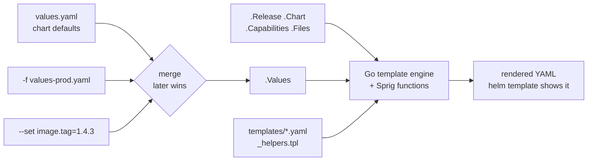
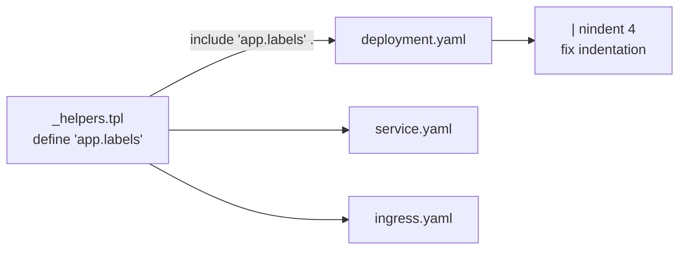

# Helm Templating: The Complete Guide

> Part of the [Helm notes](./README.md). Previous: [Chart Structure](./chart-structure.md). Next: [Commands](./helm-commands.md).

Helm templates use **Go's `text/template`** language plus the **Sprig** function library and some Helm-specific functions. Everything between `{{ }}` is an *action*; everything else is copied to the output unchanged.

**Golden rule while learning:** render, don't guess.
```bash
helm template demo ./web -f values-prod.yaml              # print everything
helm template demo ./web -s templates/deployment.yaml     # print one file
helm template demo ./web --debug                          # show the broken YAML when rendering fails
```

---

## 1. Values and built-in objects

How a chart becomes manifests:



```yaml
replicas: {{ .Values.replicaCount }}
namespace: {{ .Release.Namespace }}
chart: {{ .Chart.Name }}-{{ .Chart.Version }}
```
- `.` is the **current scope**. At the top level of a template it's the root object, holding `.Values`, `.Release`, `.Chart`, `.Capabilities`, `.Template`, `.Files`.
- Values with dashes in their names need `index`: `{{ index .Values "my-key" }}`.
- A missing key renders as **empty** (or `<no value>` for some types), not an error. Use `required` to fail instead (see below).

The full list of built-in objects is in [Chart Structure](./chart-structure.md#built-in-objects-available-in-templates).

---

## 2. Pipelines and functions

Functions can be called directly or **piped**. In a pipeline the value on the left becomes the **last** argument of the function on the right:

```yaml
name: {{ upper .Values.name }}                     # direct call
name: {{ .Values.name | upper | quote }}           # pipeline: same as quote (upper .Values.name)
tag: {{ .Values.image.tag | default .Chart.AppVersion | quote }}
port: {{ .Values.port | default 8080 }}
```

### The functions you'll use most

| Category | Functions | Example |
|---|---|---|
| Defaults & checks | `default`, `required`, `empty`, `coalesce`, `ternary`, `fail` | `{{ required "image.repository is required" .Values.image.repository }}` |
| Strings | `quote`, `squote`, `upper`, `lower`, `title`, `trim`, `trimSuffix`, `trimPrefix`, `trunc`, `replace`, `contains`, `hasPrefix`, `hasSuffix`, `printf`, `nospace`, `abbrev` | `{{ printf "%s-%s" .Release.Name "db" \| trunc 63 }}` |
| YAML/JSON | `toYaml`, `fromYaml`, `toJson`, `fromJson`, `toPrettyJson`, `toToml` | `{{- toYaml .Values.resources \| nindent 12 }}` |
| Indentation | `indent N`, `nindent N` (newline + indent) | see section 6 |
| Lists | `list`, `first`, `last`, `append`, `prepend`, `concat`, `uniq`, `has`, `without`, `compact`, `join`, `split`, `splitList`, `until`, `sortAlpha` | `{{ join "," .Values.hosts }}` |
| Dicts | `dict`, `get`, `set`, `unset`, `hasKey`, `keys`, `values`, `pick`, `omit`, `merge`, `mergeOverwrite`, `dig`, `deepCopy` | `{{ dig "a" "b" "default" .Values }}` |
| Math | `add`, `sub`, `mul`, `div`, `mod`, `max`, `min`, `int`, `float64`, `round` | `{{ mul .Values.replicas 2 }}` |
| Encoding & hashing | `b64enc`, `b64dec`, `sha256sum`, `sha1sum`, `adler32sum` | `{{ .Values.password \| b64enc }}` |
| Versions | `semver`, `semverCompare` | `{{ if semverCompare ">=1.30-0" .Capabilities.KubeVersion.Version }}` |
| Types | `kindOf`, `kindIs`, `typeOf`, `toString`, `atoi`, `int64` | `{{ if kindIs "map" .Values.env }}` |
| Regex | `regexMatch`, `regexFind`, `regexReplaceAll` | `{{ regexReplaceAll "[^a-z0-9-]" .Values.name "-" }}` |
| Crypto / random | `randAlphaNum`, `uuidv4`, `genCA`, `genSignedCert`, `htpasswd`, `bcrypt` | Avoid in GitOps: output changes on every render |
| Helm-specific | `include`, `tpl`, `required`, `lookup`, `toYaml`, `fromYaml`, `.Files.*` | sections below |

Comparisons and logic are functions too: `eq`, `ne`, `lt`, `le`, `gt`, `ge`, `and`, `or`, `not`.
```yaml
{{- if and .Values.ingress.enabled (eq .Values.service.type "ClusterIP") }}
{{- if or (eq .Values.env "prod") (gt (int .Values.replicaCount) 3) }}
```

---

## 3. Whitespace control: `{{-` and `-}}`

A `-` trims **all whitespace including newlines** on that side of the action. Without it, every `{{ if }}` line leaves a blank line behind; with too much of it, lines get glued together.

```yaml
metadata:
  labels:
    app: web
    {{- if .Values.team }}
    team: {{ .Values.team }}
    {{- end }}
```
Renders (with team set) as:
```yaml
metadata:
  labels:
    app: web
    team: payments
```
Rule of thumb: put `{{-` on control lines (`if`, `range`, `with`, `end`, `define`) and leave value actions plain. If output looks wrong, run `helm template` and look at it.

---

## 4. Control flow

### `if / else if / else`
```yaml
{{- if .Values.ingress.enabled }}
apiVersion: networking.k8s.io/v1
kind: Ingress
...
{{- end }}

type: {{ if .Values.public }}LoadBalancer{{ else if .Values.nodePort }}NodePort{{ else }}ClusterIP{{ end }}
```
A value is **false** if it's `false`, `0`, `""`, `nil`, or an empty list or map. Watch out: the string `"false"` (e.g. from `--set-string`) is **true**.

### `with`: change scope
`with` sets `.` to the value, and skips the block entirely if the value is empty, which is perfect for optional blocks:
```yaml
{{- with .Values.nodeSelector }}
nodeSelector:
  {{- toYaml . | nindent 2 }}
{{- end }}
```
Inside `with`, `.Values` **no longer works** because `.` is now the nodeSelector map. Use **`$`**, which always points to the root:
```yaml
{{- with .Values.ingress }}
  ingressClassName: {{ .className }}
  release: {{ $.Release.Name }}      # $ = root scope
{{- end }}
```

### `range`: loop over lists and maps
```yaml
# list
ports:
{{- range .Values.ports }}
  - name: {{ .name }}
    port: {{ .port }}
{{- end }}

# list with index
{{- range $i, $host := .Values.hosts }}
  - host-{{ $i }}: {{ $host }}
{{- end }}

# map (sorted by key, so output is stable)
env:
{{- range $key, $value := .Values.env }}
  - name: {{ $key }}
    value: {{ $value | quote }}
{{- end }}

# fixed number of times
{{- range $i := until 3 }}
  - shard-{{ $i }}
{{- end }}
```
Inside `range`, `.` is the current element, so again use `$` for root values: `{{ $.Values.image.tag }}`.

### Variables
```yaml
{{- $fullName := include "web.fullname" . -}}
{{- $svcPort := .Values.service.port -}}
{{- range .Values.ingress.hosts }}
  - host: {{ .host }}
    backend: { service: { name: {{ $fullName }}, port: { number: {{ $svcPort }} } } }
{{- end }}
```
`:=` declares, `=` reassigns. Variables are scoped to the block where they're declared.

---

## 5. Named templates: `define`, `include`, `template`



```yaml
{{/* templates/_helpers.tpl */}}
{{- define "web.labels" -}}
app.kubernetes.io/name: {{ .Chart.Name }}
app.kubernetes.io/instance: {{ .Release.Name }}
{{- end }}
```
```yaml
metadata:
  labels:
    {{- include "web.labels" . | nindent 4 }}
```
- **Always pass a scope** (usually `.`) as the second argument. Inside the named template, `.` is whatever you passed.
- Use **`include`, not `template`**. `template` writes output directly and can't be piped, so you can't fix indentation with `nindent`. `include` returns a string you can pipe.
- Template names are **global** across parent and subcharts: prefix with the chart name (`web.labels`, not `labels`).

### Passing several arguments
A named template only takes one argument, so pass a `dict`:
```yaml
{{- define "web.container" -}}
- name: {{ .name }}
  image: {{ .image }}
  env:
    - name: RELEASE
      value: {{ .root.Release.Name }}
{{- end }}

containers:
  {{- include "web.container" (dict "name" "app" "image" .Values.image.repository "root" $) | nindent 2 }}
```

---

## 6. Indentation: `toYaml`, `indent`, `nindent`

YAML is indentation-sensitive, so this is where most template bugs come from.

```yaml
# values.yaml
resources:
  requests: { cpu: 100m, memory: 128Mi }
  limits: { memory: 256Mi }
```
```yaml
# template: nindent 12 = newline, then indent every line 12 spaces
        containers:
          - name: app
            resources:
              {{- toYaml .Values.resources | nindent 14 }}
```
Renders:
```yaml
        containers:
          - name: app
            resources:
              limits:
                memory: 256Mi
              requests:
                cpu: 100m
                memory: 128Mi
```
- Use `nindent` after `{{-` (the dash removed the newline, and `nindent` adds it back), which is the idiomatic pattern.
- Count the spaces of the **key the block belongs under**, plus 2.
- `toYaml` sorts keys alphabetically.

---

## 7. Fail early: `required` and `fail`

```yaml
image: {{ required "A valid .Values.image.repository is required!" .Values.image.repository }}

{{- if and .Values.autoscaling.enabled (lt (int .Values.autoscaling.maxReplicas) (int .Values.autoscaling.minReplicas)) }}
{{- fail "autoscaling.maxReplicas must be >= minReplicas" }}
{{- end }}
```
These turn a bad deploy into a clear error at render time. For broad validation, use [`values.schema.json`](./chart-structure.md#valuesschemajson-validating-values).

---

## 8. `tpl`: render a string as a template

Lets users put template expressions **inside values**:
```yaml
# values.yaml
configUrl: "https://{{ .Release.Name }}-config.{{ .Release.Namespace }}.svc"
extraConfig: |
  log_level: info
  service_name: {{ include "web.fullname" . }}
```
```yaml
# template
- name: CONFIG_URL
  value: {{ tpl .Values.configUrl . | quote }}
data:
  extra.yaml: |
    {{- tpl .Values.extraConfig . | nindent 4 }}
```
Without `tpl`, the braces would be printed literally.

---

## 9. Working with files: `.Files`

Non-template files inside the chart (not in `templates/`, not excluded by `.helmignore`) can be read:

```plaintext
web/
├── config/
│   ├── app.yaml
│   └── logging.xml
└── templates/configmap.yaml
```
```yaml
apiVersion: v1
kind: ConfigMap
metadata:
  name: {{ include "web.fullname" . }}
data:
  # one file
  app.yaml: |-
    {{- .Files.Get "config/app.yaml" | nindent 4 }}
  # or every file under config/ as keys
  {{- (.Files.Glob "config/*").AsConfig | nindent 2 }}
---
apiVersion: v1
kind: Secret
metadata:
  name: {{ include "web.fullname" . }}-certs
type: Opaque
data:
  {{- (.Files.Glob "certs/*").AsSecrets | nindent 2 }}   # base64-encoded automatically
```
You can't read files outside the chart, and the files count toward the release Secret's size limit (about 1 MB).

---

## 10. Restarting pods when config changes: the checksum pattern

Changing a ConfigMap doesn't restart the pods using it. Put a hash of the ConfigMap in the pod template, so any config change changes the pod spec and triggers a rolling update:

```yaml
spec:
  template:
    metadata:
      annotations:
        checksum/config: {{ include (print $.Template.BasePath "/configmap.yaml") . | sha256sum }}
        checksum/secret: {{ include (print $.Template.BasePath "/secret.yaml") . | sha256sum }}
```
(This only works if those template files exist in the chart. Alternatives: an operator like Reloader, or Kustomize's hashed ConfigMap names.)

---

## 11. Checking the cluster: `.Capabilities` and `lookup`

```yaml
{{- if .Capabilities.APIVersions.Has "gateway.networking.k8s.io/v1/HTTPRoute" }}
apiVersion: gateway.networking.k8s.io/v1
kind: HTTPRoute
...
{{- end }}

{{- if semverCompare ">=1.33-0" .Capabilities.KubeVersion.Version }}
# use a field only available in newer clusters
{{- end }}
```
**`lookup`** reads live objects from the cluster during install or upgrade:
```yaml
{{- $existing := lookup "v1" "Secret" .Release.Namespace "web-db-password" }}
{{- $password := "" }}
{{- if $existing }}
{{- $password = index $existing.data "password" }}            {{/* keep the old one on upgrade */}}
{{- else }}
{{- $password = randAlphaNum 32 | b64enc }}                     {{/* generate on first install */}}
{{- end }}
apiVersion: v1
kind: Secret
metadata: { name: web-db-password }
data: { password: {{ $password }} }
```
Caveats: `lookup` returns an **empty map** under `helm template`, `--dry-run` (client) and in **Argo CD / Flux** rendering, so charts that depend on it behave differently in GitOps. Prefer external secret managers over generating secrets in templates.

---

## 12. Comments

```yaml
{{/* Template comment: never appears in output */}}
# YAML comment: appears in the rendered manifest (and may leak template details)
```

---

## 13. Common templating mistakes

| Symptom | Cause | Fix |
|---|---|---|
| `error converting YAML to JSON: yaml: line 12: did not find expected key` | Wrong indentation | Use `helm template --debug`, fix `nindent` count |
| `nil pointer evaluating interface {}.tag` | Parent key missing (`.Values.image` not set) | Provide defaults in values.yaml, or use `dig`, or wrap in `with` |
| `.Values` empty inside a block | Inside `with`/`range`, `.` changed | Use `$.Values...` |
| Port or number rendered as `"8080"` vs `8080` mismatch | `quote` on numbers, or `--set` turning things into strings | Don't quote ints; use `--set-string` only for strings; `int` to convert |
| Value `"true"`/`"false"` treated as true | String from `--set-string` | Use `--set` for booleans, or `eq .Values.x "true"` |
| Long names fail with `must be no more than 63 characters` | Release + chart name too long | `trunc 63 \| trimSuffix "-"` in name helpers |
| `field is immutable` on upgrade | Selector labels changed | Never change selector labels; use a new Deployment name if you must |
| Diff shows changes every deploy | `randAlphaNum`, `now`, `uuidv4` in templates | Remove randomness; use `lookup` or external secrets |
| Big number like `1e+06` | YAML/JSON float conversion of large ints | `--set-string` or `int64` / `toString` |

---

## 14. Practice exercise

Given these values:
```yaml
app: { name: orders, port: 8080 }
env: { LOG_LEVEL: info, REGION: ap-south-1 }
ingress:
  enabled: true
  hosts: [orders.corp.com, orders-dr.corp.com]
```
Write a template producing a Service and (only when enabled) an Ingress with a rule per host. Then check it with `helm template`. One possible answer:

```yaml
apiVersion: v1
kind: Service
metadata:
  name: {{ .Values.app.name }}
spec:
  selector: { app: {{ .Values.app.name }} }
  ports: [{ port: 80, targetPort: {{ .Values.app.port }} }]
{{- if .Values.ingress.enabled }}
---
apiVersion: networking.k8s.io/v1
kind: Ingress
metadata:
  name: {{ .Values.app.name }}
spec:
  rules:
  {{- range .Values.ingress.hosts }}
    - host: {{ . }}
      http:
        paths:
          - path: /
            pathType: Prefix
            backend:
              service: { name: {{ $.Values.app.name }}, port: { number: 80 } }
  {{- end }}
{{- end }}
```

**Next:** [Commands](./helm-commands.md).
