# AWS Networking Deep Dive (VPC, Subnets, Route Tables, Gateways, Endpoints, Transit Gateway, Hybrid, DNS, Troubleshooting) — Interview Questions & Answers

> Part of the [Interview Questions](./README.md) hub. A complete AWS networking round, from CIDR planning to multi-account hub-and-spoke designs, with flow diagrams for how packets actually move. Short overviews also live in [07 Q7–8, Q18, Q26, Q34](./07-aws-cloud-qna.md) and [24 Q11, Q25–27](./24-aws-deep-dive-qna.md). On-prem VPN and Direct Connect details are in [34 Q10–12](./34-onprem-banking-infrastructure-qna.md).
>
> Prices quoted are approximate us-east-1 list prices, to show *relative* cost. Check the current pricing page before quoting exact numbers.

---

## Table of Contents
- [VPC & CIDR Planning](#vpc--cidr-planning)
- [Subnets](#subnets)
- [Route Tables](#route-tables)
- [Internet Gateway, NAT Gateway & Egress](#internet-gateway-nat-gateway--egress)
- [Packet Walks (Flow Diagrams)](#packet-walks-flow-diagrams)
- [Security Groups & NACLs](#security-groups--nacls)
- [ENIs, Elastic IPs & Public IPv4](#enis-elastic-ips--public-ipv4)
- [VPC Endpoints & PrivateLink](#vpc-endpoints--privatelink)
- [VPC Peering vs Transit Gateway](#vpc-peering-vs-transit-gateway)
- [Hybrid Connectivity](#hybrid-connectivity)
- [DNS in a VPC (Route 53 Resolver)](#dns-in-a-vpc-route-53-resolver)
- [Load Balancers, CloudFront & Global Accelerator](#load-balancers-cloudfront--global-accelerator)
- [Network Security & Visibility](#network-security--visibility)
- [IPv6](#ipv6)
- [Multi-Account Network Architecture](#multi-account-network-architecture)
- [Network Cost](#network-cost)
- [Troubleshooting Scenarios](#troubleshooting-scenarios)
- [Design Round](#design-round)

---

## VPC & CIDR Planning

### 1. What is a VPC, and what do you get by default?
A **Virtual Private Cloud** is a logically isolated network in one AWS **region**, spanning all its Availability Zones. You choose its IPv4 CIDR block (between /16 and /28) and optionally an IPv6 block. A new VPC comes with:
- A **main route table** with one `local` route (the VPC CIDR to `local`), so everything inside the VPC can reach everything else.
- A **default NACL** that allows all traffic in and out.
- A **default security group** that allows all traffic from members of the same group and all outbound traffic.
- A **DHCP options set** (domain name, DNS servers = AmazonProvidedDNS).
There's no internet access until you add an Internet Gateway *and* a route to it. Each account also has a **default VPC** per region (172.31.0.0/16, a public subnet per AZ, an IGW already attached). It's fine for experiments, but production should use purpose-built VPCs.

### 2. How do you choose CIDR ranges for VPCs?
- Use RFC 1918 private space (10.0.0.0/8, 172.16.0.0/12, 192.168.0.0/16). Most enterprises use 10/8.
- **Never overlap** with on-prem networks, other VPCs, partner networks, or anything you might ever connect to. Overlapping CIDRs can't be peered or routed through a Transit Gateway, and fixing that later means re-IPing or NAT workarounds.
- **Size generously.** You can't resize a CIDR, only add **secondary CIDRs** (up to 5 by default). EKS especially uses a lot of IPs, because each pod gets a VPC IP. A /16 (65,536 addresses) per production VPC is common.
- Plan centrally with **Amazon VPC IPAM**: pools per region and environment (e.g. 10.0.0.0/12 for prod in ap-south-1), allocation rules, and overlap detection across the AWS Organization.
- Keep 100.64.0.0/10 (carrier-grade NAT space) in mind as secondary CIDRs for EKS pods. They're non-routable outside the VPC and save scarce corporate 10.x space.

A typical enterprise IP plan:

| Range | Use |
|---|---|
| 10.0.0.0/12 | AWS prod (ap-south-1), one /16 per VPC |
| 10.16.0.0/12 | AWS non-prod |
| 10.32.0.0/12 | AWS DR region (ap-south-2) |
| 10.100.0.0/14 | On-prem data centers (reserved, never used in AWS) |
| 100.64.0.0/16 | EKS pod secondary CIDR (reused per VPC, not routed) |

### 3. Why does a /24 subnet give you 251 usable IPs, not 256?
AWS reserves **5 addresses in every subnet**. In 10.0.1.0/24:
- `10.0.1.0`: network address.
- `10.0.1.1`: the **VPC router** (the implicit router, your default gateway).
- `10.0.1.2`: the **Amazon DNS resolver**. Strictly it's always the VPC base CIDR +2 (10.0.0.2 here), and AWS reserves +2 in each subnet too.
- `10.0.1.3`: reserved for future use.
- `10.0.1.255`: broadcast address (VPCs don't support broadcast, but it's reserved anyway).
So a /28, the smallest subnet, has 16 − 5 = **11** usable IPs. This comes up in sizing questions: a /24 for an EKS node group with 30 pods per node only holds about 8 nodes.

---

## Subnets

### 4. What exactly makes a subnet "public" or "private"?
**Only its route table.** There's no "public" setting on a subnet.
- **Public subnet**: its route table has `0.0.0.0/0 → igw-xxxx`. Instances also need a public IPv4 or Elastic IP to be reachable from the internet (the "auto-assign public IPv4" setting controls this at launch).
- **Private subnet**: no route to an IGW. Outbound internet, if needed, goes `0.0.0.0/0 → nat-xxxx` (a NAT gateway in a public subnet).
- **Isolated subnet** (sometimes called "private, no egress"): no route to the internet at all, only `local` and VPC endpoints. Use it for databases and the most sensitive tiers.
A subnet lives in exactly **one AZ**, and can't span AZs.

### 5. Draw a standard production VPC layout.
Three tiers across three AZs, each tier in its own subnet per AZ:

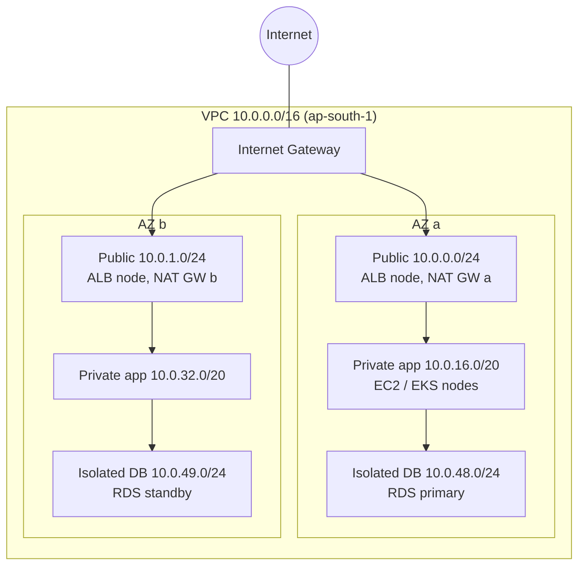

Design points to say out loud:
- **Public subnets are small** (/24). Only load balancers, NAT gateways and maybe bastions live there, never application servers.
- **App subnets are big** (/20 or larger), because that's where EC2, EKS nodes and pods consume IPs.
- **One NAT gateway per AZ**, and each AZ's private route table points to the NAT in *its own* AZ. That avoids cross-AZ data charges and means one AZ failing doesn't take out egress for the others.
- DB subnets have no internet route. RDS uses a **DB subnet group** that spans at least 2 AZs.
- Leave unallocated space in the VPC CIDR for future tiers (endpoints, a firewall subnet, TGW attachment subnets).

### 6. Why do some designs have dedicated small subnets for Transit Gateway attachments and endpoints?
- **TGW attachment subnets** (/28 per AZ): the TGW puts an ENI in the subnet you choose. A dedicated subnet with its own route table lets you control traffic coming *from* the TGW separately (for example, sending it to an inspection firewall), and keeps NACLs on app subnets from interfering with TGW traffic.
- **Endpoint subnets**: interface endpoints use one IP per AZ. Grouping them makes security groups and NACLs simpler to reason about.
- **Firewall subnets**: AWS Network Firewall endpoints need their own subnets so routing can send traffic *through* them (see Q38).

---

## Route Tables

### 7. How do route tables work, and how is a route chosen?
- Every subnet is associated with **exactly one** route table: either one you associate explicitly, or the **main** route table by default. One route table can serve many subnets.
- A route is a **destination CIDR (or prefix list) → target**. Targets include `local`, an IGW, a NAT gateway, a TGW, a peering connection, a VPC endpoint (gateway type), a virtual private gateway, an ENI or instance (appliances), an egress-only IGW, and a Gateway Load Balancer endpoint.
- **Longest prefix match wins.** For a packet to 10.1.5.7, the route `10.1.5.0/24 → pcx-...` beats `10.0.0.0/8 → tgw-...`, which beats `0.0.0.0/0 → nat-...`.
- The **`local` route** for the VPC CIDR is always there and can't be deleted. You *can* add a more specific route inside the VPC range that points to a firewall appliance (middlebox routing) to inspect traffic between subnets.
- Route tables only decide the **next hop** for traffic *leaving* a subnet. They don't filter anything. That's what security groups and NACLs do.

### 8. Show the route tables for a three-tier VPC.

**Public subnet route table**

| Destination | Target | Why |
|---|---|---|
| 10.0.0.0/16 | local | Talk to the rest of the VPC |
| 0.0.0.0/0 | igw-0abc | Internet in and out |

**Private app route table, AZ a** (one per AZ)

| Destination | Target | Why |
|---|---|---|
| 10.0.0.0/16 | local | Rest of the VPC |
| 10.0.0.0/8 | tgw-0123 | Other VPCs and on-prem through the Transit Gateway |
| pl-xxxx (S3 prefix list) | vpce-s3 | S3 through a gateway endpoint, which skips NAT charges |
| 0.0.0.0/0 | nat-aaaa | Internet egress through the NAT in the **same AZ** |

**Isolated DB route table**

| Destination | Target | Why |
|---|---|---|
| 10.0.0.0/16 | local | Only the VPC |

The same in Terraform:

```hcl
resource "aws_route_table" "private_a" {
  vpc_id = aws_vpc.main.id
  route {
    cidr_block     = "0.0.0.0/0"
    nat_gateway_id = aws_nat_gateway.a.id
  }
  route {
    cidr_block         = "10.0.0.0/8"
    transit_gateway_id = aws_ec2_transit_gateway.hub.id
  }
  tags = { Name = "rt-private-app-a" }
}

resource "aws_route_table_association" "private_a" {
  subnet_id      = aws_subnet.app_a.id
  route_table_id = aws_route_table.private_a.id
}

resource "aws_vpc_endpoint" "s3" {
  vpc_id            = aws_vpc.main.id
  service_name      = "com.amazonaws.ap-south-1.s3"
  vpc_endpoint_type = "Gateway"
  route_table_ids   = [aws_route_table.private_a.id, aws_route_table.private_b.id]  # adds the pl- route
}
```

### 9. What's the main route table, and why shouldn't you rely on it?
The main route table is used by any subnet that **isn't explicitly associated** with another route table. If someone adds `0.0.0.0/0 → igw` to the main table, every new subnet created without an explicit association becomes public by accident. Good practice: leave the main route table with only the `local` route, and **explicitly associate** every subnet with a purpose-built table. With Terraform, manage the associations in code.

### 10. What is a gateway route table (edge association)?
Normally route tables attach to subnets. A **gateway route table** attaches to an **Internet Gateway or virtual private gateway** and controls traffic *coming in* through that gateway. The main use is ingress inspection: route inbound traffic for the app subnet's CIDR to a firewall appliance or a Gateway Load Balancer endpoint *before* it reaches the application, without changing the application's subnets.

---

## Internet Gateway, NAT Gateway & Egress

### 11. What does an Internet Gateway actually do?
An IGW is a horizontally scaled, highly available, managed gateway attached to one VPC (one IGW per VPC). It does two things:
1. It's the **route target** for internet traffic.
2. It performs **1:1 NAT** between an instance's private IP and its public IPv4 or Elastic IP. The instance's OS only ever sees its private IP. The public IP exists only at the IGW. That's why `ip addr` on an EC2 instance never shows the public address.
There's no bandwidth limit to manage and no charge for the IGW itself (data transfer out is charged).

### 12. How does a NAT gateway work, and how is it different from an IGW?
A **NAT gateway** lets instances in private subnets make **outbound** connections (OS updates, external APIs) while staying unreachable from the internet.
- It sits in a **public** subnet with an Elastic IP. Private route tables send `0.0.0.0/0` to it.
- It does **many-to-one source NAT (PAT)**: it rewrites the source to its own private IP, and the IGW then maps that to the Elastic IP. Return traffic for connections that started inside is allowed back; new inbound connections are impossible.
- It's managed and scales up to 100 Gbps. It's **zonal**: if its AZ fails, it fails. So create one per AZ.
- It supports up to **55,000 simultaneous connections to each unique destination** (IP, port, protocol) per assigned IP. Busy workloads calling one API can hit `ErrorPortAllocation`. Add secondary IPs to the NAT gateway to fix it.
- **Cost**: about $0.045/hour plus **$0.045 per GB processed**. That per-GB charge is why NAT is often one of the biggest lines on a networking bill (see Q47).
- A **private NAT gateway** (no EIP) NATs between private networks, e.g. letting a VPC with an overlapping CIDR reach on-prem through the TGW using a routable IP.

| | Internet Gateway | NAT Gateway |
|---|---|---|
| Direction | Inbound and outbound | Outbound only (plus return traffic) |
| NAT type | 1:1 (private ↔ public IP) | Many:1 (PAT) |
| Lives in | Attached to the VPC | A public subnet, per AZ |
| Instances need public IP | Yes | No |
| Cost | Free (data out charged) | Hourly + per-GB processed |

### 13. NAT gateway vs NAT instance?
A NAT instance is an EC2 instance you configure to do NAT (with **source/destination check disabled**, iptables masquerade). It's cheaper for tiny workloads and lets you use it as a bastion or add custom filtering, but you own patching, scaling, HA failover and bandwidth limits tied to the instance size. NAT gateways are the default choice. NAT instances only make sense for small non-prod setups trying to save money.

### 14. What is an egress-only Internet Gateway?
The IPv6 equivalent of a NAT gateway's *behaviour*. IPv6 addresses in AWS are globally unique and public, so no NAT is needed; but you often want "outbound only". An **egress-only IGW** is stateful: it allows outbound IPv6 connections and their return traffic, and blocks connections started from the internet. Route `::/0 → eigw-xxxx` in private subnets. It's free, with no per-GB processing charge.

---

## Packet Walks (Flow Diagrams)

### 15. Walk through a user request from the internet to an app in a private subnet behind an ALB.

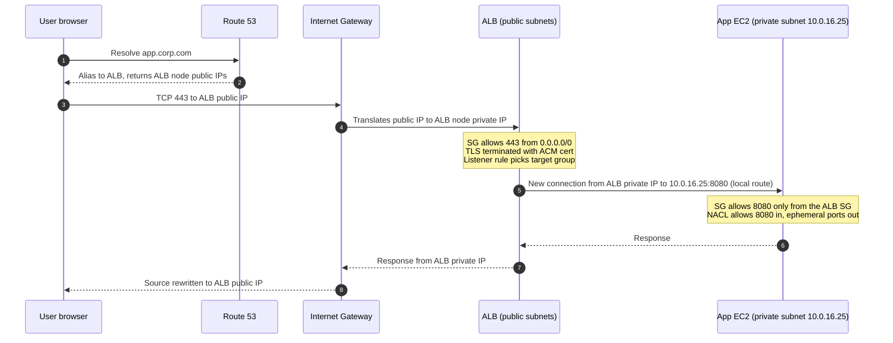

Key points:
- The ALB has **nodes in each public subnet** you select, each with its own IP. DNS returns several.
- The ALB **opens a new connection** to the target. The app sees the ALB's private IP as the source, and the real client IP arrives in the `X-Forwarded-For` header. An NLB can instead preserve the client IP.
- The app instance needs **no public IP** and no route to the IGW for this to work. The response goes back to the ALB inside the VPC.
- Security: the app's SG references the **ALB's SG**, not CIDRs, so only the load balancer can reach it.

### 16. Walk through a private instance downloading a package from the internet.

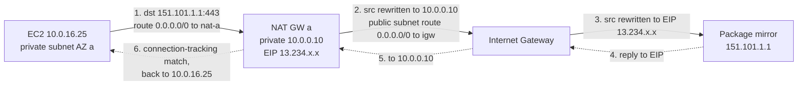

What has to be true for it to work:
1. The private subnet's route table has `0.0.0.0/0 → nat-gw`.
2. The NAT gateway is in a **public** subnet whose route table has `0.0.0.0/0 → igw`.
3. The NAT gateway has an Elastic IP.
4. The instance's SG allows outbound 443 (allowed by default). The NACLs on **both** the private and the public subnet allow outbound 443 and inbound ephemeral ports 1024–65535 for the replies.
5. DNS works (the VPC's `enableDnsSupport` is on) so the hostname resolves.
6. The destination sees the **NAT's Elastic IP**, which is why partners can allow-list a fixed IP for your traffic.

### 17. Walk through traffic between two VPCs and on-prem through a Transit Gateway.

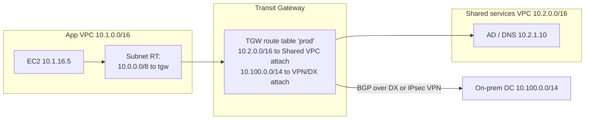

1. The EC2's subnet route table sends 10.0.0.0/8 to the TGW attachment ENI in that AZ.
2. The TGW looks up the destination in the **TGW route table associated with the source attachment**, and forwards to the destination attachment.
3. The destination VPC's subnet route table must have a **return route** to 10.1.0.0/16 through the TGW. A missing return route is the most common TGW bug.
4. SGs and NACLs at both ends still have to allow the traffic.

---

## Security Groups & NACLs

### 18. Compare security groups and network ACLs in depth.

| | Security Group | Network ACL |
|---|---|---|
| Applies to | An **ENI** (instance, ENI of an RDS/ALB/Lambda/endpoint) | A **subnet** (everything in it) |
| State | **Stateful**: return traffic allowed automatically | **Stateless**: return traffic must be allowed explicitly |
| Rules | **Allow only** | Allow **and deny** |
| Evaluation | All rules together (any allow matches) | **In order by rule number**, first match wins, then the final `*` deny |
| Sources | CIDR, prefix list, or **another security group** | CIDR only |
| Default (custom) | Deny all in, allow all out | Custom NACL: deny all. Default NACL: allow all |
| Typical use | Main micro-segmentation tool | Coarse subnet guardrails, blocking specific IPs |

How they combine for a packet into an instance:

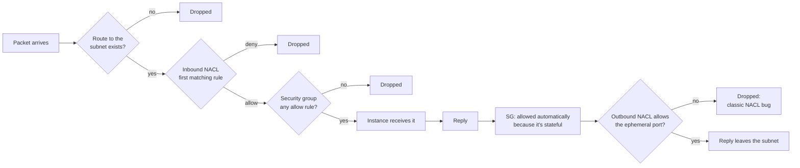

### 19. Why are ephemeral ports important with NACLs?
When a client connects to your server on port 443, the client uses a random **source** port, for example 49152. Your server's reply goes *to* that port. Because NACLs are stateless, the outbound NACL must allow the **ephemeral port range** (1024–65535 to cover Linux, Windows, NAT gateways and ELBs) to the client. The same applies in reverse for outbound calls: if your instance calls an API on 443, the *inbound* NACL must allow 1024–65535 for the reply. Forgetting this is the most common NACL mistake: "the SG is open but it still times out."

Example NACL for a public web subnet:

| Rule # | Direction | Protocol | Port | Source / Dest | Action |
|---|---|---|---|---|---|
| 90 | Inbound | All | All | 203.0.113.50/32 (attacker) | DENY |
| 100 | Inbound | TCP | 443 | 0.0.0.0/0 | ALLOW |
| 110 | Inbound | TCP | 1024–65535 | 0.0.0.0/0 | ALLOW (replies to outbound calls) |
| 120 | Inbound | TCP | 8080 | 10.0.16.0/20 | ALLOW (health checks from app tier, if needed) |
| * | Inbound | All | All | 0.0.0.0/0 | DENY |
| 100 | Outbound | TCP | 1024–65535 | 0.0.0.0/0 | ALLOW (replies to clients) |
| 110 | Outbound | TCP | 443 | 0.0.0.0/0 | ALLOW (outbound calls) |
| 120 | Outbound | TCP | 8080 | 10.0.16.0/20 | ALLOW (to app tier) |
| * | Outbound | All | All | 0.0.0.0/0 | DENY |

Rule 90 sits *before* rule 100 so the deny matches first. Number rules in steps of 10 to leave room for inserting rules later.

### 20. What is security group referencing, and why is it better than CIDRs?
A rule can name **another security group** as its source: "allow 5432 from `sg-app`". Any ENI that has `sg-app` attached is allowed, whatever its IP. When the app tier autoscales from 3 to 30 instances, or pods get new IPs, nothing needs updating. It's also self-documenting ("the app tier can reach the database") and much tighter than allowing the whole app subnet CIDR.

```hcl
resource "aws_vpc_security_group_ingress_rule" "db_from_app" {
  security_group_id            = aws_security_group.db.id
  referenced_security_group_id = aws_security_group.app.id
  from_port                    = 5432
  to_port                      = 5432
  ip_protocol                  = "tcp"
}
```
SG references work within a VPC, across **peered VPCs** (same region), and across VPCs attached to a Transit Gateway when the TGW's security group referencing support is enabled. Across regions you use CIDRs or prefix lists.

### 21. What are managed prefix lists?
A named, versioned set of CIDRs (e.g. `pl-corp-office` with 20 office ranges) that you can reference in security groups and route tables. Update the list once and every rule using it changes. They can be shared across accounts with AWS RAM. AWS also publishes **AWS-managed prefix lists**, such as the S3 and DynamoDB ranges for gateway endpoints, and `com.amazonaws.global.cloudfront.origin-facing` so you can allow only CloudFront to reach an origin ALB.

### 22. What are the common security group and NACL limits?
Defaults (most are adjustable through Service Quotas): **60 inbound and 60 outbound rules per SG**, **5 SGs per ENI** (adjustable up to 16, but SGs × rules per ENI is capped at 1,000), **20 rules per NACL** per direction (adjustable up to 40), **50 routes per route table** (adjustable up to 1,000), and **5 VPCs per region**. A prefix list counts as its *max entries* against the rule quota. Interviewers mostly want to hear that limits exist, which ones bite (SG rules when people use many CIDRs instead of SG references or prefix lists), and that they're adjustable.

---

## ENIs, Elastic IPs & Public IPv4

### 23. What is an ENI, and why does it matter?
An **Elastic Network Interface** is a virtual network card that belongs to a subnet (and therefore one AZ). It has a primary private IP, optional secondary IPs, a MAC address, optional public IP or EIP, security groups and a source/destination check flag. Much more than EC2 uses ENIs: Lambda in a VPC, RDS, ELB nodes, interface endpoints, NAT gateways, TGW attachments, EKS pods (via the VPC CNI). That's why "subnet out of IPs" can break things that don't look like servers. An ENI can be **detached and moved** to another instance in the same AZ, an old-style HA trick for software licensed to a MAC or IP address.

### 24. Public IP vs Elastic IP, and what changed in public IPv4 pricing?
- **Auto-assigned public IP**: comes from Amazon's pool, released when the instance **stops**, and you get a different one on start.
- **Elastic IP**: a static public IPv4 you allocate to your account and attach to an instance, ENI or NAT gateway. It stays the same until you release it. Use it when a partner allow-lists your IP.
- Since February 2024, **every public IPv4 address is charged** (about $0.005/hour, roughly $3.60/month each), whether attached or not. Cost-conscious designs remove public IPs from instances, put workloads behind load balancers, use IPv6, and use NAT gateways for egress.

### 25. What is the source/destination check, and when do you disable it?
By default an ENI drops traffic that isn't addressed to or from its own IP. Appliances that **forward** traffic for others, such as NAT instances, firewalls, VPN or SD-WAN appliances and routers, need it **disabled**. Otherwise the route table sends packets to them and they quietly drop them.

---

## VPC Endpoints & PrivateLink

### 26. Gateway endpoints vs interface endpoints?

| | Gateway endpoint | Interface endpoint (PrivateLink) |
|---|---|---|
| Services | **S3 and DynamoDB only** | Most AWS services (STS, ECR, Secrets Manager, KMS, SSM, CloudWatch, SQS, ...), your own services, and partner SaaS |
| How | A **route** in route tables (prefix list → vpce) | **ENIs with private IPs** in your subnets, one per AZ |
| DNS | Public service names, routed privately | **Private DNS**: the normal service hostname resolves to the ENI's private IPs |
| Reachable from on-prem / peered VPCs / TGW | **No** (only the same VPC) | **Yes** |
| Security | Endpoint policy + route | Endpoint policy + **security group** on the ENIs |
| Cost | **Free** | About $0.01/hour per AZ plus about $0.01/GB |

Always add the free **S3 and DynamoDB gateway endpoints** to every VPC. S3 traffic otherwise flows through the NAT gateway at $0.045/GB.

### 27. Which endpoints does a fully private EKS or ECS cluster need?
With no NAT and no internet access (common in banks), workloads still need AWS APIs:
- **ECR**: `ecr.api` and `ecr.dkr` interface endpoints **plus the S3 gateway endpoint** (image layers are stored in S3).
- **STS** (for IRSA/Pod Identity credentials), **EC2** (VPC CNI and node bootstrap), **Elastic Load Balancing** (LB controller), **CloudWatch Logs**, **SSM, SSM Messages and EC2 Messages** (Session Manager access instead of SSH), **KMS** and **Secrets Manager** if used, plus `eks` and `eks-auth` (Pod Identity).
- For EKS, the cluster API endpoint is set to **private** access.
Forget one, and you get failures like nodes that never join the cluster, `ImagePullBackOff`, or pods without credentials. Check with `nslookup ecr.ap-south-1.amazonaws.com` from inside: it should return private 10.x addresses.

### 28. What is an endpoint policy?
An IAM-style resource policy on the endpoint that restricts **what can be done through it**. Examples: the S3 endpoint only allows access to buckets in your organization (`aws:ResourceOrgID`), which blocks data exfiltration to an attacker's bucket even with valid credentials; or the ECR endpoint only allows pulls from your registry. Combine it with bucket policies that only accept requests coming through your endpoint (`aws:SourceVpce`). That's the core of a "data perimeter" design.

```json
{
  "Statement": [{
    "Effect": "Allow",
    "Principal": "*",
    "Action": ["s3:GetObject", "s3:PutObject", "s3:ListBucket"],
    "Resource": "*",
    "Condition": { "StringEquals": { "aws:ResourceOrgID": "o-abc123" } }
  }]
}
```

### 29. How does PrivateLink let you expose your own service to other VPCs or accounts?

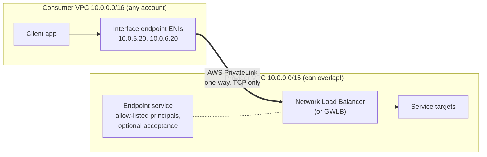
- The provider puts the service behind an **NLB** and creates an **endpoint service**, allow-listing consumer accounts or principals, with manual acceptance if wanted.
- The consumer creates an **interface endpoint** to that service name in their own subnets.
- Traffic is **one-way** (the consumer starts connections) and only reaches that one service, not the whole network. Overlapping CIDRs don't matter, because the consumer only sees its local ENI IPs.
That's why PrivateLink is the standard for SaaS-to-customer and shared-platform-service connectivity, where peering or TGW would open whole networks to each other.

---

## VPC Peering vs Transit Gateway

### 30. How does VPC peering work, and what are its limits?
A peering connection is a direct, private link between **two** VPCs (same or different account, same or different region). Traffic stays on the AWS backbone and there's no bandwidth bottleneck or single point of failure.
- **No overlapping CIDRs.**
- **Not transitive**: if A peers with B and B with C, A can't reach C through B. You'd need A–C peering too, so a full mesh of n VPCs needs n(n−1)/2 connections. 10 VPCs means 45 peerings.
- **No edge-to-edge routing**: A can't use B's IGW, NAT gateway, VPN or Direct Connect.
- Both sides need **routes** to each other's CIDR through the `pcx-` and must allow traffic in their SGs and NACLs. Same-region peering allows SG referencing.
- There's no hourly charge. Data across AZs is charged at the normal inter-AZ rate, and cross-region at inter-region rates.

### 31. How does Transit Gateway work? Explain attachments, association and propagation.
A **Transit Gateway** is a regional cloud router (hub and spoke) that connects thousands of VPCs, VPNs and Direct Connect gateways.
- **Attachments**: VPC (an ENI in one subnet per AZ), Site-to-Site VPN, Direct Connect gateway, TGW peering (to another region's TGW, static routes only), and Connect (GRE + BGP for SD-WAN appliances).
- **TGW route tables**: a TGW can have several. That's how you segment.
- **Association**: each attachment is associated with **exactly one** TGW route table. That table decides where traffic **coming from** that attachment can go.
- **Propagation**: an attachment can **advertise its routes into** one or more TGW route tables (a VPC's CIDR, or BGP-learned routes from VPN/DX).
- VPC subnet route tables still need routes pointing at the TGW. It costs about $0.05/hour per attachment plus $0.02/GB processed.

### 32. Design TGW segmentation where prod and non-prod can't talk but both reach shared services and on-prem.

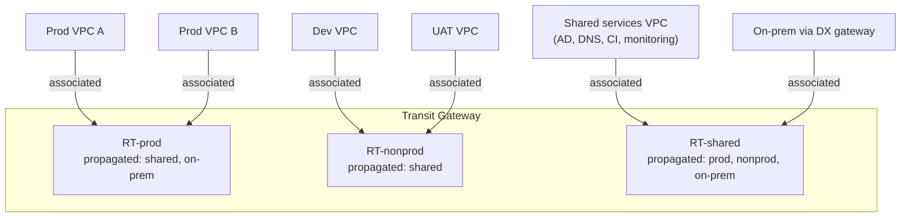

| TGW route table | Associated attachments | Propagated routes (where they can go) |
|---|---|---|
| RT-prod | Prod VPCs | Shared VPC, on-prem |
| RT-nonprod | Dev, UAT VPCs | Shared VPC only (no on-prem, which banks often require) |
| RT-shared | Shared VPC, DX/VPN | Prod, non-prod, on-prem |

Prod VPCs don't propagate into RT-nonprod and the reverse, so there's simply no route between them. Note that two prod VPCs associated with RT-prod only reach *each other* if they also propagate into RT-prod. Leave that out if you want isolation between prod VPCs too (common: every VPC talks only to shared services).

### 33. Peering vs Transit Gateway vs PrivateLink: how do you choose?

| Need | Use |
|---|---|
| A few VPCs, high throughput, lowest cost, no transitive routing needed | **VPC peering** |
| Many VPCs and accounts, on-prem connectivity, central inspection, segmentation | **Transit Gateway** |
| Expose **one service** to many consumers, overlapping CIDRs, one-way access | **PrivateLink** |
| Apps across many VPCs and accounts with service-level auth (HTTP/gRPC) | **VPC Lattice** (application-layer service network with IAM auth policies) |
| Multi-region global network with central policy | **AWS Cloud WAN** (managed global network built on TGW concepts) |

It's normal to use all of them together: TGW as the backbone, peering for one high-volume pair (to save the TGW per-GB charge), and PrivateLink for shared services.

---

## Hybrid Connectivity

### 34. Site-to-Site VPN vs Direct Connect in one table.

| | Site-to-Site VPN | Direct Connect |
|---|---|---|
| Path | IPsec over the public internet | Dedicated private fibre through a DX location |
| Setup time | Minutes | Weeks (circuit provisioning) |
| Bandwidth | About 1.25 Gbps per tunnel (ECMP across tunnels on a TGW for more) | 1, 10, 100, 400 Gbps dedicated; 50 Mbps–25 Gbps hosted |
| Latency | Variable | Consistent |
| Encryption | Yes (IPsec) | **No by default**: add MACsec or IPsec over DX |
| Redundancy | 2 tunnels per connection, to different AWS endpoints | Buy 2+ connections at 2 locations |
| Terminates on | Virtual private gateway (one VPC) or **TGW** | Private VIF → VGW or DX gateway; **Transit VIF → DX gateway → TGW**; Public VIF for AWS public services |

Standard resilient design: two DX connections at two DX locations, with a Site-to-Site VPN as backup, all using BGP and preferring DX. Details and troubleshooting are in [34 Q10–12](./34-onprem-banking-infrastructure-qna.md).

### 35. What are the Direct Connect virtual interface types?
- **Private VIF**: reach private IPs in **one VPC** (through a VGW) or several VPCs (through a **DX gateway** to VGWs).
- **Transit VIF**: connects to a **DX gateway attached to a Transit Gateway**, so you reach every VPC on the TGW. This is the common enterprise design.
- **Public VIF**: reach AWS **public** endpoints (S3, DynamoDB and other public service IPs) over DX instead of the internet. You can then run a Site-to-Site VPN over the public VIF to get encryption.
A **DX gateway** is a global object, so one DX connection in Mumbai can reach VPCs in other regions.

---

## DNS in a VPC (Route 53 Resolver)

### 36. How does DNS work inside a VPC?
- Every VPC has the **Route 53 Resolver** (AmazonProvidedDNS) at the **VPC CIDR base +2** (e.g. 10.0.0.2), and also at 169.254.169.253 from any instance.
- It answers public DNS, **private hosted zones** associated with the VPC, and AWS-internal names (`ip-10-0-1-5.ap-south-1.compute.internal`).
- Two VPC attributes control it: **`enableDnsSupport`** (the resolver works) and **`enableDnsHostnames`** (instances get DNS hostnames). Both must be **true** for private hosted zones and interface endpoint private DNS to work. This is a very common cause of "private DNS doesn't resolve".
- **Private hosted zones** (e.g. `corp.internal`) only resolve inside the VPCs they're associated with. Associate them with other VPCs, including other accounts' VPCs through an authorization, to share them.

### 37. How do you set up DNS between on-prem and AWS?

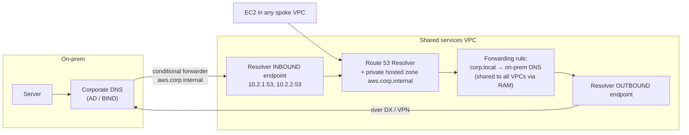

- **Inbound endpoint**: ENIs with fixed IPs in your VPC that **on-prem DNS servers forward to**, so on-prem can resolve private hosted zones and interface endpoint names.
- **Outbound endpoint + forwarding rules**: the VPC resolver forwards queries for on-prem domains (`corp.local`) to on-prem DNS servers.
- Put both in a **shared services VPC**, and share the forwarding rules to every account and VPC with AWS RAM, so each VPC doesn't need its own endpoints.
- **Route 53 Resolver DNS Firewall** can block or allow-list domains for outbound queries, which stops DNS-based exfiltration and malware callbacks.

---

## Load Balancers, CloudFront & Global Accelerator

### 38. How do ALB, NLB and GWLB sit in the network?
- **ALB (L7)**: HTTP/HTTPS/gRPC. Nodes in each selected subnet, at least 2 AZs. Content-based routing (host, path, header), TLS termination, WAF, OIDC authentication. Has security groups. Targets: instances, IPs (pods), Lambda.
- **NLB (L4)**: TCP/UDP/TLS, millions of requests per second, **one static IP per AZ** (or your own EIPs), so it's the one to use when partners need fixed IPs to allow-list. It preserves the client source IP for instance targets, or with proxy protocol v2. It supports security groups (since 2023), but they must be enabled when the NLB is created. It's the front end for PrivateLink services.
- **GWLB (L3)**: transparently sends traffic through a fleet of third-party appliances (Palo Alto, Fortinet, Check Point) using **GENEVE** encapsulation, with **GWLB endpoints** as route-table targets. That's how you insert firewalls into traffic flows at scale.
- **Cross-zone load balancing**: ALB has it on (free); NLB has it off by default, and cross-AZ traffic is charged when it's on.
- **Internal vs internet-facing**: an internal LB sits in private subnets with only private IPs, for service-to-service traffic.

### 39. How do you keep an origin private behind CloudFront?
- **S3 origins**: **Origin Access Control (OAC)** plus a bucket policy that only allows the CloudFront distribution, with public access blocked.
- **ALB/NLB/EC2 origins**: **CloudFront VPC origins** let CloudFront reach a load balancer or instance in **private subnets**, so the origin has no public exposure at all. With a public ALB, restrict its SG to the CloudFront origin-facing managed prefix list *and* check a secret custom header, because the prefix list alone allows any CloudFront distribution.
- Put WAF on the CloudFront distribution, and use Shield Advanced for DDoS-sensitive sites.

### 40. What does Global Accelerator do, and how is it different from CloudFront?
**Global Accelerator** gives you **two static anycast IPs** that bring users onto the AWS backbone at the nearest edge, then route **TCP/UDP** to the healthiest regional endpoint (ALB, NLB, EC2, EIP), with failover in seconds. It doesn't cache. **CloudFront** is a CDN that **caches** HTTP(S) content at the edge. Use Global Accelerator for non-HTTP protocols, gaming or VoIP, static IPs for allow-listing, and fast multi-region failover. Use CloudFront for websites, APIs and media.

---

## Network Security & Visibility

### 41. How do you inspect traffic centrally with AWS Network Firewall?
**AWS Network Firewall** is a managed, stateful firewall (Suricata-compatible rules, domain allow-lists, TLS inspection) that runs as endpoints in **dedicated firewall subnets**. The common pattern is a central **inspection VPC** on the Transit Gateway:

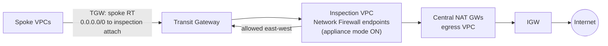

- Spoke VPC traffic for other VPCs, on-prem and the internet goes to the TGW. The spoke TGW route table sends everything to the inspection VPC, which routes it through firewall endpoints, then back to the TGW or out through centralized NAT.
- Turn on **appliance mode** on the inspection VPC's TGW attachment, so both directions of a flow go through the **same AZ's** firewall endpoint. Without it, asymmetric routing makes the stateful firewall drop return traffic.
- Benefits: one place for egress allow-lists (only `*.corp-partner.com`, `*.amazonaws.com`), IDS/IPS, and central logging, which auditors like.
- Alternatives: GWLB with third-party firewalls; per-VPC (distributed) firewalls where latency or cost matter more.

### 42. What are VPC Flow Logs, and how do you use them?
Flow logs record **metadata about IP traffic** (not packet contents) at the VPC, subnet or ENI level: source and destination IP and port, protocol, packets, bytes, **ACCEPT or REJECT**, and optional extra fields (`pkt-srcaddr` for the original IP behind NAT, `tcp-flags`, `flow-direction`, `traffic-path`). They're delivered to CloudWatch Logs, S3 or Firehose.

```
version account-id interface-id srcaddr dstaddr srcport dstport protocol packets bytes start end action log-status
2 111111111111 eni-0a1b2c 10.0.16.25 10.0.48.10 49522 5432 6 10 840 1729250000 1729250060 REJECT OK
```
That record shows the app (10.0.16.25) was **rejected** connecting to the DB on 5432, so a SG or NACL is blocking it. Uses: troubleshooting (REJECT tells you a SG or NACL is dropping traffic), security investigations (who talked to this IP), finding unexpected egress, cost analysis (top talkers across AZs), and compliance evidence. Query them in S3 with **Athena**. For full packet capture, use **Traffic Mirroring** to send copies of ENI traffic to an IDS or Wireshark host.

### 43. Which tools do you use to debug connectivity without guessing?
- **VPC Reachability Analyzer**: pick a source and destination (an ENI, an instance, an IGW) and a port. It *analyses the configuration* (routes, SGs, NACLs, TGW and peering) without sending packets, and tells you exactly which component blocks the path. This is the fastest answer to "why can't A reach B?"
- **Network Access Analyzer**: finds paths that *shouldn't* exist, for example "anything in the DB subnets reachable from an IGW". Good for audits.
- **Flow logs** for what actually happened, **CloudWatch metrics** on NAT gateways (`ErrorPortAllocation`, `PacketsDropCount`) and TGWs, and from the instance: `nc -zv`, `curl -v`, `dig`, `traceroute -T`, `tcpdump`.

---

## IPv6

### 44. How does IPv6 work in a VPC, and why would you adopt it?
- AWS assigns a **/56** to the VPC (or you bring your own from IPAM). Each subnet gets a **/64**. Addresses are **globally unique and public**, so there's no NAT.
- "Private" IPv6 subnets use an **egress-only IGW** (`::/0 → eigw`). Public ones use the IGW (`::/0 → igw`). Security groups and NACLs need **separate IPv6 rules** (`::/0`).
- **Dual-stack** (IPv4 + IPv6) is the usual path. **IPv6-only** subnets are possible, with **DNS64 + NAT64** on the NAT gateway so they can still reach IPv4-only destinations.
- Reasons to adopt: **no IPv4 exhaustion** (great for EKS: IPv6 clusters give every pod an address without worrying about subnet space), no public IPv4 charges, and no NAT gateway processing charges for IPv6 egress.

---

## Multi-Account Network Architecture

### 45. How do large organizations structure AWS networking across many accounts?
A **hub-and-spoke** model owned by a central **network account**:

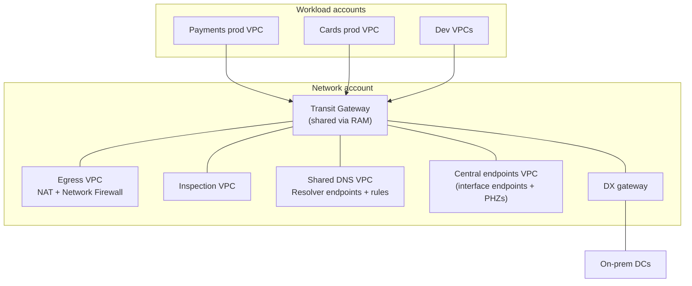
- The **Transit Gateway** lives in the network account and is shared with workload accounts through **AWS RAM**. Spoke VPCs attach to it.
- **Centralized egress**: spoke VPCs have no IGW or NAT. All internet traffic goes through the egress VPC's firewall and NAT. That means fewer NAT gateways, one egress allow-list and one place to log.
- **Centralized interface endpoints**: one set of endpoints in a shared VPC, with private hosted zones associated to spokes. That saves endpoints × VPCs × AZs, but adds TGW data charges, so check the break-even.
- **Shared DNS**: resolver endpoints and rules shared through RAM.
- **Guardrails** with SCPs: workload accounts can't create IGWs, VPC peering or public IPs. The network team controls those.
- **Alternative: VPC sharing** (RAM shares *subnets* of one central VPC with many accounts). Fewer VPCs and no TGW charge between those accounts, but less isolation between teams.

### 46. What does the AWS Landing Zone / Control Tower networking setup add?
Control Tower and Landing Zone Accelerator set up the **multi-account structure** (an OU per environment, log archive and audit accounts), and with LZA, the network baseline from config: IPAM pools, TGW and route tables, the inspection and egress VPCs, endpoints, DNS, and flow logs enabled everywhere. It answers "how do you make every new account compliant from day one": new accounts get networking from code, not tickets.

---

## Network Cost

### 47. What are the main AWS networking costs, and how do you reduce them?

| Item | Approx. price | How to reduce |
|---|---|---|
| NAT gateway processing | ~$0.045/GB + ~$0.045/hr each | S3/DynamoDB gateway endpoints (free); interface endpoints for heavy APIs like ECR; avoid pulling images through NAT; IPv6 + egress-only IGW |
| Cross-AZ traffic | ~$0.01/GB **each direction** | Keep chatty services in the same AZ (topology-aware routing in K8s); NAT per AZ; watch replication traffic |
| Data out to the internet | ~$0.09/GB (tiered) | CloudFront (cheaper egress, caching), compression |
| Transit Gateway | ~$0.05/hr per attachment + ~$0.02/GB | Peering for high-volume pairs; fewer attachments |
| Interface endpoints | ~$0.01/hr per AZ + ~$0.01/GB | Centralize in a shared VPC when spokes are many and traffic is low |
| Public IPv4 | ~$0.005/hr each | Remove unneeded public IPs; LB + NAT; IPv6 |
| Inter-region | ~$0.02/GB | Keep data in-region; replicate only what DR needs |

Find the culprits with **Cost Explorer** (filter by usage type: `NatGateway-Bytes`, `DataTransfer-Regional-Bytes`), **flow logs plus Athena** for top talkers, and the **CUR**. A classic finding: EKS nodes pulling multi-GB images from ECR through NAT on every scale-up, fixed with ECR endpoints and the S3 gateway endpoint.

---

## Troubleshooting Scenarios

### 48. An EC2 instance in a private subnet can't reach the internet. Walk through it.

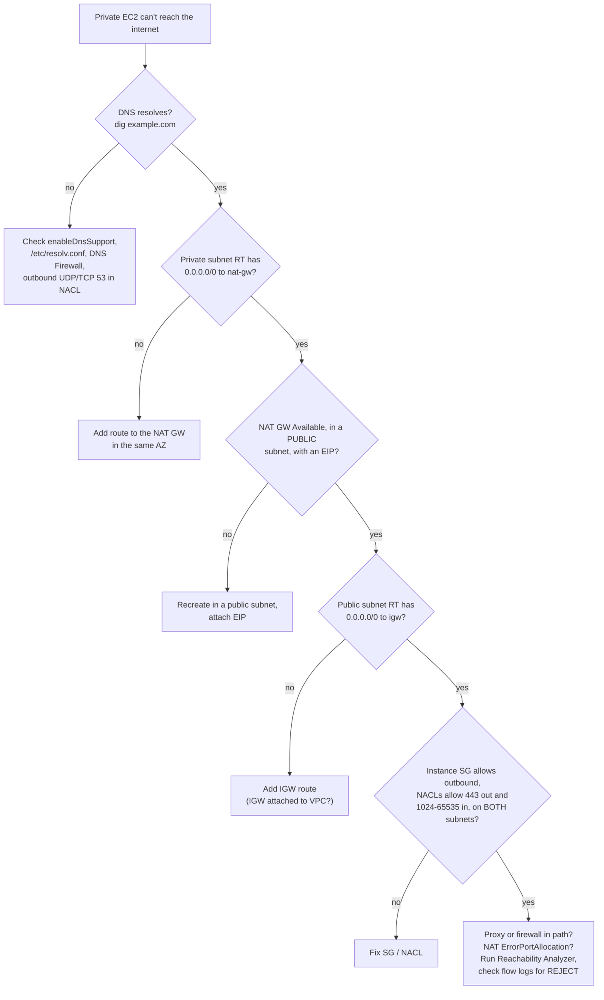
A quick tip: run `curl -v https://checkip.amazonaws.com`. If it returns the NAT gateway's EIP, egress works and the problem is the destination.

### 49. You can't SSH into an EC2 instance in a public subnet. What do you check?
1. **Public IP**: does the instance have a public IP or EIP? Without one, nothing from the internet can reach it, even in a public subnet.
2. **Route table**: the subnet has `0.0.0.0/0 → igw`, and the IGW is attached.
3. **Security group**: inbound 22 from *your* IP (the corporate egress IP, not your laptop's private IP).
4. **NACL**: inbound 22 *and* outbound 1024–65535.
5. **Instance**: sshd running, OS firewall, the correct key and username (`ec2-user`, `ubuntu`), and status checks passing. Use the EC2 serial console if networking is broken inside the OS.
6. **Better answer**: don't open SSH at all. Use **SSM Session Manager** (no inbound ports, IAM-authenticated, logged) or **EC2 Instance Connect Endpoint** for private instances.

### 50. Two peered VPCs can't communicate. Why?
- **Peering not accepted** (status `pending-acceptance`), or CIDRs overlap, so it can't be created.
- **Routes missing on one side**. Both route tables need the other VPC's CIDR → `pcx-`, for **every subnet's** route table involved.
- **SGs**: the destination SG must allow the source CIDR, or the source SG by ID (same region only).
- **NACLs** on both subnets, including ephemeral ports.
- **Transitive expectation**: trying to reach a third VPC, on-prem or the internet *through* the peer, which doesn't work.
- **DNS**: the hostname resolves to a public IP unless **DNS resolution over peering** is turned on in the peering options.

### 51. Pods or Lambda functions fail with IP or ENI errors. What's happening?
Both draw IPs from subnets. Lambda in a VPC uses Hyperplane ENIs (shared per subnet and SG combination, so far fewer than before 2019, but each still needs IPs). EKS uses one IP per pod with the VPC CNI. Symptoms: `InsufficientFreeAddressesInSubnet`, pods stuck `ContainerCreating` with "failed to assign an IP address", or Lambda `EC2ThrottledException`/ENI errors. Fixes: bigger or extra subnets, a secondary CIDR (100.64.0.0/10) with custom networking for pods, prefix delegation, or IPv6. Watch available IPs per subnet with CloudWatch or IPAM. See [33 Q53](./33-platform-engineering-deep-dive-qna.md).

### 52. An application in a VPC can't resolve a private hosted zone or interface endpoint name.
- `enableDnsSupport` **and** `enableDnsHostnames` are both true on the VPC.
- The private hosted zone is **associated with this VPC**. Each consuming VPC needs its own association, including cross-account ones.
- The instance uses the **VPC resolver** (base+2), not a hard-coded 8.8.8.8 or an on-prem server that doesn't forward back to the inbound endpoint.
- For interface endpoints in a central VPC, the spokes need a PHZ (or a Route 53 profile) associated with them. "Private DNS enabled" only applies within the endpoint's own VPC.
- Overlapping namespaces: if a PHZ for `corp.com` exists, records missing from it **don't fall back** to public DNS. Every name in that zone must be in the PHZ.

### 53. Intermittent timeouts to an external API, only under load. What's your hypothesis?
**NAT gateway port exhaustion** for a single destination: more than 55,000 concurrent connections from one NAT IP to the same destination IP and port. Check the NAT gateway CloudWatch metric `ErrorPortAllocation` and `ActiveConnectionCount`. Fixes: reuse connections (HTTP keep-alive, connection pooling, which often fixes it by itself), add secondary IPs to the NAT gateway, or spread traffic across NAT gateways. Other suspects: **conntrack limits** on the instance (`nf_conntrack: table full` in dmesg), SG connection-tracking limits on high-volume flows (check the ENA `conntrack_allowance_exceeded` stat with `ethtool -S`), or the API itself rate-limiting your one NAT IP.

### 54. Traffic through a firewall appliance works in one direction but return traffic is dropped.
**Asymmetric routing**: the request goes through the firewall in AZ a, but the reply comes back through AZ b's firewall (or skips it), and a stateful firewall drops packets for connections it never saw. Fixes: **TGW appliance mode** on the inspection VPC attachment, route tables where each AZ points to the firewall endpoint in **its own AZ**, GWLB (which keeps flows sticky), and making sure every subnet route table involved in the flow routes through the firewall.

---

## Design Round

### 55. "Design the network for a new internet banking application on AWS."
A structured answer interviewers like, covering requirements → layout → connectivity → security → operations:

1. **Requirements**: data must stay in India (ap-south-1 primary, ap-south-2 DR), PCI scope minimal, on-prem core banking integration, 99.95% availability, all traffic inspected and logged.
2. **Accounts**: separate prod, non-prod, network, security and log-archive accounts in an AWS Organization. The network account owns the TGW, inspection and egress, and DNS.
3. **VPC**: a /16 from IPAM, 3 AZs. Public subnets only hold the ALB or NLB and nothing else (or none at all, with CloudFront VPC origins). Private app subnets for EKS. Isolated DB subnets for Aurora, with no internet route. A separate small **CDE VPC or subnets** for the card-handling service, to keep PCI scope tight.
4. **Ingress**: Route 53 → CloudFront + WAF + Shield Advanced → internal ALB in private subnets through VPC origins (or a public ALB locked to CloudFront). TLS end to end with ACM certificates and mTLS inside the mesh.
5. **Egress**: no NAT in the workload VPC. All egress goes through the TGW to the inspection VPC (Network Firewall with a domain allow-list) to centralized NAT. Gateway endpoints for S3 and DynamoDB, and interface endpoints for ECR, STS, KMS, Secrets Manager, SSM and Logs.
6. **Hybrid**: 2 × Direct Connect at 2 locations → Transit VIF → DX gateway → TGW, with MACsec or IPsec over DX for encryption, and a Site-to-Site VPN as backup. TGW route tables segment prod, non-prod and on-prem.
7. **DNS**: private hosted zones, Resolver inbound and outbound endpoints for `corp.local`, and DNS Firewall.
8. **Security**: SGs referencing SGs, NACLs as coarse guardrails, SCPs denying IGWs and public IPs in workload accounts, no SSH (Session Manager only), GuardDuty, and flow logs to the log-archive account with S3 Object Lock.
9. **DR**: the same network in ap-south-2 built from the same Terraform, non-overlapping CIDRs, TGW peering between regions, Aurora Global Database, and Route 53 failover or ARC routing controls.
10. **Operations**: everything in Terraform with plan review, Reachability Analyzer checks in CI for critical paths, Network Access Analyzer scans for unintended exposure, and cost dashboards for NAT, TGW and cross-AZ traffic.

### 56. Write the core of a three-tier VPC in Terraform.
```hcl
locals {
  azs    = ["ap-south-1a", "ap-south-1b", "ap-south-1c"]
  cidr   = "10.0.0.0/16"
  public = [for i, _ in local.azs : cidrsubnet(local.cidr, 8, i)]        # 10.0.0.0/24, 10.0.1.0/24, 10.0.2.0/24
  app    = [for i, _ in local.azs : cidrsubnet(local.cidr, 4, i + 1)]    # 10.0.16.0/20, 10.0.32.0/20, 10.0.48.0/20
  db     = [for i, _ in local.azs : cidrsubnet(local.cidr, 8, i + 200)]  # 10.0.200.0/24 ...
}

resource "aws_vpc" "main" {
  cidr_block           = local.cidr
  enable_dns_support   = true
  enable_dns_hostnames = true
  tags = { Name = "vpc-netbanking-prod" }
}

resource "aws_internet_gateway" "igw" { vpc_id = aws_vpc.main.id }

resource "aws_subnet" "public" {
  count             = length(local.azs)
  vpc_id            = aws_vpc.main.id
  cidr_block        = local.public[count.index]
  availability_zone = local.azs[count.index]
  tags = { Name = "public-${local.azs[count.index]}", "kubernetes.io/role/elb" = "1" }
}

resource "aws_subnet" "app" {
  count             = length(local.azs)
  vpc_id            = aws_vpc.main.id
  cidr_block        = local.app[count.index]
  availability_zone = local.azs[count.index]
  tags = { Name = "app-${local.azs[count.index]}", "kubernetes.io/role/internal-elb" = "1" }
}

resource "aws_subnet" "db" {
  count             = length(local.azs)
  vpc_id            = aws_vpc.main.id
  cidr_block        = local.db[count.index]
  availability_zone = local.azs[count.index]
  tags = { Name = "db-${local.azs[count.index]}" }
}

# Public: one route table, default route to the IGW
resource "aws_route_table" "public" {
  vpc_id = aws_vpc.main.id
  route {
    cidr_block = "0.0.0.0/0"
    gateway_id = aws_internet_gateway.igw.id
  }
}
resource "aws_route_table_association" "public" {
  count          = length(local.azs)
  subnet_id      = aws_subnet.public[count.index].id
  route_table_id = aws_route_table.public.id
}

# One NAT gateway per AZ, one private route table per AZ pointing at its own AZ's NAT
resource "aws_eip" "nat" { count = length(local.azs) }
resource "aws_nat_gateway" "nat" {
  count         = length(local.azs)
  allocation_id = aws_eip.nat[count.index].id
  subnet_id     = aws_subnet.public[count.index].id
  depends_on    = [aws_internet_gateway.igw]
}
resource "aws_route_table" "app" {
  count  = length(local.azs)
  vpc_id = aws_vpc.main.id
  route {
    cidr_block     = "0.0.0.0/0"
    nat_gateway_id = aws_nat_gateway.nat[count.index].id
  }
}
resource "aws_route_table_association" "app" {
  count          = length(local.azs)
  subnet_id      = aws_subnet.app[count.index].id
  route_table_id = aws_route_table.app[count.index].id
}

# DB: local route only (no internet)
resource "aws_route_table" "db" { vpc_id = aws_vpc.main.id }
resource "aws_route_table_association" "db" {
  count          = length(local.azs)
  subnet_id      = aws_subnet.db[count.index].id
  route_table_id = aws_route_table.db.id
}

# Free S3 gateway endpoint on the private route tables
resource "aws_vpc_endpoint" "s3" {
  vpc_id            = aws_vpc.main.id
  service_name      = "com.amazonaws.ap-south-1.s3"
  vpc_endpoint_type = "Gateway"
  route_table_ids   = aws_route_table.app[*].id
}

resource "aws_flow_log" "all" {
  vpc_id               = aws_vpc.main.id
  traffic_type         = "ALL"
  log_destination_type = "s3"
  log_destination      = "arn:aws:s3:::corp-log-archive-flowlogs"
}
```
In practice you'd use the community `terraform-aws-modules/vpc/aws` module or an internal module, but interviewers want to see that you know what it creates underneath: the per-AZ NAT and route tables, explicit associations, the endpoint on the private tables, the EKS subnet tags, and flow logs.
