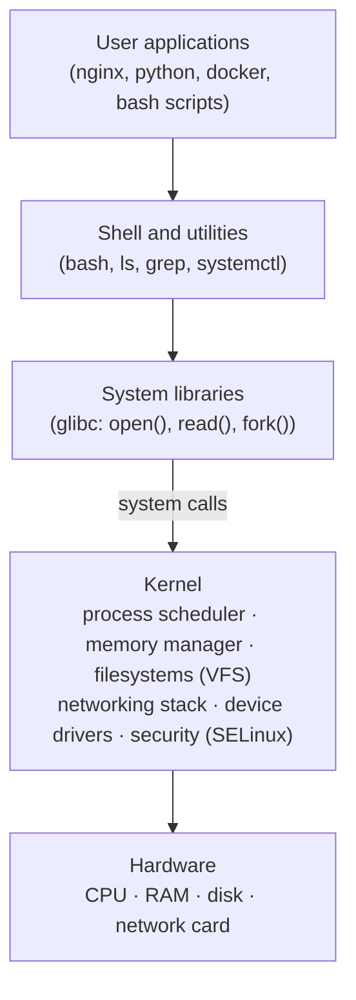
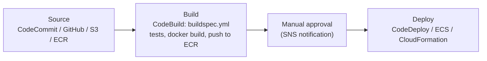
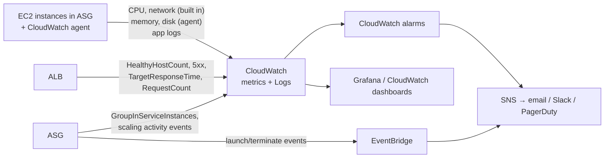

# DevOps Fundamentals Screening Round (Web Servers, Linux, Git, Jenkins, Docker, AWS, K8s, IaC) — Interview Questions & Answers

> Part of the [Interview Questions](./README.md) hub. A typical first-round "fundamentals" screen for DevOps engineer roles, asked section by section. Questions already answered elsewhere in the hub are linked in the tables. Everything else is answered in full below.

---

## Already answered elsewhere

| Section | Question | Where |
|---|---|---|
| Web server | What is a reverse proxy (in nginx)? | [08 Q16](./08-networking-and-security-fundamentals-qna.md), [22 Q3](./22-windows-proxy-vapt-jira-qna.md), nginx config in [34 Q22](./34-onprem-banking-infrastructure-qna.md). Short answer + config also in [WS-2](#ws-2-what-is-a-reverse-proxy-in-nginx) below |
| Linux | How do you give permissions to a file? | [01 Q4–5](./01-linux-and-scripting-qna.md) (`rwx`, `chmod 755`, `chown`, `chgrp`). Quick recap in [L-4](#l-4-how-do-you-give-permissions-to-a-file) |
| Git | What is Git? | [02 Q1](./02-git-version-control-qna.md). GitHub vs GitLab answered in [G-1](#g-1-what-is-git-github-and-gitlab) |
| Git | Merge vs rebase | [02 Q11, Q29, Q39](./02-git-version-control-qna.md), [23 Q15](./23-how-it-works-internals-qna.md) |
| Git | How do you revert a commit? | [02 Q18–19](./02-git-version-control-qna.md) |
| Git | What is a merge conflict and git revert? | [02 Q12–13, Q18](./02-git-version-control-qna.md) |
| Jenkins | What is CI/CD, the Jenkinsfile and its stages? | [05 Q1–3, Q11, Q35](./05-cicd-jenkins-github-actions-qna.md), [29 Q1](./29-jenkins-k8s-helm-interview-rounds-qna.md) |
| Jenkins | How to use SonarQube in Jenkins? | [05 Q37](./05-cicd-jenkins-github-actions-qna.md) (setup). Advantages answered in [J-3](#j-3-what-are-the-advantages-of-sonarqube) |
| Jenkins | What is a Declarative pipeline? | [05 Q11](./05-cicd-jenkins-github-actions-qna.md), [33 Q22](./33-platform-engineering-deep-dive-qna.md) |
| Jenkins | Do you use Aqua Trivy in Jenkins? | [05 Q37](./05-cicd-jenkins-github-actions-qna.md) (Trivy stage with gates) |
| Docker | What is a container? | [03 Q1–2](./03-docker-qna.md), [01 Q48](./01-linux-and-scripting-qna.md) |
| Docker | Image vs container | [03 Q3](./03-docker-qna.md) |
| Docker | Data persistence | [03 Q10–11, Q29](./03-docker-qna.md) |
| Docker | Have you used Docker Compose? | [03 Q12](./03-docker-qna.md). A Compose file is in [O-2](#o-2-can-you-deploy-a-three-tier-architecture-on-a-single-server) |
| Docker | Networking in Docker | [03 Q24](./03-docker-qna.md), [28 Q04](./28-production-scenarios-rapid-round-qna.md) |
| AWS | What is RDS? | [07 Q9](./07-aws-cloud-qna.md), [24 Q21–23](./24-aws-deep-dive-qna.md) |
| AWS | EC2, ASG, Lambda | [07 Q3, Q10, Q20](./07-aws-cloud-qna.md), [24 Q1–2, Q30](./24-aws-deep-dive-qna.md) |
| AWS | How to save / optimise cost in AWS? | [07 Q27, Q31](./07-aws-cloud-qna.md), [36 Q47](./36-aws-networking-deep-dive-qna.md) (network cost) |
| K8s | What is orchestration? | [23 Q35](./23-cloud-fundamentals-cross-cloud-qna.md), [04 Q1](./04-kubernetes-qna.md) |
| K8s | Kubernetes architecture | [04 Q3–4](./04-kubernetes-qna.md) |
| K8s | What is a Service? | [04 Q6–7, Q23](./04-kubernetes-qna.md) |
| K8s | What is a PVC? | [04 Q32, Q40](./04-kubernetes-qna.md) |
| IaC | What is IaC? | [06 Q1, Q3](./06-terraform-and-iac-qna.md), [24 Q65](./24-aws-deep-dive-qna.md) |
| IaC | Is Ansible push or pull? | [09 Q2, Q20](./09-ansible-and-config-management-qna.md). Short answer in [T-3](#t-3-is-ansible-push-based-or-pull-based) |
| Others | How to migrate on-prem to AWS? | [23 Q44–45](./23-cloud-fundamentals-cross-cloud-qna.md), [24 Q41, Q78](./24-aws-deep-dive-qna.md), [27 Q9](./27-cloud-architecture-scenarios-qna.md) |
| Others | Do you know Grafana? | [11 Q5, Q18–20](./11-monitoring-logging-observability-qna.md), [28 Q15](./28-production-scenarios-rapid-round-qna.md) |
| Others | How to deploy a three-tier architecture? | [24 Q79](./24-aws-deep-dive-qna.md), [36 Q5, Q8, Q55–56](./36-aws-networking-deep-dive-qna.md) |

---

## Table of Contents
- [DevOps](#devops)
- [Web Servers](#web-servers)
- [Linux](#linux)
- [Git / GitHub](#git--github)
- [CI/CD with Jenkins](#cicd-with-jenkins)
- [Docker](#docker)
- [AWS](#aws)
- [Kubernetes](#kubernetes)
- [Terraform & Ansible](#terraform--ansible)
- [Other Questions](#other-questions)

---

## DevOps

### D-1. What do you mean by DevOps, and what is the day-to-day role of a DevOps engineer?
**DevOps** is a culture and set of practices that brings development and operations together, so software goes from a commit to production **quickly, safely and repeatably**, and the team running it gets fast feedback from production. It's not a single tool or job title. It rests on **CALMS**: **C**ulture (shared ownership, no "throw it over the wall"), **A**utomation (build, test, deploy, infrastructure), **L**ean (small batches, remove waste), **M**easurement (DORA metrics: deployment frequency, lead time, change failure rate, time to restore) and **S**haring.

A DevOps engineer builds and runs the **platform and pipelines** that let developers ship. A typical day:

| Time | Typical work |
|---|---|
| Morning | Check dashboards and alerts (Grafana, CloudWatch), overnight pipeline failures, on-call handover; stand-up with the team |
| Pipelines | Fix a failing Jenkins/GitHub Actions build, add a stage (SonarQube, Trivy scan), speed up a slow pipeline |
| Infrastructure | Terraform PRs: a new RDS instance, security group change, EKS node group; review teammates' plans |
| Kubernetes | Deploy or upgrade services with Helm/Argo CD, tune resources and HPA, debug a CrashLoopBackOff |
| Support | Help developers with "works locally, fails in the pipeline", access requests, environment setup |
| Reliability | Investigate an incident or latency spike, write the RCA, add the missing alert |
| Security & cost | Patch images and AMIs, rotate secrets, act on vulnerability reports, rightsize instances, clean up unused resources |
| Automation | Script away a repetitive task (Bash/Python), write runbooks and docs |

A good closing line: *"My goal is that developers can ship safely by themselves: I build the paved road and keep it running."*

---

## Web Servers

### WS-1. What are Apache and Nginx?
Both are open-source **web servers**: programs that accept HTTP(S) requests and return responses, either serving files from disk (static content) or passing requests to an application (dynamic content).
- **Apache HTTP Server (`httpd`)**: one of the oldest and most widely used web servers (since 1995). It's very flexible through **modules** (`mod_ssl`, `mod_rewrite`, `mod_php`, `mod_proxy`) and supports per-directory config with **`.htaccess`** files, which made it the standard for shared hosting and PHP apps (WordPress, LAMP stack).
- **Nginx** ("engine-x", 2004): built to handle **many thousands of concurrent connections** with little memory, using an event-driven design. It's the most common choice as a **reverse proxy, load balancer, TLS terminator and static file server** in front of application servers (Node.js, Python/Gunicorn, Java/Tomcat), and it's the base of many Kubernetes ingress controllers and gateways.

### WS-2. What is a reverse proxy in nginx?
A **reverse proxy** sits in front of backend servers and receives client requests **on their behalf**. Clients only talk to nginx, and nginx forwards each request to a backend, then returns the backend's response. It's used for: hiding backend servers, **load balancing** across several backends, **TLS termination** (HTTPS handled once at nginx), caching, compression, rate limiting, and routing by path or hostname (`/api` → API servers, `/` → frontend).

```nginx
upstream app_servers {            # backend pool: nginx load-balances round-robin by default
    server 10.0.1.10:8000;
    server 10.0.1.11:8000;
}
server {
    listen 80;
    server_name shop.example.com;

    location /static/ {           # nginx serves static files itself
        root /var/www/shop;
    }
    location / {                  # everything else goes to the app
        proxy_pass http://app_servers;
        proxy_set_header Host $host;
        proxy_set_header X-Real-IP $remote_addr;
        proxy_set_header X-Forwarded-For $proxy_add_x_forwarded_for;
        proxy_set_header X-Forwarded-Proto $scheme;
    }
}
```
Forward vs reverse proxy: a **forward** proxy acts for **clients** (a corporate proxy that users go through to reach the internet); a **reverse** proxy acts for **servers**. See [08 Q16](./08-networking-and-security-fundamentals-qna.md); a TLS version is in [34 Q22](./34-onprem-banking-infrastructure-qna.md).

### WS-3. What's the difference between Apache and Nginx?

| | Apache | Nginx |
|---|---|---|
| Architecture | **Process/thread-based** MPMs: `prefork` (one process per connection), `worker`/`event` (threads) | **Event-driven, asynchronous**: one master + a few worker processes, each handling thousands of connections in a non-blocking loop |
| Concurrency & memory | Memory grows with connections; slower under very high concurrency | Very low, flat memory use; handles high concurrency (C10k) easily |
| Static content | Good | Excellent, faster |
| Dynamic content | Can run code **inside** the server (`mod_php`) | Doesn't run app code; **proxies** to app servers (PHP-FPM, Gunicorn, Node) |
| Configuration | Central config **plus `.htaccess`** per directory (flexible, but slower: checked on every request) | Central config only (no `.htaccess`); faster and more predictable |
| Modules | Loaded dynamically at runtime, huge ecosystem | Compiled in or dynamic modules; smaller but sufficient set |
| Typical role | Traditional web hosting, LAMP/PHP apps, shared hosting | Reverse proxy, load balancer, TLS termination, API gateway, static/CDN origin, K8s ingress |
| Config check / reload | `apachectl configtest`, `systemctl reload httpd` | `nginx -t`, `nginx -s reload` / `systemctl reload nginx` |

They're often used **together**: nginx in front (TLS, static files, load balancing) and Apache or an app server behind it.

### WS-4. Where do you find the nginx server logs?
- **Default locations** (most Linux distributions):
  - **Access log**: `/var/log/nginx/access.log`: one line per request (client IP, time, request, status, bytes, referrer, user agent).
  - **Error log**: `/var/log/nginx/error.log`: startup errors, config problems, upstream failures (e.g. `connect() failed (111: Connection refused) while connecting to upstream`, which is behind most 502s).
- The paths are set in config by the **`access_log`** and **`error_log`** directives (globally in `/etc/nginx/nginx.conf`, or per `server` block, e.g. `/var/log/nginx/shop.access.log`). Find the real paths with:
  ```bash
  nginx -T 2>/dev/null | grep -E "access_log|error_log"
  ```
- **systemd service messages**: `journalctl -u nginx`.
- **Docker**: the official nginx image links the log files to stdout/stderr, so use `docker logs <container>`; in Kubernetes, `kubectl logs <pod>`.
- Apache equivalent: `/var/log/apache2/` (Debian/Ubuntu) or `/var/log/httpd/` (RHEL/CentOS/Amazon Linux).

Useful commands:
```bash
tail -f /var/log/nginx/access.log /var/log/nginx/error.log
awk '{print $9}' /var/log/nginx/access.log | sort | uniq -c | sort -rn    # count by status code
grep " 502 " /var/log/nginx/access.log | tail
```
More log parsing: [18 Q5](./18-practical-scripting-challenges-qna.md), [35 Q24](./35-observability-rca-scripting-go-qna.md).

---

## Linux

### L-1. What is the Linux architecture?
Linux is built in layers, and each layer only talks to the one below it:



1. **Hardware**: CPU, memory, disks, network interfaces.
2. **Kernel**: the core of the OS, with full access to the hardware (**kernel space**).
3. **System libraries** (glibc): give programs functions that wrap **system calls** into the kernel.
4. **Shell**: the command interpreter (bash, zsh) that takes your commands and runs programs.
5. **Utilities and applications**: everything else, running in **user space** with restricted access. A user program can't touch hardware directly; it asks the kernel through system calls.

That split between user space and kernel space is what keeps one crashing program from bringing down the whole machine.

### L-2. What is the kernel?
The **kernel** is the core program of the operating system. It loads first at boot, stays in memory, and manages all hardware and resources:
- **Process management**: creates and schedules processes, decides which gets the CPU.
- **Memory management**: virtual memory, paging, swap, the OOM killer.
- **Device drivers**: talks to disks, network cards and USB devices.
- **Filesystems**: ext4, XFS and others through the VFS layer.
- **Networking**: the TCP/IP stack, firewalling (netfilter/iptables).
- **Security and isolation**: users and permissions, SELinux, plus **namespaces and cgroups**, which are what containers are built on.

Linux is a **monolithic kernel with loadable modules**: drivers can be added at runtime without rebooting.
```bash
uname -r                 # kernel version, e.g. 6.1.0-amzn2023 / 5.14.0-427.el9.x86_64
lsmod | head             # loaded kernel modules
modinfo ext4             # details of a module
dmesg -T | tail          # kernel messages (hardware errors, OOM kills)
sysctl net.ipv4.ip_forward   # read a kernel parameter
```

### L-3. Which Linux version did you use in your project?
Answer with the specific distributions **and why**, not just a name. A sample answer (adapt to your real setup):

> "Mostly **Ubuntu 22.04/24.04 LTS** for application servers and CI agents, and **Amazon Linux 2023** for EC2 and EKS worker nodes, because it's optimised for AWS and gets long-term security updates from AWS. In one client environment we used **RHEL 9** because the bank needed vendor support and certified builds. I check versions with `cat /etc/os-release` and `uname -r`. We also migrated some servers from Amazon Linux 2, because it reached end of support in mid-2026."

Know the package managers that go with each: `apt` (Ubuntu/Debian), `dnf`/`yum` (RHEL, Amazon Linux, Rocky), and why **LTS** releases are chosen for servers (5+ years of security patches). See [01 Q19](./01-linux-and-scripting-qna.md).

### L-4. How do you give permissions to a file?
With `chmod`, using symbolic or numeric (octal) mode. `r`=4, `w`=2, `x`=1, for **u**ser (owner), **g**roup and **o**thers.
```bash
chmod 755 deploy.sh        # rwx r-x r-x : owner full, others read+execute
chmod 640 app.conf         # rw- r-- --- : owner rw, group read, others nothing
chmod u+x script.sh        # add execute for owner
chmod g-w,o-rwx secret.txt # remove group write, remove all for others
chmod -R 750 /opt/app      # recursive
chown appuser:appgroup app.conf   # change owner and group
ls -l app.conf             # check: -rw-r----- 1 appuser appgroup ...
```
Full explanation in [01 Q4–5](./01-linux-and-scripting-qna.md).

### L-5. How many ways can you create a file and a directory in Linux?
**Files:**
```bash
touch file.txt                     # empty file (or update timestamp if it exists)
> file.txt                         # empty file via redirection (truncates if it exists!)
echo "hello" > file.txt            # with content (> overwrite, >> append)
printf "a\nb\n" > file.txt
cat > file.txt                     # type content, finish with Ctrl+D
cat > config.yaml <<'EOF'          # heredoc: multi-line content (common in scripts)
port: 8080
EOF
echo "data" | tee file.txt         # write and print (sudo tee for root-owned files)
vi file.txt  /  nano file.txt      # create with an editor
cp existing.txt new.txt            # copy
fallocate -l 1G big.img            # pre-allocate a large file (also: truncate -s 1G, dd if=/dev/zero of=big.img bs=1M count=1024)
```
**Directories:**
```bash
mkdir logs                          # one directory
mkdir -p /opt/app/{config,logs,data}   # nested + several at once (brace expansion), no error if it exists
mkdir -m 750 secure                 # with permissions
install -d -m 755 -o app -g app /var/lib/app   # create with owner, group and mode in one step
cp -r template/ newdir/             # copy a directory tree
```
`mkdir -p` and `touch` are idempotent, which makes them safe in scripts that run more than once.

### L-6. How do you add a user to a group?
```bash
sudo usermod -aG docker alice       # add alice to the docker group (keep her other groups)
sudo gpasswd -a alice docker        # same thing, alternative command
sudo useradd -m -s /bin/bash -G devops,docker bob   # new user, created with supplementary groups
sudo groupadd devops                # create the group first if it doesn't exist
id alice                            # verify: uid, gid, groups
groups alice
sudo gpasswd -d alice docker        # remove from a group
```
- **Always use `-a` with `-G`**. `usermod -G docker alice` without `-a` **replaces** all her supplementary groups with just `docker`, which can remove `sudo`/`wheel` access by accident.
- The change applies to **new login sessions**. The user must log out and back in (or run `newgrp docker`) before `id` shows it in their current shell.
- `-g` changes the **primary** group; `-G` sets **supplementary** groups.

---

## Git / GitHub

### G-1. What is Git, GitHub and GitLab?
- **Git** is the **version control system** itself: a free, open-source, **distributed** tool that runs on your machine, tracks every change to files, and supports branching and merging. Every clone has the full history. Details in [02 Q1](./02-git-version-control-qna.md).
- **GitHub** and **GitLab** are **hosting platforms** for Git repositories, adding collaboration features on top: pull/merge requests, code review, issues, CI/CD, permissions, security scanning.

| | GitHub | GitLab |
|---|---|---|
| Owner | Microsoft | GitLab Inc. |
| Code review | Pull requests | Merge requests |
| CI/CD | GitHub Actions (`.github/workflows/*.yml`), huge marketplace | GitLab CI/CD (`.gitlab-ci.yml`), built in from the start |
| Hosting | Mostly SaaS (github.com); GitHub Enterprise Server for self-hosting | SaaS **or self-managed** (free Community Edition, paid tiers) |
| Positioning | Largest open-source community, developer-centric | "Single DevSecOps platform": repos, CI/CD, registry, security scans, issue boards in one product |
| Common in | Open source, startups, most product companies | Enterprises and regulated companies (banks) that want everything self-hosted on their own network |

Interview one-liner: *"Git is the tool; GitHub and GitLab are services that host Git repos and add collaboration and CI/CD around them."*

### G-2. Why do we need to create branches?
A branch lets you work on a change **in isolation** without affecting the main code that others use and that gets deployed. Reasons:
- **Parallel work**: several developers work on different features at once without breaking each other's code.
- **Safe experimentation**: try something, and if it doesn't work, delete the branch; `main` stays clean.
- **Code review**: changes go through a pull/merge request from a branch, where tests run in CI and teammates review before merging.
- **Stable releases and hotfixes**: `main` always stays deployable; a `hotfix/*` branch fixes production without waiting for unfinished features; `release/*` branches can stabilise a version.
- **Traceability**: a branch named after a ticket (`feature/PAY-142-refund-api`) links code to the requirement.

Branches are cheap in Git: just a pointer to a commit ([02 Q7](./02-git-version-control-qna.md)). Strategies such as GitHub Flow, Git Flow and trunk-based development are compared in [02 Q38](./02-git-version-control-qna.md).

---

## CI/CD with Jenkins

### J-1. Is testing done in the CI phase or the CD phase?
**Both**, with different kinds of tests. Fast, cheap tests run early in CI ("shift left"); slower tests that need a real environment run in CD:

| Phase | Tests | Goal |
|---|---|---|
| **CI** (every commit / PR) | Unit tests, linting, **SonarQube** static analysis and code coverage, SAST, dependency (SCA) and **Trivy** image scans, component tests with mocks, build verification | Catch bugs in minutes, before merging. Fail the build fast |
| **CD** (after deploying to an environment) | Integration and API tests, end-to-end/UI tests, performance and load tests, DAST security scans, UAT, **smoke tests** after each deploy, canary analysis in prod | Prove the deployed system works with real dependencies before (and while) users get it |

This follows the **test pyramid**: many fast unit tests at the bottom, fewer slow E2E tests at the top. A good answer: *"Unit tests and code quality gates run in CI on every commit; integration, E2E and performance tests run in CD against dev/staging; and smoke tests run right after the production deploy, with automatic rollback if they fail."*

### J-2. Show a typical Jenkinsfile with its stages.
```groovy
pipeline {
  agent any
  environment {
    IMAGE = "registry.corp/shop:${env.BUILD_NUMBER}"
  }
  options { timeout(time: 30, unit: 'MINUTES'); buildDiscarder(logRotator(numToKeepStr: '20')) }
  stages {
    stage('Checkout')      { steps { checkout scm } }
    stage('Build & Unit Test') {
      steps { sh 'mvn -B clean verify' }                       // compile + unit tests
      post  { always { junit 'target/surefire-reports/*.xml' } }
    }
    stage('SonarQube') {
      steps { withSonarQubeEnv('sonar') { sh 'mvn sonar:sonar' } }
    }
    stage('Quality Gate') {
      steps { timeout(time: 10, unit: 'MINUTES') { waitForQualityGate abortPipeline: true } }
    }
    stage('Docker Build')  { steps { sh 'docker build -t $IMAGE .' } }
    stage('Trivy Scan')    { steps { sh 'trivy image --exit-code 1 --severity HIGH,CRITICAL $IMAGE' } }
    stage('Push')          { steps { withCredentials([usernamePassword(credentialsId: 'registry', usernameVariable: 'U', passwordVariable: 'P')]) {
                                 sh 'echo $P | docker login registry.corp -u $U --password-stdin && docker push $IMAGE' } } }
    stage('Deploy to Dev') { steps { sh 'helm upgrade --install shop ./chart -n dev --set image.tag=$BUILD_NUMBER --wait' } }
    stage('Approval')      { steps { input message: 'Deploy to production?', submitter: 'release-managers' } }
    stage('Deploy to Prod'){ steps { sh 'helm upgrade --install shop ./chart -n prod --set image.tag=$BUILD_NUMBER --wait --rollback-on-failure' } }
  }
  post {
    failure { echo 'Notify Slack / email here' }
    always  { cleanWs() }
  }
}
```
Stages: **Checkout → Build & unit test → Code quality (SonarQube + quality gate) → Build image → Security scan (Trivy) → Push to registry → Deploy to dev → Approval → Deploy to prod**, with `post` for notifications and cleanup. More in [05 Q11, Q35](./05-cicd-jenkins-github-actions-qna.md).

### J-3. What are the advantages of SonarQube?
SonarQube is a **static code analysis** platform that inspects source code without running it, on every build. Advantages:
- **Finds bugs, vulnerabilities and code smells early** (null pointers, SQL injection patterns, hardcoded passwords, duplicated code), when they're cheapest to fix.
- **Quality Gates**: a pass/fail rule (e.g. "new code coverage ≥ 80%, no new critical issues") that **fails the Jenkins pipeline automatically**, so bad code can't be merged or deployed.
- **Security (SAST)**: OWASP Top 10 and CWE rules, plus security hotspots for manual review.
- **Coverage and duplication tracking**: shows untested code, using reports from JaCoCo, coverage.py and similar.
- **"Clean as you code"**: focuses on **new code** in each PR, so teams improve gradually without fixing all legacy issues first.
- **Technical debt measurement**: estimates remediation time and trends over time, which is useful for managers.
- **30+ languages**, IDE integration (SonarLint) and **PR decoration** (comments directly on the GitHub/GitLab PR).
- **One standard** for code quality across all teams.
Setup steps are in [05 Q37](./05-cicd-jenkins-github-actions-qna.md).

### J-4. Do you know CircleCI?
**CircleCI** is a cloud-based (SaaS) CI/CD service, with self-hosted runners available. Pipelines are defined in **`.circleci/config.yml`** in the repo. Key concepts:
- **Jobs**: a set of steps that run in an **executor** (Docker image, Linux VM "machine", macOS, Windows, Arm, GPU).
- **Workflows**: orchestrate jobs: order, parallel runs, approvals, branch filters, schedules.
- **Orbs**: reusable, versioned packages of config (e.g. `circleci/aws-cli`, `circleci/node`), similar to GitHub Actions marketplace actions.
- **Contexts**: shared, access-controlled sets of secrets for many projects. Use **OIDC** tokens to AWS instead of stored keys (after CircleCI's 2023 security incident, every customer had to rotate secrets, which is a strong argument for OIDC).
- **Caching, workspaces and artifacts**, plus **parallelism with test splitting** (split tests across N containers by timing data), which makes big test suites fast.

```yaml
version: 2.1
orbs:
  aws-cli: circleci/aws-cli@5.1
jobs:
  test:
    docker: [{ image: cimg/python:3.12 }]
    steps:
      - checkout
      - restore_cache: { keys: [deps-{{ checksum "requirements.txt" }}] }
      - run: pip install -r requirements.txt
      - save_cache: { key: 'deps-{{ checksum "requirements.txt" }}', paths: [~/.cache/pip] }
      - run: pytest --junitxml=results/junit.xml
      - store_test_results: { path: results }
  build-push:
    docker: [{ image: cimg/base:current }]
    steps:
      - checkout
      - setup_remote_docker
      - run: docker build -t registry.corp/app:$CIRCLE_SHA1 . && docker push registry.corp/app:$CIRCLE_SHA1
workflows:
  ci:
    jobs:
      - test
      - build-push:
          requires: [test]
          context: registry-creds
          filters: { branches: { only: main } }
```
**Jenkins vs CircleCI**: Jenkins is self-hosted, free and endlessly customisable through plugins, but you maintain the server, plugins and agents. CircleCI is managed (no servers to run), fast to set up and scales automatically, but you pay per usage and have less control. If you haven't used it, say so honestly and map it to what you know: *"I haven't used CircleCI in production, but its jobs, workflows and orbs map directly to Jenkins stages and shared libraries, or GitHub Actions jobs and marketplace actions."*

---

## Docker

### DK-1. Write a Dockerfile for a Python application.
A production-style multi-stage Dockerfile for a Flask/FastAPI-style app:

```dockerfile
# ---- build stage: install dependencies into a virtualenv ----
FROM python:3.12-slim AS build
WORKDIR /app
ENV PIP_NO_CACHE_DIR=1 PIP_DISABLE_PIP_VERSION_CHECK=1
RUN python -m venv /venv
ENV PATH="/venv/bin:$PATH"
# copy only requirements first, so this layer is cached until requirements change
COPY requirements.txt .
RUN pip install -r requirements.txt

# ---- runtime stage: small image, no build tools, non-root ----
FROM python:3.12-slim
WORKDIR /app
ENV PYTHONDONTWRITEBYTECODE=1 \
    PYTHONUNBUFFERED=1 \
    PATH="/venv/bin:$PATH"
RUN useradd --create-home --uid 10001 appuser
COPY --from=build /venv /venv
COPY --chown=appuser:appuser . .
USER appuser
EXPOSE 8000
HEALTHCHECK --interval=30s --timeout=3s CMD python -c "import urllib.request; urllib.request.urlopen('http://localhost:8000/health')" || exit 1
CMD ["gunicorn", "--bind", "0.0.0.0:8000", "--workers", "3", "app:app"]
```
With a **`.dockerignore`**, so secrets and junk aren't copied into the image:
```plaintext
.git
__pycache__/
*.pyc
.venv/
.env
tests/
Dockerfile
```
```bash
docker build -t shop-api:1.0 .
docker run -d -p 8000:8000 --name api shop-api:1.0
curl localhost:8000/health
```
Points to explain: a **slim** base image (smaller, fewer CVEs); **requirements copied before code** so dependency layers are cached between builds; **multi-stage** so build tools don't end up in the final image; `PYTHONUNBUFFERED` so logs appear immediately in `docker logs`; a **non-root user**; a real WSGI server (gunicorn), not the Flask dev server; exec-form `CMD` so signals reach the process. The simplest version for a quick answer:
```dockerfile
FROM python:3.12-slim
WORKDIR /app
COPY requirements.txt .
RUN pip install --no-cache-dir -r requirements.txt
COPY . .
CMD ["python", "app.py"]
```

### DK-2. What other Docker or container tools do you know?

| Tool | What it's for |
|---|---|
| **Docker Compose** | Define and run multi-container apps from one YAML file (app + DB + cache) for local dev and simple deployments |
| **Docker Buildx / BuildKit** | Modern build engine: faster builds, cache mounts, multi-platform images (`--platform linux/amd64,linux/arm64`) |
| **Docker Scout**, **Trivy**, **Grype** | Scan images for vulnerabilities (and SBOMs with **Syft**) |
| **Hadolint** | Lint Dockerfiles for bad practices |
| **Dive** | Explore image layers to find what's making an image big |
| **Podman** | Daemonless, rootless Docker alternative with the same CLI (`alias docker=podman`); default on RHEL |
| **Buildah**, **Kaniko**, BuildKit rootless | Build images without a Docker daemon, e.g. inside Kubernetes CI pods (the original Kaniko repo was archived in 2025, so newer setups use maintained forks or BuildKit) |
| **Skopeo**, **crane** | Copy, inspect and retag images between registries without pulling them (mirroring to ECR/Harbor) |
| **containerd** + **nerdctl**, **crictl** | The runtime Kubernetes uses directly; `crictl` to debug containers on K8s nodes |
| **Harbor**, ECR, ACR, GHCR, Docker Hub | Container registries (Harbor: self-hosted, with scanning and replication) |
| **Portainer**, **Lazydocker** | UIs for managing containers |
| **Docker Swarm**, **Kubernetes** | Orchestrators for running containers across many hosts (see [K-1](#k-1-whats-the-difference-between-docker-swarm-and-kubernetes)) |

---

## AWS

### A-1. What is AWS Secrets Manager, and have you used it with RDS?
**AWS Secrets Manager** stores secrets (DB passwords, API keys, tokens) **encrypted with KMS**, controls access with **IAM**, logs every access in **CloudTrail**, and can **rotate secrets automatically** on a schedule. Applications fetch secrets at runtime through the API/SDK, so passwords never live in code, config files, images or Git.

How it's used with RDS:
1. **RDS-managed master password** (simplest, recommended): create the instance with "Manage master credentials in AWS Secrets Manager" (`manage_master_user_password = true` in Terraform). RDS creates the secret, rotates it automatically (every 7 days by default), and nobody ever sees the password, including Terraform state.
   ```hcl
   resource "aws_db_instance" "app" {
     identifier                  = "shop-db"
     engine                      = "postgres"
     instance_class              = "db.t4g.medium"
     allocated_storage           = 50
     username                    = "dbadmin"
     manage_master_user_password = true          # password generated and stored in Secrets Manager
     db_subnet_group_name        = aws_db_subnet_group.db.name
     vpc_security_group_ids      = [aws_security_group.db.id]
     storage_encrypted           = true
   }
   ```
2. **Application users** stored as secrets, with **rotation via a Lambda** (AWS provides templates for single-user and alternating-users rotation).
3. **Applications read the secret**:
   ```python
   import boto3, json
   sm = boto3.client("secretsmanager", region_name="ap-south-1")
   creds = json.loads(sm.get_secret_value(SecretId="prod/shop/db")["SecretString"])
   # creds["username"], creds["password"], creds["host"] ...
   ```
   Cache the value and refresh on authentication failure (rotation can change it). On **ECS**, inject secrets as env vars with `secrets:` in the task definition; on **EKS**, use the Secrets Store CSI driver or **External Secrets Operator**.
4. **IAM least privilege**: the app's role can only `secretsmanager:GetSecretValue` on its own secret ARN (and `kms:Decrypt` on the key).

Related: **IAM database authentication** (short-lived tokens instead of passwords) for MySQL/PostgreSQL, and **SSM Parameter Store** (SecureString) as a cheaper option for config values that don't need rotation. Secrets managers in general: [12 Q12](./12-security-devsecops-qna.md).

### A-2. What are CodeCommit and CodePipeline?
They're part of AWS's managed developer tools:

| Service | What it does | Equivalent |
|---|---|---|
| **CodeCommit** | Managed private **Git repositories** in your AWS account, with IAM-based access | GitHub / GitLab repos |
| **CodeBuild** | Managed **build** service: runs `buildspec.yml` commands in a container (compile, test, build Docker images), pay per minute | Jenkins agents / GitHub Actions runners |
| **CodeDeploy** | **Deploys** to EC2/on-prem servers, Lambda and ECS, with rolling, blue/green and canary strategies and automatic rollback on CloudWatch alarms | Deploy stages / Argo Rollouts |
| **CodePipeline** | **Orchestrates** the stages: Source → Build → Test → Approval → Deploy, triggered by commits | Jenkins pipeline / GitHub Actions workflow |
| **CodeArtifact** | Package repository (npm, Maven, PyPI) | Nexus / Artifactory |



```yaml
# buildspec.yml (CodeBuild)
version: 0.2
phases:
  pre_build:
    commands:
      - aws ecr get-login-password | docker login --username AWS --password-stdin $ECR_REPO
  build:
    commands:
      - pytest
      - docker build -t $ECR_REPO:$CODEBUILD_RESOLVED_SOURCE_VERSION .
  post_build:
    commands:
      - docker push $ECR_REPO:$CODEBUILD_RESOLVED_SOURCE_VERSION
artifacts:
  files: [appspec.yml, taskdef.json]
```
Note on CodeCommit's status: in July 2024 AWS stopped onboarding new customers to CodeCommit, then reversed course in late 2025 and made it generally available again. Many teams moved to GitHub/GitLab in between, and CodePipeline connects to those through **CodeConnections** (formerly CodeStar Connections). Check the current status before recommending it. Why choose the AWS tools: no servers to manage, IAM integration, everything stays inside the AWS account (attractive for compliance). Why not: less flexible and a smaller ecosystem than Jenkins or GitHub Actions. How they fit with IaC: [24 Q50](./24-aws-deep-dive-qna.md).

### A-3. Have you done an AWS certification?
Be honest and specific. Name the exact certification, when, and what it taught you, or what you're preparing for. A sample answer:

> "Yes, I'm an **AWS Certified Solutions Architect – Associate**. Preparing for it helped me most with VPC design, IAM, high availability across AZs and choosing between services on cost. I'm currently preparing for the **DevOps Engineer – Professional** (I also have the **CKA** for Kubernetes)."

If you don't have one: *"Not yet. I've been working hands-on with EC2, VPC, IAM, RDS, EKS and Lambda for two years, and I'm preparing for the Solutions Architect – Associate exam."*

The common path for DevOps: **Cloud Practitioner** (optional) → **Solutions Architect – Associate** or **CloudOps Engineer – Associate** (formerly SysOps Administrator) / **Developer – Associate** → **DevOps Engineer – Professional**, plus **CKA/CKAD** and **HashiCorp Terraform Associate**. Interviewers care more about what you can do than the badge, so link every certification to something you built.

### A-4. Do you have knowledge of other clouds (GCP, Azure)?
Show that the **concepts transfer**, and name the equivalents. A sample answer:

> "My main experience is AWS, but I've worked with **Azure** on one project (AKS, Azure DevOps pipelines, Key Vault), and I've done labs on **GCP**. The concepts are the same, mostly the names change:"

| Concept | AWS | Azure | GCP |
|---|---|---|---|
| VMs | EC2 | Virtual Machines | Compute Engine |
| Autoscaling group | Auto Scaling Group | VM Scale Sets | Managed Instance Groups |
| Kubernetes | EKS | AKS | GKE |
| Serverless functions | Lambda | Azure Functions | Cloud Run functions |
| Object storage | S3 | Blob Storage | Cloud Storage |
| Managed SQL | RDS / Aurora | Azure SQL / Database for PostgreSQL | Cloud SQL / AlloyDB |
| Network | VPC | VNet | VPC (global) |
| IAM | IAM roles/policies | Entra ID + Azure RBAC | Cloud IAM |
| Secrets | Secrets Manager | Key Vault | Secret Manager |
| Monitoring | CloudWatch | Azure Monitor | Cloud Monitoring/Logging |
| IaC (native) | CloudFormation / CDK | ARM / Bicep | Infrastructure Manager |
| CI/CD (native) | CodePipeline | Azure DevOps Pipelines | Cloud Build / Cloud Deploy |

And add: *"Terraform, Kubernetes, Docker and Prometheus work the same on all three, which is why I build on those."* Deep dives: [10](./10-azure-and-gcp-qna.md), [23](./23-cloud-fundamentals-cross-cloud-qna.md), [25](./25-azure-deep-dive-qna.md), [26](./26-gcp-deep-dive-qna.md).

---

## Kubernetes

### K-1. What's the difference between Docker Swarm and Kubernetes?
Both are **container orchestrators**: they run containers across a cluster of machines, restart failed ones, scale them and load-balance traffic.

| | Docker Swarm | Kubernetes |
|---|---|---|
| Setup | Very easy: `docker swarm init` / `docker swarm join`, built into Docker Engine | More complex (control plane, etcd, CNI), usually managed (EKS/AKS/GKE) |
| Learning curve | Low: uses Docker CLI and Compose files (`docker stack deploy -c compose.yml`) | Steep: Pods, Deployments, Services, Ingress, RBAC, ... |
| Units | Services and tasks | Pods, Deployments, StatefulSets, DaemonSets, Jobs |
| Scaling | Manual (`docker service scale web=5`) | Manual **and automatic**: HPA, VPA, Cluster Autoscaler/Karpenter |
| Load balancing | Built-in routing mesh | Services (kube-proxy), Ingress / Gateway API |
| Rolling updates | Yes, with rollback | Yes, plus readiness probes, PDBs, canary/blue-green via tools |
| Storage | Volumes, limited | PV/PVC, StorageClasses, CSI drivers |
| Networking & security | Overlay networks, secrets | CNI plugins, NetworkPolicies, RBAC, Pod Security, service mesh |
| Ecosystem | Small; development has slowed (maintained by Mirantis) | Huge: Helm, Argo CD, Prometheus, operators; the industry standard |
| Managed cloud offerings | None from major clouds | EKS, AKS, GKE, and many more |
| Best for | Small teams, simple apps, few nodes, quick setup | Production at scale, microservices, multi-team platforms |

Interview line: *"Swarm is simpler and fine for small setups, but Kubernetes won because of autoscaling, its extensibility (CRDs and operators), the ecosystem and managed offerings on every cloud. That's why I use Kubernetes in production."*

---

## Terraform & Ansible

### T-1. What's the major difference between Terraform and Ansible?
**Terraform provisions infrastructure; Ansible configures what runs on it.**

| | Terraform | Ansible |
|---|---|---|
| Main purpose | **Provisioning**: create VPCs, EC2, RDS, EKS, DNS, IAM (infrastructure orchestration) | **Configuration management**: install packages, edit config files, manage services, deploy apps on servers |
| Language | HCL, **declarative** ("this should exist") | YAML playbooks, **procedural** order of tasks (modules are mostly idempotent) |
| State | Keeps a **state file** that maps code to real resources; `plan` shows exact changes | **No state**: checks the current state of each host on every run |
| Change model | Encourages **immutable** infrastructure (replace resources) | **Mutable**: changes existing servers in place |
| How it connects | Cloud provider **APIs** | **SSH** (Linux) / WinRM (Windows), agentless, push-based |
| Preview | `terraform plan` | `--check --diff` (dry run) |
| Lifecycle | Create, update, **destroy** | Mostly configures; deleting cloud resources isn't its strength |

They're **used together**: Terraform creates the EC2 instances, load balancer and RDS, then Ansible (or user data, or a baked AMI from Packer) configures the instances. Example flow: `terraform apply` → outputs the instance IPs → dynamic inventory (`aws_ec2` plugin) → `ansible-playbook site.yml`. Ansible *can* create cloud resources too (`amazon.aws` modules), and Terraform *can* run scripts (provisioners, user data), but each is best at its own job. See [09](./09-ansible-and-config-management-qna.md) and [06](./06-terraform-and-iac-qna.md).

### T-2. (IaC follow-up) What does a minimal Terraform + Ansible handoff look like?
```hcl
# Terraform: create the server and output its IP
resource "aws_instance" "web" {
  ami           = "ami-0abcdef1234567890"
  instance_type = "t3.micro"
  key_name      = "deploy"
  tags          = { Name = "web", Role = "web" }   # Ansible groups hosts by this tag
}
output "web_ip" { value = aws_instance.web.public_ip }
```
```yaml
# Ansible: inventory_aws_ec2.yml (dynamic inventory groups hosts by tag)
plugin: amazon.aws.aws_ec2
regions: [ap-south-1]
keyed_groups:
  - key: tags.Role
    prefix: role
```
```yaml
# site.yml
- hosts: role_web
  become: true
  tasks:
    - name: Install nginx
      ansible.builtin.package: { name: nginx, state: present }
    - name: Start and enable nginx
      ansible.builtin.service: { name: nginx, state: started, enabled: true }
```
```bash
terraform apply -auto-approve
ansible-playbook -i inventory_aws_ec2.yml site.yml
```

### T-3. Is Ansible push-based or pull-based?
**Push-based** by default. The **control node** connects out to the managed hosts over **SSH** and pushes the tasks when you run `ansible-playbook`. Nothing needs to be installed on the hosts except Python and SSH access, which is why it's called **agentless**. Drift is only corrected when someone (or a CI job, or AWX/Ansible Automation Platform on a schedule) runs the playbook.

Ansible *can* run in **pull mode** with **`ansible-pull`**: each host clones a Git repo and runs the playbook against itself, usually from cron. That's useful for large fleets or autoscaling instances that configure themselves at boot.

By contrast, **Chef and Puppet** are **pull-based with agents**: an agent on every node checks in with a central server every ~30 minutes and corrects drift by itself. **SaltStack** supports both. Details: [09 Q2, Q20](./09-ansible-and-config-management-qna.md).

### T-4. What is the port number of SMTP?
**SMTP** (Simple Mail Transfer Protocol, for sending email) uses:
- **25**: server-to-server mail relay (MTA to MTA). Often **blocked for outbound traffic** by cloud providers and ISPs to stop spam. **AWS blocks port 25 outbound on EC2 by default**, so you request removal, or better, use **Amazon SES**.
- **587**: **mail submission** from clients and applications to a mail server, with **STARTTLS** and authentication. **This is the one apps should use** (e.g. SES SMTP endpoint `email-smtp.ap-south-1.amazonaws.com:587`).
- **465**: SMTP over implicit TLS (SMTPS). Was deprecated, then re-standardised for submission; still widely supported.

Other ports interviewers often ask about in the same breath:

| Port | Service | Port | Service |
|---|---|---|---|
| 20/21 | FTP | 443 | HTTPS |
| 22 | SSH / SFTP / SCP | 445 | SMB |
| 23 | Telnet (insecure) | 993 / 995 | IMAPS / POP3S |
| 25, 587, 465 | SMTP | 1433 | MS SQL Server |
| 53 | DNS (UDP and TCP) | 1521 | Oracle DB |
| 67/68 | DHCP | 3306 | MySQL / MariaDB |
| 80 | HTTP | 3389 | RDP |
| 110 / 143 | POP3 / IMAP | 5432 | PostgreSQL |
| 123 | NTP (UDP) | 6379 | Redis |
| 161/162 | SNMP | 6443 | Kubernetes API server |
| 389 / 636 | LDAP / LDAPS | 2379–2380, 10250 | etcd, kubelet |
| 8080 | Jenkins / alt HTTP | 9090 / 3000 | Prometheus / Grafana |
| 27017 | MongoDB | 9092 | Kafka |

---

## Other Questions

### O-1. How do you use an ASG, and how do you monitor the service?
**Setting up an Auto Scaling Group:**
1. **Launch template**: AMI (ideally a pre-baked "golden" AMI), instance type, IAM instance profile, security group, user data, IMDSv2 required.
2. **ASG**: private subnets in **at least 2 AZs**, `min`/`desired`/`max` capacity (e.g. 2/2/10), attached to an **ALB target group**, with **health check type = ELB** so instances that fail the app's health check get replaced (not just ones whose VM died).
3. **Scaling policies**:
   - **Target tracking** (most common): keep average CPU at 60%, or `ALBRequestCountPerTarget` at 1,000.
   - **Step scaling**: add 2 instances if CPU > 70%, 4 if > 90%.
   - **Scheduled**: scale up to 10 at 9 AM on weekdays, down at night.
   - **Predictive scaling**: ML-based, scales ahead of daily patterns.
4. **Deployments**: **instance refresh** to roll out a new launch template version gradually (with a minimum healthy percentage and automatic rollback); **lifecycle hooks** to run scripts on launch or drain connections before termination; **warm pools** for apps that start slowly; mixed instances with **Spot** for cost.

```hcl
resource "aws_autoscaling_group" "web" {
  name                      = "web-asg"
  min_size                  = 2
  desired_capacity          = 2
  max_size                  = 10
  vpc_zone_identifier       = aws_subnet.app[*].id
  target_group_arns         = [aws_lb_target_group.web.arn]
  health_check_type         = "ELB"
  health_check_grace_period = 120
  launch_template {
    id      = aws_launch_template.web.id
    version = "$Latest"
  }
  instance_refresh {
    strategy = "Rolling"
    preferences { min_healthy_percentage = 90 }
  }
}

resource "aws_autoscaling_policy" "cpu" {
  name                   = "cpu-target-60"
  autoscaling_group_name = aws_autoscaling_group.web.name
  policy_type            = "TargetTrackingScaling"
  target_tracking_configuration {
    predefined_metric_specification { predefined_metric_type = "ASGAverageCPUUtilization" }
    target_value = 60
  }
}
```

**Monitoring the service:**


- **Instance metrics**: CPU and network come built in. **Memory and disk need the CloudWatch agent** (a common follow-up question). Enable detailed (1-minute) monitoring.
- **ASG metrics**: enable group metrics (`GroupInServiceInstances`, `GroupDesiredCapacity`, `GroupPendingInstances`) to see whether scaling keeps up; scaling activity history for failures (e.g. "insufficient capacity", bad AMI).
- **Load balancer metrics** are the best signal of **user experience**: `HealthyHostCount`/`UnHealthyHostCount`, `HTTPCode_Target_5XX_Count`, `TargetResponseTime` (p95/p99), `RequestCount`.
- **Alarms**: "UnHealthyHostCount > 0 for 5 minutes", "5xx rate > 1%", "p99 latency > 1s", "in-service instances < min", plus ASG events through EventBridge → SNS.
- **Logs**: app and system logs to CloudWatch Logs (or Loki/ELK), and ALB access logs to S3.
- **Dashboards**: CloudWatch or Grafana showing traffic, errors, latency and instance count together, so you can see whether scaling reacts to load.
- Outside view: **CloudWatch Synthetics** canaries or Route 53 health checks hitting the public URL.

### O-2. Can you deploy a three-tier architecture on a single server?
**Yes, technically.** The tiers are *logical* layers (presentation, application, data), so all three can run on one machine: for example **nginx** (web tier) → **app server** (Gunicorn/Node/Tomcat) → **MySQL/PostgreSQL**, either installed directly or as containers with Docker Compose.

```yaml
# compose.yaml: three tiers on one host, with network separation between tiers
services:
  web:
    image: nginx:1.27-alpine
    ports: ["80:80"]                       # only the web tier is exposed
    volumes: ["./nginx.conf:/etc/nginx/conf.d/default.conf:ro"]
    depends_on: [app]
    networks: [frontend]
  app:
    build: ./app
    environment:
      DB_HOST: db
      DB_PASSWORD_FILE: /run/secrets/db_password
    secrets: [db_password]
    depends_on:
      db: { condition: service_healthy }
    networks: [frontend, backend]          # bridges the two networks
  db:
    image: postgres:16
    environment:
      POSTGRES_PASSWORD_FILE: /run/secrets/db_password
    secrets: [db_password]
    volumes: ["dbdata:/var/lib/postgresql/data"]   # data persists across restarts
    healthcheck: { test: ["CMD-SHELL", "pg_isready -U postgres"], interval: 5s, retries: 10 }
    networks: [backend]                    # not reachable from the web tier
networks:
  frontend: {}
  backend: { internal: true }              # no outside access at all
volumes:
  dbdata: {}
secrets:
  db_password: { file: ./db_password.txt }
```

**When that's fine:** dev and test environments, POCs and demos, internal tools with few users, very small budgets.

**Why it's not recommended for production:**
- **Single point of failure**: one server down (hardware, patching, a bad deploy) means the whole application is down.
- **No independent scaling**: you can't add web/app capacity without also duplicating the database.
- **Resource contention**: a heavy database query slows down the web tier, and vice versa.
- **Weaker security**: if the web tier is compromised, the attacker is already on the database server. No network segmentation or separate security groups.
- **Harder maintenance**: patching or upgrading anything means downtime for everything.

**A sensible middle ground**: start on one server, but keep the tiers separated (containers, separate networks, data on a volume) so you can later move the database to **RDS** and put the app tier in an **ASG behind an ALB** across two AZs, which is the standard production three-tier design ([24 Q79](./24-aws-deep-dive-qna.md), [36 Q5](./36-aws-networking-deep-dive-qna.md)).
