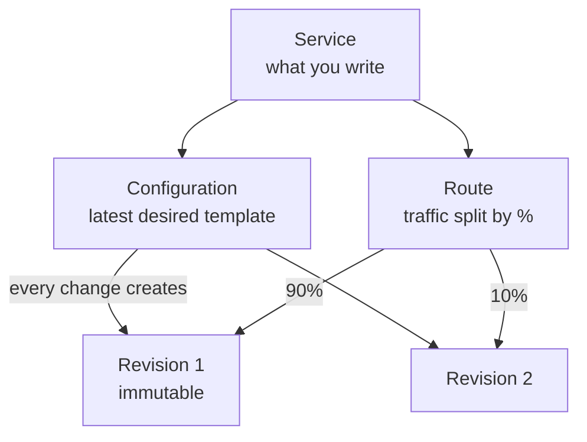

# Knative — Complete Notes (Beginner → Advanced)

> Serverless on Kubernetes: request-driven autoscaling (including **scale to zero**), immutable revisions with traffic splitting, and a CloudEvents-based eventing layer. Runs on any conformant Kubernetes cluster.

## Table of Contents
1. [Beginner — What & Why](#1-beginner--what--why)
2. [Knative Serving](#2-knative-serving)
3. [Autoscaling Internals (KPA, Activator, Queue-Proxy)](#3-autoscaling-internals-kpa-activator-queue-proxy)
4. [Networking Layer & Domains](#4-networking-layer--domains)
5. [Knative Eventing](#5-knative-eventing)
6. [Knative Functions](#6-knative-functions)
7. [Installation & Hands-on Lab](#7-installation--hands-on-lab)
8. [Production Configuration](#8-production-configuration)
9. [Observability & Troubleshooting](#9-observability--troubleshooting)
10. [Knative vs Alternatives](#10-knative-vs-alternatives)
11. [Interview Q&A](#11-interview-qa)
12. [Cheat Sheet](#12-cheat-sheet)

---

## 1. Beginner — What & Why

### What is Knative?
- An open-source, Kubernetes-native platform for **serverless workloads**, started by Google in 2018 with IBM, Red Hat, VMware, SAP and others. Now a **CNCF** project.
- It adds **CRDs + controllers** to Kubernetes. You keep the cluster. Knative gives you a higher-level "just run my container" API on top.
- Think: **"AWS Lambda / Cloud Run experience, but on your own Kubernetes."** Google Cloud Run actually implements the **Knative Serving API**, so a Knative `Service` YAML works on Cloud Run with minimal change.

### The problem it solves
With plain Kubernetes, deploying one HTTP service means writing a Deployment, Service, Ingress/HTTPRoute, HPA, maybe a PDB, plus a canary strategy. And it **never scales below 1 replica**.

Knative replaces that with **one ~10-line object**, and you get:
| You get | Plain K8s equivalent |
|---|---|
| Scale to zero and back on request | Not possible with HPA (min 1) |
| Request-based autoscaling (concurrency / RPS) | HPA on CPU (lags real load) |
| Immutable revision for every change | ReplicaSets, but no routable history |
| % traffic split between revisions | Service mesh or Argo Rollouts |
| Auto URL + TLS per service | Ingress + cert-manager by hand |
| Event routing (CloudEvents) | Build your own with Kafka consumers |

### The building blocks today
> ⚠️ Older tutorials (and the previous version of this note) list **Build, Serving, Eventing**. **Knative Build was deprecated in 2019** and became **Tekton Pipelines**. The current components are:

| Component | Purpose |
|---|---|
| **Serving** | Run stateless HTTP/gRPC containers: revisions, routing, autoscaling, scale-to-zero |
| **Eventing** | Late-binding event routing: sources → brokers/channels → triggers → subscribers, using **CloudEvents** |
| **Functions** (`func` CLI) | Write a function, and the tooling builds the image (Buildpacks/S2I) and deploys it as a Knative Service |
| **`kn` CLI** | Imperative CLI for Serving and Eventing (`kn service create ...`) |

### Mental model
```
            ┌────────────── Knative Service (ksvc) ──────────────┐
  you edit  │  spec.template  → Configuration → Revision 1,2,3…  │
  this only │  spec.traffic   → Route → % split across revisions │
            └────────────────────────────────────────────────────┘
                     │                              │
            K8s Deployment per revision     Ingress (Kourier/Istio/Contour)
            + queue-proxy sidecar           + DNS name + TLS
```

### Serverless contract (what your container must do)
- Listen for HTTP on the port given in **`$PORT`** (default `8080`).
- Be **stateless**: any replica can serve any request, and replicas can be killed at any time (including scale to zero).
- Start fast. Cold start = image pull + container start + app boot + readiness.
- Don't depend on background work after the response is sent. Idle pods may be frozen or removed.

---

## 2. Knative Serving

### The 4 Serving CRDs (`serving.knative.dev/v1`)



| Resource | Short | What it is |
|---|---|---|
| **Service** | `ksvc` | Top-level object you write. Owns a Configuration + Route and manages them for you |
| **Configuration** | `config` | Desired state of code + config (`spec.template`). Every change stamps a new Revision |
| **Revision** | `rev` | **Immutable** point-in-time snapshot of code + config. Each one gets its own Deployment and scales independently (including to 0) |
| **Route** | `route` | Maps a network endpoint to one or more revisions with % weights and tags |

Internal resources you'll see while debugging (`kubectl get` them):
- `PodAutoscaler` (`kpa`), the autoscaling object per revision
- `ServerlessService` (`sks`), which switches traffic between activator and pods (Proxy vs Serve mode)
- `Ingress` (`networking.internal.knative.dev`), turned into Kourier/Istio/Contour config
- `Certificate`, `Metric`, `Image`, `DomainMapping`

### Minimal Service
```yaml
apiVersion: serving.knative.dev/v1
kind: Service
metadata:
  name: hello
  namespace: default
spec:
  template:
    spec:
      containers:
        - image: ghcr.io/knative/helloworld-go:latest
          ports:
            - containerPort: 8080
          env:
            - name: TARGET
              value: "World"
```
```bash
kubectl apply -f hello.yaml
kubectl get ksvc hello
# NAME    URL                                       LATESTCREATED   LATESTREADY   READY
# hello   http://hello.default.127.0.0.1.sslip.io   hello-00001     hello-00001   True
```
Behind the scenes Knative creates: Configuration `hello`, Revision `hello-00001`, Deployment `hello-00001-deployment`, Route `hello`, K8s Services (public + private), the PodAutoscaler and SKS.

### Revisions
- **Any** change under `spec.template` creates a new revision: image, env, resources, annotations under `template.metadata`.
- Changes outside `template` (like `spec.traffic`) do **not** create a revision.
- **Image tags are resolved to a digest** when the revision is created. A revision pinned to `myapp:latest` keeps running that exact digest forever, even if `latest` moves. To pick up a new image you must change the template (new tag, or bump an annotation/env).
  - The controller needs registry access to resolve digests. Private registries: give it `imagePullSecrets`, or skip resolution in `config-deployment` (`registries-skipping-tag-resolving`).
- You can name revisions: `spec.template.metadata.name: hello-v2`. It must be prefixed with the service name, and you can't reuse a name with different content.

### Traffic splitting, canary and blue/green
```yaml
spec:
  template:
    metadata:
      name: hello-v2
    spec:
      containers:
        - image: ghcr.io/knative/helloworld-go:latest
          env: [{ name: TARGET, value: "v2" }]
  traffic:
    - revisionName: hello-v1
      percent: 90
      tag: stable          # → http://stable-hello.default.<domain>
    - revisionName: hello-v2
      percent: 10
      tag: canary          # → http://canary-hello.default.<domain>
    - latestRevision: true
      percent: 0
      tag: latest          # always points to newest ready revision, no live traffic
```
- **Tags** give each revision a dedicated URL, so you can test `canary-hello...` directly before shifting any real traffic.
- **Blue/green**: deploy at `percent: 0` with a tag, test it, then flip to 100.
- **Rollback**: set traffic back to the old `revisionName`. Old revisions still exist and scale up from zero on demand.
- `latestRevision: true` means "follow whatever is newest". **Pin explicit revisions in production** so a bad push doesn't instantly get 100%.
- **Gradual rollout**: annotate the Service with `serving.knative.dev/rollout-duration: "380s"`. Knative then moves traffic to the new revision step by step over that window, instead of in one jump.

Using the CLI:
```bash
kn service update hello --env TARGET=v3 --revision-name hello-v3
kn service update hello --traffic hello-v1=80 --traffic hello-v3=20 --tag hello-v3=canary
kn revision list
```

### Container spec — what's allowed
- Knative accepts a **subset of the PodSpec** by design (so the platform stays portable). Things like `nodeSelector`, `affinity`, `tolerations`, PVCs, `hostPath`, `runtimeClassName` and init containers are **behind feature flags** in `config-features` (e.g. `kubernetes.podspec-affinity: enabled`).
- **Multi-container** is supported, but **exactly one** container may expose a port.
- Probes: liveness/readiness are supported. With no readiness probe, Knative adds a default TCP probe on the port. Startup speed is critical here: the **queue-proxy** performs aggressive readiness probing to make cold starts quick.
- **Hard concurrency limit**: `spec.template.spec.containerConcurrency: 10` means at most 10 in-flight requests per pod; excess requests queue in queue-proxy/activator. `0` = unlimited (default). Use `1` for single-threaded or non-thread-safe apps.
- `timeoutSeconds` (default 300, max set by `max-revision-timeout-seconds` in `config-defaults`), `responseStartTimeoutSeconds`, `idleTimeoutSeconds`.

### Private (cluster-local) services
```yaml
metadata:
  labels:
    networking.knative.dev/visibility: cluster-local
```
→ Only reachable at `hello.default.svc.cluster.local`, never exposed on the external ingress. Use this for internal backends and for event sinks.

### Revision garbage collection (`config-gc`)
Old revisions pile up. Controlled by:
```yaml
retain-since-create-time: "48h"
retain-since-last-active-time: "15h"
min-non-active-revisions: "20"
max-non-active-revisions: "1000"   # "disabled" for no cap
```
Revisions referenced by a Route are never collected.

---

## 3. Autoscaling Internals (KPA, Activator, Queue-Proxy)

This is the part interviewers love: **how does scale-from-zero actually work?**

### Data-plane components (namespace `knative-serving`)
| Component | Role |
|---|---|
| **queue-proxy** | Sidecar injected into **every** revision pod. Proxies requests to your container, enforces `containerConcurrency`, collects concurrency/RPS metrics for the autoscaler, handles graceful drain, and probes readiness. Ports: `8012` HTTP, `8013` h2c, `8022` admin, `9090` autoscaler metrics, `9091` user-facing Prometheus metrics |
| **activator** | Shared deployment that **buffers requests** for revisions at zero (or with too little capacity), reports demand to the autoscaler, and then load-balances to pods once they're ready |
| **autoscaler** | Scrapes queue-proxy metrics (plus activator stats), computes the desired pod count, updates the PodAutoscaler → Deployment replicas |
| **controller** | Reconciles ksvc → Configuration/Revision/Route etc. |
| **webhook** | Defaulting + validation admission webhooks for Knative CRDs |
| **net-*-controller** | Translates Knative `Ingress` into Kourier/Istio/Contour/Gateway API config |

### Scale-from-zero, step by step
```
                 ┌──────────┐
client ─► Ingress│ Kourier  │─► K8s Service (public) ─► endpoints = ACTIVATOR   (SKS mode: Proxy)
                 └──────────┘                               │
                                                            │ 1. buffer request
                                                            │ 2. tell autoscaler "demand on rev X"
                                                            ▼
                                                      autoscaler ─► scale Deployment 0 → 1
                                                            │
                     pod (queue-proxy + user-container) becomes Ready
                                                            │
                 activator forwards buffered request ◄──────┘
                 once capacity is enough → SKS flips to Serve mode → endpoints = POD IPs
                 (activator drops out of the data path)
```
1. A revision at 0 replicas has its **ServerlessService (SKS) in `Proxy` mode**. The public K8s Service's endpoints point to the **activator** pods.
2. A request arrives → the activator **holds** it and reports demand → the autoscaler sets replicas ≥ 1 right away (it doesn't wait for a metric window).
3. Pod starts. The activator probes it and forwards the buffered request as soon as it's ready.
4. When there's enough spare capacity (see **target-burst-capacity**), the SKS flips to **`Serve` mode** and traffic goes **directly** to pods, so the activator is no longer an extra hop.
5. Traffic stops → after the **stable window (60s)** with no requests, plus the **scale-to-zero grace period (30s)**, SKS goes back to Proxy mode and the Deployment goes to 0.

### KPA (Knative Pod Autoscaler) algorithm
- Default class: `kpa.autoscaling.knative.dev`. It scales on **concurrency** (in-flight requests) or **RPS**, not CPU, so it reacts to real demand instead of a lagging side-effect.
- **desired pods = observed metric / (target × target-utilization)**.
  - `target` (soft): default concurrency **100** (`container-concurrency-target-default`).
  - `target-utilization-percentage` default **70%**, so with target 100 it scales out when pods average ~70 in-flight requests. The headroom absorbs bursts while new pods start.
  - If you set a hard `containerConcurrency`, that also caps the effective target.
- **Two windows**:
  - **Stable window**: 60s average, used in normal operation.
  - **Panic window**: 10% of stable = **6s**. If 6s demand ≥ **200%** (`panic-threshold-percentage`) of current capacity, KPA enters **panic mode**: it scales on the short window and **never scales down** while panicking (60s), so it doesn't flap during a spike.
- **Rate limits**: `max-scale-up-rate` (1000×) and `max-scale-down-rate` (2× per eval), so it can't halve more than once per tick.
- **target-burst-capacity (TBC)** (default 200): how much spare request capacity must exist before the activator is removed from the path. `0` = activator only used at zero. `-1` = activator always in path (best load balancing under bursty load, costs one extra hop).

### HPA class (alternative)
```yaml
metadata:
  annotations:
    autoscaling.knative.dev/class: hpa.autoscaling.knative.dev
    autoscaling.knative.dev/metric: cpu        # or memory
    autoscaling.knative.dev/target: "80"       # % CPU
```
- Uses the normal Kubernetes HPA. **Cannot scale to zero.** Use it for CPU-bound work where concurrency isn't a good signal.
- Requires the optional `autoscaler-hpa` component.

### Per-revision autoscaling annotations (on `spec.template.metadata.annotations`)
```yaml
autoscaling.knative.dev/metric: "concurrency"       # concurrency | rps (KPA) ; cpu | memory (HPA)
autoscaling.knative.dev/target: "50"                # soft target per pod
autoscaling.knative.dev/target-utilization-percentage: "70"
autoscaling.knative.dev/min-scale: "1"              # >0 → no scale to zero, no cold starts
autoscaling.knative.dev/max-scale: "20"             # cap cost / protect downstream DB
autoscaling.knative.dev/initial-scale: "3"          # replicas when revision is first created
autoscaling.knative.dev/scale-down-delay: "15m"     # hold capacity after a spike
autoscaling.knative.dev/window: "60s"               # stable window (6s–1h)
autoscaling.knative.dev/panic-window-percentage: "10"
autoscaling.knative.dev/panic-threshold-percentage: "200"
autoscaling.knative.dev/scale-to-zero-pod-retention-period: "5m"  # keep last pod around
autoscaling.knative.dev/activation-scale: "2"       # when scaling from 0, go straight to 2
```
Cluster-wide defaults live in the **`config-autoscaler`** ConfigMap (`enable-scale-to-zero`, `scale-to-zero-grace-period`, `stable-window`, `container-concurrency-target-default`, …).

### Cold-start mitigation (practical list)
1. `min-scale: "1"` for latency-sensitive services (you pay for one idle pod).
2. `scale-to-zero-pod-retention-period` / `scale-down-delay` for spiky but frequent traffic.
3. Small images (distroless / static Go / GraalVM native), pre-pulled images or a node image cache.
4. Fast app boot: lazy-init heavy clients, avoid big JIT warm-up (JVM → CDS / CRaC / native image).
5. Readiness that reflects real readiness, but returns quickly.
6. `activation-scale` > 1 if the first burst after idle is large.

---

## 4. Networking Layer & Domains

### Pluggable ingress
Knative Serving does **not** ship its own gateway. You pick one networking layer:
| Layer | Notes |
|---|---|
| **Kourier** | Lightweight Envoy-based gateway built for Knative. Default choice in docs and quickstart. No mesh |
| **Istio** (`net-istio`) | Use if you already run Istio. Gives mTLS, mesh policy, AuthorizationPolicy |
| **Contour** (`net-contour`) | Envoy-based, HTTPProxy CRDs |
| **Gateway API** (`net-gateway-api`) | Uses the K8s Gateway API implementation of your choice |

Selected in `config-network`:
```bash
kubectl patch configmap/config-network -n knative-serving --type merge \
  -p '{"data":{"ingress-class":"kourier.ingress.networking.knative.dev"}}'
```

### Domains
- URL template: `{{.Name}}.{{.Namespace}}.{{.Domain}}` (customise via `domain-template` in `config-network`).
- `config-domain` sets the domain. Default `svc.cluster.local` (internal only) or `example.com`.
  - Dev: the `serving-default-domain` job configures **sslip.io** "magic DNS" (`hello.default.1.2.3.4.sslip.io`).
  - Prod: set `config-domain` to `apps.mycorp.com: ""` and add a wildcard DNS `*.apps.mycorp.com → ingress LB IP`.
- Different domains per namespace/label: `config-domain` entries with label selectors.
- **DomainMapping** maps a vanity domain to one service:
```yaml
apiVersion: serving.knative.dev/v1beta1
kind: DomainMapping
metadata:
  name: api.mycorp.com
  namespace: default
spec:
  ref: { name: hello, kind: Service, apiVersion: serving.knative.dev/v1 }
```

### TLS
- **External domain TLS**: integrate **cert-manager** via `net-certmanager`, enable `external-domain-tls: Enabled` in `config-network`. Knative then creates a `Certificate` per service (HTTP-01 per host, or DNS-01 for wildcards).
- **cluster-local-domain-tls** and **system-internal-tls** encrypt internal hops (activator ↔ queue-proxy) when you need encryption inside the cluster without a mesh.
- `http-protocol: Redirected` forces HTTP → HTTPS.

### gRPC / HTTP/2 / WebSockets
- Name the port `h2c` for gRPC or plain-text HTTP/2: `ports: [{ name: h2c, containerPort: 8080 }]`.
- WebSockets work, but remember that long-lived connections keep "concurrency" high, so autoscaling and scale-to-zero behave differently.

---

## 5. Knative Eventing

### Core idea
Decouple **event producers** from **consumers** using **CloudEvents** (a CNCF spec: standard attributes `id`, `source`, `type`, `specversion`, `subject`, `time`, plus data) delivered over **HTTP POST**. Consumers are just HTTP endpoints, usually Knative Services, so they **scale to zero when there are no events**.

### Duck types (why everything plugs into everything)
- **Addressable**: anything with `status.address.url` (ksvc, Broker, Channel, a K8s Service).
- **Sink**: where a source/trigger sends events, referenced by `ref:` (an Addressable) or a raw `uri:`.
- **Source**: anything that produces events into a sink (`spec.sink`).

### Components
| Resource | Purpose |
|---|---|
| **Sources** | `PingSource` (cron), `ApiServerSource` (K8s API events), `ContainerSource`, `SinkBinding` (inject `K_SINK` env into any workload), `KafkaSource`, plus many more (GitHub, GitLab, AWS SQS/SNS via Apache Camel / `IntegrationSource`, RabbitMQ, Redis…) |
| **Broker** | An event mesh/hub. Producers send to it, Triggers filter from it. Implementations: `MTChannelBasedBroker` (backed by a Channel: InMemoryChannel/KafkaChannel), **Kafka Broker** (native, recommended for prod), RabbitMQ Broker |
| **Trigger** | Subscription to a Broker with an **attribute filter** → subscriber |
| **Channel + Subscription** | Lower-level pub/sub pipe (InMemoryChannel = dev only, **not durable**; KafkaChannel = durable) |
| **Sequence** | Pipeline: step1 → step2 → step3, each step's reply feeds the next |
| **Parallel** | Fan-out to branches, each with an optional filter |
| **JobSink** | Each event triggers a Kubernetes **Job** (long-running work that doesn't fit an HTTP request) |
| **EventType** | Registry/catalog of event types discoverable in the cluster |

### Broker + Trigger pattern (the one you'll use most)
```
PingSource ─┐                         ┌─► Trigger(type=order.created) ─► ksvc: invoicer
KafkaSource ┼─► Broker "default" ─────┼─► Trigger(type=order.created, source=web) ─► ksvc: emailer
any app POST┘   (durable if Kafka)    └─► Trigger(no filter) ─► ksvc: event-display (debug)
```
```yaml
apiVersion: eventing.knative.dev/v1
kind: Broker
metadata:
  name: default
  namespace: shop
  annotations:
    eventing.knative.dev/broker.class: Kafka    # or MTChannelBasedBroker
spec:
  delivery:
    retry: 5
    backoffPolicy: exponential
    backoffDelay: PT0.5S        # ISO-8601 duration
    deadLetterSink:
      ref: { apiVersion: serving.knative.dev/v1, kind: Service, name: dlq-handler }
---
apiVersion: eventing.knative.dev/v1
kind: Trigger
metadata:
  name: invoicer-on-order
  namespace: shop
spec:
  broker: default
  filter:
    attributes:
      type: com.shop.order.created
      source: /web
  subscriber:
    ref: { apiVersion: serving.knative.dev/v1, kind: Service, name: invoicer }
```
- `filter.attributes` = **exact match** on CloudEvent attributes (including extensions).
- Newer `filters:` field supports `exact`, `prefix`, `suffix`, `all`, `any`, `not` and **CESQL** expressions for richer matching.
- **Reply events**: if a subscriber responds with a CloudEvent, the broker re-ingests it. That's how you chain services without them knowing about each other. Watch out for **loops** (a trigger that matches its own reply).

### Sending an event to a Broker (manually)
```bash
kubectl run curl --image=curlimages/curl --rm -it --restart=Never -- \
  curl -v "http://broker-ingress.knative-eventing.svc.cluster.local/shop/default" \
  -H "Ce-Id: 1" -H "Ce-Specversion: 1.0" \
  -H "Ce-Type: com.shop.order.created" -H "Ce-Source: /web" \
  -H "Content-Type: application/json" -d '{"orderId":42}'
```
(That's the **binary content mode**: attributes in `Ce-*` headers. **Structured mode** puts the whole envelope in a JSON body with `Content-Type: application/cloudevents+json`.)

### Sources examples
```yaml
apiVersion: sources.knative.dev/v1
kind: PingSource
metadata: { name: every-minute }
spec:
  schedule: "*/1 * * * *"
  contentType: application/json
  data: '{"msg":"tick"}'
  sink:
    ref: { apiVersion: eventing.knative.dev/v1, kind: Broker, name: default }
---
apiVersion: sources.knative.dev/v1
kind: ApiServerSource
metadata: { name: k8s-events }
spec:
  mode: Resource
  serviceAccountName: events-sa          # needs RBAC get/list/watch on the resources
  resources:
    - apiVersion: v1
      kind: Event
  sink:
    ref: { apiVersion: eventing.knative.dev/v1, kind: Broker, name: default }
---
apiVersion: sources.knative.dev/v1
kind: SinkBinding                        # turn ANY Deployment/Job/CronJob into a source
metadata: { name: bind-my-producer }
spec:
  subject:
    apiVersion: apps/v1
    kind: Deployment
    selector: { matchLabels: { app: my-producer } }
  sink:
    ref: { apiVersion: eventing.knative.dev/v1, kind: Broker, name: default }
# Pod gets env K_SINK=<broker url> and K_CE_OVERRIDES
```

### Delivery guarantees (important for interviews)
- **At-least-once** delivery (with a durable broker). Consumers must be **idempotent**: de-dupe on CloudEvent `id` + `source`.
- **InMemoryChannel loses events** on pod restart. Never use it in production.
- Retries with backoff, then the **dead-letter sink**. Always configure a DLS in prod.
- Ordering: not guaranteed in general. The Kafka broker/source can preserve **per-partition ordering** (`kafka.eventing.knative.dev/delivery.order: ordered` on the Trigger, which costs throughput).
- Backpressure: the subscriber returning `429`/`5xx` triggers a retry. A subscriber that scales from zero absorbs a burst via the activator.

### Eventing control-plane pieces (namespace `knative-eventing`)
`eventing-controller`, `eventing-webhook`, `imc-controller`/`imc-dispatcher` (InMemoryChannel), `mt-broker-ingress`, `mt-broker-filter`, `mt-broker-controller`, and for Kafka: `kafka-controller`, `kafka-broker-receiver`, `kafka-broker-dispatcher`.

---

## 6. Knative Functions

Higher-level developer experience: write a function, and the tooling handles the container.
```bash
kn func create -l go hello-fn          # languages: go, node, python, quarkus, rust, springboot, typescript
cd hello-fn
kn func run                            # build + run locally in a container
kn func deploy --registry ghcr.io/me   # build image (Buildpacks/S2I), push, create ksvc
kn func invoke                         # send a test HTTP/CloudEvent request
kn func deploy --remote                # build ON-cluster via Tekton pipeline (CI-less)
```
- Templates: `http` and `cloudevents` (the handler receives a parsed CloudEvent).
- Config lives in `func.yaml` (envs, volumes, build options).
- The output is still just a **Knative Service**, so all of Serving (revisions, autoscaling) applies.

---

## 7. Installation & Hands-on Lab

### Option A — local quickstart (kind)
```bash
brew install knative/client/kn knative-extensions/kn-plugins/quickstart kind
kn quickstart kind        # creates kind cluster + Serving + Kourier + Eventing + sslip.io DNS
```

### Option B — YAML install (any cluster)
```bash
V=knative-v1.19.0   # pick the current release from github.com/knative/serving/releases

# Serving
kubectl apply -f https://github.com/knative/serving/releases/download/$V/serving-crds.yaml
kubectl apply -f https://github.com/knative/serving/releases/download/$V/serving-core.yaml

# Networking layer: Kourier
kubectl apply -f https://github.com/knative/net-kourier/releases/download/$V/kourier.yaml
kubectl patch configmap/config-network -n knative-serving --type merge \
  -p '{"data":{"ingress-class":"kourier.ingress.networking.knative.dev"}}'

# DNS (dev): sslip.io magic DNS
kubectl apply -f https://github.com/knative/serving/releases/download/$V/serving-default-domain.yaml

# Optional: HPA class autoscaler
kubectl apply -f https://github.com/knative/serving/releases/download/$V/serving-hpa.yaml

# Eventing
kubectl apply -f https://github.com/knative/eventing/releases/download/$V/eventing-crds.yaml
kubectl apply -f https://github.com/knative/eventing/releases/download/$V/eventing-core.yaml
kubectl apply -f https://github.com/knative/eventing/releases/download/$V/in-memory-channel.yaml  # dev only
kubectl apply -f https://github.com/knative/eventing/releases/download/$V/mt-channel-broker.yaml

kubectl get pods -n knative-serving -n knative-eventing
```

### Option C — Knative Operator (recommended for prod / GitOps)
```yaml
apiVersion: operator.knative.dev/v1beta1
kind: KnativeServing
metadata: { name: knative-serving, namespace: knative-serving }
spec:
  version: "1.19"
  ingress:
    kourier: { enabled: true }
  config:
    network:
      ingress-class: kourier.ingress.networking.knative.dev
    domain:
      apps.mycorp.com: ""
    autoscaler:
      scale-to-zero-grace-period: "30s"
  high-availability:
    replicas: 2
```
All ConfigMap tuning lives in one CR, which works well with Argo CD.

### Lab: watch scale-to-zero happen
```bash
kn service create hello --image ghcr.io/knative/helloworld-go:latest --env TARGET=Knative
URL=$(kn service describe hello -o url)

kubectl get pods -l serving.knative.dev/service=hello -w   # terminal 1
curl $URL                                                   # terminal 2 → pod appears (cold start)
# wait ~90s with no traffic → pod Terminating → 0 pods

# load test → watch it scale out
hey -z 30s -c 200 $URL          # (brew install hey)
kubectl get kpa hello-00001     # DESIREDSCALE / ACTUALSCALE
```

### Lab: canary
```bash
kn service update hello --env TARGET=v2 --revision-name hello-v2
kn service update hello --traffic hello-00001=90 --traffic hello-v2=10 --tag hello-v2=canary
for i in $(seq 20); do curl -s $URL; done | sort | uniq -c
```

### Lab: event-driven
```bash
kn broker create default
kn service create event-display --image gcr.io/knative-releases/knative.dev/eventing/cmd/event_display
kn trigger create all-events --broker default --sink ksvc:event-display
kn source ping create tick --schedule "*/1 * * * *" --data '{"hi":"there"}' --sink broker:default
kubectl logs -l serving.knative.dev/service=event-display -c user-container -f
```

---

## 8. Production Configuration

### Checklist
- [ ] **HA control plane**: ≥2 replicas of controller, webhook, activator, autoscaler (leader election built in). Add PDBs. Spread the activator across zones (it's in the data path!).
- [ ] **Activator sizing**: it buffers traffic for cold revisions and any TBC-proxied traffic. Give it an HPA (shipped by default) and enough CPU.
- [ ] **Real networking layer + TLS**: Kourier/Istio behind a cloud LB, cert-manager + `external-domain-tls`.
- [ ] **Wildcard DNS** for the app domain, or DomainMapping per service.
- [ ] **max-scale everywhere**: scale-to-many can DDoS your own database. Pair it with DB connection pooling.
- [ ] **min-scale on latency-critical** services. Allow scale-to-zero on the long tail of rarely used services (that's where the cost savings are).
- [ ] **Resource requests/limits** on the user container. The queue-proxy has its own resources (`queue-sidecar-cpu-request` etc. in `config-deployment`).
- [ ] **Durable eventing**: Kafka Broker (or RabbitMQ), never InMemoryChannel, plus a DLS on every Broker/Trigger.
- [ ] **Revision GC** tuned so etcd doesn't fill up with thousands of revisions.
- [ ] **Pin traffic** to explicit revisions. Promote via GitOps PR (Argo CD/Flux) instead of `latestRevision: true`.
- [ ] **Private registries**: imagePullSecrets on the ServiceAccount, plus the digest-resolution consideration.
- [ ] **Graceful shutdown**: the app must handle SIGTERM. Knative drains through queue-proxy, so make sure `timeoutSeconds` fits your longest request.
- [ ] **NetworkPolicies**: allow traffic from the activator + ingress namespaces to user pods. A missing rule here is a classic cause of "works at min-scale=1, breaks from zero".

### Typical uses
- APIs/webhooks with bursty or low traffic (internal tools, per-tenant services, PR preview environments): scale-to-zero saves a lot.
- Event processors: S3/Kafka/K8s events → small services.
- ML inference: **KServe** is built on Knative Serving (scale-to-zero for models, canary between model versions).
- Platform engineering: give devs a "Heroku-like" `kn service create` experience on the company cluster.

### When NOT to use Knative
- Stateful workloads, long-lived TCP (non-HTTP) servers, or databases.
- Steady high-throughput services that never idle (plain Deployment + HPA is simpler, and you skip the extra hop/sidecar).
- Background workers that pull from a queue (use **KEDA** instead).
- Very strict p99 latency where an occasional cold start is unacceptable and min-scale everywhere removes the benefit.

---

## 9. Observability & Troubleshooting

### Status conditions are your friend
```bash
kubectl get ksvc hello -o yaml | yq '.status.conditions'
kn service describe hello -v
kubectl get configuration,revision,route,kpa,sks -l serving.knative.dev/service=hello
kubectl describe revision hello-00002
```
Condition chain: `Service.Ready` ← `ConfigurationsReady` + `RoutesReady`. Drill into the failing one.

### Common problems
| Symptom | Likely cause / fix |
|---|---|
| ksvc `RevisionMissing`, revision `ContainerMissing` / `Unable to fetch image` | Digest resolution failed: private registry without pull secret, typo in tag, or controller can't reach the registry |
| Revision `ProgressDeadlineExceeded` | Pod never became Ready: crash loop, wrong port (not listening on `$PORT`), failing readiness probe, insufficient resources. Check `kubectl logs <pod> -c user-container` and `-c queue-proxy` |
| URL returns 404 | Wrong Host header/domain. `curl -H "Host: hello.default.example.com" http://<ingress-ip>`. Check `config-domain` and DNS |
| Works with min-scale=1, times out from zero | NetworkPolicy blocks the activator, the activator is unhealthy, or startup time exceeds the activator timeout |
| Slow first request | Cold start: image pull + boot. See the mitigation list in §3 |
| Never scales to zero | `min-scale` set, `enable-scale-to-zero: false`, HPA class, or something keeps polling it (health checker, Prometheus probe, long-lived WebSocket) |
| Scales too late under load | Target too high for the app's real capacity. Lower `target`, set `containerConcurrency`, consider `metric: rps` |
| Webhook errors on apply | `webhook` pods not ready, or cert issue: `kubectl get pods -n knative-serving` |
| Events not arriving | `kubectl get broker,trigger` must be Ready. Check the Trigger's subscriber URI, the filter mismatch (exact match, case-sensitive), and the DLS. Add an `event-display` trigger with no filter to see what actually flows |

### Logs & metrics
- Control plane logs: `kubectl logs -n knative-serving deploy/controller` (also `autoscaler`, `activator`).
- Logging level: `config-logging` ConfigMap (`loglevel.autoscaler: debug`).
- Metrics: queue-proxy exposes request count/latency per revision and concurrency. Autoscaler/activator expose their own. Scrape with Prometheus (ServiceMonitors / PodMonitors), with Grafana dashboards available from the Knative monitoring repo.
- Tracing: `config-tracing` / `config-observability` → OpenTelemetry/Zipkin backend. Knative propagates trace context through activator and queue-proxy.

---

## 10. Knative vs Alternatives

| | **Knative** | **AWS Lambda** | **Google Cloud Run** | **KEDA** | **OpenFaaS** | **Plain Deployment + HPA** |
|---|---|---|---|---|---|---|
| Runs on | Any K8s | AWS only | GCP managed (Knative API) | Any K8s | Any K8s / faasd | Any K8s |
| Unit | Container (HTTP) | Function (zip/image) | Container | Any Deployment/Job | Function/container | Container |
| Scale to zero | ✅ request-driven | ✅ | ✅ | ✅ event/queue-driven | ✅ | ❌ (min 1) |
| Scaling signal | Concurrency/RPS | Per-invocation | Concurrency | 60+ scalers (Kafka lag, SQS depth, cron, Prometheus…) | RPS / custom | CPU/memory/custom |
| Traffic split & revisions | ✅ built-in | Aliases/weights | ✅ | ❌ | Limited | ❌ (need mesh/Argo Rollouts) |
| Eventing | ✅ CloudEvents brokers | EventBridge etc. | Eventarc | Consumes, doesn't route | Connectors | ❌ |
| Ops burden | You run it | None | None | Low | Medium | Low |
| Lock-in | None | High | Low (Knative-compatible) | None | None | None |

**Knative vs KEDA in one line**: Knative scales **HTTP request-serving** pods (push model: requests come to you). KEDA scales **consumers** based on an external backlog (pull model: you go get work). They're complementary, and you can run both.

---

## 11. Interview Q&A

**Q1. What is Knative and what are its components?**
A K8s-native serverless platform. **Serving** (revisions, routing, request-based autoscaling with scale-to-zero), **Eventing** (CloudEvents brokers/triggers/sources) and **Functions** (build-and-deploy tooling). The old **Build** component was deprecated and became **Tekton**.

**Q2. Explain Service, Configuration, Revision and Route.**
The Service is the top-level object. It manages a Configuration (desired template) and a Route (traffic). Each template change creates an immutable Revision with its own Deployment. The Route splits traffic across revisions by percentage and exposes tag URLs.

**Q3. How does scale-from-zero work?**
At zero, the revision's SKS is in Proxy mode, so the K8s Service endpoints point to the **activator**. The activator buffers the request and signals the autoscaler, which scales the Deployment 0→1. When the pod is ready, the activator forwards the request. Once there's enough capacity (target-burst-capacity), the SKS switches to Serve mode and the activator leaves the data path.

**Q4. What does the queue-proxy do?**
It's a sidecar in every pod. It enforces `containerConcurrency`, reports concurrency/RPS metrics to the autoscaler, does fast readiness probing, handles graceful drain/timeouts, and exposes per-revision request metrics.

**Q5. KPA vs HPA in Knative?**
KPA (default) scales on concurrency or RPS, supports scale-to-zero, and has stable/panic windows for bursts. HPA class scales on CPU/memory with the standard HPA and **cannot scale to zero**.

**Q6. What's panic mode?**
If demand over the short panic window (6s) is ≥200% of current capacity, KPA scales based on that short window and suppresses scale-down until things are stable again. This lets it react to spikes without waiting for the 60s average.

**Q7. Difference between `containerConcurrency` and `autoscaling.knative.dev/target`?**
`containerConcurrency` is a **hard limit**: requests beyond it queue. `target` is a **soft goal** the autoscaler aims for when deciding replica count. Example: target 50, hard limit 100.

**Q8. How do you do a canary in Knative?**
Create a new revision (optionally with `percent: 0` and a tag to test it directly), then edit `spec.traffic` to 90/10, 50/50, 100. Rollback = point traffic back at the old revision name. You can also use `serving.knative.dev/rollout-duration` for an automatic gradual rollout.

**Q9. Why did my revision keep running the old image after I pushed `:latest`?**
Knative resolves tags to a **digest** at revision creation, so revisions are immutable. Change the template (new tag or bumped annotation) to get a new revision.

**Q10. How do you avoid cold starts?**
`min-scale ≥1`, `scale-down-delay` / pod retention period, small images and fast boot, `initial-scale` / `activation-scale`. It's a trade-off: an idle pod costs money.

**Q11. Broker/Trigger vs Channel/Subscription?**
A Channel/Subscription is a raw pub/sub pipe: every subscriber gets every event. A Broker/Trigger adds **attribute-based filtering**, so producers send to one place and consumers declare interest. That's the preferred, more decoupled model. Brokers are often backed by channels internally (MTChannelBasedBroker) or by Kafka directly.

**Q12. What delivery guarantees does Knative Eventing give?**
At-least-once with a durable broker (Kafka/RabbitMQ). It retries with linear/exponential backoff, then sends to a dead-letter sink. Consumers must be idempotent. InMemoryChannel is not durable. Ordering is only per-partition with the Kafka broker when ordered delivery is enabled.

**Q13. What is a CloudEvent?**
A CNCF spec for describing events in a common envelope: `id`, `source`, `specversion`, `type`, optional `subject`, `time`, `datacontenttype`, plus extensions. It can be sent in binary mode (`Ce-*` HTTP headers) or structured mode (whole JSON envelope).

**Q14. Knative vs KEDA?**
Knative is for request-driven HTTP autoscaling with revisions/traffic split and eventing. KEDA scales any workload based on external queue/backlog metrics. Use Knative for APIs/webhooks and KEDA for queue consumers. You can use both together.

**Q15. Knative vs AWS Lambda?**
Knative is portable, runs containers on your own K8s with no runtime/duration limits beyond the timeout you set, and you operate it yourself. Lambda is fully managed with zero ops, but locks you into AWS and has limits (15 min max duration, package size, its own cold starts).

**Q16. A Knative service works at min-scale=1 but times out when scaled to zero. Debug it.**
At zero, traffic goes through the activator. Check the activator pods/logs, NetworkPolicies allowing `knative-serving` → app namespace, the readiness probe and startup time versus the request timeout, and image pull time (a large image on a fresh node). Use `kubectl get sks` to confirm the mode switch happens.

**Q17. How would you run Knative in production?**
Use the Operator with GitOps, HA replicas plus PDBs for activator/autoscaler/controller/webhook, Kourier or Istio behind a cloud LB, cert-manager TLS, wildcard DNS, `max-scale` on every service, `min-scale` on critical paths, a Kafka broker with DLS, revision GC, Prometheus/Grafana/OTel, and NetworkPolicies.

**Q18. What platforms are built on Knative?**
Google Cloud Run (Knative Serving API), Red Hat OpenShift Serverless, KServe (model inference), and historically IBM Cloud Code Engine and VMware Tanzu.

**Q19. How do you make a Knative service internal-only?**
Add the label `networking.knative.dev/visibility: cluster-local`. It's then reachable only at `*.svc.cluster.local` and not on the external gateway.

**Q20. How does a non-Knative app publish events into Knative Eventing?**
Plain HTTP POST of a CloudEvent to the Broker ingress URL. Or use a **SinkBinding**, which injects `K_SINK` into the Deployment so the app doesn't hardcode the URL.

---

## 12. Cheat Sheet

```bash
# Serving
kn service create NAME --image IMG [--env K=V] [--scale-min 1 --scale-max 10] [--concurrency-limit 10]
kn service update NAME --image IMG --revision-name NAME-v2
kn service update NAME --traffic NAME-v1=90 --traffic NAME-v2=10 --tag NAME-v2=canary
kn service list | describe NAME | delete NAME
kn revision list | describe REV | delete REV
kn route list
kn domain create api.mycorp.com --ref NAME

# Eventing
kn broker create default
kn trigger create T --broker default --filter type=com.x.y --sink ksvc:svc
kn source ping create P --schedule "*/5 * * * *" --data '{}' --sink broker:default
kn source apiserver create A --resource Event:v1 --service-account sa --sink broker:default
kn source list | kn source list-types

# Functions
kn func create -l python fn && kn func deploy --registry REG && kn func invoke

# kubectl
kubectl get ksvc,configuration,revision,route,kpa,sks -n NS
kubectl get broker,trigger,pingsource,apiserversource -n NS
kubectl get cm -n knative-serving config-autoscaler -o yaml
kubectl logs -n knative-serving deploy/activator
kubectl logs POD -c queue-proxy
```

| Key ConfigMaps (`knative-serving`) | What you tune |
|---|---|
| `config-autoscaler` | scale-to-zero, windows, targets, TBC, rates |
| `config-network` | ingress class, domain template, TLS, HTTP→HTTPS |
| `config-domain` | cluster domain(s) |
| `config-defaults` | default timeouts, resources, containerConcurrency |
| `config-deployment` | queue-proxy image/resources, tag-resolution skip list, progress deadline |
| `config-features` | PodSpec feature flags (affinity, PVC, tolerations…) |
| `config-gc` | revision retention |
| `config-observability` / `config-tracing` / `config-logging` | metrics, traces, log levels |

**Key default numbers**: target concurrency 100 · target utilization 70% · stable window 60s · panic window 6s (10%) · panic threshold 200% · scale-to-zero grace 30s · target-burst-capacity 200 · request timeout 300s · port 8080.
