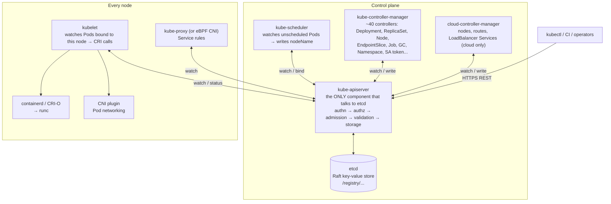
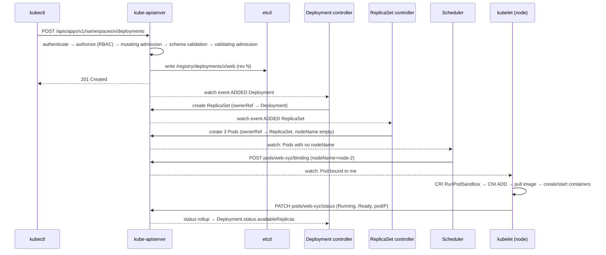
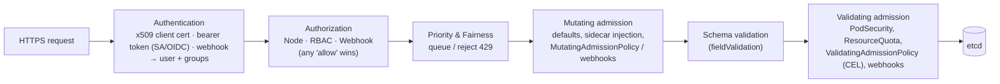
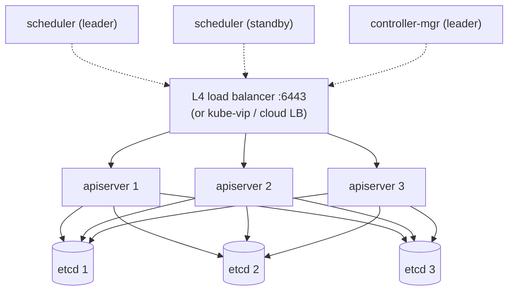

# Kubernetes Architecture & API Internals

> Part of the [Kubernetes deep dives](./README.md). Next: [Scheduling in Depth](./08-scheduling-in-depth.md).
>
> All the output on this page is real, captured on a 2-node minikube cluster running **Kubernetes v1.37.0**, containerd 2.3 and etcd 3.7.0.

Kubernetes is **a database (etcd) behind a REST API (kube-apiserver), plus a set of independent control loops that watch the API and push the world toward what's stored there.** Everything else (scheduling, Deployments, Services, autoscaling) is built from that one pattern. Once you understand it, all Kubernetes behaviour becomes predictable.

---

## 1. The components and what each one really does



| Component | Stateful? | Talks to | Failure impact |
|---|---|---|---|
| **etcd** | **Yes, the only stateful one** | apiserver only | Lose quorum → API read-only or down. Lose data → cluster is gone (restore from backup) |
| **kube-apiserver** | No (stateless, scale horizontally) | etcd, webhooks, aggregated APIs | Down → no changes and no new scheduling. **Running Pods keep running** |
| **kube-scheduler** | No (one leader) | apiserver | Down → new Pods stay `Pending`. Existing ones are fine |
| **kube-controller-manager** | No (one leader) | apiserver, cloud | Down → no self-healing: dead Pods aren't replaced, scaling stops, endpoints go stale |
| **kubelet** | Local (Pod state cached on the node) | apiserver, CRI, CNI, CSI | Down → node turns `NotReady` after ~40 s. Pods are evicted after the toleration (default 300 s) |
| **kube-proxy** | No | apiserver, netfilter | Down → existing rules keep working. New Service changes aren't programmed on that node |

**The key design rule: components never talk to each other directly.** The scheduler doesn't call the kubelet. It writes `spec.nodeName` to the Pod through the API, and the kubelet *notices*. That's why parts can fail independently and recover.

---

## 2. Life of a request: `kubectl apply` → running container



### Seeing it for real

**kubectl is just an HTTP client** (`-v=6` shows URLs, `-v=8` adds headers and bodies, `-v=9` gives curl commands):
```text
$ kubectl get pods -v=6
"Response" verb="GET" url="https://127.0.0.1:52958/api/v1/namespaces/api-lab/pods?limit=500" status="200 OK" milliseconds=6

$ kubectl create deploy web --image=nginx -v=8
"Request" verb="POST" url=".../apis/apps/v1/namespaces/api-lab/deployments?fieldManager=kubectl-create&fieldValidation=Strict"
	Content-Type: application/vnd.kubernetes.protobuf
```
Note the `fieldManager` (server-side apply tracking, §6), `fieldValidation=Strict` (unknown fields are rejected), and the **protobuf** content type that kubectl uses for built-in types.

**The scheduler binding, seen through a watch stream.** The raw watch output while scaling 3 → 4:
```text
ADDED     web-7c6cdd646-w5zn2 rv=706 Pending -          ← ReplicaSet controller created it (no node)
MODIFIED  web-7c6cdd646-w5zn2 rv=709 Pending k8slab     ← scheduler bound it (nodeName set)
MODIFIED  web-7c6cdd646-w5zn2 rv=715 Pending k8slab     ← kubelet: containers creating
MODIFIED  web-7c6cdd646-w5zn2 rv=718 Pending k8slab
MODIFIED  web-7c6cdd646-w5zn2 rv=721 Running k8slab     ← kubelet: status Running
```
Every arrow in the sequence diagram is one of those events.

---

## 3. The API: groups, versions, resources, discovery

```text
/api/v1/namespaces/{ns}/pods/{name}                    ← "core" (legacy) group, no group name
/apis/apps/v1/namespaces/{ns}/deployments/{name}        ← named group "apps", version v1
/apis/apps/v1/namespaces/{ns}/deployments/{name}/scale  ← subresource
/apis/apps/v1/namespaces/{ns}/deployments/{name}/status ← subresource (controllers write status here)
/api/v1/nodes/{name}                                    ← cluster-scoped (no namespace)
```

```text
$ kubectl get --raw /apis | jq '.groups[].name'      # 22 groups on this cluster:
apiregistration.k8s.io, apps, events.k8s.io, authentication.k8s.io, authorization.k8s.io, autoscaling,
batch, certificates.k8s.io, networking.k8s.io, policy, rbac.authorization.k8s.io, storage.k8s.io,
admissionregistration.k8s.io, apiextensions.k8s.io, scheduling.k8s.io, coordination.k8s.io, node.k8s.io,
discovery.k8s.io, resource.k8s.io, flowcontrol.apiserver.k8s.io, storagemigration.k8s.io, metrics.k8s.io
$ kubectl api-resources --no-headers | wc -l
71
```
`metrics.k8s.io` isn't served by the apiserver itself. It's an **aggregated API** (the `APIService` object proxies it to metrics-server). Custom APIs come in through **CRDs** (stored by the apiserver) or **aggregation** (your own server). See [Extending Kubernetes](./10-extending-kubernetes.md).

### Versions and maturity
| Level | Example | Promise |
|---|---|---|
| alpha | `v1alpha1` | Off by default (feature gate). Can disappear |
| beta | `v1beta1` | New beta APIs are **off by default** since 1.24. Removed ≥ 3 releases after deprecation |
| GA | `v1` | Never removed within the major version |

```bash
kubectl explain deployment.spec.strategy.rollingUpdate --recursive   # schema docs from the live server
kubectl api-versions
kubectl get deployments.v1.apps                                     # fully-qualified resource
```

**Deprecations bite on upgrades.** Manifests using a removed API version (e.g. `extensions/v1beta1` Ingress, `policy/v1beta1` PodSecurityPolicy, `autoscaling/v2beta2`) fail after the upgrade. Find them *before* upgrading with `kubent`, `pluto`, or the `apiserver_requested_deprecated_apis` metric.

### Every object has the same skeleton
```yaml
apiVersion: apps/v1
kind: Deployment
metadata:
  name: web
  namespace: api-lab
  uid: 6ee99ddb-...            # unique forever — names can be reused, UIDs never
  resourceVersion: "634"       # etcd revision of last change — used for concurrency and watches
  generation: 2                # bumped on SPEC changes only
  labels: {...}                # identifying, selectable
  annotations: {...}           # non-identifying metadata
  ownerReferences: [...]       # garbage collection (§7)
  finalizers: [...]            # deletion hooks (§7)
  managedFields: [...]         # who owns which field (§6)
spec: {...}                    # desired state — written by you
status:                        # observed state — written by controllers, via /status subresource
  observedGeneration: 2        # "I have processed generation 2"
```
```text
before scale:  resourceVersion=620 generation=1 observedGeneration=1
after scale:   resourceVersion=634 generation=2 observedGeneration=2
```
**`observedGeneration == generation`** is how you know a controller has acted on your latest spec. `kubectl rollout status` checks exactly this.

---

## 4. etcd: how the cluster's state is really stored

```text
$ etcdctl get /registry/configmaps/api-lab --prefix --keys-only
/registry/configmaps/api-lab/app
/registry/configmaps/api-lab/kube-root-ca.crt

$ etcdctl get /registry/configmaps/api-lab/app --print-value-only | xxd | head -2
00000000: 6b38 7300 0a0f 0a02 7631 1209 436f 6e66  k8s.....v1..Conf
00000010: 6967 4d61 7012 8302 0ae3 010a 0361 7070  igMap........app
```
- Keys follow the pattern `/registry/<resource>/<namespace>/<name>`.
- Values are **protobuf**, with a `k8s\0` magic prefix (CRDs are stored as JSON).
- **resourceVersion is etcd's `mod_revision`** (`mod_revision 735` here). It's one global, monotonically increasing counter.

### Secrets are not encrypted by default (proved)
```text
$ kubectl create secret generic s1 --from-literal=password=SuperSecret123
$ etcdctl get /registry/secrets/api-lab/s1 --print-value-only | strings | grep -i super
SuperSecret123
```
Base64 in the API is **encoding, not encryption**. Anyone with etcd access, or a copy of an etcd backup, can read every Secret. The fix is an `EncryptionConfiguration` (KMS v2 provider), covered in [Security Hardening](./12-security-hardening.md). Managed clusters (EKS, GKE, AKS) offer envelope encryption with the cloud KMS.

### Raft, quorum, sizing
```text
$ etcdctl endpoint status -w table
VERSION 3.7.0 | DB SIZE 1.7 MB | QUOTA 2.1 GB | IS LEADER true | RAFT TERM 2 | RAFT INDEX 833
```
| Members | Quorum | Failures tolerated |
|---|---|---|
| 1 | 1 | 0 |
| 3 | 2 | **1** |
| 5 | 3 | **2** |
| 4 or 6 | 3 / 4 | Same as 3 / 5. **Even numbers add no tolerance** |

- **Writes need a quorum.** Without it, the cluster can't change anything.
- etcd is **latency-sensitive** (an fsync on every write). Use SSD/NVMe and low-latency links between members. Slow disks show up as `apply request took too long` and leader elections.
- **DB quota** is 2 GB by default (8 GB max recommended). Exceeding it raises an `NOSPACE` alarm and the cluster becomes read-only. Defrag and compaction keep it small. Large objects (huge ConfigMaps, thousands of events, CRDs with big status) are the usual cause.
- Backup and restore is in [Cluster Operations](./11-cluster-operations.md).

---

## 5. The API request pipeline: authentication → authorisation → admission



### Authentication (who are you?)
Kubernetes has **no user objects**. Identity comes from the credential:
```text
$ kubectl auth whoami
Username   minikube-user
Groups     [system:masters system:authenticated]
Extra: authentication.kubernetes.io/credential-id   [X509SHA256=db3569d0...]
```
| Method | Who uses it |
|---|---|
| **x509 client certificates** | Admins (kubeadm `admin.conf`), kubelets (`system:node:<name>`). CN = user, O = groups. **Can't be revoked** before expiry |
| **ServiceAccount tokens** (projected, short-lived, audience-bound JWTs) | Pods → `system:serviceaccount:<ns>:<name>` |
| **OIDC** (Okta, Entra ID, Google, Dex) | Humans in real clusters. Structured authentication config allows multiple issuers |
| **Webhook / cloud IAM** | EKS (IAM → access entries), GKE (Google identity), AKS (Entra ID) |

> `system:masters` **bypasses RBAC entirely**, and you can't revoke it short of rotating the CA. Never give it to humans day to day. Break-glass only.

### Authorisation (may you do this?)
Usually `Node,RBAC`. The **Node authorizer** limits each kubelet to the objects of Pods on its own node.
```text
$ kubectl auth can-i create pods --as=system:serviceaccount:api-lab:default -n api-lab
no                                     ← default SA has no permissions (good)
$ kubectl auth can-i --list --as=jane -n team-a
```
RBAC in depth: [Security: RBAC](./06-security-rbac-networkpolicy.md).

### Admission (should this object be allowed, and changed?)
Built-in plugins include `NamespaceLifecycle`, `LimitRanger`, `ServiceAccount`, `DefaultStorageClass`, `ResourceQuota`, `PodSecurity`, `NodeRestriction` and more. A real PodSecurity rejection from the lab:
```text
$ kubectl label ns api-lab pod-security.kubernetes.io/enforce=restricted
$ kubectl run bad --image=nginx
Error from server (Forbidden): pods "bad" is forbidden: violates PodSecurity "restricted:latest":
  allowPrivilegeEscalation != false, unrestricted capabilities (must drop ALL),
  runAsNonRoot != true, seccompProfile (must be RuntimeDefault or Localhost)
```
Mutation runs **before** validation, so validators see the final object. Webhooks, ValidatingAdmissionPolicy and MutatingAdmissionPolicy are covered in [Extending Kubernetes](./10-extending-kubernetes.md).

**`--dry-run=server`** runs the *entire* pipeline (including defaulting and webhooks) without storing anything. The lab returned a full object with a UID and defaulted fields such as `terminationMessagePath: /dev/termination-log`. Use it in CI to catch admission failures before they hit production.

### API Priority and Fairness (APF): stops one client from DoSing the apiserver
```text
$ kubectl get prioritylevelconfigurations
NAME              TYPE      NOMINALCONCURRENCYSHARES   QUEUES
exempt            Exempt    <none>                     <none>     ← system:masters, health probes
system            Limited   30                         64
leader-election   Limited   10                         16
node-high         Limited   40                         64
workload-high     Limited   40                         128        ← controllers, scheduler
workload-low      Limited   100                        128        ← all other service accounts
global-default    Limited   20                         128        ← everyone else
catch-all         Limited   5                          <none>

$ kubectl get flowschemas      # matched in precedence order → picks a priority level
exempt(1) probes(2) system-leader-election(100) system-node-high(400) system-nodes(500)
kube-controller-manager(800) kube-scheduler(800) kube-system-service-accounts(900)
service-accounts(9000) global-default(9900) catch-all(10000)
```
Each request is matched to a **FlowSchema**, which assigns a **PriorityLevel** (a share of the apiserver's concurrency). Within a level, requests are fairly queued **per flow** (by user or namespace), so one noisy operator listing all Pods in a loop gets queued or `429 Too Many Requests` without starving kubelets or controllers. Look at `apiserver_flowcontrol_rejected_requests_total` and the `X-Kubernetes-PF-*` response headers.

---

## 6. Concurrency, apply, and who owns which field

### Optimistic concurrency (resourceVersion)
Every update carries the `resourceVersion` the client last saw. If someone else changed the object in between, the update is rejected:
```text
$ kubectl get deploy web -o json > old.json      # rv=634
$ kubectl label deploy web touched=1             # someone else changes it → rv=650
$ kubectl replace -f old.json
Error from server (Conflict): Operation cannot be fulfilled on deployments.apps "web":
the object has been modified; please apply your changes to the latest version and try again
```
There are **no locks**. Controllers just re-read and retry. That's why controller logs are full of harmless "object has been modified" messages.

### Three ways to change objects
| Method | How it merges | Notes |
|---|---|---|
| `kubectl replace` / `PUT` | Whole object | Needs the current rv. Drops fields you left out |
| `kubectl patch` | JSON patch, merge patch, or **strategic merge patch** (knows list keys like container `name`) | Precise edits |
| `kubectl apply` (client-side) | Three-way diff against the `last-applied-configuration` annotation | Legacy. Breaks with large objects (annotation size limit 256 KB) |
| **`kubectl apply --server-side`** (SSA) | The **server** merges and tracks **field ownership** in `managedFields` | Modern. Used by controllers, Helm 4, Argo CD, Flux |

### Server-side apply and field managers (real conflict)
```text
$ kubectl apply --server-side --field-manager=team-a -f cm.yaml          # color: blue, size: small
configmap/app serverside-applied
$ kubectl apply --server-side --field-manager=team-b -f cm2.yaml         # color: red
error: Apply failed with 1 conflict: conflict with "team-a": .data.color
$ kubectl apply --server-side --field-manager=team-b --force-conflicts -f cm2.yaml
configmap/app serverside-applied
$ kubectl get cm app -o jsonpath='{range .metadata.managedFields[*]}{.manager} {.fieldsV1}{"\n"}{end}'
team-a Apply {"f:data":{"f:size":{}}}                    ← team-a lost color, still co-owns size
team-b Apply {"f:data":{"f:color":{},"f:size":{}}}
```
SSA turns "two tools fighting over a field" from a silent flip-flop into an **explicit conflict**. Typical real case: HPA owns `spec.replicas` while your GitOps tool also sets `replicas`. **Remove `replicas` from the manifest when an HPA manages it.**

---

## 7. Controllers, ownership, garbage collection and finalizers

### The controller pattern
```text
for {
  desired := read spec (from informer cache)
  actual  := observe world (cache, or external API)
  if diff → take ONE step toward desired (create/delete/update via API)
  write status
}
```
- **Level-triggered, not edge-triggered.** Controllers compare *states*, not events, so a missed event is harmless. The next resync or event repairs it.
- **Informers** run one `LIST` and then a long-lived `WATCH` (the stream shown in §2), keep a local cache, and feed a rate-limited **work queue**. That's why controllers scale: they read from memory, not from the apiserver.
- Watches resume from a `resourceVersion`. If it's too old (compacted), the server answers `410 Gone` and the client re-lists.

### Owner references → cascading deletion
```text
ReplicaSet web-7c6cdd646 ownerReferences: [{"kind":"Deployment","name":"web","controller":true,"blockOwnerDeletion":true,"uid":"6ee99ddb-..."}]
Pod web-7c6cdd646-5vj6k  ownerReferences: ReplicaSet/web-7c6cdd646 controller=true
```
The **garbage collector** deletes dependents whose owner (matched by **UID**, not name) is gone:

| `--cascade=` | Behaviour |
|---|---|
| `background` (default) | Owner deleted immediately, and the GC deletes dependents afterwards |
| `foreground` | Owner gets `deletionTimestamp` + the `foregroundDeletion` finalizer. Dependents are deleted first, then the owner |
| `orphan` | Owner deleted, dependents **kept** and their ownerRefs removed |

Real orphan run:
```text
$ kubectl delete deploy web --cascade=orphan
$ kubectl get deploy,rs,pod
   1 replicaset.apps/web-7c6cdd646      ← survived
   4 pod/web-7c6cdd646-*                ← survived, still Running
```
A legitimate use: swapping out a Deployment without restarting its Pods (create a new Deployment with the same selector and it adopts the orphaned ReplicaSet).

Rules: an owner must be in the **same namespace** (or be cluster-scoped), and cluster-scoped objects can't have namespaced owners.

### Finalizers: why objects get "stuck Terminating"
A finalizer is a string in `metadata.finalizers`. Deletion only **sets `deletionTimestamp`**. The object stays until every finalizer has been removed by the controller responsible for it:
```text
$ kubectl patch cm stuck -p '{"metadata":{"finalizers":["example.com/cleanup"]}}'
$ kubectl delete cm stuck --wait=false
configmap "stuck" deleted
$ kubectl get cm stuck -o jsonpath='{.metadata.deletionTimestamp} {.metadata.finalizers}'
2026-10-18T16:17:09Z ["example.com/cleanup"]          ← still exists! no controller will ever remove it
$ kubectl patch cm stuck --type=json -p='[{"op":"remove","path":"/metadata/finalizers"}]'
$ kubectl get cm stuck
Error from server (NotFound)                          ← gone
```
Common real finalizers: `kubernetes.io/pvc-protection` (a PVC in use by a Pod), `kubernetes.io/pv-protection`, `foregroundDeletion`, `service.kubernetes.io/load-balancer-cleanup` (the cloud LB must be deleted first), `kubernetes` on namespaces, and operator finalizers (`argocd`, `cert-manager`, Crossplane).

**Stuck namespace?** `kubectl get ns X -o json | jq .status.conditions` names the resources that can't be deleted, which is often a CRD whose controller was uninstalled first, or an unavailable aggregated API (`metrics.k8s.io` down). **Fix the cause.** Stripping finalizers leaks whatever they were protecting (cloud LBs, disks).

---

## 8. Leader election and leases

```text
$ kubectl -n kube-node-lease get lease
k8slab       k8slab        ← node heartbeats: kubelet renews every ~10s (cheap, instead of full status writes)
k8slab-m02   k8slab-m02
$ kubectl -n kube-system get lease
apiserver-n3zxmfoupyyo6ivqdpqbmamjju   ← apiserver identity lease (used for storage version / peer proxy)
```
- In HA control planes, **kube-controller-manager and kube-scheduler run on every control-plane node but only the leader acts**. They hold `kube-system` leases named `kube-controller-manager` and `kube-scheduler`. (This single-control-plane minikube shows no such leases, because leader election isn't needed with one replica.)
- Your own controllers and operators use the same mechanism (`coordination.k8s.io/v1` Lease, client-go `leaderelection`).
- Node health: the node-lifecycle controller marks a node `Unknown`/`NotReady` when its lease stops being renewed (`node-monitor-grace-period`, about 40–50 s). Pods get the `node.kubernetes.io/unreachable` taint and are evicted after 300 s by default (`tolerationSeconds`).

---

## 9. High availability for the control plane


- **Stacked** (etcd on the control-plane nodes, the kubeadm default) vs **external** etcd (separate nodes, more resilient, more machines).
- 3 control-plane nodes spread across 3 AZs, with apiservers behind a load balancer.
- Managed Kubernetes (EKS, GKE, AKS) runs all of this for you. You only see the endpoint.

---

## 10. What survives what (outage reasoning)

| Failure | Running Pods | Services/DNS | New deploys | Self-healing |
|---|---|---|---|---|
| All apiservers down | ✅ keep running | ✅ existing rules work. CoreDNS serves from cache, then stale | ❌ | ❌ |
| etcd quorum lost | ✅ | ✅ (static) | ❌ | ❌ |
| Scheduler down | ✅ | ✅ | ⚠️ Pods created but `Pending` | Partial (no rescheduling) |
| Controller-manager down | ✅ | ⚠️ endpoints not updated | ⚠️ Deployments don't create Pods | ❌ |
| One node down | ❌ on that node (replaced elsewhere after ~5 min) | ✅ endpoints removed when the node is NotReady | ✅ | ✅ |

The data plane (Pods, kube-proxy rules, CNI) is designed to **keep serving when the control plane is down**. That's a common interview question.

---

## 11. Gotchas

1. **`kubectl delete` returned but the object is still there**: a finalizer or foreground deletion. Look at `metadata.finalizers`.
2. **"The object has been modified"**: optimistic concurrency. Retry with a fresh read, or use SSA.
3. **GitOps and HPA fighting over `replicas`**: remove `replicas` from Git, or use SSA field ownership.
4. **Secrets readable in etcd backups**: enable encryption at rest, and protect the backups.
5. **`system:masters` handed out casually**: it can't be revoked and it skips RBAC.
6. **A broken webhook blocks every create in the cluster**: `failurePolicy: Fail`, the webhook Pod is down, and nothing (including the webhook's own Pods) can be created. Scope webhooks with `namespaceSelector` and exclude `kube-system` (see page 10).
7. **A huge object in etcd**: a 1.5 MB size limit per object, plus quota exhaustion. Don't store blobs in ConfigMaps.
8. **Stale watch → 410 Gone**: informers recover by re-listing. Naive custom watchers must handle it.

Next: [Scheduling in Depth →](./08-scheduling-in-depth.md)
