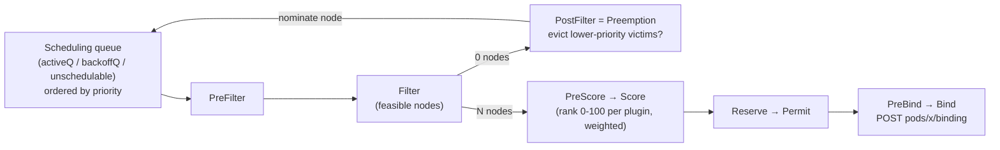

# Scheduling in Depth

> Part of the [Kubernetes deep dives](./README.md). Previous: [Architecture & API Internals](./07-architecture-and-api-internals.md). Next: [Autoscaling](./09-autoscaling.md).
>
> Event messages and outcomes are real, from a 2-node v1.37 minikube (`k8slab` labelled `zone=a`, `k8slab-m02` labelled `zone=b`).

The scheduler has exactly one job: **for every Pod with an empty `spec.nodeName`, pick a node and write a Binding.** Everything else (starting containers, enforcing limits, evicting) is the kubelet's job.

---

## 1. The scheduling cycle



Two phases: the **scheduling cycle** (serial, one Pod at a time, from Filter to Reserve) and the **binding cycle** (asynchronous, can run in parallel, PreBind and Bind, e.g. waiting for volume binding).

### Default plugins and what they check

| Extension point | Plugin | Checks or prefers |
|---|---|---|
| Filter | `NodeResourcesFit` | Requests ≤ allocatable − already-requested (CPU, memory, ephemeral-storage, extended resources) |
| Filter | `NodeName`, `NodePorts`, `NodeUnschedulable` | `spec.nodeName`, free hostPorts, cordoned nodes |
| Filter | `NodeAffinity` | `nodeSelector` + required node affinity |
| Filter | `TaintToleration` | NoSchedule/NoExecute taints vs tolerations |
| Filter | `InterPodAffinity` | Required pod (anti-)affinity |
| Filter | `PodTopologySpread` | `DoNotSchedule` constraints |
| Filter | `VolumeBinding`, `VolumeZone`, `VolumeRestrictions`, `NodeVolumeLimits` | PVC can bind, volume is in the node's zone, attach limits (e.g. EBS per instance) |
| Filter | `DynamicResources` | DRA ResourceClaims (GPUs and other devices) |
| Score | `NodeResourcesFit` (LeastAllocated by default), `NodeResourcesBalancedAllocation` | Spread load, balance CPU and memory |
| Score | `ImageLocality` | Node already has the image |
| Score | `InterPodAffinity`, `NodeAffinity`, `PodTopologySpread`, `TaintToleration` | Preferred rules and `PreferNoSchedule` |
| PostFilter | `DefaultPreemption` | Preemption |

**The scheduler uses *requests*, never actual usage, and never limits.** A node at 5% real CPU can be "full" if its Pods request 100%. And a Pod with no requests can be scheduled onto a node that's already overloaded.

---

## 2. Reading `FailedScheduling` (real messages)

The message format is: **`0/N nodes are available: <count> <reason>, ... preemption: <result>`**.

```text
# required nodeAffinity gpu=a100 — no node has the label
0/2 nodes are available: 2 node(s) didn't match Pod's node affinity/selector.
  preemption: 0/2 nodes are available: 2 Preemption is not helpful for scheduling.

# requests more CPU than any node can give
0/2 nodes are available: 2 Insufficient cpu.
  preemption: 0/2 nodes are available: 2 Insufficient cpu.

# required pod anti-affinity, 3 replicas, 2 nodes
0/2 nodes are available: 2 node(s) didn't match pod anti-affinity rules.
  preemption: 0/2 nodes are available: 2 No preemption victims found for incoming pod.

# high-priority Pod when the cluster is full
0/2 nodes are available: 2 Insufficient cpu.
  preemption: found a potential placement for pod on node k8slab-m02, preempting 1 victims
```

Other reasons you'll see:

| Message fragment | Meaning |
|---|---|
| `had untolerated taint {node-role.kubernetes.io/control-plane: }` | Missing toleration |
| `node(s) were unschedulable` | The node is cordoned |
| `node(s) had volume node affinity conflict` | The PV lives in another AZ. Use `volumeBindingMode: WaitForFirstConsumer` |
| `pod has unbound immediate PersistentVolumeClaims` | No PV or StorageClass can satisfy the PVC |
| `Too many pods` | `maxPods` reached (EKS: an ENI/IP limit) |
| `didn't have free ports for the requested pod ports` | hostPort clash |
| `didn't match pod topology spread constraints` | `DoNotSchedule` spread can't be satisfied |
| `Insufficient nvidia.com/gpu` | No free devices |

**Pod spec is (mostly) immutable.** From the lab, re-applying a Pod with a different CPU request:
```text
The Pod "too-big" is invalid: spec: Forbidden: pod updates may not change fields other than
`spec.containers[*].image`, `spec.initContainers[*].image`, `spec.activeDeadlineSeconds`, `spec.tolerations` (only additions)...
```
Change the **Deployment**, which creates new Pods. (The exception is in-place resize through the `resize` subresource, covered in [Autoscaling](./09-autoscaling.md#5-in-place-pod-resize).)

---

## 3. Choosing nodes: nodeSelector, node affinity, nodeName

```yaml
spec:
  nodeSelector:                       # simple AND of exact labels
    kubernetes.io/arch: arm64
  affinity:
    nodeAffinity:
      requiredDuringSchedulingIgnoredDuringExecution:      # hard
        nodeSelectorTerms:                                  # terms are ORed
          - matchExpressions:                               # expressions within a term are ANDed
              - { key: node.kubernetes.io/instance-type, operator: In, values: [m7g.large, m7g.xlarge] }
              - { key: topology.kubernetes.io/zone, operator: NotIn, values: [us-east-1e] }
      preferredDuringSchedulingIgnoredDuringExecution:     # soft, weighted 1-100
        - weight: 80
          preference:
            matchExpressions: [{ key: karpenter.sh/capacity-type, operator: In, values: [spot] }]
```
- Operators: `In`, `NotIn`, `Exists`, `DoesNotExist`, `Gt`, `Lt`.
- **IgnoredDuringExecution**: if a node's labels change later, running Pods stay put.
- `spec.nodeName` **skips the scheduler entirely** (the kubelet just runs the Pod). Taints, resources and affinity are *not* checked by the scheduler, though the kubelet still rejects a Pod that doesn't fit (`OutOfcpu`). This is how DaemonSet Pods and static Pods worked historically, and it's used in debugging.
- Well-known labels: `kubernetes.io/hostname`, `topology.kubernetes.io/zone`/`region`, `node.kubernetes.io/instance-type`, `kubernetes.io/os`/`arch`.

---

## 4. Taints and tolerations: nodes repel Pods

```bash
kubectl taint node gpu-1 nvidia.com/gpu=present:NoSchedule
kubectl taint node gpu-1 nvidia.com/gpu-                       # remove
```
```yaml
tolerations:
  - { key: nvidia.com/gpu, operator: Exists, effect: NoSchedule }
  - { key: dedicated, operator: Equal, value: batch, effect: NoSchedule }
  - { key: maint, operator: Exists, effect: NoExecute, tolerationSeconds: 20 }
```

| Effect | New Pods | Running Pods |
|---|---|---|
| `PreferNoSchedule` | Avoid if possible | Unaffected |
| `NoSchedule` | Blocked unless tolerated | Unaffected |
| `NoExecute` | Blocked unless tolerated | **Evicted** unless tolerated. With `tolerationSeconds`, evicted after that delay |

**NoExecute timing (real).** Two Pods on `k8slab-m02`, then `kubectl taint node k8slab-m02 maint=true:NoExecute`:
```text
t+5s:   tolerant Running            ← intolerant already gone (evicted immediately)
t+27s:  (none)                      ← tolerant evicted after its 20s tolerationSeconds
TaintManagerEviction: intolerant: Marking for deletion Pod sched/intolerant
TaintManagerEviction: tolerant: Marking for deletion Pod sched/tolerant
```

**Every Pod gets these tolerations automatically** (injected by the DefaultTolerationSeconds admission plugin):
```text
node.kubernetes.io/not-ready    NoExecute 300
node.kubernetes.io/unreachable  NoExecute 300
```
That's the "5 minutes before Pods move off a dead node" behaviour. Lower it for latency-sensitive stateless apps (e.g. 30 s). Stateful Pods should usually keep it high, so a brief network blip doesn't trigger failover.

**Tolerations allow, they don't attract.** A toleration lets a Pod *onto* a tainted node, but doesn't send it there. For dedicated nodes, use **both** a taint (to keep others off) **and** node affinity (to pull your Pods on).

Built-in taints the node controller adds: `not-ready`, `unreachable`, `memory-pressure`, `disk-pressure`, `pid-pressure`, `network-unavailable`, `unschedulable` (cordon), and `node-role.kubernetes.io/control-plane` (kubeadm). Minikube leaves the control plane untainted, which is why lab Pods land on it.

---

## 5. Pod affinity and anti-affinity: placement relative to other Pods

```yaml
affinity:
  podAntiAffinity:
    requiredDuringSchedulingIgnoredDuringExecution:      # hard: never two replicas per node
      - labelSelector: { matchLabels: { app: ha } }
        topologyKey: kubernetes.io/hostname
    preferredDuringSchedulingIgnoredDuringExecution:     # soft: try to spread over zones
      - weight: 100
        podAffinityTerm:
          labelSelector: { matchLabels: { app: ha } }
          topologyKey: topology.kubernetes.io/zone
  podAffinity:
    preferredDuringSchedulingIgnoredDuringExecution:     # co-locate with cache for latency
      - weight: 50
        podAffinityTerm:
          labelSelector: { matchLabels: { app: redis } }
          topologyKey: kubernetes.io/hostname
```
Real result, 3 replicas with **required** anti-affinity on 2 nodes:
```text
1 Running k8slab
1 Running k8slab-m02
1 Pending            ← "2 node(s) didn't match pod anti-affinity rules"
```
- Required anti-affinity caps replicas at the number of topology domains. That's great for a 3-replica etcd/Kafka on 3+ nodes, and dangerous for a Deployment that has to scale. Prefer **topology spread** or *preferred* anti-affinity for scalable workloads.
- Inter-pod affinity is the **most expensive** filter (it's O(pods × nodes)). Avoid it on clusters with thousands of nodes.
- `matchLabelKeys: [pod-template-hash]` (1.33+) scopes the rule to the *same rollout revision*, so old and new Pods don't block each other during a rolling update.

---

## 6. Topology spread constraints: the right tool for HA spreading

```yaml
topologySpreadConstraints:
  - maxSkew: 1                               # max difference between most- and least-loaded domain
    topologyKey: topology.kubernetes.io/zone
    whenUnsatisfiable: DoNotSchedule         # hard (Filter)   | ScheduleAnyway = soft (Score)
    labelSelector: { matchLabels: { app: web } }
    matchLabelKeys: [pod-template-hash]      # count only Pods from the same ReplicaSet revision
    minDomains: 3                            # treat missing zones as having 0 (forces spread to 3 zones)
    nodeAffinityPolicy: Honor                # only count nodes the Pod could land on
    nodeTaintsPolicy: Honor
  - maxSkew: 2
    topologyKey: kubernetes.io/hostname
    whenUnsatisfiable: ScheduleAnyway
    labelSelector: { matchLabels: { app: web } }
```
Real result: 5 replicas, `maxSkew: 1` over `zone` (2 zones):
```text
2 k8slab      (zone=a)
3 k8slab-m02  (zone=b)        ← skew 1 = allowed
```

Gotchas:
- **Spreading is only enforced at scheduling time.** Scale-downs, node deletions and evictions can leave things skewed. The **descheduler** (`RemovePodsViolatingTopologySpreadConstraint`) rebalances.
- Without `minDomains`, a cluster that currently has nodes in only 2 zones happily spreads over 2, even if you wanted 3.
- Cluster-level defaults: the scheduler's `defaultConstraints` apply soft hostname and zone spreading to Pods that don't set their own.

---

## 7. Priority and preemption

```yaml
apiVersion: scheduling.k8s.io/v1
kind: PriorityClass
metadata: { name: critical }
value: 100000
preemptionPolicy: PreemptLowerPriority     # or Never (high priority in queue, but never evicts)
globalDefault: false
description: "Revenue-path services"
```
Real run. Two `low` (value 100) Pods each requesting 7 CPU filled both 10-CPU nodes. Then a `critical` Pod requesting 7 CPU arrived:
```text
FailedScheduling: vip: 0/2 nodes are available: 2 Insufficient cpu.
                  preemption: found a potential placement for pod on node k8slab-m02, preempting 1 victims
Preempted:        filler-...-fddcz: Preempted by pod 68fdaab5-... on node k8slab-m02
vip               Running   k8slab-m02
filler-...-zv2h6  Pending   ← ReplicaSet recreated the victim. It can't preempt the higher-priority vip:
                              "0/2 nodes are available: 2 Insufficient cpu. preemption: ... 2 Insufficient cpu"
```
How preemption picks victims: it finds nodes where evicting **lower-priority** Pods would make room. It prefers the option that violates the **fewest PDBs**, then the lowest victim priorities, then the fewest victims, then the latest-started victims. Victims get their graceful termination, and the preemptor's `status.nominatedNodeName` is set while it waits.

- Built-in classes: `system-cluster-critical` (2000000000) and `system-node-critical` (2000001000) for CoreDNS, CNI, kube-proxy. Never use them for apps.
- **PDBs are respected on a best-effort basis by preemption.** A PDB can be violated if there's no other choice.
- `preemptionPolicy: Never` suits batch jobs that should jump the queue without killing anything.
- Pair it with ResourceQuota per PriorityClass (`scopeSelector`), so teams can't mark everything `critical`.

---

## 8. Scheduling gates (GA 1.30)

```yaml
spec:
  schedulingGates:
    - name: example.com/quota-check     # Pod is held (status SchedulingGated) until all gates are removed
```
```text
gated   0/1   SchedulingGated            ← scheduler ignores it (no wasted cycles, no FailedScheduling spam)
$ kubectl patch pod gated --type=json -p='[{"op":"remove","path":"/spec/schedulingGates"}]'
gated   ContainerCreating   k8slab       ← scheduled seconds later
```
Used by queueing systems (**Kueue**) and admission controllers that need to check quota, capacity or licences before a Pod is allowed to compete for nodes. Gates can only be removed, never added after creation.

---

## 9. Resources: requests, limits, allocatable, overcommit

```text
$ kubectl get nodes -o custom-columns=NAME:.metadata.name,CPU:.status.allocatable.cpu,MEM:.status.allocatable.memory,PODS:.status.allocatable.pods
k8slab       10    8126480Ki   110
```
(The minikube Docker driver reports the **host's** CPUs. Real nodes report capacity minus reservations.)

```text
Allocatable = Capacity − kube-reserved − system-reserved − eviction-threshold
```
```bash
kubectl describe node X | sed -n '/Allocated resources/,/Events/p'   # sum of requests and limits vs allocatable
kubectl top node                                                     # ACTUAL usage (metrics-server)
```

| | CPU | Memory |
|---|---|---|
| Request (scheduling + share) | Guaranteed share (CFS weight) | Used for scheduling, and for eviction ranking |
| Limit (enforcement) | **Throttled** (CFS quota). Never killed for CPU | **OOM-killed** (exit 137, `OOMKilled`) |
| Compressible? | Yes | No |

QoS classes (they decide eviction and OOM order):

| QoS | Rule | Evicted |
|---|---|---|
| **Guaranteed** | Every container sets requests = limits for CPU and memory | Last |
| **Burstable** | At least one request or limit set, but not Guaranteed | Middle (by usage above request) |
| **BestEffort** | Nothing set | **First** |

Practical defaults:
- **Always set memory requests and limits** (limits equal or close to requests). Memory overcommit leads to OOM kills and node pressure.
- **Set CPU requests. Think hard before setting CPU limits.** Limits cause throttling even on idle nodes. Many teams drop CPU limits for latency-sensitive services, and keep them for noisy batch workloads.
- Enforce defaults per namespace with **LimitRange**, and cap totals with **ResourceQuota** (see [Advanced Workloads & Multi-tenancy](./14-advanced-workloads-and-multitenancy.md)).

---

## 10. Node-pressure eviction (the kubelet, not the scheduler)

The kubelet watches node resources and **evicts Pods** before the kernel OOM killer gets involved:

| Signal | Default hard threshold |
|---|---|
| `memory.available` | `< 100Mi` |
| `nodefs.available` | `< 10%` |
| `imagefs.available` | `< 15%` |
| `nodefs.inodesFree` | `< 5%` |
| `pid.available` | — (configurable) |

What happens:
1. The node gets a condition (`MemoryPressure`, `DiskPressure`, `PIDPressure`) and a taint (`node.kubernetes.io/memory-pressure:NoSchedule`).
2. It first reclaims node-level resources (image GC and dead containers for disk).
3. Then it evicts Pods: **BestEffort and Burstable Pods using more than their request**, by usage relative to request, then priority. Guaranteed Pods go last.
4. The evicted Pod shows `Status: Failed, Reason: Evicted, Message: The node was low on resource: memory`. The controller recreates it elsewhere.

Soft thresholds (`evictionSoft` + grace period) evict gracefully. Hard thresholds kill immediately (no grace period). Evicted Pods stay as `Failed` objects until GC: `kubectl get pods -A --field-selector=status.phase=Failed`.

**Eviction vs OOMKill:** eviction is the kubelet deciding at the node level. OOMKill is the kernel killing one container that exceeded its **own** memory limit (or the node running out before the kubelet could react).

---

## 11. Voluntary disruptions: cordon, drain, PDB, Eviction API

```bash
kubectl cordon node-1          # NoSchedule (spec.unschedulable=true)
kubectl drain node-1 --ignore-daemonsets --delete-emptydir-data --timeout=10m
kubectl uncordon node-1
```
`drain` calls the **Eviction API** for each Pod, and that API **respects PodDisruptionBudgets**:
```yaml
apiVersion: policy/v1
kind: PodDisruptionBudget
metadata: { name: web }
spec:
  minAvailable: 2               # or maxUnavailable: 1  (prefer maxUnavailable — it scales with replicas)
  selector: { matchLabels: { app: web } }
  unhealthyPodEvictionPolicy: AlwaysAllow   # don't let crashlooping pods block drains
```
- A PDB with `maxUnavailable: 0`, or `minAvailable` equal to the replica count, **blocks drains forever**, which stalls node upgrades and Karpenter consolidation. Lint for it.
- PDBs only cover **voluntary** disruptions (drain, eviction, autoscaler scale-down). Node crashes ignore them.
- Plain `kubectl delete pod` **bypasses** PDBs. Only evictions honour them.

---

## 12. Beyond the default scheduler

| Tool | What it adds |
|---|---|
| **Scheduler profiles** (`KubeSchedulerConfiguration`) | Plugin weights (e.g. `MostAllocated` bin-packing to save cost), several profiles selected by `spec.schedulerName` |
| **Descheduler** | Evicts Pods to fix drift: duplicates on one node, spread violations, low or high node utilisation, affinity no longer satisfied |
| **Kueue** | Job queueing, quotas and fair sharing for batch/ML (uses scheduling gates) |
| **Volcano / YuniKorn** | Gang scheduling (all-or-nothing for distributed training), queues |
| **Karpenter / Cluster Autoscaler** | Add nodes when Pods are unschedulable. See [Autoscaling](./09-autoscaling.md) |
| Coscheduling plugin | Gang scheduling with the default scheduler (scheduler-plugins project) |

```yaml
# bin-packing profile (fewer, fuller nodes)
apiVersion: kubescheduler.config.k8s.io/v1
kind: KubeSchedulerConfiguration
profiles:
  - schedulerName: default-scheduler
    pluginConfig:
      - name: NodeResourcesFit
        args:
          scoringStrategy:
            type: MostAllocated
            resources: [{ name: cpu, weight: 1 }, { name: memory, weight: 1 }]
```

---

## 13. Troubleshooting "Pending"

```bash
kubectl describe pod X | sed -n '/Events/,$p'       # FailedScheduling message: read it literally
kubectl get pod X -o jsonpath='{.status.conditions}'
kubectl get nodes -L topology.kubernetes.io/zone,node.kubernetes.io/instance-type
kubectl describe node N | grep -A5 Taints
kubectl describe node N | sed -n '/Allocated resources/,/Events/p'
kubectl get pvc -n NS                                # Pending PVC → Pending Pod
kubectl get events -A --field-selector reason=FailedScheduling --sort-by=.lastTimestamp
```

| Status | Look at |
|---|---|
| `Pending`, no events at all | Scheduler down, wrong `schedulerName`, or `SchedulingGated` |
| `Pending` + FailedScheduling | The message (table in §2) |
| `Pending` + `nominatedNodeName` set | Preemption in progress |
| Scheduled but `ContainerCreating` | Not the scheduler. Image pull, CNI, volume attach (see [Observability & Troubleshooting](./13-observability-and-troubleshooting.md)) |
| Pending only in one AZ | PV zone affinity, or no capacity in that zone |

Next: [Autoscaling →](./09-autoscaling.md)
