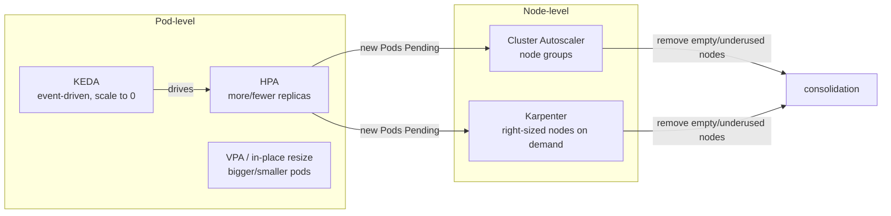

# Autoscaling: HPA, VPA, KEDA, In-place Resize, Cluster Autoscaler & Karpenter

> Part of the [Kubernetes deep dives](./README.md). Previous: [Scheduling](./08-scheduling-in-depth.md). Next: [Extending Kubernetes](./10-extending-kubernetes.md).
>
> The HPA and resize output is real, from v1.37 minikube with metrics-server.



Pod autoscalers change **how many Pods there are, or how big they are**. Node autoscalers react to the resulting **Pending Pods** (scale up) or **idle nodes** (scale down). They're independent loops, and that's where most surprises come from.

---

## 1. HPA: how it decides

```text
desiredReplicas = ceil( currentReplicas × currentMetricValue / targetMetricValue )
```
- Resource utilisation is **relative to requests**. With a request of 100m and a target of 50%, the target is 50m per Pod. **No CPU request means the HPA can't work** (`missing request for cpu`).
- **Tolerance:** no change if the ratio is within ±10% (`--horizontal-pod-autoscaler-tolerance`, and configurable per HPA in newer releases).
- The sync loop runs every **15 s**.
- With several metrics, it computes a desired count **per metric and takes the max**.
- Pods that are **not ready, or have no metrics yet**, are treated conservatively: assumed 0% when scaling up, and 100% when scaling down. CPU samples from the first minutes after start are ignored (`cpu-initialization-period`, 5 min).

### Real run
A Deployment burning CPU (`while true; do :; done`), request 100m, **limit 200m**, target 50%, scale-up policy "+2 Pods per 15 s":

```text
FailedGetResourceMetric   failed to get cpu utilization: no metrics returned from resource metrics API   ← first ~30s: metrics-server has no sample yet
SuccessfulRescale  16:23:31  New size: 3; reason: cpu resource utilization (percentage of request) above target
SuccessfulRescale  16:23:46  New size: 5                     ← +2 per 15s, exactly as the policy says
SuccessfulRescale  16:25:31  New size: 6                     ← delayed: new pods had no CPU samples yet (conservative)

TARGETS  cpu: 200%/50%   REPLICAS 6   ← capped at maxReplicas (ScalingLimited)
kubectl top pods → every pod at 200m = exactly its LIMIT
```
**Lesson 1: utilisation can't exceed limit ÷ request.** Here that's 200%. A CPU limit set too close to the request blunts how strongly the HPA reacts.

Then the load was removed by **changing the Pod template**, which triggered a rollout:
```text
t+15s … t+60s  cpu: <unknown>/50%  replicas=6
FailedComputeMetricsReplicas: did not receive metrics for targeted pods (pods might be unready)
t+75s          cpu: 1%/50%
SuccessfulRescale 16:27:31  New size: 1; reason: All metrics below target    ← 6 → 1 in one step (100% policy)
```
**Lesson 2: during a rollout, metrics can go `<unknown>` and the HPA pauses.** A long rollout under heavy load means no scale-up while it runs. Keep rollouts fast (`maxSurge`) and keep a little headroom.

### HPA conditions (always look at these)
```text
AbleToScale     True    ReadyForNewScale     recommended size matches current size
ScalingActive   True    ValidMetricFound     ...
ScalingLimited  False   DesiredWithinRange   ← True + TooManyReplicas/TooFewReplicas when clamped by max/min
```
`ScalingActive=False` (FailedGetResourceMetric) means a broken metrics pipeline: metrics-server down, a missing request, or an adapter misconfigured.

### Full spec with `behavior`
```yaml
apiVersion: autoscaling/v2
kind: HorizontalPodAutoscaler
metadata: { name: api }
spec:
  scaleTargetRef: { apiVersion: apps/v1, kind: Deployment, name: api }
  minReplicas: 3                      # ≥ 2 for HA; ≥ AZ count for zonal spread
  maxReplicas: 50
  metrics:
    - type: Resource                  # pod-average of a resource
      resource: { name: cpu, target: { type: Utilization, averageUtilization: 60 } }
    - type: ContainerResource         # one container only (ignore sidecars skewing the average)
      containerResource: { name: memory, container: app, target: { type: AverageValue, averageValue: 600Mi } }
    - type: Pods                      # custom per-pod metric (via custom.metrics.k8s.io adapter)
      pods:
        metric: { name: http_requests_per_second }
        target: { type: AverageValue, averageValue: "100" }
    - type: Object                    # metric of another object (e.g. Ingress RPS)
      object:
        describedObject: { apiVersion: networking.k8s.io/v1, kind: Ingress, name: api }
        metric: { name: requests_per_second }
        target: { type: Value, value: "2k" }
    - type: External                  # outside the cluster (SQS depth, Pub/Sub lag) via external.metrics.k8s.io
      external:
        metric: { name: sqs_messages_visible, selector: { matchLabels: { queue: orders } } }
        target: { type: AverageValue, averageValue: "30" }
  behavior:
    scaleUp:
      stabilizationWindowSeconds: 0   # react immediately
      selectPolicy: Max
      policies:
        - { type: Percent, value: 100, periodSeconds: 15 }   # double
        - { type: Pods, value: 4, periodSeconds: 15 }        # or +4, whichever is more
    scaleDown:
      stabilizationWindowSeconds: 300 # use the HIGHEST recommendation of last 5 min → no flapping
      policies: [{ type: Percent, value: 10, periodSeconds: 60 }]   # shrink slowly
```

### Where metrics come from
| API | Served by | Metric types |
|---|---|---|
| `metrics.k8s.io` | **metrics-server** (kubelet `/metrics/resource`, ~15 s resolution, in-memory only) | Resource, ContainerResource |
| `custom.metrics.k8s.io` | prometheus-adapter, KEDA, Datadog cluster agent | Pods, Object |
| `external.metrics.k8s.io` | KEDA, cloud adapters | External |

metrics-server is **only for autoscaling and `kubectl top`**. It's not a monitoring system.

### HPA pitfalls
- Scaling on **memory** rarely works: most runtimes don't give memory back, so the HPA scales up and never down.
- **HPA + VPA on the same resource** fight each other (VPA raises requests, so utilisation drops, so the HPA scales in). Combine HPA on custom or RPS metrics with VPA on resources, or don't use VPA in Auto mode on that workload.
- **GitOps writing `spec.replicas`** resets the HPA on every sync. Drop the field.
- `minReplicas: 1` is a single point of failure. A PDB then blocks node drains.
- Scale-to-zero needs KEDA (or the alpha `HPAScaleToZero` feature gate).

---

## 2. VPA: right-size requests

The **Vertical Pod Autoscaler** (an add-on in kubernetes/autoscaler) has three parts: the **recommender** (watches usage history), the **updater** (evicts Pods whose requests are far off), and the **admission controller** (rewrites requests on new Pods).

```yaml
apiVersion: autoscaling.k8s.io/v1
kind: VerticalPodAutoscaler
metadata: { name: api }
spec:
  targetRef: { apiVersion: apps/v1, kind: Deployment, name: api }
  updatePolicy:
    updateMode: "Off"            # Off = recommend only | Initial = set at creation | Recreate = evict to apply
                                 # InPlaceOrRecreate = use in-place resize when possible (newer VPA)
  resourcePolicy:
    containerPolicies:
      - containerName: app
        minAllowed: { cpu: 100m, memory: 128Mi }
        maxAllowed: { cpu: "2",  memory: 2Gi }
        controlledValues: RequestsOnly    # keep your limits; or RequestsAndLimits (keeps the ratio)
```
```bash
kubectl describe vpa api     # Recommendation: Lower Bound / Target / Uncapped Target / Upper Bound
```
**The best-value use is `updateMode: Off` everywhere**: read the recommendations, and fix requests in Git. That's FinOps right-sizing with no risk. `Recreate` evicts Pods, so it needs PDBs and enough replicas.

---

## 3. KEDA: event-driven autoscaling and scale to zero

KEDA runs an operator plus a metrics adapter. A `ScaledObject` **creates and manages an HPA for you**, and KEDA itself handles 0 ↔ 1 activation.

```yaml
apiVersion: keda.sh/v1alpha1
kind: ScaledObject
metadata: { name: orders-worker }
spec:
  scaleTargetRef: { name: orders-worker }      # Deployment
  minReplicaCount: 0                            # scale to zero when idle
  maxReplicaCount: 100
  cooldownPeriod: 300                           # seconds idle before → 0
  pollingInterval: 15
  triggers:
    - type: aws-sqs-queue
      metadata:
        queueURL: https://sqs.us-east-1.amazonaws.com/123456789012/orders
        queueLength: "20"                       # target messages per replica
        awsRegion: us-east-1
      authenticationRef: { name: keda-aws-irsa }
    - type: cron                                # pre-scale for business hours
      metadata: { timezone: Europe/London, start: "0 8 * * 1-5", end: "0 19 * * 1-5", desiredReplicas: "5" }
```
There are 70+ scalers: Kafka lag, RabbitMQ, SQS, Pub/Sub, Redis lists, Prometheus queries, Postgres queries, cron, HTTP (the KEDA HTTP add-on). `ScaledJob` launches a Job per batch of events instead.

Watch out for cold starts after scaling to zero (image pull plus app start), and for scaling on lag without a max, which can stampede your database.

---

## 4. Cluster Autoscaler vs Karpenter

| | Cluster Autoscaler (CA) | Karpenter |
|---|---|---|
| Model | Scales **pre-defined node groups** (ASG / MIG / VMSS) | Launches **individual instances** chosen per batch of Pending Pods |
| Instance choice | Fixed per group (use many groups for variety) | Picks from all allowed types, sizes, arch and capacity types for the best fit and price |
| Speed | Minutes (ASG round trip) | Faster (direct fleet API) |
| Scale-down | Underutilised node (< 50% requests by default) for 10 min, Pods movable | **Consolidation**: delete *or replace* nodes with cheaper or smaller ones, plus drift and expiry |
| Clouds | All major | AWS (mature), Azure (AKS NAP), others emerging |

### Karpenter NodePool (AWS)
```yaml
apiVersion: karpenter.sh/v1
kind: NodePool
metadata: { name: general }
spec:
  template:
    spec:
      requirements:
        - { key: karpenter.sh/capacity-type, operator: In, values: [spot, on-demand] }
        - { key: kubernetes.io/arch, operator: In, values: [arm64, amd64] }
        - { key: karpenter.k8s.aws/instance-category, operator: In, values: [c, m, r] }
        - { key: karpenter.k8s.aws/instance-generation, operator: Gt, values: ["5"] }
      nodeClassRef: { group: karpenter.k8s.aws, kind: EC2NodeClass, name: default }
      expireAfter: 720h                       # recycle nodes monthly (patching)
  disruption:
    consolidationPolicy: WhenEmptyOrUnderutilized
    consolidateAfter: 1m
    budgets:
      - nodes: "10%"                          # never disrupt more than 10% at once
      - nodes: "0"                            # freeze during business hours
        schedule: "0 9 * * mon-fri"
        duration: 8h
  limits: { cpu: "1000", memory: 4000Gi }     # cap spend
```

### What blocks node scale-down (both tools)
- Pods with **no controller** (naked Pods), or local storage (`emptyDir` without `cluster-autoscaler.kubernetes.io/safe-to-evict: "true"`)
- **PDBs** that allow 0 disruptions
- `karpenter.sh/do-not-disrupt: "true"` / CA `safe-to-evict: "false"` annotations
- kube-system Pods without a PDB (CA, by default)
- Pods whose affinity or selectors can't be satisfied anywhere else

### Overprovisioning (instant headroom)
Run low-priority "placeholder" Pods that reserve capacity. Real Pods preempt them right away (see [preemption](./08-scheduling-in-depth.md#7-priority-and-preemption)), and the evicted placeholders go Pending, which triggers a new node *before* you actually need it.
```yaml
apiVersion: scheduling.k8s.io/v1
kind: PriorityClass
metadata: { name: overprovisioning }
value: -10
preemptionPolicy: Never
---
apiVersion: apps/v1
kind: Deployment
metadata: { name: headroom }
spec:
  replicas: 3
  selector: { matchLabels: { app: headroom } }
  template:
    metadata: { labels: { app: headroom } }
    spec:
      priorityClassName: overprovisioning
      containers:
        - name: pause
          image: registry.k8s.io/pause:3.10
          resources: { requests: { cpu: "1", memory: 2Gi } }
```

---

## 5. In-place Pod resize

You can change a running container's CPU and memory **without recreating the Pod**, through the `resize` subresource. Real run:
```text
before: req=100m lim=200m restarts=0
$ kubectl patch pod burner-... --subresource resize \
    --patch '{"spec":{"containers":[{"name":"c","resources":{"requests":{"cpu":"150m"},"limits":{"cpu":"300m"}}}]}}'
after:  req=150m lim=300m restarts=0
        status.resources={"limits":{"cpu":"300m","memory":"32Mi"},"requests":{"cpu":"150m","memory":"16Mi"}}   ← applied by kubelet
$ ... memory 32Mi → 16Mi limit
mem lim=16Mi restarts=0
```
```yaml
containers:
  - name: app
    resizePolicy:
      - { resourceName: cpu, restartPolicy: NotRequired }       # default
      - { resourceName: memory, restartPolicy: RestartContainer } # for runtimes that read memory only at start (JVM -Xmx)
```
- `spec.resources` is what you *want*. `status.containerStatuses[].resources` is what's *applied*. A resize that doesn't fit the node shows the conditions `PodResizePending` (`Deferred` / `Infeasible`) and `PodResizeInProgress`.
- The QoS class can't change through a resize.
- **The Deployment template isn't changed.** The next rollout returns to the template values. So in-place resize is a tool for VPA (`InPlaceOrRecreate`) and for emergency fixes, not a replacement for fixing the manifest.

---

## 6. Putting it together: a production pattern

| Workload | Pod scaling | Node scaling |
|---|---|---|
| Stateless web/API | HPA on CPU at 60–70% (or RPS via adapter), min ≥ 3 | Karpenter/CA, spread across AZs |
| Queue workers | KEDA on queue depth, scale to 0 if latency allows | Karpenter with spot |
| Batch/ML | Jobs + Kueue | Karpenter NodePool with GPU, `consolidateAfter` tuned |
| Stateful (DB, Kafka) | Manual or operator-driven | Dedicated node groups, no consolidation |
| Everything | VPA `Off` for right-sizing reports | Overprovisioning for spiky traffic |

**Checklist:** requests on every container · HPA `behavior` with slow scale-down · PDBs with `maxUnavailable: 1` · no `replicas` in Git for HPA targets · topology spread so scale-up lands in every AZ · readiness probes (the HPA ignores unready Pods) · alerts on `ScalingLimited=True` (stuck at max) and `ScalingActive=False` (blind).

Next: [Extending Kubernetes →](./10-extending-kubernetes.md)
