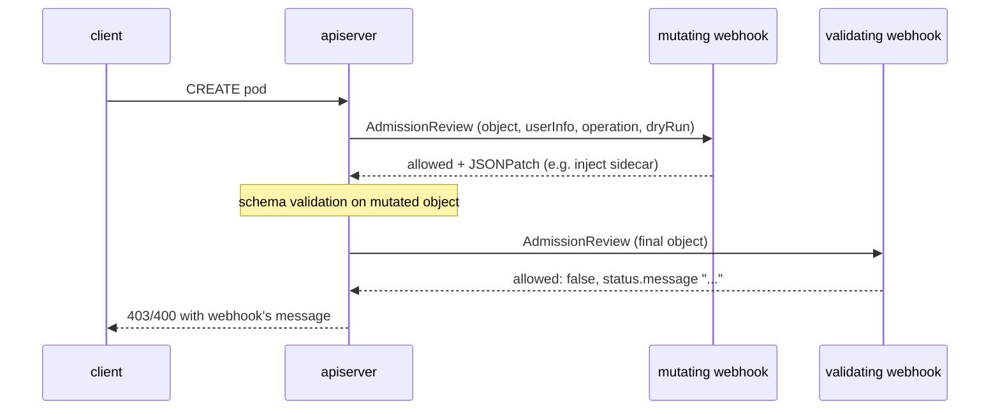

# Extending Kubernetes: CRDs, Operators, Admission Webhooks & Admission Policies (CEL)

> Part of the [Kubernetes deep dives](./README.md). Previous: [Autoscaling](./09-autoscaling.md). Next: [Cluster Operations](./11-cluster-operations.md).
>
> Every CRD, policy and webhook on this page was applied to a v1.37 cluster, and the errors shown are the real responses.

Kubernetes is designed to be extended. Ways to extend it, from least to most effort:

| Need | Mechanism |
|---|---|
| New object type (store and validate data) | **CRD** |
| Make that object *do* something | **Controller / operator** (watches the CRD and reconciles) |
| Reject bad objects | **ValidatingAdmissionPolicy** (CEL, in-process) → Kyverno/Gatekeeper → validating webhook |
| Default or change objects | **MutatingAdmissionPolicy** (CEL, GA in 1.37 here) → mutating webhook |
| A whole custom API server (custom storage, sub-resources, non-etcd backends) | **API aggregation** (`APIService`). metrics-server works this way |
| Scheduling logic | Scheduler plugins / profiles ([page 08](./08-scheduling-in-depth.md#12-beyond-the-default-scheduler)) |
| Node devices (GPUs, NICs) | Device plugins / **DRA** ([page 14](./14-advanced-workloads-and-multitenancy.md)) |
| Storage, network, runtime | CSI, CNI, CRI plugins |

---

## 1. Custom Resource Definitions

### A production-grade CRD (applied as-is)
```yaml
apiVersion: apiextensions.k8s.io/v1
kind: CustomResourceDefinition
metadata: { name: databases.example.com }        # MUST be <plural>.<group>
spec:
  group: example.com
  scope: Namespaced                               # or Cluster
  names: { plural: databases, singular: database, kind: Database, shortNames: [db] }
  versions:
    - name: v1
      served: true                                # API serves this version
      storage: true                               # exactly ONE version is the storage version
      subresources:
        status: {}                                # /status — spec and status updated separately
        scale: { specReplicasPath: .spec.replicas, statusReplicasPath: .status.replicas }   # kubectl scale + HPA
      additionalPrinterColumns:
        - { name: Engine,   type: string,  jsonPath: .spec.engine }
        - { name: Replicas, type: integer, jsonPath: .spec.replicas }
        - { name: Phase,    type: string,  jsonPath: .status.phase }
        - { name: Age,      type: date,    jsonPath: .metadata.creationTimestamp }
      schema:
        openAPIV3Schema:                          # structural schema required
          type: object
          properties:
            spec:
              type: object
              required: [engine, storageGB]
              x-kubernetes-validations:           # CEL rules (cross-field, transition)
                - rule: "self.engine != 'mysql' || self.storageGB <= 1000"
                  message: "mysql is limited to 1000GB"
                - rule: "!has(oldSelf.engine) || self.engine == oldSelf.engine"
                  message: "engine is immutable"
              properties:
                engine:    { type: string, enum: [postgres, mysql] }
                version:   { type: string, default: "16" }
                storageGB: { type: integer, minimum: 10, maximum: 5000 }
                replicas:  { type: integer, minimum: 1, default: 1 }
            status:
              type: object
              properties:
                phase:    { type: string }
                replicas: { type: integer }
```

### What the apiserver now does for you (real responses)
```text
$ kubectl get db
NAME     ENGINE     REPLICAS   PHASE   AGE                  ← printer columns
orders   postgres   1                  0s
defaults: version=16 replicas=1                             ← schema defaults applied on write

# unknown field → strict decoding (kubectl sends fieldValidation=Strict)
unknown field "spec.colour"

# OpenAPI validation
* spec.engine: Unsupported value: "oracle": supported values: "postgres", "mysql"
* spec.storageGB: Invalid value: 5: spec.storageGB in body should be greater than or equal to 10
* some validation rules were not checked because the object was invalid      ← CEL runs only after schema passes

# CEL cross-field rule
The Database "big" is invalid: spec: Invalid value: mysql is limited to 1000GB

# CEL transition rule (oldSelf) — immutability
The Database "orders" is invalid: spec: Invalid value: engine is immutable

# scale subresource
$ kubectl scale db orders --replicas=3     → REPLICAS 3

# status subresource: writes to /status ignore spec changes
$ kubectl patch db orders --subresource=status -p '{"status":{"phase":"Ready"},"spec":{"storageGB":999}}'
phase=Ready storage=50                     ← spec untouched
```
- In etcd, CRs are stored as **JSON** under `/registry/<group>/<plural>/<ns>/<name>`, unlike the protobuf used for built-in types.
- Without the `status` subresource, any user who can update the spec can also forge the status. RBAC can grant `databases/status` separately, to the controller only.
- CEL rules have **cost limits**. Unbounded lists need `maxItems`/`maxLength`, or the CRD is rejected ("estimated rule cost exceeds budget").

### CRD versioning and conversion
```yaml
versions:
  - name: v1beta1
    served: true
    storage: false
    deprecated: true
    deprecationWarning: "example.com/v1beta1 Database is deprecated; use v1"
  - name: v1
    served: true
    storage: true
conversion:
  strategy: Webhook                    # None = only apiVersion changes (identical schemas)
  webhook:
    conversionReviewVersions: [v1]
    clientConfig: { service: { name: db-operator, namespace: db-system, path: /convert } }
```
Rules for moving to a new version:
1. Add v1 as *served*, with conversion working in both directions (round-trip without loss).
2. Switch the `storage` version to v1.
3. **Migrate stored objects.** Objects written as v1beta1 stay that way in etcd until rewritten. Use a no-op update of every object, or the `StorageVersionMigration` API (`storagemigration.k8s.io`).
4. Remove v1beta1 from `status.storedVersions`, then set `served: false`.

Skip step 3 and removing the old version makes those objects unreadable.

### Dangers
- **Deleting a CRD deletes every CR of that type** (cascading), along with any cloud resources an operator manages through them. Protect CRDs: Helm `"helm.sh/resource-policy": keep`, RBAC, and Argo CD `Prune=false`.
- A CRD with a controller that's been uninstalled leaves objects with finalizers that never clear, and namespaces stuck in `Terminating` (see [page 07 §7](./07-architecture-and-api-internals.md#7-controllers-ownership-garbage-collection-and-finalizers)).

---

## 2. Operators: controllers for your CRDs

An **operator** is a controller that encodes operational knowledge: "to upgrade Postgres, fail over, back up first, then roll replicas one at a time". The pattern is identical to the built-in controllers.

### The reconcile loop (controller-runtime / kubebuilder, Go)
```go
// +kubebuilder:rbac:groups=example.com,resources=databases,verbs=get;list;watch;update;patch
// +kubebuilder:rbac:groups=example.com,resources=databases/status,verbs=update;patch
// +kubebuilder:rbac:groups=apps,resources=statefulsets,verbs=get;list;watch;create;update;patch;delete
func (r *DatabaseReconciler) Reconcile(ctx context.Context, req ctrl.Request) (ctrl.Result, error) {
    var db examplev1.Database
    if err := r.Get(ctx, req.NamespacedName, &db); err != nil {
        return ctrl.Result{}, client.IgnoreNotFound(err)        // deleted → nothing to do
    }

    // 1. Deletion: run cleanup, then remove our finalizer
    if !db.DeletionTimestamp.IsZero() {
        if controllerutil.ContainsFinalizer(&db, finalizer) {
            if err := r.deleteExternalBackups(ctx, &db); err != nil { return ctrl.Result{}, err }
            controllerutil.RemoveFinalizer(&db, finalizer)
            return ctrl.Result{}, r.Update(ctx, &db)
        }
        return ctrl.Result{}, nil
    }
    if controllerutil.AddFinalizer(&db, finalizer) {
        return ctrl.Result{}, r.Update(ctx, &db)
    }

    // 2. Desired child objects — idempotent create-or-update, owned by the CR (GC on delete)
    sts := &appsv1.StatefulSet{ObjectMeta: metav1.ObjectMeta{Name: db.Name, Namespace: db.Namespace}}
    _, err := controllerutil.CreateOrUpdate(ctx, r.Client, sts, func() error {
        sts.Spec = desiredStatefulSet(&db)
        return controllerutil.SetControllerReference(&db, sts, r.Scheme)
    })
    if err != nil { return ctrl.Result{}, err }               // error → requeue with backoff

    // 3. Status from observed state
    db.Status.Replicas = sts.Status.ReadyReplicas
    db.Status.Phase = phaseFor(sts)
    if err := r.Status().Update(ctx, &db); err != nil { return ctrl.Result{}, err }

    return ctrl.Result{RequeueAfter: 5 * time.Minute}, nil     // periodic drift check
}

func (r *DatabaseReconciler) SetupWithManager(mgr ctrl.Manager) error {
    return ctrl.NewControllerManagedBy(mgr).
        For(&examplev1.Database{}).
        Owns(&appsv1.StatefulSet{}).        // changes to owned STS re-trigger reconcile of the owner
        Complete(r)
}
```
```bash
kubebuilder init --domain example.com --repo github.com/acme/db-operator
kubebuilder create api --group "" --version v1 --kind Database   # generates types, CRD, controller, RBAC
make manifests generate && make install && make run              # run locally against your kubeconfig
```

Rules for writing operators properly:
- **Idempotent and level-based.** Reconcile can run any number of times for any reason. Never assume "this is the create event".
- **One object per reconcile, with fast returns.** Long work goes into status conditions and requeues.
- **Status conditions** (`type`, `status`, `reason`, `message`, `observedGeneration`) are the standard way to report state, and `kubectl wait --for=condition=Ready` works with them.
- **Owner references** on everything you create, so cleanup happens through GC. Use **finalizers only for external resources** (cloud DBs, DNS records).
- **Leader election** so only one replica acts. Least-privilege RBAC generated from the markers.
- Don't hammer the API. Read from the informer cache (the default `client.Get` does this).

Frameworks: **kubebuilder / controller-runtime** (Go, standard), **Operator SDK** (adds Helm and Ansible operators, plus OLM bundles), **kopf** (Python), **Metacontroller** (webhook-based "lambda controllers"), **java-operator-sdk**. Operator maturity levels go from basic install → upgrades → full lifecycle (backup/restore) → deep insights → autopilot.

Well-known operators worth studying: CloudNativePG, Strimzi (Kafka), Prometheus Operator, cert-manager, Crossplane (cloud resources as CRDs), Argo CD.

---

## 3. Admission webhooks



```yaml
apiVersion: admissionregistration.k8s.io/v1
kind: ValidatingWebhookConfiguration
metadata: { name: policy.example.com }
webhooks:
  - name: pods.policy.example.com
    admissionReviewVersions: [v1]
    sideEffects: None                  # required; NoneOnDryRun if it writes elsewhere but honours dryRun
    failurePolicy: Fail                # or Ignore  (see the outage below)
    timeoutSeconds: 5                  # default 10, max 30 — adds latency to EVERY matching request
    matchPolicy: Equivalent            # also match the same resource via other API versions
    clientConfig:
      service: { name: policy-webhook, namespace: policy, path: /validate, port: 443 }
      caBundle: <base64 CA>            # cert-manager's ca-injector fills this in
    rules:
      - { apiGroups: [""], apiVersions: [v1], operations: [CREATE, UPDATE], resources: [pods], scope: Namespaced }
    namespaceSelector:                 # ALWAYS scope — exclude system namespaces
      matchExpressions:
        - { key: kubernetes.io/metadata.name, operator: NotIn, values: [kube-system, policy] }
    objectSelector: {}
    matchConditions:                   # CEL pre-filter (cheap) before calling the webhook
      - name: not-node-users
        expression: "!request.userInfo.username.startsWith('system:node:')"
```

### The classic outage (reproduced)
A webhook with `failurePolicy: Fail` whose Service doesn't exist (the operator was uninstalled, its Pods crashed, or there's a network policy in the way):
```text
$ kubectl -n ext create cm x --from-literal=a=b
Error: Internal error occurred: failed calling webhook "validate.example.com": failed to call webhook:
  Post "https://does-not-exist.ext.svc:443/validate?timeout=5s": service "does-not-exist" not found
$ kubectl -n default create cm y ...        → created     ← namespaceSelector kept the blast radius small
# switch to failurePolicy: Ignore
$ kubectl -n ext create cm x ...            → created
```
Now imagine the webhook matches **Pods in every namespace**, and the webhook's own Pods need recreating. Nothing can be created, including the webhook itself. That's a real deadlock: you have to delete the webhook configuration to recover.

Webhook rules:
- Exclude `kube-system` and the webhook's own namespace.
- Run **2+ replicas** with a PDB and a high `priorityClassName`.
- Use `Fail` only for security-critical policy, and `Ignore` for nice-to-haves (like label defaulting).
- Keep `timeoutSeconds` low and the code fast. Webhooks sit in the hot path of the API.
- Handle `dryRun` correctly (no side effects).
- Watch `apiserver_admission_webhook_rejection_count` and `apiserver_admission_webhook_admission_duration_seconds`.
- Mutating webhooks run in an undefined order. Use `reinvocationPolicy: IfNeeded` if one depends on another's changes.

---

## 4. ValidatingAdmissionPolicy (CEL, GA in 1.30): policy without a webhook

It runs **inside the apiserver**: no extra service, no TLS, no network hop, and it can't take the cluster down by being unavailable.

```yaml
apiVersion: admissionregistration.k8s.io/v1
kind: ValidatingAdmissionPolicy
metadata: { name: replica-limit }
spec:
  failurePolicy: Fail
  paramKind: { apiVersion: v1, kind: ConfigMap }          # policy parameters from another object
  matchConstraints:
    resourceRules:
      - apiGroups: [apps]
        apiVersions: [v1]
        operations: [CREATE, UPDATE]
        resources: [deployments, deployments/scale]       # ← include the scale SUBRESOURCE (see below)
  variables:
    - name: maxReplicas
      expression: "int(params.data.maxReplicas)"
  validations:
    - expression: "object.spec.replicas <= variables.maxReplicas"
      messageExpression: "'replicas ' + string(object.spec.replicas) + ' exceeds limit ' + string(variables.maxReplicas)"
      reason: Invalid
    - expression: >
        request.subResource == "scale" ||
        object.spec.template.spec.containers.all(c, !c.image.endsWith(':latest') && c.image.contains(':'))
      message: "images must use a pinned tag, not :latest"
  auditAnnotations:
    - key: replicas
      valueExpression: "string(object.spec.replicas)"
---
apiVersion: v1
kind: ConfigMap
metadata: { name: replica-limit-params, namespace: ext }
data: { maxReplicas: "5" }
---
apiVersion: admissionregistration.k8s.io/v1
kind: ValidatingAdmissionPolicyBinding
metadata: { name: replica-limit-ext }
spec:
  policyName: replica-limit
  validationActions: [Deny]            # Deny | Warn | Audit  — roll out with [Warn, Audit] first!
  paramRef: { name: replica-limit-params, namespace: ext, parameterNotFoundAction: Deny }
  matchResources:
    namespaceSelector: { matchLabels: { kubernetes.io/metadata.name: ext } }
```
Real results:
```text
$ kubectl create deploy big --image=nginx:1.27 --replicas=9
deployments.apps "big" is forbidden: ValidatingAdmissionPolicy 'replica-limit' with binding 'replica-limit-ext'
  denied request: replicas 9 exceeds limit 5
$ kubectl create deploy latest --image=nginx:latest
  denied request: images must use a pinned tag, not :latest
$ kubectl create deploy ok --image=nginx:1.27-alpine --replicas=2     → created
```

**The subresource gotcha (found in the lab).** With only `resources: [deployments]`, this **succeeded**:
```text
$ kubectl scale deploy ok --replicas=8
deployment.apps/ok scaled          ← policy bypassed! kubectl scale writes deployments/scale
```
After adding `deployments/scale`:
```text
The deployments "ok" is invalid: ValidatingAdmissionPolicy 'replica-limit' ... denied request: replicas 8 exceeds limit 5
```
On a `scale` request, `object` is an `autoscaling/v1 Scale` (it has `spec.replicas` but no Pod template), so rules that read the template have to skip it with `request.subResource == "scale"`. The same trap exists for `pods/exec`, `pods/ephemeralcontainers`, `*/status` and the like. **Always ask which subresources can change the thing you're protecting.**

CEL variables available in a VAP: `object`, `oldObject` (UPDATE), `request` (userInfo, operation, subResource, dryRun), `params`, `namespaceObject`, `authorizer` (for "is this user allowed X" checks), and `variables`.

---

## 5. MutatingAdmissionPolicy (CEL mutation, `admissionregistration.k8s.io/v1` on 1.37)

```yaml
apiVersion: admissionregistration.k8s.io/v1
kind: MutatingAdmissionPolicy
metadata: { name: add-team-label }
spec:
  failurePolicy: Fail
  reinvocationPolicy: Never
  matchConstraints:
    resourceRules:
      - { apiGroups: [""], apiVersions: [v1], operations: [CREATE], resources: [pods] }
  matchConditions:
    - name: no-team-label
      expression: "!has(object.metadata.labels) || !('team' in object.metadata.labels)"
  mutations:
    - patchType: ApplyConfiguration        # SSA-style merge; or JSONPatch
      applyConfiguration:
        expression: >
          Object{ metadata: Object.metadata{ labels: {"team": "unassigned"} } }
---
apiVersion: admissionregistration.k8s.io/v1
kind: MutatingAdmissionPolicyBinding
metadata: { name: add-team-label-ext }
spec:
  policyName: add-team-label
  matchResources:
    namespaceSelector: { matchLabels: { kubernetes.io/metadata.name: ext } }
```
```text
$ kubectl run p1 --image=pause                      → TEAM=unassigned   (mutated)
$ kubectl run p2 --image=pause --labels=team=payments → TEAM=payments     (matchCondition skipped it)
```
Typical uses: default labels and annotations, default `securityContext`, injecting `imagePullSecrets`, setting `topologySpreadConstraints` defaults. This used to need a webhook.

---

## 6. Policy engines: Kyverno and OPA Gatekeeper

| | **VAP / MAP** (built in) | **Kyverno** | **Gatekeeper** (OPA) |
|---|---|---|---|
| Language | CEL | YAML (+ CEL, JMESPath) | Rego |
| Validate | ✅ | ✅ | ✅ |
| Mutate | ✅ (MAP) | ✅ | ✅ (limited) |
| **Generate** resources (e.g. a default NetworkPolicy per namespace) | ❌ | ✅ | ❌ |
| Verify image signatures (cosign) | ❌ | ✅ | Via external data |
| Background scans / reports | ❌ (audit annotations) | ✅ PolicyReports | ✅ audit |
| Runs as | apiserver | Webhook + controllers | Webhook + audit |

A Kyverno policy that generates a default-deny NetworkPolicy in every new namespace:
```yaml
apiVersion: kyverno.io/v1
kind: ClusterPolicy
metadata: { name: default-deny }
spec:
  rules:
    - name: generate-default-deny
      match: { any: [{ resources: { kinds: [Namespace] } }] }
      generate:
        apiVersion: networking.k8s.io/v1
        kind: NetworkPolicy
        name: default-deny
        namespace: "{{request.object.metadata.name}}"
        synchronize: true
        data:
          spec: { podSelector: {}, policyTypes: [Ingress, Egress] }
```
**Guidance:** use VAP/MAP for simple guard rails (no extra moving parts). Use Kyverno when you need generation, image verification or reports. Use Gatekeeper if you've already standardised on Rego (shared with Conftest for Terraform plans; see [Policy as Code](../../IaC%20Testing%20and%20Policy%20as%20Code/policy-as-code-with-opa-and-conftest.md)). Kyverno is covered in depth in [kyverno.md](../../IaC%20Testing%20and%20Policy%20as%20Code/kyverno.md).

---

## 7. API aggregation (extension API servers)

```yaml
apiVersion: apiregistration.k8s.io/v1
kind: APIService
metadata: { name: v1beta1.metrics.k8s.io }
spec:
  group: metrics.k8s.io
  version: v1beta1
  service: { name: metrics-server, namespace: kube-system }
  groupPriorityMinimum: 100
  versionPriority: 100
```
The apiserver proxies `/apis/metrics.k8s.io/...` to your server. Use aggregation instead of a CRD when you need non-etcd storage, computed resources or custom verbs. **If an aggregated API is unavailable** (`kubectl get apiservice` shows `False (MissingEndpoints)`), discovery errors break `kubectl api-resources`, **namespace deletion** and GC. It's a frequent cause of namespaces stuck in Terminating.

---

## 8. Checklist

- [ ] CRDs: structural schema, `status` subresource, CEL rules with bounded cost, printer columns, defaults
- [ ] Versioning plan: conversion that round-trips, storage version migration before removing old versions
- [ ] CRDs protected from accidental deletion (they take every CR with them)
- [ ] Operators: idempotent reconcile, owner refs, finalizers only for external state, status conditions with `observedGeneration`, leader election, least-privilege RBAC
- [ ] Prefer VAP/MAP over webhooks. Roll out policies with `[Warn, Audit]` first
- [ ] Policies cover the **subresources** (`/scale`, `/status`, `/exec`, `/ephemeralcontainers`) that can bypass them
- [ ] Webhooks: scoped `namespaceSelector` excluding system namespaces, HA, short timeout, the right `failurePolicy`, `matchConditions` pre-filters, monitored latency
- [ ] Aggregated APIs monitored (`kubectl get apiservice | grep False`)

Next: [Cluster Operations →](./11-cluster-operations.md)
