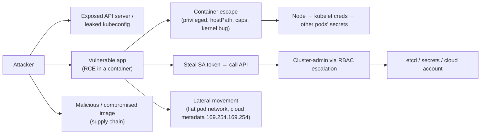
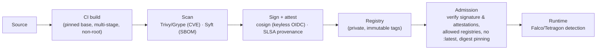

# Kubernetes Security Hardening

> Part of the [Kubernetes deep dives](./README.md). Previous: [Cluster Operations](./11-cluster-operations.md). Next: [Observability & Troubleshooting](./13-observability-and-troubleshooting.md).
>
> Every result here was reproduced on a v1.37 cluster: PSA messages, `/proc` security state, token claims, RBAC answers, and encrypted vs plaintext etcd bytes. Basics of RBAC and NetworkPolicy are in [06-security-rbac-networkpolicy.md](./06-security-rbac-networkpolicy.md). This page goes deeper.

## The threat model in one picture


Defence works in layers (the "4C": Cloud → Cluster → Container → Code). Each layer below breaks one of those arrows.

---

## 1. Pod Security Admission (PSA)

PSA is the built-in replacement for PodSecurityPolicy (removed in 1.25). It's configured **per namespace with labels**, and has three levels and three modes:

| Level | Blocks |
|---|---|
| `privileged` | Nothing |
| `baseline` | Known privilege escalations: `privileged`, host namespaces (`hostNetwork`/`hostPID`/`hostIPC`), `hostPath`, hostPorts, added capabilities beyond the default set, unsafe sysctls, AppArmor/SELinux overrides |
| `restricted` | Baseline **plus**: must `runAsNonRoot`, `allowPrivilegeEscalation: false`, drop **ALL** capabilities (only `NET_BIND_SERVICE` may be added), `seccompProfile` RuntimeDefault/Localhost, restricted volume types |

| Mode | Effect |
|---|---|
| `enforce` | Reject the Pod |
| `warn` | Allow, and return a warning to the client |
| `audit` | Allow, and add an annotation to the audit event |

```bash
kubectl label ns sec \
  pod-security.kubernetes.io/enforce=baseline \
  pod-security.kubernetes.io/warn=restricted \
  pod-security.kubernetes.io/audit=restricted
# pin versions so upgrades don't change rules under you:  pod-security.kubernetes.io/enforce-version=v1.37
```
Real results with that labelling:
```text
$ kubectl run plain --image=nginx:1.27-alpine
Warning: would violate PodSecurity "restricted:latest": allowPrivilegeEscalation != false ...,
  unrestricted capabilities ..., runAsNonRoot != true ..., seccompProfile ...
pod/plain created                                  ← baseline allows it; restricted only WARNS

$ kubectl apply -f privileged-pod.yaml
pods "privileged" is forbidden: violates PodSecurity "baseline:latest":
  privileged (container "c" must not set securityContext.privileged=true)   ← baseline ENFORCES
```
**Rollout pattern:** set `warn` + `audit` to `restricted` everywhere first, fix what the warnings show, then flip `enforce` to `restricted`. Keep `privileged` only for system namespaces (CNI, CSI, monitoring agents). Use `kubectl label --dry-run=server ns X pod-security.kubernetes.io/enforce=restricted` to list the existing Pods that would violate it.

PSA checks **Pods only**, but Deployments get the warnings at create time too. For anything finer-grained (allowed registries, required labels, exceptions per workload), add ValidatingAdmissionPolicy or Kyverno ([page 10](./10-extending-kubernetes.md)).

---

## 2. securityContext: what each setting really does (measured in `/proc`)

### The hardened Pod (passes `restricted`)
```yaml
apiVersion: v1
kind: Pod
metadata: { name: hardened }
spec:
  automountServiceAccountToken: false          # no API token unless the app needs one
  securityContext:                              # pod level
    runAsNonRoot: true
    runAsUser: 10001
    runAsGroup: 10001
    fsGroup: 10001                              # volume group ownership
    seccompProfile: { type: RuntimeDefault }
  containers:
    - name: c
      image: busybox:1.36
      command: ["sh", "-c", "sleep 3600"]
      securityContext:                          # container level (overrides pod level)
        allowPrivilegeEscalation: false         # sets no_new_privs → setuid binaries can't gain privileges
        readOnlyRootFilesystem: true
        capabilities: { drop: ["ALL"] }
      resources: { requests: { cpu: 10m, memory: 16Mi }, limits: { memory: 32Mi } }
      volumeMounts: [{ name: tmp, mountPath: /tmp }]   # writable scratch space
  volumes: [{ name: tmp, emptyDir: {} }]
```

### Default vs hardened, from inside the container
```text
-- plain (no securityContext)                     -- hardened
uid=0(root) gid=0(root) groups=0(root),1(bin),... uid=10001 gid=10001 groups=10001
CapEff:     00000000a80425fb                       CapEff:     0000000000000000     ← zero capabilities
NoNewPrivs: 0                                      NoNewPrivs: 1
Seccomp:    0           ← UNCONFINED!              Seccomp:    2   (filter mode)
                                                   touch /etc/x: Read-only file system
SA token mounted (ca.crt, namespace, token)        /var/run/secrets/...: No such file or directory
```
**Note the plain Pod's `Seccomp: 0`.** Kubernetes runs containers **without seccomp by default**. The runtime's default profile (which blocks ~40+ dangerous syscalls such as `keyctl`, `unshare` and `mount`) is only applied if you set `seccompProfile: RuntimeDefault`, or enable the kubelet's `seccompDefault: true` cluster-wide (recommended).

`CapEff 00000000a80425fb` decodes (`capsh --decode=a80425fb`) to the runtime default set: `chown, dac_override, fowner, fsetid, kill, setgid, setuid, setpcap, net_bind_service, net_raw, sys_chroot, mknod, audit_write, setfcap`. Note **`NET_RAW`** (raw sockets, ARP/DNS spoofing inside the node) and **`SETUID`/`SETGID`**. Drop ALL, and add back only what you can prove you need.

### `runAsNonRoot` with a root image (real)
```text
nonroot-nginx   0/1   CreateContainerConfigError
Error: container has runAsNonRoot and image will run as root (pod: "nonroot-nginx_sec(...)", container: c)
```
The kubelet checks the image's `USER`. The fixes are: use a non-root image (`nginxinc/nginx-unprivileged`, distroless `:nonroot`, Chainguard), set `runAsUser: <non-zero>`, or set `USER 10001` in your Dockerfile. If `runAsUser` is numeric, the image's user name doesn't matter.

### Every field
| Field | Purpose / gotcha |
|---|---|
| `privileged: true` | All capabilities and all devices, effectively root on the node. Only for CNI/CSI/system agents |
| `runAsUser/runAsGroup/runAsNonRoot` | Identity. `runAsNonRoot` is a *check*, not a setting |
| `allowPrivilegeEscalation` | `false` → `no_new_privs`. Automatically `true` if privileged or `CAP_SYS_ADMIN` |
| `readOnlyRootFilesystem` | Stops attackers dropping tools and binaries. Mount `emptyDir` at `/tmp` and cache dirs |
| `capabilities.add/drop` | Fine-grained root powers. `drop: [ALL]` |
| `seccompProfile` | `RuntimeDefault`, `Localhost` (custom JSON on the node, e.g. generated by the Security Profiles Operator), `Unconfined` |
| `appArmorProfile` (field GA 1.30) | `RuntimeDefault` / `Localhost` (Ubuntu/Debian nodes) |
| `seLinuxOptions` | SELinux labels (RHEL/Bottlerocket nodes) |
| `fsGroup` / `fsGroupChangePolicy: OnRootMismatch` | Volume ownership. `OnRootMismatch` avoids slow recursive chowns on big volumes |
| `supplementalGroupsPolicy: Strict` | Ignore groups from the image's `/etc/group` |
| `procMount`, `sysctls` | Rarely needed. Unsafe sysctls are blocked by baseline |
| `hostUsers: false` | **User namespaces**: container root maps to an unprivileged host UID. Very strong mitigation against escapes (stable in recent releases, needs kernel and runtime support) |
| `hostNetwork/hostPID/hostIPC`, `hostPath` | Node access. Treat each as privileged. `hostPath: /` or `/var/run/containerd/containerd.sock` = node takeover |

---

## 3. RBAC: the escalation paths people miss

Real `can-i` answers for a ServiceAccount bound to the built-in **`edit`** ClusterRole in its namespace:
```text
get secrets                    yes     ← reads EVERY secret in the namespace
create pods                    yes
create pods/exec               yes     ← shell into any pod, read its env/mounted secrets
create serviceaccounts/token   yes     ← mint tokens for ANY SA in the namespace
patch deployments              yes
create rolebindings            no      ← edit can't grant RBAC... (admin can)
```
And then:
```text
$ kubectl apply --as=system:serviceaccount:sec:ci -f thief.yaml     # spec.serviceAccountName: powerful
pod/thief created               ← "create pods" = act as ANY ServiceAccount in the namespace
```
**`create pods` in a namespace means you can be every ServiceAccount in that namespace.** If any SA there has cluster-wide rights, so do you. Treat these verbs as equivalent to their most powerful target:

| Verb/resource | Why it's dangerous |
|---|---|
| `create pods` (and Deployments, Jobs, CronJobs, DaemonSets...) | Run as any SA, mount any Secret, hostPath if PSA allows |
| `get/list/watch secrets` | All credentials. **`list` returns the contents**, not just names |
| `pods/exec`, `pods/attach`, `pods/portforward` | Interactive access to running workloads |
| `serviceaccounts/token` (create) | Mint tokens for other identities |
| `escalate`, `bind` on roles | Grant permissions you don't hold |
| `impersonate` | Become another user, group or SA |
| `nodes/proxy` | Talk to kubelets (exec into any Pod on the node) |
| `create/patch` on `validating`/`mutatingwebhookconfigurations` | Intercept or alter every object |
| `update` on `namespaces` | Change PSA labels and disable enforcement |
| `*` on `*` | Obviously |
| `certificatesigningrequests/approval` + `signers` | Issue client certs (e.g. `system:masters`) |

The built-in protection is that **you can't grant permissions you don't have** (escalation prevention):
```text
$ kubectl create rolebinding sneaky --clusterrole=admin --serviceaccount=sec:reader --as=system:serviceaccount:sec:ci
forbidden: User "system:serviceaccount:sec:ci" cannot create resource "rolebindings" ...
```
Practice: no wildcards; separate the "deployer" role (manage Deployments) from "secret reader"; split namespaces per trust boundary; review with `kubectl auth can-i --list --as=...` and tools like `rakkess`, `rbac-tool`, `kubectl-who-can`; and alert on new `clusterrolebindings` in the audit log ([page 11 §7](./11-cluster-operations.md#7-audit-logging)).

---

## 4. ServiceAccount tokens

### What's in a projected token (decoded from a real Pod)
```json
{
 "aud": ["https://kubernetes.default.svc.cluster.local"],
 "iss": "https://kubernetes.default.svc.cluster.local",
 "sub": "system:serviceaccount:sec:default",
 "kubernetes.io": {
   "namespace": "sec",
   "pod":  { "name": "plain",      "uid": "f6a76d57-..." },     ← bound to THIS pod
   "node": { "name": "k8slab-m02", "uid": "a6f9a9c1-..." },
   "serviceaccount": { "name": "default", "uid": "a89b3eb0-..." },
   "warnafter": 1792361280                                     ← ~1h after issue
 },
 "_ttl_hours": 8760.0                                          ← exp = 1 year
}
```
- The kubelet requests a **1-hour** token and refreshes it on disk. The apiserver *extends* the exp to a year (`--service-account-extend-token-expiration`, for old clients that never re-read the file), and records `warnafter` so it can log callers using stale tokens.
- **The real protection is binding.** Proven in the lab:
  ```text
  before delete:  Username system:serviceaccount:sec:default   pod-name [victim]
  $ kubectl delete pod victim
  after delete:   error: You must be logged in to the server (Unauthorized)
  ```
  A stolen projected token dies with its Pod. Legacy Secret-based tokens (`kubernetes.io/service-account-token` Secrets) never expire. They're no longer auto-created (1.24+), and unused ones are cleaned up automatically. Find old ones with `kubectl get secrets -A --field-selector type=kubernetes.io/service-account-token`.
- On-demand tokens: `kubectl create token default --duration=10m --audience=vault` gives a 0.17 h TTL with a custom audience. Audiences stop a token meant for Vault being replayed against the apiserver.
- `automountServiceAccountToken: false` on the Pod (or the SA) for workloads that don't talk to the API. That's most of them.

### Workload identity to the cloud (no static keys)
| Cloud | Mechanism | How |
|---|---|---|
| AWS EKS | **EKS Pod Identity** (newer, simpler) or **IRSA** | Pod Identity: an association of namespace/SA ↔ IAM role through the EKS API plus an agent DaemonSet. IRSA: an OIDC provider, an SA annotation `eks.amazonaws.com/role-arn`, and an IAM trust on `system:serviceaccount:ns:sa` |
| GKE | Workload Identity Federation | SA annotation / principal `ns/sa` → IAM bindings |
| AKS | Entra Workload ID | Federated credential on a managed identity |

Also **block the instance metadata endpoint** (169.254.169.254) from Pods (IMDSv2 hop limit 1 on AWS, or a NetworkPolicy), or every Pod inherits the **node's** IAM role.

---

## 5. Secrets management

### Encryption at rest (configured and verified)
```yaml
# /etc/kubernetes/enc/config.yaml  →  kube-apiserver --encryption-provider-config=...
apiVersion: apiserver.config.k8s.io/v1
kind: EncryptionConfiguration
resources:
  - resources: [secrets]                 # add configmaps / custom resources if they hold sensitive data
    providers:
      - aescbc:                          # first provider = used for WRITES
          keys:
            - name: key1
              secret: <32-byte base64 key>
      - identity: {}                     # still able to READ old plaintext data
```
Raw etcd bytes, before vs after:
```text
before:            6b38 7300 0a0c 0a02 7631 1206 5365 6372   k8s.....v1..Secr     ← protobuf, plaintext ("SuperSecret123" readable)
new secret after:  6b38 733a 656e 633a 6165 7363 6263 3a76   k8s:enc:aescbc:v1:key1:.PO[u..5.   ← encrypted
OLD secret after enabling:   still  k8s\0 ... plaintext!     ← existing data is NOT re-encrypted automatically
$ kubectl get secrets -A -o json | kubectl replace -f -      ← rewrite everything
OLD secret after rewrite:    k8s:enc:aescbc:v1:key1:...      ← now encrypted
```
- **Prefer `kms` v2** (AWS KMS, GCP KMS, Azure Key Vault, Vault through a KMS plugin), with envelope encryption so the key never sits on disk next to etcd. `aescbc`/`secretbox` keep the key in a file on the control plane. That protects etcd backups, not someone with root on the control-plane node.
- **Key rotation:** add the new key first in the list → restart the apiservers → rewrite all secrets → remove the old key.
- Managed: EKS envelope encryption (on by default for new clusters), GKE application-layer secrets encryption, AKS KMS.

### Getting secrets *into* the cluster without Git exposure
| Tool | Model |
|---|---|
| **External Secrets Operator** | A `SecretStore` (AWS Secrets Manager, Vault, GCP SM, Azure KV) plus an `ExternalSecret` CR. It syncs into a native Secret and refreshes |
| **Secrets Store CSI Driver** | Mounts secrets from the external store as a volume (optionally synced to a Secret). The secret can avoid etcd entirely |
| **Sealed Secrets** | Encrypt with the controller's public key. The ciphertext is safe in Git, and the controller decrypts into a Secret |
| **SOPS** (+ Flux/Argo plugins, helm-secrets) | Encrypted YAML in Git, decrypted at deploy time with KMS/age |
| **Vault Agent / VSO** | Injects secrets with a sidecar or syncs to a Secret, with dynamic DB credentials |

```yaml
apiVersion: external-secrets.io/v1
kind: ExternalSecret
metadata: { name: db }
spec:
  refreshInterval: 1h
  secretStoreRef: { kind: ClusterSecretStore, name: aws-sm }
  target: { name: db-credentials }
  data:
    - secretKey: password
      remoteRef: { key: prod/orders/db, property: password }
```
App-side rules: prefer **mounted files over env vars** (env vars leak through `/proc/<pid>/environ`, crash dumps, child processes and `kubectl describe`). Watch for file changes, or restart on rotation (Reloader). Mark ConfigMaps and Secrets `immutable: true` where you can.

---

## 6. Supply chain: what runs in your cluster


- **Pin by digest** (`image: repo/app@sha256:...`), or at least use immutable tags. `:latest` plus `imagePullPolicy: Always` means "run whatever someone pushed last".
- **Admission verification:** Kyverno `verifyImages`, Sigstore policy-controller, Connaisseur, Ratify (Gatekeeper). Reject unsigned images, and images from registries outside your allowlist (the [VAP example on page 10](./10-extending-kubernetes.md#4-validatingadmissionpolicy-cel-ga-in-130-policy-without-a-webhook) blocks `:latest`).
- **Minimal images** (distroless, Chainguard, scratch) mean fewer CVEs and no shell for attackers.
- **`imagePullSecrets`** for private registries, ideally through node or workload identity (ECR through the node role, GAR through workload identity) instead of static docker-config Secrets.
- Scan continuously (new CVEs appear for old images): Trivy Operator, cloud registry scanning.

---

## 7. Runtime isolation and detection

| Control | What it gives you |
|---|---|
| **RuntimeClass + gVisor (`runsc`)** | A user-space kernel intercepts syscalls. Strong isolation for untrusted code, some performance cost |
| **RuntimeClass + Kata Containers** | Each Pod runs in a lightweight VM. Hardware-level isolation |
| **User namespaces** (`hostUsers: false`) | Root in the container ≠ root on the host |
| **Falco / Tetragon / Tracee** (eBPF) | Detects shells in containers, writes to `/etc`, unexpected outbound connections, privilege escalation |
| **Node OS** | Minimal, immutable OS (Bottlerocket, Flatcar, Talos, COS), automatic patching, no SSH (use SSM or `kubectl debug node`) |

```yaml
apiVersion: node.k8s.io/v1
kind: RuntimeClass
metadata: { name: gvisor }
handler: runsc
scheduling:
  nodeSelector: { sandbox: gvisor }
---
# in a Pod
spec:
  runtimeClassName: gvisor
```

---

## 8. Cluster and control-plane hardening

- **API server exposure:** a private endpoint (EKS private/public with CIDR allowlists, GKE private clusters). Never leave anonymous auth enabled for non-health endpoints.
- **Kubelet:** `anonymous-auth=false`, `authorization-mode=Webhook`, no read-only port 10255, and the NodeRestriction admission plugin (on by default with kubeadm) so a compromised node can only change its own objects.
- **etcd:** mTLS only, not reachable from Pod networks, encrypted backups.
- **Audit logs** on and shipped ([page 11](./11-cluster-operations.md#7-audit-logging)).
- **NetworkPolicy default-deny**, and block the metadata API ([networking deep dive §12](../kubernetes-networking-deep-dive.md#12-networkpolicy-in-depth)).
- **Benchmarks:** `kube-bench` (CIS Kubernetes Benchmark) for node and control-plane config, `kubescape` / `trivy k8s` / Polaris for workload posture, `kube-hunter`-style probing from outside.
- **Human access:** SSO (OIDC) to the cluster, short-lived credentials, `system:masters` only for break-glass, `kubectl` access through a bastion or zero-trust proxy (Teleport, Pomerium, cloud IAP).

---

## 9. Hardening checklist

- [ ] PSA: `restricted` enforced on app namespaces (`warn`/`audit` first). `privileged` only for system namespaces
- [ ] Every container: non-root, `allowPrivilegeEscalation: false`, `drop: [ALL]`, `RuntimeDefault` seccomp (or kubelet `seccompDefault: true`), `readOnlyRootFilesystem`
- [ ] No `privileged`, `hostPath`, `hostNetwork`/`hostPID` in app workloads. User namespaces where supported
- [ ] `automountServiceAccountToken: false` by default. One SA per workload. No legacy token Secrets
- [ ] RBAC: no wildcards, and `create pods`/`secrets`/`exec`/`token`/`escalate`/`bind`/`impersonate` treated as admin-equivalent. Reviewed regularly
- [ ] Cloud access through workload identity (Pod Identity, IRSA, WI). Metadata endpoint blocked
- [ ] Secrets: KMS encryption at rest (existing data rewritten), External Secrets/CSI, files instead of env vars, rotation
- [ ] Images: private registry, digest-pinned, scanned, signed and verified at admission, minimal base
- [ ] NetworkPolicy default-deny + egress control
- [ ] Runtime detection (Falco/Tetragon). Sandboxed RuntimeClass for untrusted code
- [ ] Control plane: private endpoint, audit logs, kube-bench clean, kubelet hardened, etcd isolated

Next: [Observability & Troubleshooting →](./13-observability-and-troubleshooting.md)
