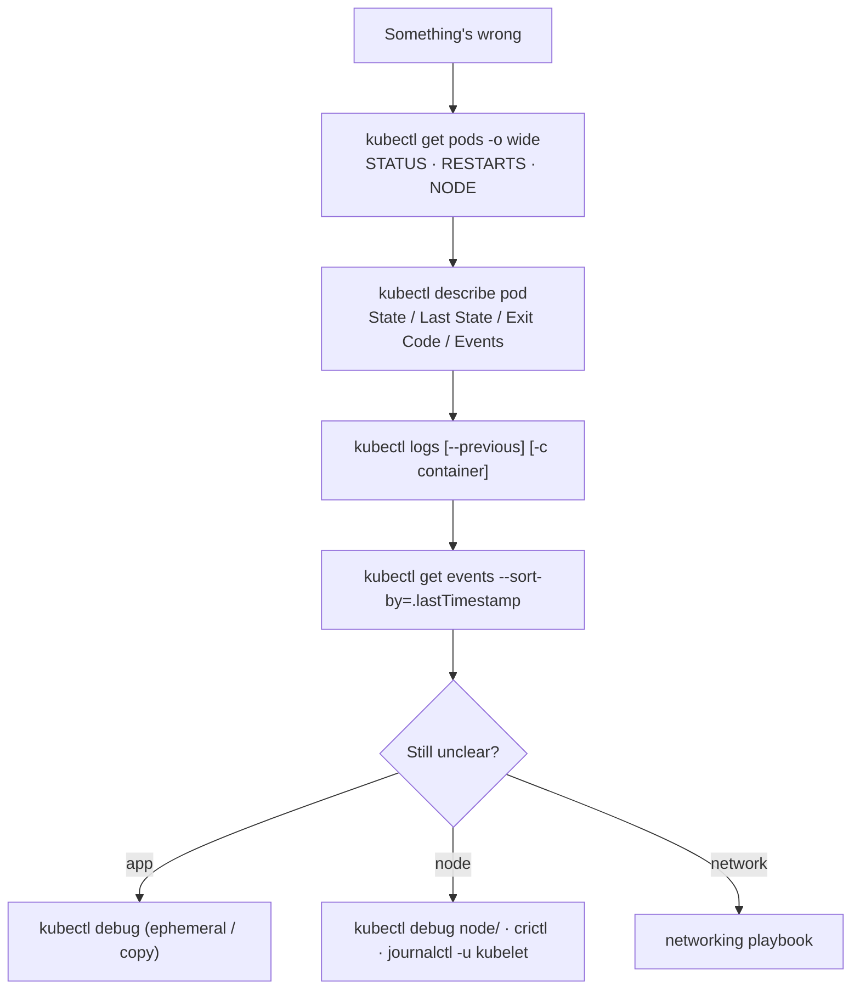

# Observability & Troubleshooting

> Part of the [Kubernetes deep dives](./README.md). Previous: [Security Hardening](./12-security-hardening.md). Next: [Advanced Workloads & Multi-tenancy](./14-advanced-workloads-and-multitenancy.md).
>
> Every status, exit code, event and message in the failure zoo below was produced on a v1.37 cluster. Networking failures have their own playbook in the [networking deep dive §17](../kubernetes-networking-deep-dive.md#17-troubleshooting-playbook), and Pending Pods are covered in [Scheduling §13](./08-scheduling-in-depth.md#13-troubleshooting-pending).

---

## Part A: Observability

### 1. The four signal sources

| Signal | Kubernetes source | Typical stack |
|---|---|---|
| **Metrics** | kubelet/cAdvisor (container CPU, memory, fs, network), **kube-state-metrics** (object state: replicas, restarts, Pod phase, HPA status), node-exporter (host), control-plane `/metrics` (apiserver, etcd, scheduler, CoreDNS), app `/metrics` | Prometheus (kube-prometheus-stack) or a managed Prometheus → Grafana, Alertmanager. Thanos/Mimir for long retention |
| **Logs** | Container stdout/stderr → `/var/log/pods/...` on the node, plus node journald (kubelet, containerd), plus audit logs | Fluent Bit / Vector / OTel Collector DaemonSet → Loki, Elasticsearch/OpenSearch, CloudWatch, Datadog |
| **Traces** | Your app (OTel SDK), mesh sidecars, apiserver tracing | OpenTelemetry Collector → Tempo, Jaeger, X-Ray |
| **Events** | `Event` objects (scheduling, pulls, probes, OOM, evictions). **Kept for only 1 hour** by default (`--event-ttl`) | Export them: kubernetes-event-exporter, OTel `k8sobjects` receiver |

**metrics-server isn't monitoring.** It holds about one sample per Pod in memory, for `kubectl top` and HPA ([page 09](./09-autoscaling.md#where-metrics-come-from)). You need Prometheus as well.

### 2. Metrics that matter, with PromQL

```promql
# Pods restarting (CrashLoop, OOM, liveness kills)
increase(kube_pod_container_status_restarts_total[15m]) > 3

# Why the last restart happened
kube_pod_container_status_last_terminated_reason{reason="OOMKilled"} == 1

# Pods not ready for 10m
sum by (namespace, pod) (kube_pod_status_ready{condition="false"}) == 1

# Deployment not at desired replicas
kube_deployment_spec_replicas != kube_deployment_status_replicas_available

# CPU throttling (limits too low → latency)
sum by (pod) (rate(container_cpu_cfs_throttled_periods_total[5m]))
  / sum by (pod) (rate(container_cpu_cfs_periods_total[5m])) > 0.25

# Memory close to limit (OOM soon)
container_memory_working_set_bytes / on(namespace,pod,container) kube_pod_container_resource_limits{resource="memory"} > 0.9

# Requests vs real usage (right-sizing / waste)
sum by (namespace) (kube_pod_container_resource_requests{resource="cpu"})
  - sum by (namespace) (rate(container_cpu_usage_seconds_total[5m]))

# Node health
kube_node_status_condition{condition="Ready",status="true"} == 0
kube_node_status_condition{condition=~"MemoryPressure|DiskPressure|PIDPressure",status="true"} == 1

# HPA pinned at max
kube_horizontalpodautoscaler_status_current_replicas == kube_horizontalpodautoscaler_spec_max_replicas

# PVC almost full
kubelet_volume_stats_used_bytes / kubelet_volume_stats_capacity_bytes > 0.85

# Control plane
histogram_quantile(0.99, sum by (le, verb) (rate(apiserver_request_duration_seconds_bucket{verb!~"WATCH|CONNECT"}[5m])))
sum(rate(apiserver_request_total{code=~"5.."}[5m]))
histogram_quantile(0.99, rate(etcd_disk_wal_fsync_duration_seconds_bucket[5m])) > 0.01
```
Use `container_memory_working_set_bytes` (what the OOM killer and eviction look at), not `container_memory_usage_bytes`, which includes reclaimable page cache.

### 3. Logging patterns
- Apps log **JSON to stdout/stderr**. Never write to files inside the container (no rotation, and lost on restart).
- A node DaemonSet tails `/var/log/containers/*.log` and enriches with Pod labels (the Kubernetes filter/processor).
- `kubectl logs` reads only what's still on the node (rotated at `containerLogMaxSize`), so your log backend is the only history.
- Control-plane logs: static Pod logs on the nodes. For managed clusters, enable control-plane logging (EKS → CloudWatch: api, audit, authenticator, controllerManager, scheduler).

---

## Part B: Troubleshooting

### 4. The method


**Read STATUS, then Last State and the exit code, then Events, then logs from the *previous* container.** Most incidents are solved by the third step.

### 5. The failure zoo (real output)
```text
$ kubectl get pods -n zoo
NAME        READY   STATUS                       RESTARTS      AGE
badimage    0/1     ImagePullBackOff             0             75s
completed   0/1     Completed                    3 (59s ago)   75s
crashloop   0/1     Error                        3 (60s ago)   75s
initstuck   0/1     Init:0/1                     0             75s
liveness    0/1     CrashLoopBackOff             4 (12s ago)   75s
missingcm   0/1     CreateContainerConfigError   0             75s
oom         0/1     OOMKilled                    3 (60s ago)   75s
wrongcmd    0/1     RunContainerError            3 (36s ago)   75s
```
STATUS cycles while a Pod is crash looping (`Error` → `CrashLoopBackOff` → `Running` → `Error`), so `crashloop`, `oom` and `liveness` were all caught at different points of the same cycle.

#### CrashLoopBackOff: the app exits
```text
crashloop: restarts=3 last=Error/exit=1
$ kubectl logs crashloop
starting
FATAL: DB_URL not set
Warning BackOff: Back-off restarting failed container c in pod crashloop_zoo(...)
```
- The kubelet restarts with **exponential backoff**: 10 s, 20 s, 40 s ... capped at **5 min**, and reset after 10 min of running cleanly. "CrashLoopBackOff" means *waiting for the next retry*, not a separate error.
- `kubectl logs --previous` gives the **last crashed** container's output. If that has already been rotated or replaced, you get `unable to retrieve container logs`. Ship logs centrally.
- Usual causes: missing config or env, can't reach a dependency at startup, a bad migration, a wrong entrypoint, a liveness probe killing it (see below).

#### OOMKilled: exit 137
```text
oom: restarts=3 last=OOMKilled/exit=137
```
- The container exceeded its **own memory limit** and the kernel killed it (cgroup OOM). `137 = 128 + 9 (SIGKILL)`.
- The fix is to raise the limit, find the leak, or tune the runtime (JVM `-XX:MaxRAMPercentage=75`, Node `--max-old-space-size`, Go `GOMEMLIMIT`).
- Not the same as an **eviction** (`Status: Failed, Reason: Evicted`, decided by the kubelet under node pressure, [page 08 §10](./08-scheduling-in-depth.md#10-node-pressure-eviction-the-kubelet-not-the-scheduler)).
- Exit 137 **without** `OOMKilled` means something else sent SIGKILL: a grace period expiry (SIGTERM ignored for `terminationGracePeriodSeconds`), or a liveness kill.

#### ImagePullBackOff / ErrImagePull
```text
Warning Failed: Failed to pull image "nginx:1.99-doesnotexist": rpc error: code = NotFound desc = failed to pull and unpack image
  "docker.io/library/nginx:1.99-doesnotexist": failed to resolve reference ...
Warning Failed: Error: ErrImagePull
Warning Failed: Error: ImagePullBackOff
```
| Message fragment | Cause |
|---|---|
| `NotFound` / `manifest unknown` | Wrong tag or repo |
| `401 Unauthorized` / `pull access denied` / `no basic auth credentials` | Missing or wrong `imagePullSecrets`, or node IAM (ECR) |
| `429 Too Many Requests` | Docker Hub rate limits. Use a mirror or pull-through cache |
| `no match for platform in manifest` | arm64 node, amd64-only image (or the reverse) |
| `i/o timeout` / `dial tcp` | Node can't reach the registry (NAT, proxy, VPC endpoint, DNS) |
| `x509: certificate signed by unknown authority` | Private registry CA not trusted on the nodes |

Test from the node with `crictl pull <image>`.

#### CreateContainerConfigError: config can't be resolved
```text
Warning Failed (x8): Error: configmap "app-config" not found
```
This also happens for a missing Secret, a missing key in a ConfigMap or Secret (`couldn't find key X`), and `runAsNonRoot` with a root image ([page 12](./12-security-hardening.md#runasnonroot-with-a-root-image-real)). The Pod waits and retries. Create the object, or mark the reference `optional: true`.

#### RunContainerError / StartError (exit 128): the runtime can't start the process
```text
wrongcmd: last=StartError/exit=128
Error: failed to create containerd task: ... OCI runtime create failed: runc create failed: unable to start container process:
  error during container init: exec: "/app/server": stat /app/server: no such file or directory
```
Causes: a wrong `command` or path, a binary built for another architecture (`exec format error`), a missing executable bit (`permission denied`), a bad volume mount (`not a directory`), or a `readOnlyRootFilesystem` app that needs to write at startup.

#### Liveness probe kills a healthy app
```text
Warning Unhealthy (x1): Liveness probe failed: Get "http://10.244.0.25:80/healthz": dial tcp ...: connect: connection refused   ← before nginx was up
Warning Unhealthy (x9): Liveness probe failed: HTTP probe failed with statuscode: 404                                        ← wrong path
liveness: restarts=4 waiting=CrashLoopBackOff last=Completed/exit=0
```
Note `exit=0`. The kubelet sent SIGTERM, nginx shut down **cleanly**, and it still counts as a restart. A liveness restart doesn't look like a crash in the exit code. **Look at the `Unhealthy` events.**

Probe rules (detail in [page 03](./03-pod-lifecycle-probes-resources.md)):
- `startupProbe` for slow starters. Liveness and readiness only begin once it passes.
- Liveness should check **"is this process wedged?"**, never dependencies. A database outage shouldn't restart every app Pod, which is a classic cascading failure.
- Readiness *can* check dependencies, because it only removes the Pod from Service endpoints.

#### `Completed` with restarts: wrong workload type
```text
completed: restarts=3 last=Completed/exit=0      ← "echo done" in a bare Pod / Deployment
```
Pods default to `restartPolicy: Always`. Deployments **require** `Always`, so a container that finishes successfully gets restarted forever and eventually shows CrashLoopBackOff. **Run-to-completion work belongs in a Job** (`restartPolicy: OnFailure`/`Never`).

#### Init:0/1: stuck init container
```text
$ kubectl logs initstuck -c wait-db --tail=2
waiting for db
```
`Init:N/M` means N of M init containers have finished. `Init:Error` / `Init:CrashLoopBackOff` means an init container is failing. Always pass `-c <init-name>` to `logs`.

### 6. Status and exit code reference

| STATUS | Meaning | First check |
|---|---|---|
| `Pending` | Not scheduled, or volumes not bound | describe → FailedScheduling ([page 08](./08-scheduling-in-depth.md#2-reading-failedscheduling-real-messages)) |
| `ContainerCreating` (long) | Sandbox/CNI, image pull, volume attach/mount | Events: `FailedCreatePodSandBox`, `FailedMount`, `FailedAttachVolume` |
| `PodInitializing` / `Init:x/y` | Init containers running | `logs -c <init>` |
| `CrashLoopBackOff` / `Error` | App exits | `logs --previous`, exit code |
| `OOMKilled` | Memory limit | Limits, leak, runtime flags |
| `ImagePullBackOff` / `ErrImagePull` | Registry | Event message (table above) |
| `CreateContainerConfigError` | Missing ConfigMap/Secret/key, nonroot check | Event message |
| `RunContainerError` / `StartError` | Runtime can't exec | Command, arch, mounts |
| `Terminating` (stuck) | Finalizers, or the node is gone | `metadata.finalizers`. `--force --grace-period=0` **only** if the node is really dead |
| `Evicted` | Node pressure | Node conditions, usage vs requests |
| `Unknown` / `NodeLost` | Node unreachable | Node status (below) |
| `Completed` + restarts | Run-to-completion in an `Always` Pod | Use a Job |
| Running but `0/1` READY | Readiness failing | `Unhealthy` events, the endpoint |

| Exit code | Meaning |
|---|---|
| 0 | Clean exit (or graceful shutdown after SIGTERM) |
| 1 / other small numbers | App error |
| 126 | Not executable (permission) |
| 127 | Command not found (within a shell) |
| 128 | Runtime StartError (the exec itself failed) |
| 137 | SIGKILL: OOM (check `reason`), grace period exceeded, or forced kill |
| 139 | SIGSEGV (segfault, native library or arch issues) |
| 143 | SIGTERM, process terminated (normal on shutdown if not handled) |

### 7. When a node fails (real timeline)
Stopping the kubelet on `k8slab-m02`:
```text
t+20s   node: Ready      ready=KubeletReady
t+45s   node: Ready      ready=KubeletReady                 ← still within node-monitor-grace-period (~50s)
t+70s   node: NotReady   ready=NodeStatusUnknown  "Kubelet stopped posting node status."
        taints = node.kubernetes.io/unreachable (NoSchedule + NoExecute)
        app-...-9wq2t   1/1   Running                         ← STALE: the API shows the last reported state
```
What follows:
1. The endpoints controller marks that node's Pods **not ready**, so they're removed from Service endpoints.
2. After `tolerationSeconds` (300 s by default, [page 08 §4](./08-scheduling-in-depth.md#4-taints-and-tolerations-nodes-repel-pods)), Pods are marked for deletion and their controllers create replacements elsewhere.
3. **StatefulSet Pods aren't replaced automatically** while the old Pod's status is unknown, because two copies of `db-0` could corrupt data. You (or the cloud node controller deleting the Node) must confirm the node is gone: `kubectl delete node`, or the `node.kubernetes.io/out-of-service` taint (non-graceful node shutdown).
4. RWO volumes stay attached to the dead node until it's force-detached (that same out-of-service taint), a common cause of "new Pod stuck ContainerCreating: Multi-Attach error".

Node checklist: `kubectl describe node` (Conditions, Events), `kubectl debug node/X` or SSH, `systemctl status kubelet containerd`, `journalctl -u kubelet`, disk (`df -h`, `df -i`), memory, cert expiry, CNI agent Pod on that node, and clock skew.

### 8. `kubectl debug`: the three modes (all tested)

**1. Ephemeral container in a running Pod.** For distroless or minimal images that have no shell:
```bash
kubectl debug -it pod/app-xyz --image=busybox:1.36 --target=nginx --profile=general
```
```text
PID   USER     TIME  COMMAND
    1 root     0:00 nginx: master process nginx -g daemon off;     ← --target shares the app container's PID namespace
   30 101      0:00 nginx: worker process
```
Ephemeral containers can't be removed (they stay in `spec.ephemeralContainers` until the Pod dies), and `pods/ephemeralcontainers` RBAC controls who can add them.

**2. Copy of a Pod with changes.** For a crashing app you need to keep alive:
```bash
kubectl debug crashloop -it --copy-to=crashloop-dbg --container=c -- sh
# options: --set-image=c=busybox, --share-processes, --same-node
```
```text
crashloop-dbg   1/1   Running        ← same spec, overridden command; inspect env/files at leisure
```

**3. Node debugging.** A Pod in the host namespaces with `/` mounted at `/host`:
```bash
kubectl debug node/k8slab-m02 -it --image=busybox:1.36 --profile=sysadmin
# inside: chroot /host  →  journalctl -u kubelet, crictl ps, ip route ...
```
```text
Creating debugging pod node-debugger-k8slab-m02-6d82s ...
ls /host/etc/kubernetes → manifests pki
```
Delete the `node-debugger-*` Pod afterwards. It isn't cleaned up automatically.

Profiles: `legacy`, `general`, `baseline`, `restricted`, `netadmin` (NET_ADMIN/NET_RAW for tcpdump), `sysadmin` (privileged).

### 9. Other quick commands

```bash
kubectl get pods -A --field-selector=status.phase!=Running,status.phase!=Succeeded
kubectl get pods -A -o wide --sort-by=.status.containerStatuses[0].restartCount | tail
kubectl get events -A --field-selector type=Warning --sort-by=.lastTimestamp | tail -30
kubectl get pod X -o jsonpath='{.status.containerStatuses[*].lastState}'
kubectl top pods -A --sort-by=memory | head;  kubectl top nodes
kubectl rollout status deploy/X; kubectl rollout history deploy/X; kubectl rollout undo deploy/X
kubectl describe deploy X | sed -n '/Conditions/,/Events/p'      # ProgressDeadlineExceeded?
kubectl get --raw='/readyz?verbose'                               # apiserver component health
kubectl get --raw /api/v1/nodes/NODE/proxy/stats/summary | jq '.pods[] | {name: .podRef.name, mem: .memory.workingSetBytes}'
kubectl auth can-i --list --as=system:serviceaccount:ns:sa        # permission problems
kubectl get apiservice | grep False                               # broken aggregated APIs (stuck namespaces)
```

### 10. Deployment rollout stuck
```text
kubectl rollout status deploy/api
Waiting for deployment "api" rollout to finish: 1 out of 3 new replicas have been updated...
error: deployment "api" exceeded its progress deadline
```
The Deployment condition becomes `Progressing=False, reason=ProgressDeadlineExceeded` (after `progressDeadlineSeconds`, default 600). **Kubernetes doesn't roll back automatically.** Look at the new ReplicaSet's Pods (they'll be in one of the zoo states above), then `kubectl rollout undo` or fix forward. Argo Rollouts and Flagger add automated, metric-driven rollback.

Next: [Advanced Workloads & Multi-tenancy →](./14-advanced-workloads-and-multitenancy.md)
