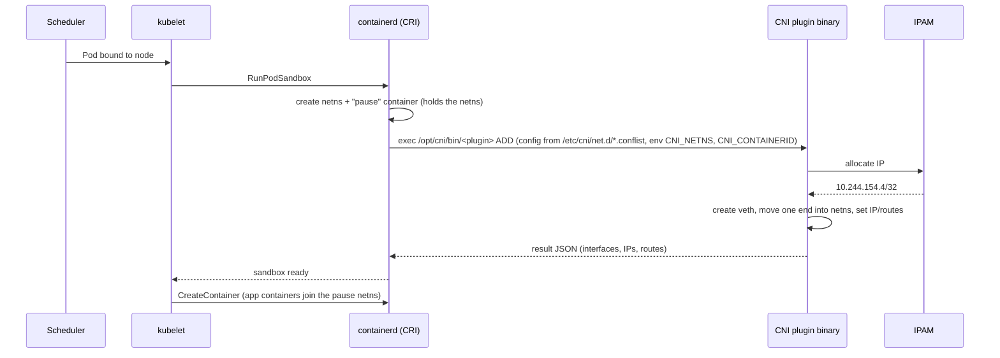
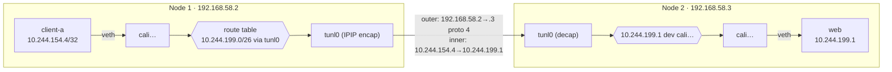
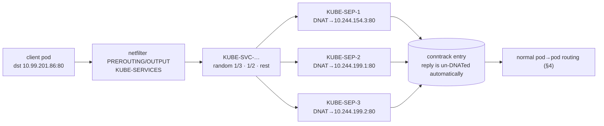
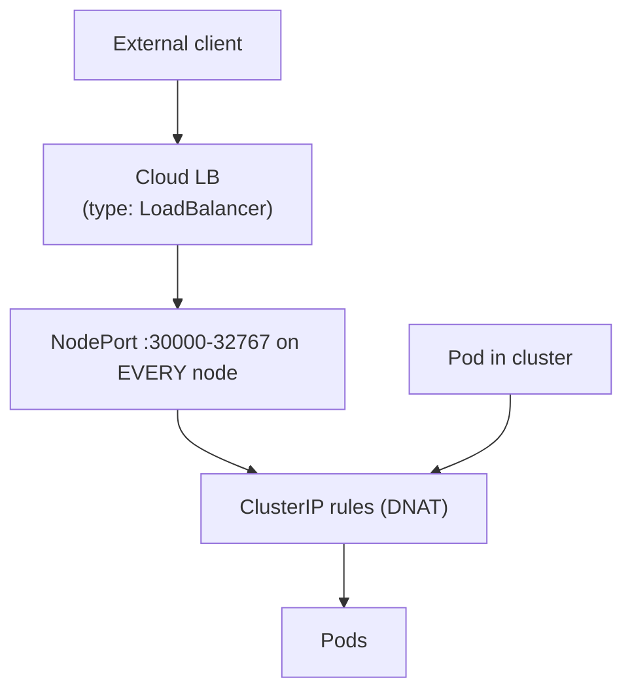
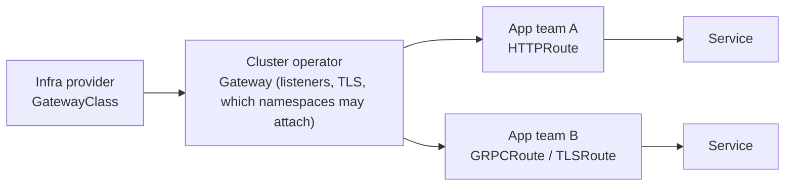
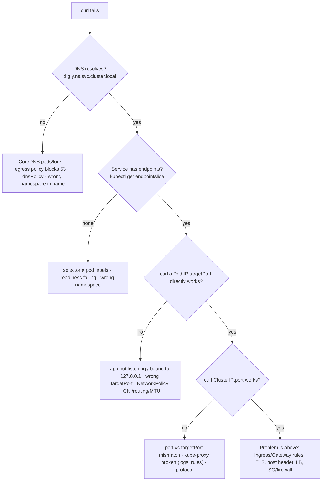

# Kubernetes Networking: The Complete Deep Dive

> Companion to [Networking.md](./Networking.md) (Docker + K8s basics), [Services, Endpoints & Ports](./deep-dive/01-services-endpoints-ports.md), [NetworkPolicy & security](./deep-dive/06-security-rbac-networkpolicy.md), the [Ingress deep dive](../Service%20Mesh/kubernetes-ingress-deep-dive.md) and [Good-practice networking](./good-practice-networking.md).

This page explains how a packet *really* moves through a Kubernetes cluster, from Linux primitives up to Gateway API. All the command output on this page was captured on a real cluster, not copied from docs. The cluster was a 2-node minikube with **Kubernetes v1.37**, **containerd 2.3**, **Calico** CNI in IPIP mode, and kube-proxy in **iptables** mode. Node IPs were `192.168.58.2` and `192.168.58.3`, and the cluster CIDR was `10.244.0.0/16`. Section 19 has the steps to reproduce it.

## Contents
1. [The Kubernetes network model](#1-the-kubernetes-network-model)
2. [Linux building blocks](#2-linux-building-blocks)
3. [What happens when a Pod gets its network](#3-what-happens-when-a-pod-gets-its-network-cni)
4. [Packet walk: Pod → Pod](#4-packet-walk-pod--pod)
5. [CNI plugins compared](#5-cni-plugins-compared)
6. [Services: how a virtual IP works](#6-services-how-a-virtual-ip-actually-works)
7. [kube-proxy modes: iptables, IPVS, nftables, eBPF](#7-kube-proxy-modes)
8. [EndpointSlices and readiness](#8-endpointslices-readiness-and-graceful-termination)
9. [Service types in depth and traffic policies](#9-service-types-in-depth-and-traffic-policies)
10. [DNS: CoreDNS, ndots and the 5-query problem](#10-dns-coredns-ndots-and-the-5-query-problem)
11. [North-south: Ingress and Gateway API](#11-north-south-ingress-and-gateway-api)
12. [NetworkPolicy in depth](#12-networkpolicy-in-depth)
13. [Egress: leaving the cluster](#13-egress-leaving-the-cluster)
14. [Cloud-managed networking (EKS, GKE, AKS)](#14-cloud-managed-networking-eks-gke-aks)
15. [IP planning, dual-stack and MTU](#15-ip-planning-dual-stack-and-mtu)
16. [Service mesh: where it fits](#16-service-mesh-where-it-fits)
17. [Troubleshooting playbook](#17-troubleshooting-playbook)
18. [Production checklist](#18-production-checklist)
19. [Reproduce every experiment (lab)](#19-reproduce-every-experiment-lab)
20. [Interview rapid-fire](#20-interview-rapid-fire)

---

## 1. The Kubernetes network model

Kubernetes doesn't *implement* most of its networking. It sets **requirements** and leaves the implementation to plugins.

### The three rules
1. **Every Pod gets its own IP address.** Containers in a Pod share it, along with `localhost` and the port space.
2. **Any Pod can reach any other Pod on any node without NAT.** The source IP the receiver sees is the sender's real Pod IP.
3. **Agents on a node** (kubelet, system daemons) can reach every Pod on that node.

The rules say nothing about isolation. A cluster is a **flat, fully open network by default**, and NetworkPolicy is how you take that openness away.

### The four problems, and who solves each

| Problem | Solved by | Section |
|---|---|---|
| Container ↔ container in the same Pod | A shared network namespace (the "pause" container holds it) | §3 |
| Pod ↔ Pod (same or different node) | **CNI plugin** (Calico, Cilium, Flannel, AWS VPC CNI...) | §3–5 |
| Pod ↔ Service (stable virtual IP, load balancing) | **kube-proxy** (or an eBPF replacement) + EndpointSlices | §6–9 |
| External ↔ Service | NodePort / LoadBalancer / Ingress / Gateway API + cloud LB | §9, §11 |

Plus **DNS** (CoreDNS) so names resolve, and **NetworkPolicy** (enforced by the CNI) for isolation.

### The three IP ranges in every cluster

| Range | Example (our lab) | Who allocates | Routable? |
|---|---|---|---|
| **Node network** | `192.168.58.0/24` | Your VPC/DC (DHCP, cloud) | Yes, a real network |
| **Pod CIDR** (cluster CIDR) | `10.244.0.0/16` | CNI IPAM (sometimes per node from `node.spec.podCIDR`) | Inside the cluster. Natively routable in the VPC with cloud CNIs |
| **Service CIDR** | `10.96.0.0/12` (kube-dns = `10.96.0.10`) | kube-apiserver `--service-cluster-ip-range` | **No.** These are virtual and exist only as iptables/IPVS/eBPF rules |

**The three ranges must not overlap with each other, or with anything the cluster needs to reach** (corporate networks, peered VPCs, VPN ranges). An overlap gives you silent black holes, and fixing it means rebuilding the cluster.

---

## 2. Linux building blocks

Every CNI is built from the same kernel features. If you know these, every CNI makes sense.

| Primitive | What it is | Where you see it in K8s |
|---|---|---|
| **Network namespace (netns)** | A separate copy of the network stack: interfaces, routes, iptables, ports | One per Pod (shared by its containers) |
| **veth pair** | A virtual cable: two interfaces, and a packet in one end comes out the other | `eth0` in the Pod ↔ `caliXXXX` / `vethXXXX` on the node |
| **Linux bridge** | A virtual L2 switch | `cni0` (Flannel/bridge plugin), `docker0` |
| **Routing table** | Where a packet goes next, by destination | Per-Pod routes on the node, routes to other nodes' Pod blocks |
| **netfilter / iptables / nftables** | Packet hooks (PREROUTING, INPUT, FORWARD, OUTPUT, POSTROUTING) with tables (nat, filter, mangle) | kube-proxy Service DNAT, NetworkPolicy, masquerade |
| **conntrack** | Kernel connection-tracking table. NAT decisions are made once per flow | Why Service load balancing is per *connection*, not per request |
| **IPVS** | Kernel L4 load balancer (hash tables) | kube-proxy IPVS mode |
| **Tunnels: IPIP, VXLAN, Geneve, WireGuard** | Wrap a packet inside another packet | Overlay networks between nodes |
| **eBPF** | Programs that run at kernel hooks (tc, XDP, socket) | Cilium, Calico eBPF, GKE Dataplane V2 |

### Build "Kubernetes networking" by hand in 10 commands

This is what a CNI does for every Pod:
```bash
sudo ip netns add podA                                  # 1. the Pod's network namespace
sudo ip link add vethA type veth peer name eth0 netns podA   # 2. cable: host end vethA, pod end eth0
sudo ip -n podA addr add 10.244.1.10/24 dev eth0        # 3. IPAM: give the pod an IP
sudo ip -n podA link set eth0 up && sudo ip -n podA link set lo up
sudo ip link add cni0 type bridge && sudo ip addr add 10.244.1.1/24 dev cni0 && sudo ip link set cni0 up
sudo ip link set vethA master cni0 && sudo ip link set vethA up   # 4. plug host end into the bridge
sudo ip -n podA route add default via 10.244.1.1        # 5. pod's default gateway = bridge
sudo sysctl -w net.ipv4.ip_forward=1                    # 6. let the node route
sudo iptables -t nat -A POSTROUTING -s 10.244.1.0/24 ! -o cni0 -j MASQUERADE   # 7. SNAT to leave the node
sudo ip netns exec podA ping -c1 8.8.8.8                # works
# 8. for other nodes: ip route add 10.244.2.0/24 via <node2-ip>  (routed)  — or a VXLAN/IPIP tunnel (overlay)
```
That's the **bridge** CNI (as used by Flannel and kindnet). Calico does things slightly differently, as shown next.

---

## 3. What happens when a Pod gets its network (CNI)



Key facts:
- **CNI is a spec plus binaries.** The runtime executes `/opt/cni/bin/<name>` with `ADD`, `DEL`, `CHECK` or `VERSION`, and passes the config JSON on stdin. Most CNIs *also* run a DaemonSet agent (calico-node, cilium-agent, aws-node) to program routes and policy.
- The config is the **first file in lexical order** in `/etc/cni/net.d/`. Leftover config from a previous CNI is a classic cause of "pods get the wrong IPs".
- **No CNI means no Pod networking.** We saw this live: nodes report `NotReady` and CoreDNS stays in `ContainerCreating` until the CNI DaemonSet is up:
  ```text
  netlab-m02   NotReady   <none>   16s   v1.37.0
  coredns-559f6c778d-cq2ht   0/1   ContainerCreating
  calico-node-4dhzk          0/1   Init:0/3
  ```
- The **pause container** owns the netns. App containers can restart without losing the Pod IP, because the sandbox survives.
- **The Pod IP is ephemeral.** Delete or recreate the Pod and you get a new IP. In the lab, scaling `web` to 0 and back changed `10.244.199.1` to `10.244.199.5`, and a curl to the old IP timed out. *Never hardcode Pod IPs.* Use a Service or DNS.

### What a Pod sees (real, Calico)
```text
$ kubectl exec client-a -- ip -br addr
lo               UNKNOWN   127.0.0.1/8 ::1/128
eth0@if18        UP        10.244.154.4/32            ← /32! no subnet neighbours

$ kubectl exec client-a -- ip route
default via 169.254.1.1 dev eth0                      ← a gateway IP that exists nowhere
169.254.1.1 dev eth0 scope link

$ kubectl exec client-a -- ip neigh
169.254.1.1 dev eth0 lladdr ee:ee:ee:ee:ee:ee REACHABLE
```
That's Calico's design: **pure L3, no bridge.** Every Pod has a `/32` and a fake link-local gateway. The host end of the veth (`caliXXXX`, MAC `ee:ee:ee:ee:ee:ee`) answers ARP for anything (**proxy ARP**), so *every* packet goes to the host, which routes it. `eth0@if18` means the peer is interface index 18 on the host.

### IPAM: Pod IPs don't always come from `node.spec.podCIDR`
```text
NAME         PODCIDR             ← assigned by kube-controller-manager
netlab       10.244.0.0/24
netlab-m02   10.244.1.0/24

client-a     10.244.154.4  netlab        ← actual Pod IPs: Calico's own IPAM
client-b     10.244.199.3  netlab-m02

$ kubectl get ippools -o jsonpath=...
default-ipv4-ippool 10.244.0.0/16 ipip=Always vxlan=Never block=26 nat=true
```
Calico hands out `/26` **blocks** to nodes on demand (from its IPPool) and ignores `podCIDR`. Flannel and kindnet *do* use `podCIDR`. AWS VPC CNI uses **real VPC IPs** from the node's ENIs. Knowing which IPAM model you're on matters for IP exhaustion and for routing.

---

## 4. Packet walk: Pod → Pod

### Same node
`client-a (10.244.154.4) → web (10.244.154.3)`, both on `netlab`:
1. The Pod sends to `169.254.1.1` (its default gateway) → veth → host side `calief40f93d799`.
2. The host routing table has a `/32` route per local Pod:
   ```text
   10.244.154.3 dev cali0d8c16a8294 scope link
   10.244.154.4 dev calief40f93d799 scope link
   ```
3. The packet goes out `cali0d8c16a8294` → veth → the web Pod's `eth0`. It never touches the physical network.

(With a bridge CNI, steps 1–3 are L2 switching inside `cni0` instead.)

### Different nodes: overlay (IPIP), captured on the wire
Node 1's routing table (real):
```text
blackhole 10.244.154.0/26 proto bird                         ← my own block (drop anything not a live pod)
10.244.154.4 dev calief40f93d799 scope link                  ← local pods
10.244.199.0/26 via 192.168.58.3 dev tunl0 proto bird onlink ← node2's block → IPIP tunnel to node2
```
`proto bird` means the route was learned over **BGP**: each calico-node runs the BIRD daemon and advertises its blocks to its peers.

```text
$ kubectl exec client-a -- traceroute -n 10.244.199.1
 1  10.244.154.0      ← node1 (tunl0 address)
 2  10.244.199.0      ← node2 (tunl0 address)
 3  10.244.199.1      ← destination pod
$ ping → ttl=62       ← 64 minus 2 routed hops (node1, node2)
```

`tcpdump -v 'ip proto 4'` on node 2's `eth0`, while `client-a` curls a Pod on node 2:
```text
IP (ttl 63, proto IPIP (4), length 80)
    192.168.58.2 > 192.168.58.3:                               ← OUTER header: node1 → node2
      IP (ttl 63, proto TCP (6), length 60)
      10.244.154.4.39694 > 10.244.199.1.80: Flags [S] ...      ← INNER header: pod → pod (unchanged, no NAT)
```
That's the network model's "no NAT" rule in action. The receiving Pod sees the real source Pod IP, and the physical network only ever sees node IPs.



### Overlay vs native routing

| Mode | How cross-node packets travel | Pros | Cons | Examples |
|---|---|---|---|---|
| **VXLAN** overlay | Encapsulated in UDP/4789 (+50 B) | Works on any L3 network, no BGP | Overhead, MTU drop, harder to inspect | Flannel default, Calico VXLAN, Cilium default |
| **IPIP** overlay | IP-in-IP, protocol 4 (+20 B) | Lighter than VXLAN | Some clouds block proto 4 (Azure) | Calico default |
| **Native routing, BGP** | Plain IP, routes advertised over BGP | No overhead, Pod IPs visible to the network | Needs BGP peering or an L2-adjacent fabric | Calico BGP, Cilium BGP, kube-router |
| **Cloud native** (VPC-routed) | Pod IPs are real VPC IPs, or cloud route tables | No overlay, VPC features (SGs, flow logs) work on Pod IPs | IP exhaustion, provider lock-in | AWS VPC CNI, Azure CNI, GKE VPC-native |
| **Encrypted** | WireGuard / IPsec between nodes | Encryption in transit transparently | CPU cost, MTU | Cilium/Calico WireGuard |

Calico's `CrossSubnet` mode is a good compromise: native routing inside an L2 subnet, and encapsulation only between subnets.

---

## 5. CNI plugins compared

| CNI | Data plane | NetworkPolicy | Notable |
|---|---|---|---|
| **Flannel** | VXLAN (bridge + routes) | **No** (pair it with Calico = "Canal") | Simplest. Common in k3s and labs |
| **Calico** | iptables/nftables, or **eBPF**. IPIP/VXLAN/BGP | Yes, plus `GlobalNetworkPolicy`, tiers, deny rules | BGP peering with ToR switches, very mature |
| **Cilium** | **eBPF** (can replace kube-proxy) | Yes, plus **L7** (HTTP/gRPC/Kafka) and **FQDN** policies | Hubble observability, ClusterMesh, Gateway API, WireGuard, BGP, egress gateway. Default on GKE Dataplane V2 and AKS "Azure CNI powered by Cilium" |
| **AWS VPC CNI** | Pods get VPC IPs on node ENIs | Yes (network policy agent, eBPF) since 2023. Or add Calico/Cilium | SGs-for-pods, prefix delegation, max-pods limited by ENIs |
| **Azure CNI** (+Overlay / +Cilium) | VNet IPs or overlay | Azure NPM / Cilium | Overlay mode solves VNet IP exhaustion |
| **GKE VPC-native** | Alias IP ranges | Dataplane V2 (Cilium) | Secondary ranges for Pods and Services |
| **kindnet** | Simple routes, no overlay | Basic (newer versions) | kind's default |
| **Multus** | Meta-plugin: **several interfaces per Pod** | Depends | Telco/NFV, SR-IOV, macvlan secondary networks |
| Weave Net | VXLAN mesh | Yes | **Abandoned**. Migrate off it |

How to choose:
- **Managed cloud:** start with the provider's default (VPC CNI / Azure CNI Overlay / Dataplane V2), and add Cilium or Calico for policy if needed.
- **Self-managed, want features:** Cilium (eBPF, L7 policy, observability).
- **Self-managed, want BGP and enterprise policy:** Calico.
- **Lab or edge:** Flannel or kindnet.

---

## 6. Services: how a virtual IP actually works

```text
service/web   ClusterIP   10.99.201.86   80/TCP   selector app=web
endpointslice web-rp2d8   10.244.154.3,10.244.199.1,10.244.199.2
```

**`10.99.201.86` isn't on any interface anywhere.** No device owns it, and nothing answers ARP for it. It exists only as rules that kube-proxy writes on every node. Here are the real chains from node 1 (`iptables-save -t nat`):

```text
# 1. Entry: every packet to the ClusterIP:port jumps to the service chain
-A KUBE-SERVICES -d 10.99.201.86/32 -p tcp --dport 80 -m comment --comment "netlab/web:http cluster IP" -j KUBE-SVC-PQ5UKG5XQO5CVPRO

# 2. Hairpin/off-cluster sources get marked for masquerade (SNAT)
-A KUBE-SVC-PQ5UKG5XQO5CVPRO ! -s 10.244.0.0/16 -d 10.99.201.86/32 -p tcp --dport 80 -j KUBE-MARK-MASQ

# 3. Load balancing = a chain of random coin flips
-A KUBE-SVC-PQ5UKG5XQO5CVPRO -m statistic --mode random --probability 0.33333333349 -j KUBE-SEP-C2EKLOOU4IVTXTPZ   # 1/3
-A KUBE-SVC-PQ5UKG5XQO5CVPRO -m statistic --mode random --probability 0.50000000000 -j KUBE-SEP-QROGTR7JASOG6BM2   # 1/2 of remaining 2/3 = 1/3
-A KUBE-SVC-PQ5UKG5XQO5CVPRO                                                         -j KUBE-SEP-Y4BMFIKOBN3L3LVR   # the rest = 1/3

# 4. Each Service EndPoint chain DNATs to a real pod IP:port
-A KUBE-SEP-C2EKLOOU4IVTXTPZ -p tcp -j DNAT --to-destination 10.244.154.3:80
-A KUBE-SEP-QROGTR7JASOG6BM2 -p tcp -j DNAT --to-destination 10.244.199.1:80
-A KUBE-SEP-Y4BMFIKOBN3L3LVR -p tcp -j DNAT --to-destination 10.244.199.2:80
# (+ a KUBE-MARK-MASQ rule if a pod connects to its own Service and lands on itself — "hairpin")
```



What follows from this, all of which matter in production:
- **DNAT happens on the *client's* node**, in the client Pod's network path. The ClusterIP never leaves that node. On the wire you only ever see Pod IPs.
- **Load balancing is per connection** (conntrack pins the flow). One long-lived HTTP/2 or gRPC connection goes to **one** Pod forever, so gRPC "doesn't load balance" on plain Services. The fixes are client-side LB (headless Service + gRPC `round_robin`), a mesh, or an L7 proxy.
- **You can't `ping` a ClusterIP:**
  ```text
  $ ping -c2 10.99.201.86
  2 packets transmitted, 0 received, 100% packet loss     ← rules match TCP/80 only; ICMP hits nothing
  $ curl http://web → 200
  ```
  In iptables mode, ping simply fails. In **IPVS mode it answers**, because the VIP is bound to `kube-ipvs0`. Either way, *test Services with curl or nc, not ping.*
- **A Service with zero ready endpoints gets an explicit REJECT:**
  ```text
  -A KUBE-SERVICES -d 10.99.201.86/32 -p tcp --dport 80 --comment "netlab/web:http has no endpoints" -j REJECT --reject-with icmp-port-unreachable
  $ curl http://web
  curl: (7) Failed to connect to web:80 after 12 ms: Could not connect to server     ← fast "refused", not a timeout
  ```
  **Fast "connection refused" on a Service** means no ready endpoints (wrong selector, or failing readiness). A **timeout** points at NetworkPolicy, routing, or a Pod that isn't listening.
- **Session affinity:** `sessionAffinity: ClientIP` (with `timeoutSeconds`, default 10800) adds `-m recent` rules so a client IP sticks to one Pod.

---

## 7. kube-proxy modes

| Mode | How | Scale | Notes |
|---|---|---|---|
| **iptables** (long-time default) | Sequential rule chains (shown above) | Rule updates get slow with tens of thousands of Services/endpoints (whole-table rewrites). Lookup is O(n) in the first-packet path | Most battle-tested |
| **IPVS** | Kernel hash-based L4 LB. VIPs bound to the `kube-ipvs0` dummy interface | Good at large scale | Many schedulers (`rr`, `lc`, `sh`...). Still uses iptables for masquerade and NodePort helpers. Upstream is steering users to nftables |
| **nftables** (GA in 1.33) | nftables maps/sets: O(1) lookups, incremental updates | Best of the kube-proxy modes | The modern choice on recent kernels. `kube-proxy --proxy-mode=nftables` |
| **No kube-proxy (eBPF)** | Cilium / Calico eBPF do the Service translation at socket or tc level | Excellent. Can also preserve the source IP (DSR) | Needs a recent kernel. Replaces kube-proxy fully |

```bash
kubectl -n kube-system get cm kube-proxy -o jsonpath='{.data.config\.conf}' | grep mode   # lab: mode: iptables
# on a node:
sudo iptables-save -t nat | grep -c KUBE-SEP     # iptables mode
sudo ipvsadm -Ln                                 # IPVS mode
sudo nft list table ip kube-proxy                # nftables mode
cilium status | grep KubeProxyReplacement        # Cilium eBPF
```

Even in our tiny lab, the node had **341 iptables lines**. Production clusters with 5,000 Services have hundreds of thousands, and that's when you move to nftables or eBPF.

---

## 8. EndpointSlices, readiness and graceful termination

- **EndpointSlices** (`discovery.k8s.io/v1`) replaced the old `Endpoints` object. They hold up to 100 endpoints per slice by default, so a change only rewrites one slice instead of one huge object.
- The EndpointSlice controller adds a Pod only if it matches the Service selector. Each endpoint carries **conditions**:

| Condition | Meaning | Gets traffic? |
|---|---|---|
| `ready: true` | Running, readiness probe passing, not terminating | Yes |
| `ready: false, serving: true, terminating: true` | Shutting down but still passing readiness | Only as a fallback when there are no ready endpoints (for graceful drain) |
| `serving: false` | Not passing readiness | No |

- **Readiness controls Service membership.** A failing readiness probe removes the Pod from every Service (no restart). A failing liveness probe restarts the container. Mixing these up causes outages.
- `publishNotReadyAddresses: true` puts unready Pods into DNS too (StatefulSet peer discovery: etcd, Cassandra).
- Services without a selector plus a manual EndpointSlice let you point a Service at anything (an external DB or a VM).

### Why you get 502s during rolling updates, and the fix
When a Pod is deleted, **two things happen in parallel**: the kubelet sends SIGTERM, *and* the endpoint removal propagates (API → EndpointSlice → kube-proxy on every node → ingress controllers → cloud LB target groups). The app can exit before every node has stopped sending it traffic.

```yaml
spec:
  terminationGracePeriodSeconds: 45
  containers:
    - name: app
      lifecycle:
        preStop:
          sleep:                 # native sleep action (1.30+); older: exec ["sleep","10"]
            seconds: 10          # keep serving while endpoints are removed everywhere
      readinessProbe: { httpGet: { path: /ready, port: http }, periodSeconds: 5 }
```
The app should still handle SIGTERM by finishing in-flight requests. For AWS ALB/NLB, also tune the target group's `deregistration_delay` and use Pod readiness gates (AWS LB controller).

---

## 9. Service types in depth and traffic policies



Each type **builds on the previous one**: LoadBalancer ⊃ NodePort ⊃ ClusterIP.

| Type | What you get | Use for |
|---|---|---|
| `ClusterIP` | Virtual IP, inside the cluster only | Default for internal services |
| headless (`clusterIP: None`) | **No VIP.** DNS returns Pod IPs directly | StatefulSets, client-side LB (gRPC), peer discovery |
| `NodePort` | ClusterIP + a port (30000–32767) open on **every** node | Behind your own LB, bare metal, debugging |
| `LoadBalancer` | NodePort + a cloud LB provisioned by the cloud controller / LB controller | Exposing L4 services |
| `ExternalName` | DNS CNAME only (`db.example.com`). No proxying, no ports | Aliasing external dependencies |
| `externalIPs` | kube-proxy accepts traffic for arbitrary IPs | **Avoid it.** Anyone who can create Services can hijack IPs (CVE-2020-8554). Block it with policy |

Real headless vs ClusterIP DNS (lab):
```text
$ dig +short web.netlab.svc.cluster.local            → 10.99.201.86                              (one VIP)
$ dig +short web-headless.netlab.svc.cluster.local   → 10.244.199.1 10.244.154.3 10.244.199.2    (every ready pod)
$ dig +short SRV _http._tcp.web.netlab.svc.cluster.local → 0 100 80 web.netlab.svc.cluster.local.   (named port → SRV)
```

### `externalTrafficPolicy`: the source IP question

| | `Cluster` (default) | `Local` |
|---|---|---|
| Path | LB → any node → may hop to a Pod on **another** node | LB → only nodes **with** a local Pod → that Pod |
| Client source IP | **Lost.** SNAT to the node IP (needed so the reply comes back through the same node) | **Preserved** |
| Load spread | Even across Pods | Even across *nodes*. Pods on busy nodes get more traffic |
| Health | Every node passes the LB health check | `healthCheckNodePort`: nodes without local Pods **fail** the check on purpose so the LB skips them |
| Extra hop | Possible | None |

Use `Local` when you need the real client IP (allowlists, logging, rate limits) and spread Pods with topology spread constraints. On AWS with the LB controller in **IP target mode** (`service.beta.kubernetes.io/aws-load-balancer-nlb-target-type: ip`), the NLB targets Pod IPs directly, so there's no NodePort hop at all.

### `internalTrafficPolicy` and topology-aware routing
- `internalTrafficPolicy: Local` sends in-cluster traffic only to Pods on the **same node**, and drops it if there's none. Good for node-local agents (log shippers, DNS caches).
- `trafficDistribution: PreferClose` (GA in 1.33. Newer releases add `PreferSameZone`/`PreferSameNode`) prefers endpoints in the same zone, which **cuts cross-AZ data charges** (often a real line on the cloud bill) and latency.
- `loadBalancerSourceRanges` restricts which CIDRs can reach the LB.
- `loadBalancerClass` picks which controller implements the LB (for example the AWS LB controller vs the legacy in-tree one, or MetalLB).

### Bare metal
There's no cloud controller, so `LoadBalancer` stays `<pending>` forever. Install **MetalLB** (L2/ARP or BGP mode), **kube-vip**, **Cilium LB-IPAM + BGP**, or **Calico BGP service advertisement**.

---

## 10. DNS: CoreDNS, ndots and the 5-query problem

### Records CoreDNS serves
| Name | Record |
|---|---|
| `svc.ns.svc.cluster.local` | A/AAAA → ClusterIP (or Pod IPs for headless) |
| `_port._proto.svc.ns.svc.cluster.local` | SRV (named ports) |
| `pod-0.svc.ns.svc.cluster.local` | A → that Pod (StatefulSet + headless `serviceName`) |
| `10-244-154-4.ns.pod.cluster.local` | A → Pod IP (`pods insecure` mode) |
| `4.154.244.10.in-addr.arpa` | PTR |

### What every Pod's resolv.conf looks like (real)
```text
search netlab.svc.cluster.local svc.cluster.local cluster.local
nameserver 10.96.0.10        ← kube-dns Service VIP (CoreDNS pods behind it)
options ndots:5
```

`ndots:5` means **any name with fewer than 5 dots is tried with every search domain first**. Here's the real trace for `google.com` (1 dot) from the lab:
```text
;google.com.netlab.svc.cluster.local. IN A   → NXDOMAIN
;google.com.svc.cluster.local.        IN A   → NXDOMAIN
;google.com.cluster.local.            IN A   → NXDOMAIN
;google.com.                          IN A   → NOERROR      ← the 4th query
```
That's ×2 again for AAAA, so **8 queries for one external lookup**. (Cloud hosts often add more search domains, like `ec2.internal`, which makes it worse.) At scale this overloads CoreDNS and adds latency to every outbound call.

Fixes:
- Use an **FQDN with a trailing dot** in config: `api.stripe.com.`. That skips the search list.
- Lower ndots per Pod:
  ```yaml
  spec:
    dnsConfig:
      options:
        - name: ndots
          value: "2"
  ```
- **NodeLocal DNSCache**: a DaemonSet cache on every node (link-local `169.254.20.10`). It cuts latency, takes load off CoreDNS, and gets around the **conntrack UDP race** (parallel A+AAAA queries over UDP sometimes lose a packet, which shows up as random 5-second DNS delays). Another workaround is `options single-request-reopen` on glibc.
- Scale CoreDNS (cluster-proportional-autoscaler) and keep `cache` enabled.

### `dnsPolicy`
| Value | resolv.conf |
|---|---|
| `ClusterFirst` (default) | CoreDNS + search domains (above) |
| `Default` | The **node's** resolv.conf (no cluster names!). The name is a historic trap |
| `ClusterFirstWithHostNet` | Required for `hostNetwork: true` Pods that need cluster DNS |
| `None` | Only what `dnsConfig` supplies |

### The Corefile (real, minikube)
```text
.:53 {
    errors
    health { lameduck 5s }
    ready
    kubernetes cluster.local in-addr.arpa ip6.arpa {   # answers cluster names from the API
       pods insecure
       fallthrough in-addr.arpa ip6.arpa
       ttl 30
    }
    prometheus :9153                                   # metrics: coredns_dns_requests_total etc.
    forward . /etc/resolv.conf { max_concurrent 1000 } # everything else → node's upstream
    cache 30
    loop                                               # detects forwarding loops (CrashLoop if found)
    reload
    loadbalance
}
```
Common tweaks: add a stub zone for corporate DNS, `forward corp.local 10.0.0.2`, or a `rewrite` rule. A `loop` plugin crash usually means the node's `/etc/resolv.conf` points at `127.0.0.53` (systemd-resolved). Point the kubelet's `--resolv-conf` at `/run/systemd/resolve/resolv.conf`.

---

## 11. North-south: Ingress and Gateway API

### Ingress (L7 HTTP routing, v1 since 1.19)
An Ingress object is **just config**. It does nothing until an **Ingress controller** (NGINX, Traefik, HAProxy, AWS LB controller → ALB, GCE) reads it.

```yaml
apiVersion: networking.k8s.io/v1
kind: Ingress
metadata:
  name: web
  namespace: netlab
spec:
  ingressClassName: nginx
  tls:
    - hosts: [shop.example.com]
      secretName: shop-tls
  rules:
    - host: shop.example.com
      http:
        paths:
          - path: /api
            pathType: Prefix
            backend: { service: { name: api, port: { name: http } } }
          - path: /
            pathType: Prefix
            backend: { service: { name: web, port: { number: 80 } } }
```
Ingress's limits: HTTP only, with anything advanced (rewrites, canaries, timeouts, auth) done through **controller-specific annotations** that don't port between controllers, and a single object mixing infrastructure and app concerns.

> The community **ingress-nginx** controller has been retired upstream (best-effort maintenance ended in early 2026). New work should go to Gateway API or a maintained controller. Don't confuse it with F5's separate NGINX Ingress Controller.

Full Ingress coverage (TLS termination, pathType, annotations): [Ingress deep dive](../Service%20Mesh/kubernetes-ingress-deep-dive.md).

### Gateway API (the successor, `gateway.networking.k8s.io/v1`)



```yaml
apiVersion: gateway.networking.k8s.io/v1
kind: Gateway
metadata:
  name: public
  namespace: infra
spec:
  gatewayClassName: cilium          # or istio, envoy-gateway, nginx, gke-l7-global-external-managed, amazon-vpc-lattice ...
  listeners:
    - name: https
      protocol: HTTPS
      port: 443
      hostname: "*.example.com"
      tls:
        certificateRefs: [{ name: wildcard-tls }]
      allowedRoutes:
        namespaces:
          from: Selector
          selector: { matchLabels: { gateway-access: "true" } }
---
apiVersion: gateway.networking.k8s.io/v1
kind: HTTPRoute
metadata:
  name: shop
  namespace: shop
spec:
  parentRefs: [{ name: public, namespace: infra }]
  hostnames: [shop.example.com]
  rules:
    - matches: [{ path: { type: PathPrefix, value: /api } }]
      backendRefs:                        # weighted canary — no annotations needed
        - { name: api-v1, port: 8080, weight: 90 }
        - { name: api-v2, port: 8080, weight: 10 }
      timeouts: { request: 10s }
    - backendRefs: [{ name: web, port: 80 }]
```
What it gives you: **role separation** (infra team vs app teams), **portable** traffic splitting, header matching, rewrites, mirroring, timeouts and retries **in the spec**, GRPCRoute/TLSRoute/TCPRoute, cross-namespace references guarded by `ReferenceGrant`, and the same API for meshes (GAMMA).

---

## 12. NetworkPolicy in depth

### Semantics (memorise these)
1. **Default: everything is allowed.**
2. A Pod becomes **isolated for a direction** (Ingress or Egress) as soon as **any** policy selects it with that `policyType`. From then on, only traffic some policy allows gets through.
3. Policies are **additive allow-lists**. There are no deny rules, and order doesn't matter (Calico/Cilium/AdminNetworkPolicy add deny and priority).
4. Both ends must allow: egress from A **and** ingress to B.
5. Return traffic for an allowed connection is allowed automatically (it's stateful, via conntrack).
6. **It's enforced by the CNI.** On a CNI without policy support (plain Flannel), policies are accepted by the API and **silently do nothing**.

### Real results from the lab
Setup: `web` Pods (`app=web`), `client-a` (`role=client`), `client-b` (`role=other`).

| Step | Policy added | client-a → web | client-b → web |
|---|---|---|---|
| 0 | none | **200** | **200** |
| 1 | `default-deny-ingress` (`podSelector: {}`, `policyTypes: [Ingress]`) | timeout | timeout |
| 2 | + allow ingress to `app=web` from `role=client` on port `http` | **200** | timeout |
| 3 | + `client-egress`: clients may egress only to `app=web:80` | `Resolving timed out` ⚠️ | — |
|   | ...but by ClusterIP directly: `curl http://10.99.201.86` | **200** | — |
| 4 | + egress to kube-dns (UDP+TCP 53) | **200** | — |

Two lessons from steps 3 and 4:
- **Egress policies break DNS** unless you allow it explicitly. The symptom is *name resolution* failing, not connection failing. Always add the DNS rule (and allow both UDP and TCP).
- **Policy is evaluated on Pod IPs *after* Service DNAT.** The egress rule only allows `app=web` *Pods*, yet the curl to the *ClusterIP* worked, because by the time the policy checks the packet, kube-proxy has already rewritten the destination to a Pod IP. **Never write policies against ClusterIPs**, because `ipBlock` with a Service IP won't match.

### Selector logic: the indentation that changes everything
```yaml
ingress:
  - from:
      - namespaceSelector: { matchLabels: { team: a } }
        podSelector:       { matchLabels: { app: api } }   # SAME list item → AND: api pods IN team-a namespaces
---
ingress:
  - from:
      - namespaceSelector: { matchLabels: { team: a } }    # item 1
      - podSelector:       { matchLabels: { app: api } }   # item 2 → OR: anything in team-a namespaces, OR api pods in THIS namespace
```
One dash is the difference between "API Pods in team A" and "all of team A plus local API Pods". This is the most common NetworkPolicy security bug.

### Standard baseline per namespace
```yaml
apiVersion: networking.k8s.io/v1
kind: NetworkPolicy
metadata: { name: default-deny-all, namespace: shop }
spec:
  podSelector: {}
  policyTypes: [Ingress, Egress]
---
apiVersion: networking.k8s.io/v1
kind: NetworkPolicy
metadata: { name: allow-dns, namespace: shop }
spec:
  podSelector: {}
  policyTypes: [Egress]
  egress:
    - to:
        - namespaceSelector: { matchLabels: { kubernetes.io/metadata.name: kube-system } }
          podSelector: { matchLabels: { k8s-app: kube-dns } }
      ports: [{ port: 53, protocol: UDP }, { port: 53, protocol: TCP }]
---
apiVersion: networking.k8s.io/v1
kind: NetworkPolicy
metadata: { name: allow-from-ingress, namespace: shop }
spec:
  podSelector: { matchLabels: { app: web } }
  ingress:
    - from:
        - namespaceSelector: { matchLabels: { kubernetes.io/metadata.name: ingress-nginx } }
      ports: [{ port: http }]
```
Then add explicit allows per flow (web → api, api → db:5432, api → `ipBlock` for an external SaaS).

### Gotchas
- **`ipBlock` and source NAT:** traffic arriving through a LoadBalancer with `externalTrafficPolicy: Cluster` has a **node IP** as its source, not the client's. An ingress `ipBlock` of client CIDRs won't match. Use `Local`, or filter at the LB/WAF.
- **`hostNetwork` Pods** use the node's netns. Most CNIs don't apply Pod policies to them.
- **Kubelet probes** come from the node. Most CNIs always allow host → local Pod traffic so probes keep working.
- **Egress to the API server** (operators, controllers): allow `kubernetes.default` endpoints (`kubectl get endpointslice -n default kubernetes`), which are often on a host or control-plane IP outside the Pod CIDR.
- **There's no FQDN egress** in the core API. Use Cilium `toFQDNs`, Calico DNS policy, or an egress proxy.
- **Cluster-wide guardrails:** `AdminNetworkPolicy` / `BaselineAdminNetworkPolicy` (SIG-network, CNI support varies), Calico `GlobalNetworkPolicy`, or `CiliumClusterwideNetworkPolicy`.
- **Test with real traffic.** Use `kubectl exec ... curl`, or the Cilium/Calico policy tracing tools (`hubble observe --verdict DROPPED`).

---

## 13. Egress: leaving the cluster

Pod IPs usually aren't routable on the internet, so outbound traffic gets **SNAT/masquerade** to the node IP. In Calico this is `natOutgoing: true` on the IPPool. Then a NAT gateway translates again to a public IP.

| Need | Solution |
|---|---|
| Partner requires a **fixed source IP** | All egress via cloud NAT Gateway (static EIPs), or a **Cilium/Calico egress gateway** that pins specific namespaces to specific nodes and IPs |
| Pods must keep their own IP to on-prem | Disable SNAT for those CIDRs (AWS VPC CNI `AWS_VPC_K8S_CNI_EXCLUDE_SNAT_CIDRS`, Calico IPPool rules) |
| Restrict egress destinations | Egress NetworkPolicy + FQDN policy (Cilium) or an egress proxy (Squid, Envoy) |
| Private access to cloud APIs | VPC endpoints / Private Service Connect |
| Too many outbound connections to one destination | **SNAT port exhaustion** (a NAT gateway allows ~55k connections per destination IP per public IP). Add EIPs, pool connections, use keep-alive |

---

## 14. Cloud-managed networking (EKS, GKE, AKS)

### EKS: AWS VPC CNI
- Every Pod gets a **real VPC IP** from secondary IPs on the node's ENIs. No overlay, and VPC flow logs and SGs see Pod IPs.
- **Max Pods per node** is capped by ENIs × IPs per ENI (e.g. `m5.large` gives 29). **Prefix delegation** (`ENABLE_PREFIX_DELEGATION=true`) assigns /28 prefixes for up to 110+ Pods per node.
- **Subnet IP exhaustion** is the top EKS networking incident. Fixes: bigger subnets, prefix delegation, **custom networking** (Pods in a secondary CIDR such as `100.64.0.0/10`), or IPv6 clusters.
- **Security Groups for Pods** (branch ENIs) give per-Pod AWS SGs.
- **AWS Load Balancer Controller:** `Ingress` → ALB, `Service type=LoadBalancer` → NLB. Use `target-type: ip` for direct-to-Pod.

### GKE
- **VPC-native** clusters with alias IP ranges (a secondary range each for Pods and Services). Plan the ranges up front, because they're hard to change.
- **Dataplane V2** = Cilium/eBPF (policy, logging, no kube-proxy).
- Container-native LB with **NEGs** (the LB targets Pods directly), and Gateway API GatewayClasses (`gke-l7-*`).

### AKS
- **kubenet** (legacy, being retired) → **Azure CNI Overlay** (Pods get overlay IPs, no VNet exhaustion) or **Azure CNI with VNet IPs**. **Azure CNI powered by Cilium** for the eBPF dataplane.
- Azure blocks IPIP, so Calico on Azure uses VXLAN.

---

## 15. IP planning, dual-stack and MTU

### Sizing (decide on day 0. Changing it later means rebuilding)
- **Pod CIDR:** (max nodes) × (max Pods per node, rounded up to a block). A `/16` is 65k IPs. With Calico `/26` blocks (64 IPs), that's 1,024 node blocks. Flannel's per-node `/24` caps you at 256 nodes in a `/16`.
- **Service CIDR:** a `/16`–`/12` is plenty. **It must not overlap** anything routed. (1.33+ supports extending it through `ServiceCIDR` objects.)
- Reserve **non-overlapping** ranges across clusters if you'll ever mesh them (ClusterMesh, Submariner, multi-cluster Services).

### Dual-stack (IPv4 + IPv6, stable since 1.23)
```yaml
apiVersion: v1
kind: Service
spec:
  ipFamilyPolicy: PreferDualStack      # SingleStack | PreferDualStack | RequireDualStack
  ipFamilies: [IPv6, IPv4]
```
It needs dual-stack Pod and Service CIDRs on the cluster and CNI support. IPv6-only EKS clusters solve IP exhaustion completely.

### MTU: the silent killer
An overlay adds headers. If the Pod MTU is bigger than what the path can carry, the kernel relies on **Path MTU Discovery**: a DF packet that's too big triggers an ICMP "fragmentation needed" reply, and the sender shrinks its packets. **When a firewall, security group or NACL drops that ICMP, you get a PMTU black hole.** Small packets work and large ones vanish. The symptoms are **TLS handshakes hanging, `curl` of big pages stalling, and SSH working but `scp` freezing**.

> Checked in the lab: lowering `tunl0` to MTU 1000 on both nodes did **not** break a 200 KB cross-node download, and neither did dropping ICMP frag-needed in FORWARD and OUTPUT. On a single Docker host, the kernel segments forwarded TCP (GSO) down to the tunnel MTU, so the failure doesn't appear. It does appear on real networks, where a router or VPN between nodes has a smaller MTU *and* filters ICMP type 3 code 4. So: set the Pod MTU correctly for your encapsulation, and allow ICMP frag-needed in SGs and NACLs between nodes.

| Encapsulation | Overhead | Pod MTU on a 1500 network |
|---|---|---|
| None (native) | 0 | 1500 |
| IPIP | 20 B | 1480 |
| VXLAN | 50 B | 1450 |
| WireGuard | 60 B | 1440 |
| VXLAN on a 9001 jumbo network (AWS) | 50 B | 8951 |

Check with `ip link show eth0` inside the Pod, and test with `ping -M do -s 1472 <ip>` (1472 + 28 = 1500 means don't fragment). Modern CNIs auto-detect the MTU. Problems show up with VPNs, nested virtualisation, or a hand-set value.

---

## 16. Service mesh: where it fits

A mesh (Istio, Linkerd, Cilium mesh) adds **L7** on top of everything above: mTLS between Pods (identity-based zero trust), per-request load balancing (which fixes the gRPC problem), retries, timeouts, circuit breaking, traffic splitting, and golden metrics and traces. Sidecar meshes intercept traffic with iptables `REDIRECT` inside the Pod netns (an init container or CNI plugin sets this up). **Ambient** (Istio) and **eBPF** (Cilium) modes do it without sidecars.

Deep coverage is in [Service Mesh](../Service%20Mesh/service-mesh-overview.md): [architecture & sidecars](../Service%20Mesh/service-mesh-architecture-and-sidecar-pattern.md), [traffic management](../Service%20Mesh/traffic-management.md), [mTLS](../Service%20Mesh/security-and-mtls.md).

---

## 17. Troubleshooting playbook

### Toolkit
```bash
# ephemeral debug container in an existing pod's netns (no image changes needed)
kubectl debug -it pod/web-xyz --image=nicolaka/netshoot --target=nginx
# throwaway client pod
kubectl run tmp --rm -it --image=nicolaka/netshoot -- bash
# node-level debug pod (host netns, host fs at /host)
kubectl debug node/netlab -it --image=nicolaka/netshoot

# inside netshoot
curl -v http://web.netlab.svc.cluster.local     # test L7
nc -zv web 80                                   # test L4
dig web.netlab.svc.cluster.local; dig +search +showsearch google.com
ip addr; ip route; ip neigh; ss -tlnp           # is the app listening? on 0.0.0.0 or 127.0.0.1?
tcpdump -ni eth0 port 80
traceroute -n <podIP>; mtr <podIP>

# control-plane view
kubectl get svc,endpointslice -n NS -o wide
kubectl describe svc web                         # Endpoints: <none>?  selector typo?
kubectl get pod -l app=web -o wide --show-labels
kubectl get netpol -A
kubectl -n kube-system logs -l k8s-app=kube-dns
kubectl -n kube-system get pods -l k8s-app=calico-node   # / cilium / aws-node

# node view
sudo iptables-save -t nat | grep <svc-name>      # iptables mode
sudo ipvsadm -Ln | grep -A3 <clusterIP>          # IPVS
sudo conntrack -L -d <clusterIP>                 # flows (install conntrack-tools)
ip route; ip -br link
```

### Debug order for "service X can't reach service Y"



### Symptom → cause

| Symptom | Most likely cause |
|---|---|
| `Could not resolve host` / `Resolving timed out` | Egress policy missing DNS, CoreDNS down, wrong name or namespace |
| **Fast** `connection refused` to a Service | **No ready endpoints** (REJECT rule), or the app isn't listening on that port |
| **Timeout** to a Service or Pod | NetworkPolicy drop, routing/CNI broken, SG/firewall between nodes (IPIP proto 4 / VXLAN UDP 4789 / BGP TCP 179 blocked) |
| Works on the same node, fails across nodes | Overlay traffic blocked between nodes, CNI route missing, `rp_filter`, cloud source/dest check (must be off for native routing) |
| Small requests work, large ones hang | **MTU** |
| Random 5 s DNS delays | conntrack UDP race. Use NodeLocal DNSCache or `single-request-reopen` |
| Intermittent 502/503 during deploys | No `preStop` delay, readiness misconfigured, LB deregistration |
| gRPC traffic all lands on one Pod | Connection-level LB. Use headless + client LB, or a mesh |
| Real client IP missing | `externalTrafficPolicy: Cluster` SNAT. Use `Local`, PROXY protocol, or `X-Forwarded-For` at L7 |
| `LoadBalancer` stuck `<pending>` | No cloud controller/LB controller (bare metal → MetalLB), quota, missing subnet tags (EKS: `kubernetes.io/role/elb`) |
| Pods stuck `ContainerCreating`: `failed to set up sandbox ... network` | CNI not ready, IP exhaustion (`failed to assign an IP address`), stale CNI config |
| New Pods fail only on some nodes | That node's CNI agent is crashlooping. Check the per-node DaemonSet Pod |
| Can't ping a ClusterIP | Expected in iptables mode. Use curl |
| CoreDNS CrashLoopBackOff, `Loop detected` | Node resolv.conf → `127.0.0.53`. Fix the kubelet `resolvConf` |
| Pod → own Service hangs | Hairpin mode disabled (`--hairpin-mode`) |

---

## 18. Production checklist

- [ ] Pod, Service and node CIDRs planned, non-overlapping with VPC/on-prem/peers, sized for 3× growth
- [ ] CNI chosen for policy support. MTU verified end to end
- [ ] kube-proxy on **nftables**, or eBPF replacement, for large clusters
- [ ] Default-deny NetworkPolicy in every app namespace + DNS allow + explicit flows. Enforcement tested
- [ ] NodeLocal DNSCache. CoreDNS autoscaled and monitored (`coredns_dns_request_duration_seconds`). FQDNs or a lower `ndots` for hot external calls
- [ ] Readiness probes on every Service backend. `preStop` sleep + graceful shutdown
- [ ] `externalTrafficPolicy: Local` or IP-target LBs where the client IP matters. Topology spread across nodes and zones
- [ ] `trafficDistribution: PreferClose` on chatty internal Services (cross-AZ cost)
- [ ] Ingress → **Gateway API** migration plan (and off retired ingress-nginx)
- [ ] `externalIPs` blocked by admission policy. `LoadBalancer` creation restricted
- [ ] Egress: static IPs where partners need them. SNAT port capacity. FQDN restrictions for sensitive namespaces
- [ ] Encryption in transit: mesh mTLS or CNI WireGuard where compliance requires it
- [ ] Observability: Hubble/Calico flow logs or VPC flow logs, CNI agent and kube-proxy alerts, IP pool utilisation alerts (EKS subnet free IPs)

---

## 19. Reproduce every experiment (lab)

You need about 5 GB of RAM, Docker and minikube. The `netlab` profile is separate from your other contexts, and the `--context netlab` flags keep the commands away from any real cluster.

```bash
minikube start -p netlab --nodes 2 --cni calico --memory 2600 --cpus 2
alias kn='kubectl --context netlab'
kn -n kube-system wait --for=condition=Ready pod -l k8s-app=calico-node --timeout=400s
```

```yaml
# lab.yaml — kn apply -f lab.yaml
apiVersion: v1
kind: Namespace
metadata: { name: netlab }
---
apiVersion: apps/v1
kind: Deployment
metadata: { name: web, namespace: netlab }
spec:
  replicas: 3
  selector: { matchLabels: { app: web } }
  template:
    metadata: { labels: { app: web } }
    spec:
      containers:
        - name: nginx
          image: nginx:1.27-alpine
          ports: [{ name: http, containerPort: 80 }]
          readinessProbe: { httpGet: { path: /, port: http } }
---
apiVersion: v1
kind: Service
metadata: { name: web, namespace: netlab }
spec:
  selector: { app: web }
  ports: [{ name: http, port: 80, targetPort: http }]
---
apiVersion: v1
kind: Service
metadata: { name: web-headless, namespace: netlab }
spec:
  clusterIP: None
  selector: { app: web }
  ports: [{ name: http, port: 80, targetPort: http }]
---
apiVersion: v1
kind: Pod
metadata: { name: client-a, namespace: netlab, labels: { role: client } }
spec:
  nodeName: netlab                 # pin to node 1
  containers: [{ name: shell, image: nicolaka/netshoot, command: ["sleep", "infinity"] }]
---
apiVersion: v1
kind: Pod
metadata: { name: client-b, namespace: netlab, labels: { role: other } }
spec:
  nodeName: netlab-m02             # pin to node 2
  containers: [{ name: shell, image: nicolaka/netshoot, command: ["sleep", "infinity"] }]
```

| # | Exercise | Command | Look for |
|---|---|---|---|
| 1 | Pod's view | `kn -n netlab exec client-a -- ip -br addr; ... ip route; ... ip neigh` | `/32`, gateway `169.254.1.1`, MAC `ee:ee:...` |
| 2 | Node routes | `minikube -p netlab ssh -- ip route` | `cali*` /32s, `blackhole`, `via ... dev tunl0 proto bird` |
| 3 | Service chains | `minikube -p netlab ssh -- sudo iptables-save -t nat \| grep netlab/web` | `KUBE-SVC` probabilities, `KUBE-SEP` DNAT |
| 4 | Encapsulation | hostNetwork netshoot Pod on node 2: `tcpdump -ni eth0 -v 'ip proto 4'`, then curl a node-2 Pod from client-a | Outer node IPs, inner Pod IPs |
| 5 | Ping vs curl a ClusterIP | `exec client-a -- ping -c2 <clusterIP>` and `curl http://web` | 100% loss vs 200 |
| 6 | Zero endpoints | `kn -n netlab scale deploy web --replicas=0` then curl | Fast refusal + `has no endpoints ... REJECT` rule |
| 7 | Pod IPs are ephemeral | Scale back to 3, curl the *old* Pod IPs | Timeouts. New IPs in `get pods -o wide` |
| 8 | DNS | `dig +short web...`, `web-headless...`, `SRV _http._tcp.web...`, `dig +search +showsearch google.com` | VIP vs Pod IPs. The 3 NXDOMAINs before success |
| 9 | NetworkPolicy | Apply the §12 policies one at a time, curl from both clients | The table in §12, including the DNS trap and the ClusterIP-after-DNAT result |
| 10 | MTU | `exec client-a -- ip link show eth0`, then `minikube -p netlab ssh -- ip link show tunl0` | MTU values. (Lowering `tunl0` to 1000 still worked here, because the kernel segments to fit. Real black holes need a smaller-MTU hop that drops ICMP, see §15) |

Clean up: `minikube delete -p netlab`.

---

## 20. Interview rapid-fire

1. **What are the three rules of the Kubernetes network model?** Every Pod gets an IP. Pod ↔ Pod without NAT across all nodes. Node agents can reach local Pods.
2. **Who gives a Pod its IP?** The CNI plugin's IPAM, called by the container runtime during `RunPodSandbox`. Not the kubelet or the scheduler.
3. **Where does a ClusterIP live?** Nowhere. It's netfilter/IPVS/eBPF rules on every node. DNAT happens on the client's node.
4. **Why does gRPC overload one Pod?** kube-proxy balances per connection (conntrack), and gRPC multiplexes on one long-lived connection.
5. **Fast refused vs timeout on a Service?** Refused means no endpoints (REJECT rule), or nothing listening. Timeout means a drop (policy, routing, firewall, MTU).
6. **Overlay vs native routing?** Encapsulation (VXLAN/IPIP) works anywhere but costs MTU and overhead. Native routing (BGP/VPC) has no overhead but needs network cooperation.
7. **`externalTrafficPolicy: Local` trade-offs?** It keeps the client IP and avoids the extra hop. Nodes without Pods fail health checks on purpose. Load is spread per node.
8. **Why is `ndots:5` a problem?** External names are tried against every search domain first, so 1 lookup becomes up to 8 queries. Use FQDNs with a trailing dot, a lower ndots, or NodeLocal DNSCache.
9. **Default NetworkPolicy behaviour?** Allow all until a Pod is selected for a direction. Then it's allow-list only. Enforcement is by the CNI.
10. **Your default-deny broke everything, including DNS. Why?** Egress isolation blocks UDP/TCP 53 to CoreDNS. Add an explicit DNS allow rule.
11. **Can a NetworkPolicy allow traffic to a Service IP?** No. Policies see post-DNAT Pod IPs. Select the backend Pods by label.
12. **iptables vs IPVS vs nftables?** O(n) chains with full rewrites, vs a kernel hash LB, vs nftables maps with O(1) lookups and incremental updates (GA in 1.33, the modern default choice).
13. **Ingress vs Gateway API?** Ingress is HTTP-only with annotation sprawl. Gateway API is role-oriented, portable, multi-protocol, with traffic splitting in the spec.
14. **EKS Pods stuck in ContainerCreating with "failed to assign an IP"?** Subnet or ENI IP exhaustion. Fix with prefix delegation, larger or secondary CIDRs, or IPv6.
15. **A Pod reaches Pods on its own node but not other nodes?** Inter-node encapsulation is blocked (proto 4, UDP 4789, BGP 179), source/dest check is on, routes are missing, or the CNI agent is unhealthy on one node.
