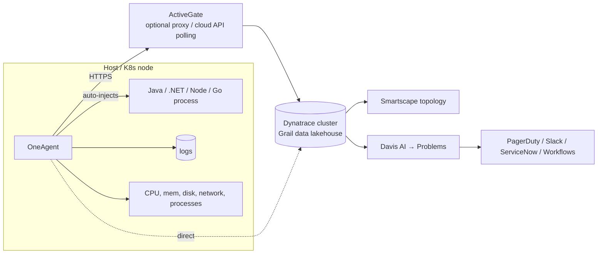

# Dynatrace — Complete Notes

## 1. Beginner

### What is Dynatrace?
- A commercial, **all-in-one observability and APM platform** (SaaS, or self-managed "Managed"). It covers infrastructure, APM and distributed tracing, logs, real user monitoring (RUM), synthetics, application security, and business analytics.
- What sets it apart is **automatic discovery plus AI root-cause analysis**. One agent (OneAgent) instruments everything on a host without code changes, builds a live dependency map (Smartscape), and its AI engine (**Davis**) groups related anomalies into one **Problem** with a probable root cause, instead of sending 50 separate alerts.
- Common in large enterprises (banking, telecom, retail) with lots of Java/.NET apps and hybrid on-prem + cloud estates. **Datadog** is usually the comparison: Datadog is more DIY, priced per product and built around tags; Dynatrace is more automatic and opinionated.

### Core building blocks


| Component | What it does |
|---|---|
| **OneAgent** | One agent per host. Automatically instruments the processes it supports (Java, .NET, Node.js, PHP, Go, NGINX, etc.), captures traces, metrics and logs, and discovers services. No code changes needed |
| **ActiveGate** | Optional relay or proxy between agents and the Dynatrace cluster. It also runs cloud integrations (AWS/Azure/GCP API polling), Kubernetes API monitoring, extensions, and private synthetic locations |
| **Smartscape** | A live topology map: data centre → host → process → service → application, plus who calls whom. Davis uses it to work out causality |
| **PurePath** | Dynatrace's name for an end-to-end distributed trace, down to code level |
| **Davis AI** | Learns normal baselines automatically, detects anomalies, and correlates them through Smartscape into one Problem with a root cause and the affected users or services |
| **Grail** | The current storage backend (a "data lakehouse") for logs, metrics, traces, events and business data, queried with **DQL** (Dynatrace Query Language) |

### Installing
```bash
# Linux host (installer URL + token come from the Dynatrace UI: Deploy OneAgent)
wget -O Dynatrace-OneAgent.sh "https://<env-id>.live.dynatrace.com/api/v1/deployment/installer/agent/unix/default/latest?arch=x86" \
  --header="Authorization: Api-Token <PaaS-token>"
sudo /bin/sh Dynatrace-OneAgent.sh --set-host-group=prod-web
# Restart the application processes afterwards so deep monitoring gets injected
```
```bash
# Kubernetes: Dynatrace Operator + a DynaKube custom resource
helm install dynatrace-operator oci://public.ecr.aws/dynatrace/dynatrace-operator \
  --namespace dynatrace --create-namespace --atomic
kubectl apply -f dynakube.yaml     # defines API URL, tokens secret, and monitoring mode
```
DynaKube monitoring modes:
- **cloudNativeFullStack** (recommended): OneAgent on each node plus code-module injection into pods through a webhook.
- **classicFullStack**: a OneAgent DaemonSet that injects at the host level.
- **applicationMonitoring**: pod injection only, no host agent. Use it where you can't run privileged DaemonSets, such as Fargate or restricted clusters.
- **hostMonitoring**: infrastructure only.

---

## 2. Intermediate

### Services, applications, and process groups
- **Process group**: identical processes across hosts, for example all `payment-api` JVMs.
- **Service**: what a process group serves (web requests, DB calls, queues), discovered automatically from traffic.
- **Application**: the front end as real users see it, captured by RUM JavaScript injected into pages (sessions, user actions, Core Web Vitals).
- **Management zones / segments**: filter the data by team or environment (for example `env:prod AND team:payments`) for both access control and dashboards. Tag consistently with host groups, K8s labels or `DT_TAGS`.

### Problems vs alerts
Davis sets baselines automatically for response time, failure rate and throughput, so you don't hand-tune thresholds for every metric. When the payment DB slows down, you get **one Problem** ("Response time degradation, root cause: database `orders-db` CPU saturation, 3 services and 12k users affected"), not separate alerts from the DB, the API, the front end and the load balancer. That's Dynatrace's main answer to **alert fatigue**.

**Alerting profiles** decide which problems notify whom (severity, management zone, how long it has been open). **Problem notifications / Workflows** send them to PagerDuty, Opsgenie, Slack, ServiceNow, Jira or webhooks.

### Custom metrics and thresholds
- Metrics can also come in from OpenTelemetry (OTLP), Prometheus scraping (through the ActiveGate or OTel Collector), StatsD, the Metrics API, and extensions (databases, network devices, JMX).
- **Metric events** let you set a static threshold or a custom baseline where the automatic one doesn't fit, such as queue depth or a business KPI.
- Query in DQL:
```
fetch logs
| filter k8s.namespace.name == "payments" and loglevel == "ERROR"
| summarize count(), by:{k8s.deployment.name}
| sort `count()` desc
```

### SLOs
Built-in SLOs are defined on metrics (for example `builtin:service.errors.server.successCount` / total). Dynatrace shows the error budget and **burn rate**, and can alert when the budget is being used up too quickly. The same SLI/SLO/error-budget concepts as in [detection-and-alerting.md](../../Incident%20Response%20and%20On-Call/detection-and-alerting.md).

### Release and deployment awareness
Send deployment events (`POST /api/v2/events/ingest` with `CUSTOM_DEPLOYMENT`) from CI/CD, or set `DT_RELEASE_VERSION`/`DT_RELEASE_STAGE` env vars. Davis then links problems to the release that caused them, and you can compare versions side by side. This supports automated **quality gates**, for example in Jenkins/GitLab or Keptn-style "promote only if response time and error rate stayed within the SLO".

---

## 3. Advanced

### Automation (Workflows / AutomationEngine)
Event-triggered workflows (on a problem, on a schedule, on a security finding) can run DQL, call APIs, open Jira or ServiceNow tickets, scale a deployment, or run a remediation such as restarting a pod or rolling back. Use them for auto-remediation of well-understood failures, and keep a human in the loop for anything risky.

### Application security
Runtime Vulnerability Analytics uses OneAgent's view of the libraries that are actually loaded, so it flags only vulnerabilities in code that **really runs** and is reachable or exposed, ranked by risk. That's less noisy than image scanners that list every CVE in every layer. Runtime Application Protection can block attacks like SQL injection in-process. These complement Trivy/Snyk in CI; they don't replace them.

### Cost and licensing
- Pricing is the **Dynatrace Platform Subscription (DPS)**: you commit to an annual spend and use draws it down, priced by usage type (full-stack monitoring by host memory GiB-hours, infrastructure monitoring, log ingest/retain/query, traces, RUM sessions, synthetics). Older contracts used **host units** (based on host RAM) and DEM units.
- Main cost drivers: full-stack monitoring on big-memory hosts, log ingest volume, and retention. Controls:
  - Use infrastructure-only mode for non-critical hosts.
  - Filter or drop logs at ingest with OpenPipeline.
  - Lower trace sampling for high-volume, low-value services.
  - Set retention per bucket.

### Dynatrace vs Datadog vs a self-hosted stack
| | Dynatrace | Datadog | Prometheus + Grafana + Loki/ELK + Tempo/Jaeger |
|---|---|---|---|
| Setup | One agent, automatic instrumentation and topology | Agent plus integrations and tags; more manual wiring | You build and run everything |
| Root cause | Davis AI causation through Smartscape | Watchdog anomalies, correlation through tags | Your dashboards, your runbooks, your brain |
| Strengths | Large enterprise Java/.NET, hybrid/on-prem, mainframe, less tuning | Broad integration catalogue, developer-friendly UI, fast to adopt | No licence cost, no lock-in, full control, CNCF standard |
| Weaknesses | Expensive, opinionated, harder to bend to custom needs | Costs grow quickly with hosts, custom metrics and logs | Operational burden (scale, HA, retention), no automatic RCA |
| Pricing | Committed platform spend (DPS) | Per host / per product / per volume | Infrastructure plus people |

**OpenTelemetry** reduces lock-in in every case: instrument with OTel SDKs, and the backend becomes a swappable decision. Dynatrace, Datadog and Grafana all ingest OTLP.

### Troubleshooting
- **No deep monitoring for a process**: it hasn't been restarted since OneAgent was installed, the technology isn't supported or is disabled, or (on K8s) the pod isn't in a namespace the webhook injects into, so check the DynaKube `namespaceSelector`.
- **Host shows but no data**: the agent can't reach the cluster or ActiveGate (proxy, firewall, port 443), or the token or tenant is wrong. Run `oneagentctl --get-server` and `systemctl status oneagent`, and check the logs under `/var/log/dynatrace/oneagent/`.
- **Too many Problems / noise**: tune anomaly-detection sensitivity per service, mark known-noisy endpoints (health checks) as "do not monitor", use frequent-issue detection, and scope alerting profiles by management zone.
- **Overhead**: usually a small CPU percentage. Turn off unneeded deep-monitoring features for latency-critical processes.

---

## Quick Revision — Dynatrace
- **OneAgent** = one agent per host, automatic instrumentation; **ActiveGate** = relay plus cloud and K8s API polling.
- **Smartscape** = live topology; **PurePath** = distributed trace; **Davis** = baselines plus causal RCA, which turns many alerts into one **Problem**.
- **Grail** stores everything; query it with **DQL**.
- K8s: **Dynatrace Operator** plus a **DynaKube** CR; `cloudNativeFullStack` is the usual mode.
- Strong at automatic RCA and reducing alert fatigue; the trade-offs are cost and lock-in. Use OTel to keep instrumentation portable.

## Related Notes
- [Datadog](../datadog/datadog.md) · [Prometheus](../prometheus/prometheus.md) · [Grafana](../grafana/grafana.md) · [Monitoring index](../index.md)
- [OpenTelemetry](../../CNCF/open-telemetry/opentelemetry.md) · [Detection & Alerting](../../Incident%20Response%20and%20On-Call/detection-and-alerting.md)
