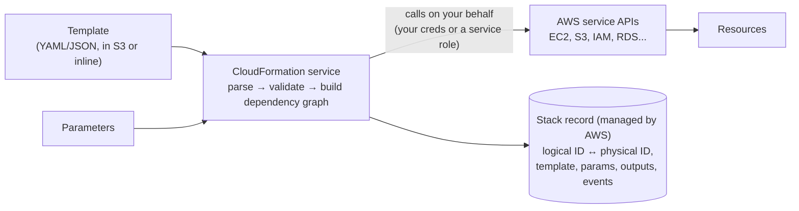
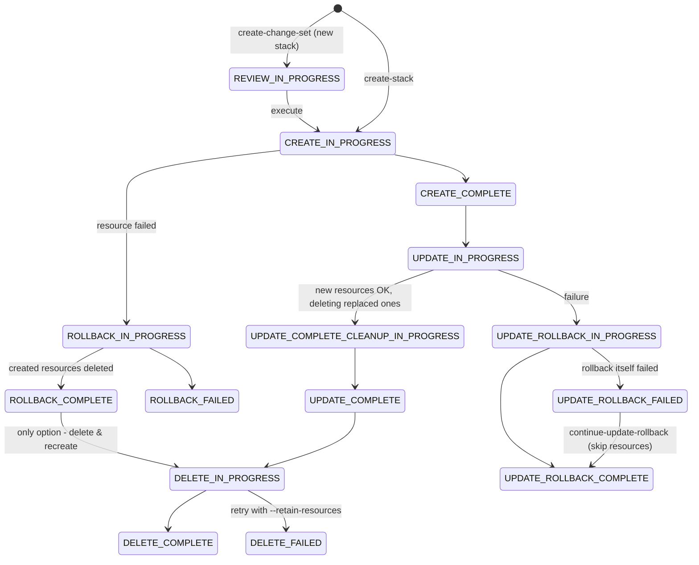

# ☁️ AWS CloudFormation: Zero to Mastery

CloudFormation is AWS's native Infrastructure-as-Code **service**. You give it a template (YAML/JSON), and AWS itself creates, updates and deletes the resources as one unit, called a **stack**. Unlike Terraform, the state, the locking and the rollback all live *inside AWS*.

**How these notes were verified:** every template on these pages passes **`cfn-lint` 1.57**, which validates against AWS's current resource schemas. Linting caught real mistakes along the way (deprecated RDS engine versions, an invalid `cfn-init` package manager, case-sensitive `Fn::ForEach` IDs, stacked YAML tags), and those are documented where they come up. Runtime behaviour (replacement, rollback, export locks) is described from AWS's documented semantics. A local emulator (LocalStack 4.4) was tested and found to **get these wrong**: it showed a `BucketName` change as an in-place update, skipped the rollback after a failed create, and let an in-use export be deleted. So emulator results aren't used as evidence. To *see* that behaviour, run the [labs](./cloudformation-hands-on-labs.md) in a sandbox account.

## Learning path

| # | Note | What you'll learn |
|---|---|---|
| 1 | **Fundamentals & Template Language** (this page) | How CloudFormation works, stack lifecycle and every status, template sections, parameter types, pseudo parameters, every intrinsic function, conditions, Rules, `Fn::ForEach`, dynamic references, CLI basics |
| 2 | [Updates, Rollbacks & Safety](./cloudformation-updates-rollbacks-and-safety.md) | Update behaviours (no interruption / interruption / **replacement**), change sets, DeletionPolicy & UpdateReplacePolicy, stack policies, termination protection, rollback triggers, `UPDATE_ROLLBACK_FAILED` recovery, drift detection, import, stack refactoring |
| 3 | [Composition & Extensibility](./cloudformation-composition-and-extensibility.md) | Exports/ImportValue vs SSM vs nested stacks, StackSets, modules, macros & transforms, custom resources, registry/private types, Hooks, cfn-init/cfn-signal/CreationPolicy/UpdatePolicy |
| 4 | [Tooling, CI/CD & Troubleshooting](./cloudformation-tooling-cicd-and-troubleshooting.md) | cfn-lint, cfn-guard, rain, taskcat, SAM, CDK, IaC generator, Git sync, GitHub Actions with OIDC, the real error → fix table, CloudFormation vs Terraform vs CDK, migration |
| 5 | [Hands-on Labs](./cloudformation-hands-on-labs.md) | 10 labs in a sandbox account (mostly free-tier resources): lifecycle, replacement via change sets, rollback, retain policies, export locks, stack policies, drift, import, nested stacks, custom resources |

Related: [Terraform series](./terraform.md) · [Pulumi](./pulumi.md) · [AWS DevOps, IaC & Monitoring](../Cloud/AWS/aws-devops-iac-monitoring.md) · [Policy as Code](../IaC%20Testing%20and%20Policy%20as%20Code/policy-as-code-with-opa-and-conftest.md) · Official: [User Guide](https://docs.aws.amazon.com/AWSCloudFormation/latest/UserGuide/Welcome.html) · [Resource & property reference](https://docs.aws.amazon.com/AWSCloudFormation/latest/TemplateReference/aws-template-resource-type-ref.html) · [Intrinsic functions](https://docs.aws.amazon.com/AWSCloudFormation/latest/TemplateReference/intrinsic-function-reference.html)

---

## 1. How CloudFormation works



| Concept | Meaning |
|---|---|
| **Template** | Desired state. Logical resources keyed by **logical ID** (`LogsBucket`) |
| **Stack** | One deployed instance of a template (plus parameters). It's the unit of create, update and delete |
| **Logical ID → physical ID** | `LogsBucket` → `acme-dev-logs-123456789012`. This mapping is CloudFormation's "state", and AWS stores it for you |
| **Change set** | A preview of what an update will do. Real "plan" for CloudFormation |
| **Stack events** | A log of every resource state transition. Your first stop when debugging |
| **Service role** | IAM role CloudFormation assumes to make calls (`--role-arn`), instead of the caller's credentials |

### CloudFormation vs Terraform at the architecture level
| | CloudFormation | Terraform |
|---|---|---|
| State | Managed by AWS, nothing to store or lock | You run a backend (S3 + lockfile) |
| Engine | Runs **in AWS** (async, survives your laptop closing) | Runs on your machine or CI |
| Failure | **Automatic rollback** to the last good state | Partial apply, you fix forward |
| Scope | AWS (plus third-party types through the registry) | Any API |
| Language | YAML/JSON + intrinsic functions (or CDK/SAM generating it) | HCL |
| New AWS features | Usually there at or soon after launch (the schemas *are* the service APIs) | Waits on provider releases (often same-day for AWS) |
| Preview | Change sets (resource-level, with replacement info) | Plan (attribute-level diffs) |

---

## 2. Stack lifecycle and every status



| Status | What you can do |
|---|---|
| `CREATE_COMPLETE`, `UPDATE_COMPLETE`, `UPDATE_ROLLBACK_COMPLETE`, `IMPORT_COMPLETE` | Stable. Update or delete |
| **`ROLLBACK_COMPLETE`** | The **first create** failed and everything was rolled back. **You can't update it.** Delete the stack and create it again (or use `--disable-rollback` / `--on-failure DO_NOTHING` / `RETAIN` while developing) |
| **`UPDATE_ROLLBACK_FAILED`** | Rollback couldn't restore a resource. Fix the cause, then `continue-update-rollback` (optionally `--resources-to-skip`). See [part 2](./cloudformation-updates-rollbacks-and-safety.md#5-rollbacks-and-recovering-from-update_rollback_failed) |
| `DELETE_FAILED` | Something couldn't be deleted (non-empty bucket, dependency outside the stack). Fix it, or delete again with `--retain-resources` |
| `*_IN_PROGRESS` | Wait. Only `cancel-update-stack` is allowed during an update |

Since 2021 you can also choose **`--disable-rollback`** on create/update, or "preserve successfully provisioned resources" (`DisableRollback`), then fix and retry with `continue-update-rollback`/`update-stack`. That makes iterating on a broken template much faster.

---

## 3. Template anatomy (every section, lint-clean)

```yaml
AWSTemplateFormatVersion: "2010-09-09"
Description: Web tier - every template section in one place
Metadata:
  AWS::CloudFormation::Interface:
    ParameterGroups:
      - Label: { default: Network }
        Parameters: [VpcId, SubnetIds]
Parameters:
  Env:
    Type: String
    AllowedValues: [dev, staging, prod]
    Default: dev
  VpcId:
    Type: AWS::EC2::VPC::Id
  SubnetIds:
    Type: List<AWS::EC2::Subnet::Id>
  AmiId:
    Type: AWS::SSM::Parameter::Value<AWS::EC2::Image::Id>
    Default: /aws/service/ami-amazon-linux-latest/al2023-ami-kernel-default-x86_64
Rules:
  ProdNeedsTwoSubnets:
    RuleCondition: !Equals [!Ref Env, prod]
    Assertions:
      - Assert: !Not [!Equals [!Select [0, !Ref SubnetIds], !Select [1, !Ref SubnetIds]]]
        AssertDescription: prod requires two distinct subnets
Mappings:
  Sizing:
    dev:     { InstanceType: t3.micro,  MinSize: "1" }
    staging: { InstanceType: t3.small,  MinSize: "1" }
    prod:    { InstanceType: m7i.large, MinSize: "2" }
Conditions:
  IsProd: !Equals [!Ref Env, prod]
  NotProd: !Not [!Condition IsProd]
Resources:
  WebSG:
    Type: AWS::EC2::SecurityGroup
    Properties:
      GroupDescription: !Sub "web ${Env}"
      VpcId: !Ref VpcId
      SecurityGroupIngress:
        - { IpProtocol: tcp, FromPort: 443, ToPort: 443, CidrIp: 0.0.0.0/0 }
      Tags: [{ Key: Name, Value: !Sub "${AWS::StackName}-web" }]
  LaunchTemplate:
    Type: AWS::EC2::LaunchTemplate
    Properties:
      LaunchTemplateData:
        ImageId: !Ref AmiId
        InstanceType: !FindInMap [Sizing, !Ref Env, InstanceType]
        SecurityGroupIds: [!GetAtt WebSG.GroupId]
        MetadataOptions: { HttpTokens: required }
        UserData:
          Fn::Base64: !Sub |
            #!/bin/bash
            echo "env=${Env} region=${AWS::Region} stack=${AWS::StackName}" > /etc/app.env
  DebugBucket:
    Type: AWS::S3::Bucket
    Condition: NotProd
    DeletionPolicy: Delete
Outputs:
  SecurityGroupId:
    Description: Web security group
    Value: !GetAtt WebSG.GroupId
    Export: { Name: !Sub "${AWS::StackName}-WebSG" }
  DebugBucketName:
    Condition: NotProd
    Value: !Ref DebugBucket
  SubnetCount:
    Value: !Join [",", !Ref SubnetIds]
```

| Section | Required | Notes |
|---|---|---|
| `AWSTemplateFormatVersion` | No | Only valid value: `"2010-09-09"` |
| `Description` | No | Up to 1024 chars, shown in the console |
| `Metadata` | No | `AWS::CloudFormation::Interface` (console parameter grouping), `AWS::CloudFormation::Init` (cfn-init config), tool hints |
| `Parameters` | No | Max **200**. Typed inputs (§4) |
| `Rules` | No | Validate parameter *combinations* before anything is created |
| `Mappings` | No | Static lookup tables, `!FindInMap` |
| `Conditions` | No | Booleans that control resources, outputs and properties |
| `Transform` | No | Macros: `AWS::Serverless-2016-10-31` (SAM), `AWS::LanguageExtensions`, `AWS::Include`, your own |
| **`Resources`** | **Yes** | Max **500** resources per template |
| `Outputs` | No | Max **200**. Optional `Export` for cross-stack use |

Template size limits: **51,200 bytes inline** (`--template-body`), **1 MB from S3** (`--template-url`). Large templates must be uploaded to S3 (`aws cloudformation deploy --s3-bucket` / `package` does this for you).

### Resource attributes (on any resource)
| Attribute | Purpose | Covered in |
|---|---|---|
| `Type` | `AWS::Service::Thing`, `Custom::X`, a registry type, or a module | — |
| `Properties` | Resource configuration | — |
| `DependsOn` | Explicit ordering (references already create implicit ordering) | §5 |
| `Condition` | Create only when a condition is true | §6 |
| `DeletionPolicy` / `UpdateReplacePolicy` | `Delete`, `Retain`, `RetainExceptOnCreate`, `Snapshot` | [Part 2](./cloudformation-updates-rollbacks-and-safety.md#3-deletionpolicy-and-updatereplacepolicy) |
| `CreationPolicy` / `UpdatePolicy` | Wait for signals, ASG rolling updates, Lambda alias CodeDeploy, ElastiCache/OpenSearch | [Part 3](./cloudformation-composition-and-extensibility.md#7-bootstrapping-ec2-cfn-init-cfn-signal-creationpolicy-updatepolicy) |
| `Metadata` | Per-resource data (cfn-init) | Part 3 |

---

## 4. Parameters

| Type | Example / notes |
|---|---|
| `String`, `Number`, `CommaDelimitedList`, `List<Number>` | With `AllowedValues`, `AllowedPattern`, `MinLength`/`MaxLength`, `MinValue`/`MaxValue`, `ConstraintDescription` |
| **AWS-specific types** | `AWS::EC2::VPC::Id`, `AWS::EC2::Subnet::Id`, `List<AWS::EC2::Subnet::Id>`, `AWS::EC2::KeyPair::KeyName`, `AWS::Route53::HostedZone::Id`... CloudFormation **checks that the value exists** in the account and region, and the console shows dropdowns |
| **SSM parameter types** | `AWS::SSM::Parameter::Value<String>`, `AWS::SSM::Parameter::Value<AWS::EC2::Image::Id>`. The parameter holds an SSM *name*, and CloudFormation resolves its value at deploy time. The public AMI parameter (`/aws/service/ami-amazon-linux-latest/...`) is the standard way to always get the latest AMI |
| `NoEcho: true` | Masks the value in console, API and events. **It isn't encryption**, and it's still visible in places like `Metadata` if you echo it there. Prefer dynamic references to Secrets Manager (§8) |

```bash
aws cloudformation deploy --stack-name web --template-file web.yaml \
  --parameter-overrides Env=prod VpcId=vpc-0abc SubnetIds=subnet-1,subnet-2
# update keeping the old value:
aws cloudformation update-stack ... --parameters ParameterKey=Env,UsePreviousValue=true
```

**Rules** (in the template above) check *combinations* of parameters, e.g. "prod requires two distinct subnets". They run before any resource is touched, and the failure shows your `AssertDescription`.

### Pseudo parameters
`AWS::AccountId`, `AWS::Region`, `AWS::StackName`, `AWS::StackId`, `AWS::Partition` (`aws`, `aws-cn`, `aws-us-gov`: use it in ARNs so templates work in every partition), `AWS::URLSuffix` (`amazonaws.com`), `AWS::NotificationARNs`, and `AWS::NoValue` (removes a property, see §6).

---

## 5. Intrinsic functions (complete reference)

| Function | Short form | Returns | Example |
|---|---|---|---|
| `Ref` | `!Ref X` | Parameter value, or the resource's **primary identifier** (bucket name, SG id, queue URL... depends on type, see the docs' "Return values") | `!Ref LogsBucket` |
| `Fn::GetAtt` | `!GetAtt R.Attr` | A named attribute | `!GetAtt LogsBucket.Arn`, `!GetAtt Db.Endpoint.Address` |
| `Fn::Sub` | `!Sub` | String interpolation of `${Param}`, `${Resource}` (= Ref), `${Resource.Attr}`, `${AWS::Region}`. Use `${!Literal}` to escape | `!Sub "arn:${AWS::Partition}:s3:::${LogsBucket}/*"` |
| `Fn::Join` | `!Join [",", list]` | Joined string | |
| `Fn::Split` | `!Split ["-", str]` | List | |
| `Fn::Select` | `!Select [i, list]` | List element | `!Select [0, !GetAZs ""]` |
| `Fn::FindInMap` | `!FindInMap [Map, Top, Second]` | Mapping value (with `AWS::LanguageExtensions`: a `DefaultValue` option) | |
| `Fn::If` | `!If [Cond, a, b]` | Conditional value | |
| `Fn::Equals / And / Or / Not` | `!Equals [a, b]` | Boolean (Conditions section, and `Fn::If`) | |
| `Fn::GetAZs` | `!GetAZs ""` | AZs of the current region | |
| `Fn::Base64` | `!Base64` | Base64 (UserData) | |
| `Fn::Cidr` | `!Cidr [cidr, count, bits]` | List of subnet CIDRs | `!Cidr ["10.0.0.0/16", 3, 8]` → 3 × /24 |
| `Fn::ImportValue` | `!ImportValue Name` | Another stack's export ([part 3](./cloudformation-composition-and-extensibility.md#1-sharing-values-between-stacks)) | |
| `Fn::Transform` | — | Invoke a macro on a snippet | |
| `Fn::Length` | — | List length (needs `AWS::LanguageExtensions`) | |
| `Fn::ToJsonString` | `!ToJsonString` | Object → JSON string (LanguageExtensions) | |
| `Fn::ForEach` | — | Loops that generate resources, conditions or outputs (LanguageExtensions) | §7 |
| `Ref` + `Condition` | `!Condition X` | Reference one condition from another | |

**`Ref` vs `GetAtt` is the most common source of errors.** `!Ref` on an `AWS::SQS::Queue` gives the **URL**, while `!GetAtt Q.Arn` gives the ARN. `!Ref` on an `AWS::IAM::Role` gives the role **name**, and `!GetAtt Role.Arn` the ARN. Always check the resource's "Return values" section.

### Short-form gotcha (cfn-lint caught this)
```yaml
Value: !Base64 !Sub "x"          # INVALID YAML: two tags on one node
# E0000 did not find expected key
UserData:
  Fn::Base64: !Sub |              # valid: long form outside, short form inside
    #!/bin/bash
```
The same applies to `!Length !Ref X`. Write `Fn::Length: !Ref X`.

---

## 6. Conditions and `AWS::NoValue`

```yaml
Conditions:
  IsProd: !Equals [!Ref Env, prod]
  NotProd: !Not [!Condition IsProd]
  ProdInUsEast1: !And [!Condition IsProd, !Equals [!Ref "AWS::Region", us-east-1]]
Resources:
  DebugBucket:
    Type: AWS::S3::Bucket
    Condition: NotProd                      # whole resource on/off
  Db:
    Type: AWS::RDS::DBInstance
    Properties:
      MultiAZ: !If [IsProd, true, false]    # value switch
      Iops: !If [IsProd, 6000, !Ref "AWS::NoValue"]   # property removed entirely when not prod
Outputs:
  DebugBucketName:
    Condition: NotProd                      # outputs need the condition too, or the Ref fails
    Value: !Ref DebugBucket
```
Gotchas: you **can't `Ref` a conditional resource from an unconditional one** (wrap the reference in `!If [Cond, !Ref X, !Ref AWS::NoValue]`). Conditions are evaluated **once per deployment**, from parameters, mappings and pseudo parameters only, never from resource attributes. Flipping a condition from true to false **deletes** that resource on the next update.

---

## 7. Loops with `Fn::ForEach` (`AWS::LanguageExtensions`), lint-clean

```yaml
AWSTemplateFormatVersion: "2010-09-09"
Transform: AWS::LanguageExtensions
Parameters:
  Env: { Type: String, Default: dev }
  Queues:
    Type: CommaDelimitedList
    Default: orders,payments,emails
  EnableDlq: { Type: String, AllowedValues: ["true", "false"], Default: "true" }
Conditions:
  HasDlq: !Equals [!Ref EnableDlq, "true"]
Resources:
  Fn::ForEach::Queues:
    - QueueName
    - !Ref Queues
    - "${QueueName}Queue":
        Type: AWS::SQS::Queue
        Properties:
          QueueName: !Sub "${Env}-${QueueName}"
          VisibilityTimeout: 60
          RedrivePolicy: !If
            - HasDlq
            - deadLetterTargetArn: !GetAtt DeadLetterQueue.Arn
              maxReceiveCount: 5
            - !Ref AWS::NoValue
  DeadLetterQueue:
    Type: AWS::SQS::Queue
    Condition: HasDlq
    Properties:
      QueueName: !Sub "${Env}-dlq"
  ConfigParam:
    Type: AWS::SSM::Parameter
    Properties:
      Name: !Sub "/${Env}/queues"
      Type: String
      Value: !ToJsonString
        env: !Ref Env
        count:
          Fn::Length: !Ref Queues
        first: !Select [0, !Ref Queues]
        region: !Ref AWS::Region
        azs: !GetAZs ""
  DbSecretUser:
    Type: AWS::SSM::Parameter
    Properties:
      Name: !Sub "/${Env}/db-user-copy"
      Type: String
      Value: "{{resolve:ssm:/shared/db/username}}"
Outputs:
  OrdersUrl:
    Value: !Ref ordersQueue
  FirstAz:
    Value: !Select [0, !GetAZs ""]
  Split:
    Value: !Select [1, !Split ["-", !Ref AWS::StackName]]
  Cidrs:
    Value: !Join [",", !Cidr ["10.0.0.0/16", 3, 8]]
```

What this shows:
- `Fn::ForEach::Queues` creates three queues, with **logical IDs generated from the values**. cfn-lint caught the gotcha: the IDs are **case-sensitive copies of the values**, so `orders` becomes **`ordersQueue`**, not `OrdersQueue`:
  ```text
  E6101 'OrdersQueue' is not one of [..., 'ordersQueue', 'paymentsQueue', 'emailsQueue', ...]
  ```
- `!If [HasDlq, {...}, !Ref AWS::NoValue]` removes `RedrivePolicy` completely when the DLQ is disabled.
- `!ToJsonString` and `Fn::Length` also come from LanguageExtensions. Without the `Transform` line they're errors.
- Transforms (and therefore `Fn::ForEach`) require deploying through a **change set** (the CLI `deploy` command does this), plus the `CAPABILITY_AUTO_EXPAND` capability for macros.

Before LanguageExtensions, people looped with CDK, Jinja/Jsonnet pre-processing, or copy-paste. If your loops need logic, CDK is usually the better tool ([part 4](./cloudformation-tooling-cicd-and-troubleshooting.md)).

---

## 8. Dynamic references: secrets and parameters at deploy time

```yaml
MasterUserPassword: "{{resolve:secretsmanager:prod/orders/db:SecretString:password}}"
                     # {{resolve:secretsmanager:<secret-id>:SecretString:<json-key>:<version-stage>:<version-id>}}
ImageId:            "{{resolve:ssm:/golden/ami/web}}"           # String / StringList, optional :version
ApiKey:             "{{resolve:ssm-secure:/prod/api-key:3}}"    # SecureString: ONLY in properties that support it
```
- CloudFormation resolves the value when it calls the service API, so it **never appears in the template, the parameters or the events**. That's better than a `NoEcho` parameter.
- `ssm-secure` only works for a limited list of resource properties (e.g. some passwords). Elsewhere, use Secrets Manager.
- **Better still:** don't pass the secret at all. RDS `ManageMasterUserPassword: true` makes RDS generate and rotate the password in Secrets Manager (see [part 2](./cloudformation-updates-rollbacks-and-safety.md#3-deletionpolicy-and-updatereplacepolicy)).
- Resolved values are fetched on create/update. Changing the secret value doesn't update the resource until the next stack update that touches that property.

---

## 9. Dependencies and parallelism

CloudFormation builds a graph from `Ref`, `GetAtt`, `Sub` and `DependsOn`, then creates independent resources **in parallel** and deletes in reverse order. You need `DependsOn` when the dependency is real but not expressed by a reference:
- An EC2 instance or ASG in a public subnet that must wait for the **`AWS::EC2::VPCGatewayAttachment`** (or the route to the IGW). The classic one.
- An IAM **policy** that must be attached before a Lambda or ECS service starts using the role.
- An API Gateway **Deployment** that must come after all its Methods.

Circular references produce `Circular dependency between resources: [A, B]`. The usual culprit is two security groups that reference each other inline. Split the rules into `AWS::EC2::SecurityGroupIngress` resources.

---

## 10. CLI essentials

```bash
aws cloudformation validate-template --template-body file://t.yaml       # syntax only; use cfn-lint for real validation
aws cloudformation deploy --stack-name app --template-file t.yaml \
  --parameter-overrides Env=prod --capabilities CAPABILITY_NAMED_IAM \
  --role-arn arn:aws:iam::123456789012:role/cfn-deployer \
  --tags Team=platform --no-execute-changeset                             # create a change set only → review → execute
aws cloudformation package --template-file t.yaml --s3-bucket artifacts --output-template-file packaged.yaml   # upload local code/nested templates
aws cloudformation describe-stack-events --stack-name app --query 'StackEvents[?contains(ResourceStatus, `FAILED`)]'
aws cloudformation describe-stacks --stack-name app --query 'Stacks[0].Outputs'
aws cloudformation list-stack-resources --stack-name app
aws cloudformation get-template --stack-name app --template-stage Processed  # after transforms (SAM/ForEach expanded)
aws cloudformation delete-stack --stack-name app && aws cloudformation wait stack-delete-complete --stack-name app
```

**Capabilities** must be acknowledged explicitly: `CAPABILITY_IAM` (creates IAM resources), `CAPABILITY_NAMED_IAM` (IAM resources with custom names), `CAPABILITY_AUTO_EXPAND` (macros or nested transforms). Without them you get `Requires capabilities : [CAPABILITY_NAMED_IAM]`.

---

## 11. Mental models

1. **The logical ID is the identity.** Rename `LogsBucket` to `AppLogs` in the template and CloudFormation creates a new bucket and deletes the old one. Use stack refactoring ([part 2](./cloudformation-updates-rollbacks-and-safety.md#8-refactoring-rename-logical-ids-or-move-resources-between-stacks)) instead.
2. **Some property changes mean replacement.** Read the change set's `Replacement` column every time.
3. **Rollback is your friend, until it fails.** Design so rollbacks *can* succeed: don't hand-edit stack resources, and keep IAM permissions for delete as well as create.
4. **Stateful resources need policies:** `DeletionPolicy`, `UpdateReplacePolicy` and service-level deletion protection.
5. **Small stacks, clear boundaries:** split by lifecycle (network / data / app), just like Terraform state.
6. **Never change stack-managed resources by hand.** That's drift, and it breaks updates and rollbacks.

Next: [Updates, Rollbacks & Safety →](./cloudformation-updates-rollbacks-and-safety.md)
