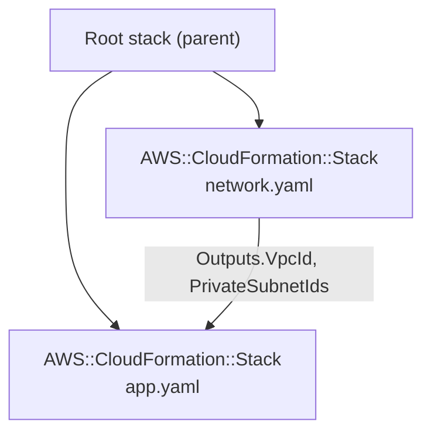
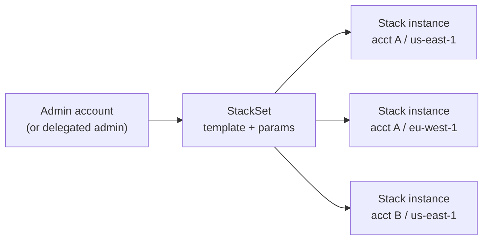
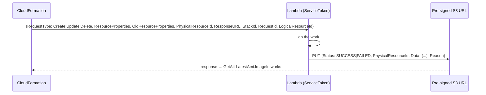

# CloudFormation Composition & Extensibility

> Part of the [CloudFormation notes](./cloud-formation.md). Previous: [Updates, Rollbacks & Safety](./cloudformation-updates-rollbacks-and-safety.md). Next: [Tooling, CI/CD & Troubleshooting](./cloudformation-tooling-cicd-and-troubleshooting.md).
>
> Every template on this page passes cfn-lint 1.57.

How to split infrastructure into many stacks, share values between them, deploy across accounts and regions, and teach CloudFormation new tricks.

---

## 1. Sharing values between stacks

Three mechanisms, from tightest to loosest coupling:

| | **Exports + `Fn::ImportValue`** | **SSM Parameter Store** | **Nested stacks** (`Outputs` → `GetAtt`) |
|---|---|---|---|
| Scope | Same account and region | Same account and region (cross-account through sharing or RAM) | Inside one root stack |
| Coupling | **Hard lock**: an export that's in use can't be changed or deleted | Loose: the consumer reads the value at deploy time | Parent and children deploy together |
| Changing the value | Blocked while imported (`Export X cannot be updated as it is in use by Y`) | Update the parameter, then redeploy consumers | Normal update |
| Visibility | `aws cloudformation list-exports`, `list-imports --export-name` | Parameter hierarchy, IAM per path | Within the root stack |
| Best for | Values that **never** change (VPC ID, a shared KMS key ARN) | Most cross-team contracts | Composing one deployable unit |

Producer (publishes both ways):
```yaml
AWSTemplateFormatVersion: "2010-09-09"
Description: Network stack publishes values two ways
Resources:
  Vpc:
    Type: AWS::EC2::VPC
    Properties: { CidrBlock: 10.20.0.0/16, EnableDnsHostnames: true }
  VpcIdParam:
    Type: AWS::SSM::Parameter
    Properties:
      Name: /platform/network/vpc-id
      Type: String
      Value: !Ref Vpc
Outputs:
  VpcId:
    Value: !Ref Vpc
    Export: { Name: platform-network-VpcId }
```

Consumer:
```yaml
AWSTemplateFormatVersion: "2010-09-09"
Parameters:
  VpcIdFromSsm:
    Type: AWS::SSM::Parameter::Value<AWS::EC2::VPC::Id>
    Default: /platform/network/vpc-id
Resources:
  SgViaExport:
    Type: AWS::EC2::SecurityGroup
    Properties:
      GroupDescription: tightly coupled (export)
      VpcId: !ImportValue platform-network-VpcId
  SgViaSsm:
    Type: AWS::EC2::SecurityGroup
    Properties:
      GroupDescription: loosely coupled (ssm)
      VpcId: !Ref VpcIdFromSsm
```

**The export lock is the #1 cross-stack pain point.** To change an exported value: (1) change the consumers to stop importing it (hard-code it temporarily, or switch to SSM), (2) deploy the consumers, (3) change the export in the producer, (4) re-point the consumers. That's why many teams use exports **only** for immutable IDs and use SSM for everything else. Export names must be unique per account and region, so prefix them with the stack name (`!Sub "${AWS::StackName}-VpcId"`).

The SSM parameter *type* `AWS::SSM::Parameter::Value<AWS::EC2::VPC::Id>` both resolves **and validates** that the VPC exists. CloudFormation records the resolved value, so a changed parameter takes effect on the consumer's next update.

---

## 2. Nested stacks


```yaml
AWSTemplateFormatVersion: "2010-09-09"
Parameters:
  Env: { Type: String, Default: dev }
  ArtifactBucket: { Type: String }
Resources:
  Network:
    Type: AWS::CloudFormation::Stack
    Properties:
      TemplateURL: !Sub "https://${ArtifactBucket}.s3.${AWS::Region}.amazonaws.com/templates/network.yaml"
      Parameters: { Env: !Ref Env, VpcCidr: "10.20.0.0/16" }
      TimeoutInMinutes: 30
  App:
    Type: AWS::CloudFormation::Stack
    Properties:
      TemplateURL: !Sub "https://${ArtifactBucket}.s3.${AWS::Region}.amazonaws.com/templates/app.yaml"
      Parameters:
        Env: !Ref Env
        VpcId: !GetAtt Network.Outputs.VpcId
        SubnetIds: !GetAtt Network.Outputs.PrivateSubnetIds
Outputs:
  VpcId:
    Value: !GetAtt Network.Outputs.VpcId
```

```bash
# package uploads local child templates (and Lambda code) to S3 and rewrites TemplateURL for you
aws cloudformation package --template-file root.yaml --s3-bucket acme-cfn-artifacts --output-template-file packaged.yaml
aws cloudformation deploy --template-file packaged.yaml --stack-name platform --capabilities CAPABILITY_NAMED_IAM CAPABILITY_AUTO_EXPAND
```
(In the source template you can write `TemplateURL: ./network.yaml`, and `package` replaces it with the S3 URL.)

Nested stack rules:
- **Always operate on the root stack.** Updating a child directly breaks the parent's view, and the console warns about it.
- A failure in any child rolls back **the whole tree**.
- Change sets need `--include-nested-stacks` to show children's changes.
- They're useful for getting around the 500-resource limit and reusing building blocks, but deep nesting makes debugging slow (events are spread across stacks). One or two levels is plenty.
- Nested stack vs separate stacks: nested means *one lifecycle, deployed together*. Separate stacks + SSM means *independent lifecycles and teams*.

---

## 3. StackSets: one template, many accounts and regions



Defined as code (lint-clean). This deploys an audit role into every account of an OU, in two regions:
```yaml
AWSTemplateFormatVersion: "2010-09-09"
Description: Org-wide baseline delivered by a service-managed StackSet
Resources:
  Baseline:
    Type: AWS::CloudFormation::StackSet
    Properties:
      StackSetName: org-security-baseline
      PermissionModel: SERVICE_MANAGED
      AutoDeployment: { Enabled: true, RetainStacksOnAccountRemoval: false }
      CallAs: SELF
      Capabilities: [CAPABILITY_NAMED_IAM]
      ManagedExecution: { Active: true }
      OperationPreferences:
        RegionConcurrencyType: PARALLEL
        MaxConcurrentPercentage: 25
        FailureTolerancePercentage: 10
      StackInstancesGroup:
        - DeploymentTargets: { OrganizationalUnitIds: [ou-abcd-11111111] }
          Regions: [us-east-1, eu-west-1]
      TemplateBody: |
        Resources:
          AuditRole:
            Type: AWS::IAM::Role
            Properties:
              RoleName: org-audit-readonly
              AssumeRolePolicyDocument:
                Version: "2012-10-17"
                Statement:
                  - Effect: Allow
                    Principal: { AWS: "arn:aws:iam::111111111111:root" }
                    Action: sts:AssumeRole
              ManagedPolicyArns: [arn:aws:iam::aws:policy/SecurityAudit]
```

| Setting | Meaning |
|---|---|
| `PermissionModel: SELF_MANAGED` | You create `AWSCloudFormationStackSetAdministrationRole` (admin account) and `AWSCloudFormationStackSetExecutionRole` (each target) |
| `PermissionModel: SERVICE_MANAGED` | Uses AWS Organizations (trusted access). Target OUs, not account IDs |
| `AutoDeployment` | New accounts joining the OU get the stack automatically. `RetainStacksOnAccountRemoval` decides what happens when they leave |
| `CallAs: DELEGATED_ADMIN` | Run from a delegated admin member account instead of the management account |
| `ManagedExecution: Active` | Queue non-conflicting operations instead of rejecting them |
| `MaxConcurrentPercentage/Count` | How many accounts are deployed at once |
| `FailureTolerancePercentage/Count` | How many failures before the operation stops |
| `RegionConcurrencyType` / `RegionOrder` | Sequential (safer) vs parallel regions |

```bash
aws cloudformation create-stack-instances --stack-set-name org-security-baseline \
  --deployment-targets OrganizationalUnitIds=ou-abcd-11111111 --regions us-east-1 eu-west-1 \
  --operation-preferences FailureToleranceCount=0,MaxConcurrentCount=5
aws cloudformation list-stack-instances --stack-set-name org-security-baseline \
  --query 'Summaries[?Status!=`CURRENT`].[Account,Region,Status,StatusReason]'
aws cloudformation detect-stack-set-drift --stack-set-name org-security-baseline
```
Typical uses are landing-zone baselines (CloudTrail, Config, GuardDuty, IAM roles, budgets, VPC flow-log settings), usually via Control Tower / Customizations for Control Tower (CfCT) or Landing Zone Accelerator. Gotchas: **instances go `OUTDATED`** when one account fails (often an SCP denies something, or the execution role is missing); named IAM resources must be unique per account (fine) but are global within the account, so deploying the same role to two regions in one account clashes; and `TemplateBody` is limited, so use `TemplateURL` for bigger ones.

---

## 4. Modules: reusable resource bundles from the registry

A **CloudFormation module** packages a set of resources and parameters (for example "a compliant S3 bucket + bucket policy + access-logging") registered as a type like `Acme::S3::SecureBucket::MODULE`:
```yaml
Resources:
  Reports:
    Type: Acme::S3::SecureBucket::MODULE
    Properties:
      BucketPrefix: reports
```
```bash
cfn init     # choose "module", put fragments/*.json in place
cfn submit   # registers a private type version in the account/region
```
The module expands into its resources at deploy time, with logical IDs prefixed by the module's logical ID (`ReportsBucket`, `ReportsBucketPolicy`). Modules give you consistency without nested-stack overhead, but they're **per account and region**, so you'd distribute them with a StackSet. Many teams find CDK constructs or plain template snippets easier.

---

## 5. Macros and transforms

A macro is a **Lambda function that rewrites the template** before deployment. AWS-managed transforms:

| Transform | Does |
|---|---|
| `AWS::Serverless-2016-10-31` | **SAM**: `AWS::Serverless::Function`, `Api`, `SimpleTable`... expand into Lambda, IAM, API Gateway, events ([part 4](./cloudformation-tooling-cicd-and-troubleshooting.md#3-sam)) |
| `AWS::LanguageExtensions` | `Fn::ForEach`, `Fn::Length`, `Fn::ToJsonString`, `DefaultValue` in FindInMap, intrinsic functions in `DeletionPolicy`/`UpdateReplacePolicy` ([part 1 §7](./cloud-formation.md#7-loops-with-fnforeach-awslanguageextensions-lint-clean)) |
| `AWS::Include` | Insert a snippet from S3 |
| `AWS::SecretsManager-2020-07-23` | Rotation Lambda for Secrets Manager |
| `AWS::CodeDeployBlueGreen` | ECS blue/green through CodeDeploy hooks |

Your own macro (lint-clean registration):
```yaml
AWSTemplateFormatVersion: "2010-09-09"
Description: Registers a template macro that upper-cases a "Shout" property
Resources:
  MacroRole:
    Type: AWS::IAM::Role
    Properties:
      AssumeRolePolicyDocument:
        Version: "2012-10-17"
        Statement: [{ Effect: Allow, Principal: { Service: lambda.amazonaws.com }, Action: sts:AssumeRole }]
      ManagedPolicyArns: [!Sub "arn:${AWS::Partition}:iam::aws:policy/service-role/AWSLambdaBasicExecutionRole"]
  MacroFunction:
    Type: AWS::Lambda::Function
    Properties:
      Runtime: python3.13
      Handler: index.handler
      Role: !GetAtt MacroRole.Arn
      Code:
        ZipFile: |
          def handler(event, context):
              frag = event["fragment"]
              for res in frag.get("Resources", {}).values():
                  props = res.get("Properties", {})
                  if "Shout" in props:
                      props["Value"] = props.pop("Shout").upper()
              return {"requestId": event["requestId"], "status": "success", "fragment": frag}
  ShoutMacro:
    Type: AWS::CloudFormation::Macro
    Properties:
      Name: Shout
      FunctionName: !GetAtt MacroFunction.Arn
```
```yaml
# a template that uses it
Transform: Shout
Resources:
  Greeting:
    Type: AWS::SSM::Parameter
    Properties: { Type: String, Shout: hello }      # becomes Value: HELLO
```
The macro receives `{fragment, params, templateParameterValues, region, accountId, requestId}` and must return `{requestId, status: "success", fragment}`. Deploying templates that use macros needs a **change set** and `CAPABILITY_AUTO_EXPAND`. Look at the expanded result with `get-template --template-stage Processed`. Macros are powerful but invisible: reviewers see the *input* template, not what gets deployed. Keep them small and well tested.

---

## 6. Custom resources: run code during stack operations

When CloudFormation can't do something (look up a value, call a third-party API, empty a bucket before deletion, seed a database), a **custom resource** invokes your Lambda (or SNS) on Create, Update and Delete. Lint-clean example that looks up the newest AMI tagged `App=web`:
```yaml
AWSTemplateFormatVersion: "2010-09-09"
Description: Lambda-backed custom resource that looks up the newest AMI by tag
Resources:
  LookupRole:
    Type: AWS::IAM::Role
    Properties:
      AssumeRolePolicyDocument:
        Version: "2012-10-17"
        Statement:
          - Effect: Allow
            Principal: { Service: lambda.amazonaws.com }
            Action: sts:AssumeRole
      ManagedPolicyArns:
        - !Sub "arn:${AWS::Partition}:iam::aws:policy/service-role/AWSLambdaBasicExecutionRole"
      Policies:
        - PolicyName: describe-images
          PolicyDocument:
            Version: "2012-10-17"
            Statement:
              - { Effect: Allow, Action: ec2:DescribeImages, Resource: "*" }
  LookupFunction:
    Type: AWS::Lambda::Function
    Properties:
      Runtime: python3.13
      Handler: index.handler
      Timeout: 60
      Role: !GetAtt LookupRole.Arn
      Code:
        ZipFile: |
          import boto3, cfnresponse
          def handler(event, context):
              try:
                  if event["RequestType"] == "Delete":
                      return cfnresponse.send(event, context, cfnresponse.SUCCESS, {}, event.get("PhysicalResourceId", "none"))
                  tag = event["ResourceProperties"]["AppTag"]
                  imgs = boto3.client("ec2").describe_images(Owners=["self"], Filters=[{"Name": "tag:App", "Values": [tag]}])["Images"]
                  newest = max(imgs, key=lambda i: i["CreationDate"])
                  cfnresponse.send(event, context, cfnresponse.SUCCESS, {"ImageId": newest["ImageId"]}, newest["ImageId"])
              except Exception as e:
                  cfnresponse.send(event, context, cfnresponse.FAILED, {}, reason=str(e)[:200])
  LatestAmi:
    Type: Custom::AmiLookup
    Properties:
      ServiceToken: !GetAtt LookupFunction.Arn
      ServiceTimeout: 120
      AppTag: web
Outputs:
  AmiId:
    Value: !GetAtt LatestAmi.ImageId
```

The contract:

Rules that prevent the infamous "stack stuck for an hour":
1. **Always send a response, including on exceptions and on `Delete`.** If the Lambda crashes without responding, CloudFormation waits for the timeout. That used to be 1 hour, and `ServiceTimeout` (used above) now lets you lower it.
2. **Handle `Delete` gracefully.** If your code fails on Delete, the stack can't be deleted or rolled back.
3. **`PhysicalResourceId` matters.** Return a *different* ID on Update and CloudFormation treats it as a **replacement**, sending a Delete for the old ID during cleanup. Return the same ID for in-place updates.
4. **Only property changes trigger Update.** To re-run on every deploy, add a property like `Nonce: !Ref DeployTimestamp`.
5. `cfnresponse` is only auto-available for inline `ZipFile` Python and Node code. Otherwise bundle it, or use the **CDK Provider framework** / `crhelper`, which handle polling, timeouts and responses for you.

---

## 7. Bootstrapping EC2: cfn-init, cfn-signal, CreationPolicy, UpdatePolicy

Lint-clean ASG that waits for 2 healthy instances, and rolls updates one at a time:
```yaml
AWSTemplateFormatVersion: "2010-09-09"
Parameters:
  AmiId: { Type: "AWS::EC2::Image::Id" }
  SubnetIds: { Type: "List<AWS::EC2::Subnet::Id>" }
Resources:
  LaunchTemplate:
    Type: AWS::EC2::LaunchTemplate
    Metadata:
      AWS::CloudFormation::Init:
        configSets:
          default: [install, configure]
        install:
          packages: { yum: { nginx: [] } }
        configure:
          files:
            /usr/share/nginx/html/index.html:
              content: !Sub "<h1>${AWS::StackName}</h1>"
              mode: "000644"
          services:
            systemd:
              nginx: { enabled: true, ensureRunning: true }
    Properties:
      LaunchTemplateData:
        ImageId: !Ref AmiId
        InstanceType: t3.small
        UserData:
          Fn::Base64: !Sub |
            #!/bin/bash -xe
            dnf install -y aws-cfn-bootstrap
            /opt/aws/bin/cfn-init -v --stack ${AWS::StackName} --resource LaunchTemplate --region ${AWS::Region}
            curl -sf http://localhost/ >/dev/null
            /opt/aws/bin/cfn-signal -e $? --stack ${AWS::StackName} --resource WebAsg --region ${AWS::Region}
  WebAsg:
    Type: AWS::AutoScaling::AutoScalingGroup
    CreationPolicy:
      ResourceSignal: { Count: 2, Timeout: PT15M }
      AutoScalingCreationPolicy: { MinSuccessfulInstancesPercent: 100 }
    UpdatePolicy:
      AutoScalingRollingUpdate:
        MinInstancesInService: 2
        MaxBatchSize: 1
        PauseTime: PT10M
        WaitOnResourceSignals: true
        SuspendProcesses: [HealthCheck, ReplaceUnhealthy, AZRebalance, AlarmNotification, ScheduledActions]
    Properties:
      MinSize: "2"
      MaxSize: "6"
      DesiredCapacity: "2"
      VPCZoneIdentifier: !Ref SubnetIds
      LaunchTemplate:
        LaunchTemplateId: !Ref LaunchTemplate
        Version: !GetAtt LaunchTemplate.LatestVersionNumber
```

How it fits together:
1. `AWS::CloudFormation::Init` metadata declares packages, files, commands, users and services, grouped into `configSets`.
2. UserData runs **`cfn-init`**, which reads that metadata and applies it.
3. A health check (`curl localhost`) then runs **`cfn-signal -e $?`**, which reports success or failure to CloudFormation.
4. **`CreationPolicy.ResourceSignal`**: the ASG isn't `CREATE_COMPLETE` until 2 success signals arrive within 15 minutes. A failure signal or timeout means the create fails and rolls back.
5. **`UpdatePolicy.AutoScalingRollingUpdate`**: on a launch-template change, replace 1 instance at a time, keep 2 in service, and wait for each new instance's signal. Suspending `HealthCheck`/`ReplaceUnhealthy` stops the ASG fighting the rollout.

cfn-lint caught a real mistake in the first draft:
```text
E3009 Additional properties are not allowed ('dnf' was unexpected)
```
`cfn-init` only knows the package managers **`yum`, `rpm`, `apt`, `python`, `rubygems` and `msi`**. On Amazon Linux 2023 you still write `yum:` (dnf provides it).

Other `UpdatePolicy` options: `AutoScalingReplacingUpdate: { WillReplace: true }` (build a whole new ASG, then swap, which is blue/green-like), `AutoScalingScheduledAction` (ignore scheduled-action sizes during updates), `CodeDeployLambdaAliasUpdate` (Lambda traffic shifting), and `UseOnlineResharding` (ElastiCache). The older `AWS::CloudFormation::WaitCondition` + `WaitConditionHandle` signals arbitrary out-of-band completion.

`cfn-hup` (a daemon) re-runs cfn-init when metadata changes. It's mostly legacy now: prefer immutable AMIs (Packer, EC2 Image Builder) and rolling replacement. cfn-init logs are in `/var/log/cfn-init.log` and `/var/log/cfn-init-cmd.log`, and cloud-init output is in `/var/log/cloud-init-output.log`.

---

## 8. The registry: third-party and private resource types

```bash
aws cloudformation list-types --visibility PUBLIC --type RESOURCE --filters Category=THIRD_PARTY --query 'TypeSummaries[].TypeName' | head
aws cloudformation activate-type --type RESOURCE --type-name-alias Datadog::Monitors::Monitor \
  --public-type-arn <arn> --execution-role-arn <role> --auto-update
```
- **Public extensions** from AWS partners (Datadog, MongoDB Atlas, Snowflake, PagerDuty, GitHub ...). After activating one, use it like any `AWS::` type.
- **Private resource types**: build your own with the CloudFormation CLI (`cfn init` → implement create/read/update/delete/list handlers in Java, Python, Go or TypeScript → `cfn submit`). They're proper resources with drift detection and import support, which makes them better than custom resources for anything long-lived.
- **Resource types vs custom resources**: a type is a real, schema'd, versioned resource. A custom resource is a one-off Lambda contract with no drift or import support.
- Configure types per account and region with `set-type-configuration` (API keys from Secrets Manager).

---

## 9. Hooks: proactive policy checks inside CloudFormation

**Hooks** run *before* CloudFormation creates, updates or deletes resources (or executes a whole stack or change set), and can **fail or warn** the operation:

| Hook kind | You write |
|---|---|
| **Guard hook** | cfn-guard rules stored in S3 (no code) |
| **Lambda hook** | A Lambda that returns success/failure |
| Proactive controls (Control Tower) | AWS-managed Guard rules from the Control Catalog |
| Custom hook type (CloudFormation CLI) | Full handler code |

```text
Example: block any S3 bucket without encryption, organisation-wide, before it exists:
  HookTargets: RESOURCE AWS::S3::Bucket on CREATE/UPDATE   FailureMode: FAIL
  → CREATE_FAILED  "Hook failed: S3_BUCKET_ENCRYPTION ..."
```
```bash
aws cloudformation describe-change-set-hooks --stack-name app --change-set-name v2   # which hooks will run
aws cloudformation list-hook-results --target-type CHANGE_SET --target-id <arn>
aws cloudformation get-hook-result --hook-result-id <id>
```
Hooks give you **shift-left enforcement on the server side**: they run for every CloudFormation deployment (console, CLI, CDK, SAM, pipelines), so nobody can skip them, unlike linting in CI. Use `FailureMode: WARN` first, then `FAIL`.

---

## 10. Choosing the composition pattern

| Situation | Use |
|---|---|
| One app, several layers deployed together | Nested stacks |
| Independent teams/lifecycles in one account | Separate stacks + **SSM parameters** (exports only for immutable IDs) |
| Same baseline in every account/region | **StackSets** (service-managed, auto-deploy) |
| Reusable compliant building block | CDK construct (if on CDK), a module, or a snippet library |
| Missing AWS feature or external API | Registry type (long-lived) or custom resource (one-off) |
| Template generation logic | `AWS::LanguageExtensions`, CDK, or a macro (last resort) |
| Org-wide guardrails at deploy time | Hooks (Guard hooks) + SCPs |

Next: [Tooling, CI/CD & Troubleshooting →](./cloudformation-tooling-cicd-and-troubleshooting.md)
