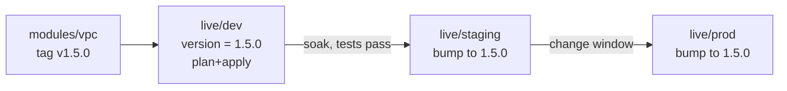

# Terraform Environments, Team Workflows & CI/CD

> Part of the [Terraform notes](./terraform.md). Previous: [CLI Reference](./terraform-cli-reference.md). Next: [Production Patterns & Troubleshooting](./terraform-production-and-troubleshooting.md).

---

## 1. Workspaces

CLI workspaces let **one configuration and one backend** hold **several states**:

```bash
terraform workspace new staging
terraform workspace select prod
terraform workspace list
#   default
#   staging
# * prod
```

With S3, non-default workspaces are stored at `env:/<workspace>/<key>` (the prefix is configurable with `workspace_key_prefix`).

```hcl
locals {
  env = terraform.workspace
  size = {
    default = "t3.micro"
    staging = "t3.small"
    prod    = "m6i.large"
  }[terraform.workspace]
}

resource "aws_instance" "app" {
  instance_type = local.size
  tags          = { Environment = local.env }
}
```

### Should you use workspaces for dev/staging/prod?

**Usually not**, for real environments:

| Problem | Why |
|---|---|
| Same backend and credentials | Prod state sits in the same bucket and is reachable with the same role as dev. You can't separate access with IAM |
| Invisible context | Whether you're about to touch prod depends on `terraform workspace show`. Nothing in the code or directory tells you. This is a classic cause of "applied to prod by accident" |
| Same code, forced | Environments can't differ structurally without `count = terraform.workspace == "prod" ? 1 : 0` scattered everywhere |
| Same provider versions and modules | You can't roll a module upgrade through dev before prod |

**Where workspaces work well:** short-lived copies of the *same* thing. Examples are per-developer sandboxes, per-PR preview environments, and the same stack deployed to N identical regions.

> HCP Terraform "workspaces" are a different concept: each one is a separate state with its own variables, permissions and run history, so they're closer to "directories".

---

## 2. Directory-per-environment (the default recommendation)

```text
infra/
├── modules/                    # reusable, versioned
│   ├── vpc/
│   ├── eks/
│   └── rds/
└── live/
    ├── dev/
    │   ├── network/            # root module = 1 state
    │   │   ├── main.tf         # module "vpc" { source = "../../../modules/vpc" ... }
    │   │   ├── backend.tf      # key = "dev/network/terraform.tfstate"
    │   │   ├── providers.tf    # assume_role → dev account
    │   │   └── terraform.tfvars
    │   ├── data/
    │   └── apps/
    ├── staging/ ...
    └── prod/
        ├── network/
        ├── data/
        └── apps/
```

The pros: the environment is **explicit in the path**, each environment can have **its own backend, account and IAM**, they can differ structurally, and module versions can be promoted (dev uses `v1.5.0` while prod stays on `v1.4.2`).

The con is repetition: `backend.tf`, `providers.tf` and the module calls are copied N times. Accept it, or generate them with Terragrunt.

### Promoting changes



Each bump is its own PR with its own plan. Nobody sees a prod plan for the first time on release day.

### Multi-account (AWS best practice)

Use one AWS account per environment, or per environment per workload, under AWS Organizations. Each `live/<env>` uses a provider that assumes a role in *that* account, and `allowed_account_ids` stops cross-environment mistakes.

---

## 3. Terragrunt (DRY wrapper)

Terragrunt is a thin wrapper that generates the repetitive backend and provider config, and orchestrates many stacks:

```hcl
# live/root.hcl
remote_state {
  backend = "s3"
  generate = { path = "backend.tf", if_exists = "overwrite" }
  config = {
    bucket       = "acme-tfstate-${get_env("ACCOUNT_ID")}"
    key          = "${path_relative_to_include()}/terraform.tfstate"   # auto unique key per dir
    region       = "us-east-1"
    encrypt      = true
    use_lockfile = true
  }
}

generate "provider" {
  path      = "provider.tf"
  if_exists = "overwrite"
  contents  = <<-EOF
    provider "aws" {
      region = "us-east-1"
      assume_role { role_arn = "arn:aws:iam::${get_env("ACCOUNT_ID")}:role/terraform" }
    }
  EOF
}
```

```hcl
# live/prod/apps/terragrunt.hcl
include "root" { path = find_in_parent_folders("root.hcl") }

terraform {
  source = "git::https://github.com/acme/tf-modules.git//app?ref=v2.3.0"
}

dependency "network" {
  config_path = "../network"
  mock_outputs = { private_subnet_ids = ["subnet-mock"] }   # lets plan run before network exists
}

inputs = {
  subnet_ids = dependency.network.outputs.private_subnet_ids
}
```

```bash
terragrunt plan                     # in one dir
terragrunt run --all plan           # whole tree, in dependency order (older: run-all plan)
```

Use Terragrunt when you have many environments × many stacks and the copy-paste is hurting. Skip it for small setups, because it's one more tool, one more DSL and one more thing to debug.

Alternatives: **Terramate** (stack orchestration and change detection), **HCP Terraform Stacks** (native multi-deployment orchestration), or a plain Makefile/Taskfile.

---

## 4. The team workflow

```mermaid
sequenceDiagram
  participant Dev
  participant PR as Pull Request
  participant CI
  participant Cloud
  Dev->>PR: push branch (HCL change)
  PR->>CI: trigger
  CI->>CI: fmt -check, validate, tflint, checkov, terraform test
  CI->>Cloud: plan (read-only role) -out=tfplan
  CI->>PR: comment plan summary + policy results + cost diff
  PR->>PR: review code AND plan; approve
  Dev->>PR: merge to main
  PR->>CI: trigger on main
  CI->>Cloud: plan again (or reuse artifact) → apply (write role, env protection/approval)
  CI->>PR: comment apply result
```

Non-negotiable rules:
1. **Nobody applies from a laptop** to shared environments. CI is the only writer.
2. **The plan is reviewed** along with the code. A one-line change can mean "destroy the database".
3. **Apply what was reviewed.** Either keep the plan artifact from the PR and apply it, or plan again on merge and fail if the result differs.
4. **Serialise applies per state** with CI concurrency groups and state locking.
5. **Separate roles:** a plan role (read-only plus state read) for PRs, and an apply role (write) only on protected branches.

---

## 5. GitHub Actions with OIDC (no long-lived keys)

### AWS side (Terraform, in the bootstrap stack)

```hcl
resource "aws_iam_openid_connect_provider" "github" {
  url            = "https://token.actions.githubusercontent.com"
  client_id_list = ["sts.amazonaws.com"]
}

data "aws_iam_policy_document" "gha_trust_plan" {
  statement {
    actions = ["sts:AssumeRoleWithWebIdentity"]
    principals {
      type        = "Federated"
      identifiers = [aws_iam_openid_connect_provider.github.arn]
    }
    condition {
      test     = "StringEquals"
      variable = "token.actions.githubusercontent.com:aud"
      values   = ["sts.amazonaws.com"]
    }
    condition {
      test     = "StringLike"
      variable = "token.actions.githubusercontent.com:sub"
      values   = ["repo:acme/infra:pull_request"]          # PRs can only PLAN
    }
  }
}

data "aws_iam_policy_document" "gha_trust_apply" {
  statement {
    actions = ["sts:AssumeRoleWithWebIdentity"]
    principals {
      type        = "Federated"
      identifiers = [aws_iam_openid_connect_provider.github.arn]
    }
    condition {
      test     = "StringEquals"
      variable = "token.actions.githubusercontent.com:aud"
      values   = ["sts.amazonaws.com"]
    }
    condition {
      test     = "StringEquals"
      variable = "token.actions.githubusercontent.com:sub"
      values   = ["repo:acme/infra:environment:prod"]       # only the protected "prod" environment
    }
  }
}

resource "aws_iam_role" "tf_plan" {
  name               = "gha-terraform-plan"
  assume_role_policy = data.aws_iam_policy_document.gha_trust_plan.json
}
resource "aws_iam_role_policy_attachment" "tf_plan_ro" {
  role       = aws_iam_role.tf_plan.name
  policy_arn = "arn:aws:iam::aws:policy/ReadOnlyAccess"   # + state bucket read + lock write
}

resource "aws_iam_role" "tf_apply" {
  name               = "gha-terraform-apply"
  assume_role_policy = data.aws_iam_policy_document.gha_trust_apply.json
}
```

The `sub` claim is the security boundary. `repo:acme/infra:*` would let **any branch, including a PR from a fork**, assume the role. Scope the apply role to `environment:prod` and protect that environment with required reviewers.

### Workflow

```yaml
# .github/workflows/terraform.yml
name: terraform
on:
  pull_request:
    paths: ["live/prod/network/**", "modules/**"]
  push:
    branches: [main]
    paths: ["live/prod/network/**", "modules/**"]

permissions:
  id-token: write        # OIDC
  contents: read
  pull-requests: write   # plan comment

concurrency:
  group: tf-prod-network          # one run per state at a time
  cancel-in-progress: false       # never cancel a running apply

env:
  TF_IN_AUTOMATION: "1"
  TF_INPUT: "0"
  WORKDIR: live/prod/network

jobs:
  plan:
    runs-on: ubuntu-latest
    steps:
      - uses: actions/checkout@v4
      - uses: hashicorp/setup-terraform@v3
        with:
          terraform_version: 1.15.8
          terraform_wrapper: false
      - uses: aws-actions/configure-aws-credentials@v4
        with:
          role-to-assume: arn:aws:iam::123456789012:role/gha-terraform-plan
          aws-region: us-east-1
      - run: terraform fmt -check -recursive
      - run: terraform -chdir=$WORKDIR init -lockfile=readonly
      - run: terraform -chdir=$WORKDIR validate
      - name: plan
        id: plan
        run: |
          set +e
          terraform -chdir=$WORKDIR plan -out=tfplan -detailed-exitcode -lock-timeout=5m
          ec=$?
          echo "exitcode=$ec" >> "$GITHUB_OUTPUT"
          [ $ec -eq 1 ] && exit 1 || exit 0
      - name: guard destroys
        run: |
          terraform -chdir=$WORKDIR show -json tfplan > plan.json
          DELETES=$(jq '[.resource_changes[] | select(.change.actions|index("delete"))] | length' plan.json)
          echo "Resources to delete: $DELETES"
          if [ "$DELETES" -gt 0 ] && [ "${{ github.event_name }}" = "pull_request" ]; then
            echo "::warning::Plan deletes $DELETES resources — needs explicit review"
          fi
      - name: comment plan
        if: github.event_name == 'pull_request'
        run: |
          terraform -chdir=$WORKDIR show -no-color tfplan > plan.txt
          { echo '### Terraform plan — prod/network'; echo '```diff'; head -c 60000 plan.txt; echo '```'; } > body.md
          gh pr comment ${{ github.event.pull_request.number }} --body-file body.md --edit-last || \
          gh pr comment ${{ github.event.pull_request.number }} --body-file body.md
        env: { GH_TOKEN: "${{ github.token }}" }
      - uses: actions/upload-artifact@v4
        if: github.event_name == 'push'
        with: { name: tfplan, path: "${{ env.WORKDIR }}/tfplan" }

  apply:
    needs: plan
    if: github.event_name == 'push' && github.ref == 'refs/heads/main'
    runs-on: ubuntu-latest
    environment: prod                 # required reviewers + the OIDC sub claim
    steps:
      - uses: actions/checkout@v4
      - uses: hashicorp/setup-terraform@v3
        with: { terraform_version: 1.15.8, terraform_wrapper: false }
      - uses: aws-actions/configure-aws-credentials@v4
        with:
          role-to-assume: arn:aws:iam::123456789012:role/gha-terraform-apply
          aws-region: us-east-1
      - uses: actions/download-artifact@v4
        with: { name: tfplan, path: "${{ env.WORKDIR }}" }
      - run: terraform -chdir=$WORKDIR init -lockfile=readonly
      - run: terraform -chdir=$WORKDIR apply -lock-timeout=10m tfplan    # applies EXACTLY what was planned
```

Notes:
- The plan job on `push` runs with the *plan* role, which can't write. **Make sure the plan role has read access to the state bucket and permission to write the lock** (or plan with `-lock=false` for read-only plans). Otherwise plans fail with access errors on the `.tflock` object.
- **Plan files hold secrets.** Artifacts are visible to anyone with repo read access. Set short retention, or plan again in the apply job instead of passing the artifact.
- `terraform_wrapper: false` stops the setup action from wrapping stdout, which otherwise breaks `-detailed-exitcode` and `-json` piping.
- **Monorepos with many stacks:** detect changed directories (`dorny/paths-filter`, `tj-actions/changed-files`, or Terramate) and build a matrix of stacks.

---

## 6. Atlantis (PR automation, self-hosted)

```yaml
# atlantis.yaml (repo root)
version: 3
automerge: false
projects:
  - name: prod-network
    dir: live/prod/network
    workflow: default
    autoplan:
      when_modified: ["*.tf", "../../../modules/vpc/**/*.tf"]
    apply_requirements: [approved, mergeable]
```

The flow: open a PR → Atlantis comments the plan → a reviewer approves → you comment `atlantis apply` → Atlantis applies and comments the result → you merge. Atlantis holds a **per-directory lock** while the PR is open, so two PRs can't plan conflicting changes to the same stack.

---

## 7. HCP Terraform / Terraform Enterprise

```hcl
terraform {
  cloud {
    organization = "acme"
    workspaces {
      name = "prod-network"           # or: tags = ["network"] to select several
    }
  }
}
```

What you get: remote state, locking, **remote runs** (plans execute on HashiCorp's workers or on your agents), VCS-driven runs, workspace variables (sensitive ones are write-only), RBAC, **Sentinel/OPA policy** checks between plan and apply, cost estimation, drift detection and health assessments (which run `check` blocks), a private module registry, run tasks (Snyk, Infracost) and **Stacks** for multi-deployment orchestration.

Pricing moved to resources-under-management (RUM), so large estates get expensive. Alternatives include **Spacelift, env0, Scalr, Terrakube** (open source) and **Atlantis** (free, self-hosted).

---

## 8. Secrets in pipelines

| Secret | Good | Bad |
|---|---|---|
| Cloud credentials | OIDC → short-lived role | `AWS_ACCESS_KEY_ID` in repo secrets |
| DB master password | `manage_master_user_password = true` (RDS stores it in Secrets Manager), or ephemeral + `password_wo` | `var.db_password` in tfvars committed to git |
| API tokens for providers (Datadog, GitHub) | Pulled from Vault/Secrets Manager at runtime into `TF_VAR_x` or provider env vars | Hardcoded in `provider {}` |
| tfvars with secrets | Stored in a secret manager and written at job start | Committed |

```hcl
# Vault provider: read a secret ephemerally (1.10+), never stored in state
ephemeral "vault_kv_secret_v2" "dd" {
  mount = "secret"
  name  = "datadog"
}
provider "datadog" {
  api_key = ephemeral.vault_kv_secret_v2.dd.data["api_key"]
  app_key = ephemeral.vault_kv_secret_v2.dd.data["app_key"]
}
```

---

## 9. Quality gates in CI

```bash
terraform fmt -check -recursive
terraform init -backend=false && terraform validate
tflint --recursive                    # provider-aware lint (invalid instance types, deprecated args)
checkov -d . --framework terraform    # or: trivy config .
terraform test                        # unit tests with mocks
terraform plan -out=tfplan && terraform show -json tfplan > plan.json
conftest test plan.json -p policy/    # OPA rules on the PLAN (e.g. no public S3, required tags)
infracost diff --path plan.json       # cost delta comment on PR
```

A sample Rego policy, "deny deleting any RDS instance":
```rego
package terraform.deny_db_delete
import rego.v1

deny contains msg if {
  rc := input.resource_changes[_]
  rc.type == "aws_db_instance"
  "delete" in rc.change.actions
  msg := sprintf("Refusing to delete database %s", [rc.address])
}
```

More detail: [Policy as Code with OPA & Conftest](../IaC%20Testing%20and%20Policy%20as%20Code/policy-as-code-with-opa-and-conftest.md).

Next: [Production Patterns & Troubleshooting →](./terraform-production-and-troubleshooting.md)
