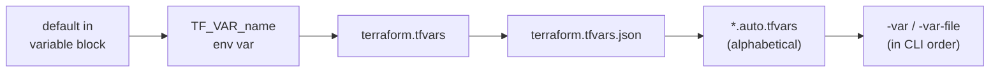

# Terraform HCL Language Deep Dive

> Part of the [Terraform notes](./terraform.md). Previous: [Fundamentals](./terraform.md). Next: [Meta-Arguments & Lifecycle](./terraform-meta-arguments-and-lifecycle.md).

Every expression result shown here was checked with `terraform console` on v1.15.8. Open a console in any initialised directory and try them as you read. The fastest way to learn HCL is to play with it.

---

## 1. Syntax building blocks

```hcl
# BLOCK:  type   label(s)           { body }
resource "aws_instance" "web" {
  # ARGUMENT: name = expression
  ami           = "ami-123"
  instance_type = var.size

  # NESTED BLOCK (defined by the provider schema; no "=")
  root_block_device {
    volume_size = 20
  }

  # Attribute that takes a map: uses "="
  tags = {
    Name = "web"
  }
}
```

| Concept | Meaning |
|---|---|
| **Block** | A container with a type, 0+ labels and a body. Examples: `resource`, `variable`, `module`, `provider`, `terraform`, `locals`, `output`, `data`, `moved`, `import`, `removed`, `check`, `ephemeral` |
| **Argument** | `name = value` inside a block |
| **Attribute** | A value you *read*, e.g. `aws_instance.web.id` (arguments plus computed values) |
| **Identifier** | Letters, digits, `_` and `-`. Can't start with a digit |
| **Comments** | `#` and `//` for single lines, `/* */` for multiple lines. `terraform fmt` normalises `//` to `#` |

Two things trip people up. **Argument vs nested block:** `tags = {}` is an argument that takes a map, while `ingress {}` is a nested block. Using the wrong form gives `Unsupported block type` or `An argument named "ingress" is not expected here`. **JSON syntax:** each `.tf` file can also be written as `.tf.json`, which is handy for generated config.

### All top-level block types

| Block | Purpose |
|---|---|
| `terraform` | Settings: `required_version`, `required_providers`, `backend`, `cloud`, `experiments`, `provider_meta` |
| `provider` | Configure a provider (region, credentials, alias) |
| `resource` | A managed infrastructure object |
| `data` | Read-only lookup of an existing object |
| `ephemeral` (1.10+) | An object that exists only during a run and is **never written to state or plan**, such as a freshly fetched secret or a temporary token |
| `variable` | Module input |
| `output` | Module output |
| `locals` | Named intermediate expressions |
| `module` | Call a child module |
| `moved` (1.1+) | Record an address rename |
| `import` (1.5+) | Declarative import of an existing object |
| `removed` (1.7+) | Stop managing (and optionally keep) an object |
| `check` (1.5+) | Continuous assertions that warn instead of failing |
| `action` / `list` (1.14+) | Provider actions (imperative ops like "invoke Lambda") and `terraform query` list resources for discovering unmanaged infra |

---

## 2. Types

### Primitive types
- `string`: `"hello"`, heredocs, templates
- `number`: `42` or `3.14`. There's one number type, with arbitrary precision
- `bool`: `true` or `false`
- `null`: "unset". Passing `null` to an argument is the same as leaving the argument out, so the provider default applies

### Complex types

| Type | Literal | Ordered? | Element types | Notes |
|---|---|---|---|---|
| `list(T)` | `["a","b"]` | Yes | All T | Indexed `[0]` |
| `tuple([T1,T2])` | `["a", 1]` | Yes | Fixed per position | A bracket literal is really a tuple |
| `set(T)` | (from `toset()`) | **No** | All T, unique | **Can't index `[0]`**. Iterated in lexical order for strings |
| `map(T)` | `{a=1, b=2}` | Keys sorted | All T | Keys are always strings |
| `object({k=T,...})` | `{name="x", port=80}` | — | Fixed per attribute | A brace literal is really an object |

### Automatic conversion

Terraform converts between types when it's safe to:

```text
> "5" + 1
6                             # string → number
> type(["a", 1])
tuple([string, number])       # literal is a tuple, not a list
> tolist(["a", 1])
tolist(["a", "1"])            # unified to list(string)
> tostring(true)
"true"
```

Common gotcha: `toset(["b","a","a"])` gives `["a","b"]`. Duplicates are removed **and the order is lost**. That's exactly why `for_each` needs a set or map: the keys are stable identities.

### Type constraints in variables

```hcl
variable "anything"  { type = any }                    # inferred; avoid in reusable modules
variable "subnets"   { type = list(string) }
variable "ports"     { type = set(number) }
variable "tags"      { type = map(string) }
variable "matrix"    { type = list(list(number)) }

variable "service" {
  type = object({
    name      = string
    port      = number
    public    = optional(bool, false)            # optional with default (1.3+)
    replicas  = optional(number)                 # optional, null if absent
    env       = optional(map(string), {})
    probes    = optional(object({
      path     = optional(string, "/healthz")
      interval = optional(number, 10)
    }), {})                                       # nested default object → inner defaults apply
  })
}
```

```text
# with { name = "api", port = 8080 }
> var.service
{
  "env"      = {}
  "name"     = "api"
  "port"     = 8080
  "probes"   = { "interval" = 10, "path" = "/healthz" }
  "public"   = false
  "replicas" = null
}
```

`optional()` is how you design module inputs that are easy to use: callers pass only what they care about.

---

## 3. Input variables

```hcl
variable "environment" {
  type        = string
  description = "Deployment environment."
  default     = "dev"
  nullable    = false        # passing null → error instead of using null (1.1+)
  sensitive   = false        # true → redacted in plan/apply output (NOT in state!)
  ephemeral   = false        # true (1.10+) → value never persisted to plan/state

  validation {
    condition     = contains(["dev", "staging", "prod"], var.environment)
    error_message = "environment must be dev, staging or prod."
  }
  validation {
    condition     = can(regex("^[a-z]+$", var.environment))
    error_message = "lowercase letters only."
  }
}
```

Since 1.9, a validation `condition` can refer to **other variables, data sources and locals**, not only the variable it belongs to:
```hcl
variable "max_size" { type = number }
variable "min_size" {
  type = number
  validation {
    condition     = var.min_size <= var.max_size
    error_message = "min_size must be <= max_size."
  }
}
```

### How values are assigned, lowest to highest precedence



When the same variable is set in several places, **the last one wins**. If a variable has no default and no value, Terraform prompts for it interactively. In CI, pass `-input=false` so the job fails instead of hanging.

```bash
export TF_VAR_environment=prod
export TF_VAR_tags='{"team":"core"}'          # complex values = HCL/JSON syntax
terraform plan -var-file=prod.tfvars -var 'replicas=5'
```

```hcl
# prod.tfvars — just assignments, no blocks
environment = "prod"
replicas    = 5
subnets     = ["subnet-a", "subnet-b"]
service     = { name = "api", port = 8080 }
```

> **Root vs child module:** `-var`, tfvars and `TF_VAR_` only set **root module** variables. Child module variables are set by the arguments in the `module` block.

---

## 4. Locals

```hcl
locals {
  name_prefix = "${var.project}-${var.environment}"
  common_tags = merge(var.extra_tags, {
    Project     = var.project
    Environment = var.environment
  })
  is_prod     = var.environment == "prod"
  azs         = slice(data.aws_availability_zones.this.names, 0, local.is_prod ? 3 : 2)
}

resource "aws_s3_bucket" "logs" {
  bucket = "${local.name_prefix}-logs"
  tags   = local.common_tags
}
```

Rules of thumb:
- Use locals to **name a computed value** that's used more than once, or that's complex enough to deserve a name.
- Don't wrap every variable in a local (`local.region = var.region`). It's indirection with no benefit.
- Locals can refer to other locals. Terraform orders them by dependency, and cycles are an error.

---

## 5. Outputs

```hcl
output "vpc_id" {
  description = "ID of the VPC."
  value       = aws_vpc.main.id
}

output "db_password" {
  value     = random_password.db.result
  sensitive = true              # required if value derives from something sensitive
}

output "lb_dns" {
  value      = aws_lb.web.dns_name
  depends_on = [aws_lb_listener.https]   # rare: only expose once listener exists

  precondition {
    condition     = aws_lb.web.internal == false
    error_message = "Expected a public LB."
  }
}
```

Outputs do three jobs: they're a **module's return values** (`module.network.vpc_id`), they're **printed after apply** at the root, and they're **read** by other configurations through `terraform output -json` or `terraform_remote_state`.

```bash
terraform output                  # all (sensitive ones shown as <sensitive>)
terraform output -raw lb_dns      # no quotes — for scripts
terraform output -json | jq -r .db_password.value   # sensitive values ARE shown in -json
```

If an output's value comes from a sensitive value and you forget `sensitive = true`, you get `Error: Output refers to sensitive values`. Fix it by marking the output sensitive, or by deliberately calling `nonsensitive()` when the derived value isn't secret (for example, a length).

---

## 6. References: everything you can name

| Expression | Meaning |
|---|---|
| `var.NAME` | Input variable |
| `local.NAME` | Local value |
| `TYPE.NAME.ATTR` | Managed resource attribute, e.g. `aws_vpc.main.id` |
| `TYPE.NAME[0]` / `TYPE.NAME["key"]` | Instance of a `count` / `for_each` resource |
| `data.TYPE.NAME.ATTR` | Data source |
| `ephemeral.TYPE.NAME.ATTR` | Ephemeral resource |
| `module.NAME.OUTPUT` | Child module output |
| `path.module` | Directory of the current module (use it for `file()`/`templatefile()` paths) |
| `path.root` | Directory of the root module |
| `path.cwd` | Where Terraform was run (avoid, because it isn't portable) |
| `terraform.workspace` | Current workspace name |
| `count.index` | Inside `count` |
| `each.key` / `each.value` | Inside `for_each` |
| `self` | Inside provisioners, connection blocks and postconditions: the current resource |

---

## 7. Strings and templates

```hcl
locals {
  greeting = "Hello, ${var.name}!"                  # interpolation
  literal  = "Use $${var.x} to reference"            # escape → "${var.x}" literally
  pct      = "100%%{"                                  # escape directive start

  # Heredoc; <<- strips leading indentation
  user_data = <<-EOT
    #!/bin/bash
    echo "env=${var.environment}" > /etc/app.env
    %{ for p in var.packages ~}
    apt-get install -y ${p}
    %{ endfor ~}
    %{ if var.debug }echo debug on%{ else }echo debug off%{ endif }
  EOT
}
```

- `%{ for } ... %{ endfor }` and `%{ if } ... %{ else } ... %{ endif }` are **template directives**.
- `~` trims the whitespace and newline on that side. Without it, every loop iteration leaves a blank line behind.

### `templatefile()`: keep big templates out of HCL

```hcl
# templates/nginx.conf.tftpl
# upstream app {
# %{ for ip in backends ~}
#   server ${ip}:8080;
# %{ endfor ~}
# }

resource "local_file" "nginx" {
  filename = "${path.module}/out/nginx.conf"
  content  = templatefile("${path.module}/templates/nginx.conf.tftpl", {
    backends = ["10.0.1.10", "10.0.1.11"]
  })
}
```

Generating JSON or YAML? **Don't template it by hand.** Build an HCL object and use `jsonencode()`/`yamlencode()`, so quoting, commas and escaping can't go wrong:

```hcl
resource "aws_iam_policy" "read_logs" {
  name   = "read-logs"
  policy = jsonencode({
    Version   = "2012-10-17"
    Statement = [{
      Effect   = "Allow"
      Action   = ["s3:GetObject", "s3:ListBucket"]
      Resource = [aws_s3_bucket.logs.arn, "${aws_s3_bucket.logs.arn}/*"]
    }]
  })
}
```

An even better option for IAM is the `aws_iam_policy_document` data source. It validates the document and merges statements for you.

(`templatestring()`, added in 1.9, renders a template that's held in a *variable or data source*. If you pass it a literal string, it refuses and tells you to use an ordinary string template instead.)

---

## 8. Operators and conditionals

```text
Arithmetic:  + - * / %        (unary -)
Comparison:  == != < <= > >=   (== compares type too: 1 == "1" is false)
Logical:     && || !           (short-circuit since 1.12: `var.n != null && length(var.n) > 0` is safe;
                                on older versions both sides evaluate → wrap in try())
Conditional: cond ? a : b
```

```hcl
instance_type = var.environment == "prod" ? "m6i.large" : "t3.micro"

# Both branches must be convertible to the same type:
x = var.enabled ? ["a"] : []          # OK: list(string) vs empty tuple → list
y = var.enabled ? { a = 1 } : null    # OK
z = var.enabled ? "a" : 1             # converts 1 → "1"... surprising; avoid mixing
```

**Turning a resource on or off** (the most common conditional):
```hcl
resource "aws_cloudwatch_log_group" "this" {
  count = var.enable_logs ? 1 : 0
  name  = "/app/${var.name}"
}

output "log_group_arn" {
  value = one(aws_cloudwatch_log_group.this[*].arn)   # null when disabled, no index error
}
```

---

## 9. `for` expressions

Two output shapes: `[...]` builds a **tuple/list** and `{...}` builds an **object/map**.

```text
> [for s in ["a", "b"] : upper(s)]
["A", "B"]

> [for i, v in ["x", "y"] : "${i}-${v}" if i > 0]      # index, value, filter
["1-y"]

> {for k, v in {a = 1, b = 2} : v => k}                # invert a map
{ "1" = "a", "2" = "b" }

> {for s in ["a", "b", "a"] : s => s...}               # "..." groups duplicate keys
{ "a" = ["a", "a"], "b" = ["b"] }
```

Without the `...`, a duplicate key is an error (`Duplicate object key`). Iterating over a map gives you `k, v`, and iterating over a list gives you `index, value`.

### The patterns you'll write most

```hcl
locals {
  # list of objects → map keyed by a unique field (for for_each)
  users_by_name = { for u in var.users : u.name => u }

  # filter a map
  prod_services = { for k, s in var.services : k => s if s.env == "prod" }

  # nested → flat (classic "subnet per AZ per tier")
  subnets = flatten([
    for tier, cfg in var.tiers : [
      for idx, az in var.azs : {
        key  = "${tier}-${az}"
        tier = tier
        az   = az
        cidr = cidrsubnet(var.vpc_cidr, 8, cfg.offset + idx)
      }
    ]
  ])
  subnets_by_key = { for s in local.subnets : s.key => s }
}

resource "aws_subnet" "this" {
  for_each          = local.subnets_by_key
  vpc_id            = aws_vpc.main.id
  availability_zone = each.value.az
  cidr_block        = each.value.cidr
  tags              = { Name = each.key, Tier = each.value.tier }
}
```

**Flatten, then key by a unique string, then `for_each`.** That pattern solves about 80% of "how do I loop over X × Y" questions.

---

## 10. Splat expressions

```hcl
aws_instance.web[*].id                 # count resource → list of ids
[for i in aws_instance.web : i.id]     # equivalent

values(aws_instance.by_name)[*].id     # for_each resource is a MAP → [*] won't work directly
[for k, i in aws_instance.by_name : i.private_ip]
```

There's a special case: applying `[*]` to a **single value** (not a list) turns it into a list of one element, or an empty list if the value is null. Combine it with `one()` to make "optional" resources safe to reference.

---

## 11. `dynamic` blocks

Use these to generate **nested blocks** (not resources) from a collection:

```hcl
variable "ingress_rules" {
  type = list(object({
    port  = number
    cidrs = list(string)
    desc  = optional(string, "")
  }))
}

resource "aws_security_group" "web" {
  name   = "web"
  vpc_id = aws_vpc.main.id

  dynamic "ingress" {
    for_each = var.ingress_rules
    iterator = rule                     # default iterator name = block label ("ingress")
    content {
      from_port   = rule.value.port
      to_port     = rule.value.port
      protocol    = "tcp"
      cidr_blocks = rule.value.cidrs
      description = rule.value.desc
    }
  }
}
```

An optional single nested block (present or absent):
```hcl
dynamic "logging" {
  for_each = var.log_bucket == null ? [] : [var.log_bucket]
  content {
    target_bucket = logging.value
  }
}
```

**Don't overuse `dynamic`.** If the blocks are fixed, write them out. Nested `dynamic` blocks quickly become unreadable. And for security group rules specifically, prefer separate `aws_vpc_security_group_ingress_rule` resources. Inline rules and separate rule resources for the same SG fight each other, and the plan flaps between them forever.

---

## 12. Unknown values ("known after apply")

At plan time, some values don't exist yet: a new instance's ID, an ARN, a generated password. Terraform carries them through the plan as **unknown**, and anything computed from an unknown value is unknown too.

Where unknowns cause errors:

| Construct | Error | Fix |
|---|---|---|
| `for_each` **keys** | `The "for_each" map includes keys derived from resource attributes that cannot be determined until apply` | Key by static values (names from variables) and put the unknown values in the map *values* |
| `count` | `The "count" value depends on resource attributes that cannot be determined until apply` | Derive `count` from variables or locals, not from resource outputs |
| Provider config | Provider can't be configured with unknown values (e.g. a k8s provider using an EKS endpoint created in the same apply) | Split into two states/applies, or accept it on first apply with care |
| Data source arguments | Data source read is deferred to apply, so its outputs become unknown | Usually fine. Can cascade into "forces replacement" surprises |

```hcl
# BAD — keys come from unknown ids
for_each = toset(aws_subnet.private[*].id)

# GOOD — keys are static; ids are values
for_each = aws_subnet.private          # map keyed by AZ name (known), values are objects
subnet_id = each.value.id
```

`terraform plan -target` is sometimes suggested as a way to "pre-create" the unknowns. It works as a one-off, but it isn't a design. (HashiCorp is working on *deferred actions*, which would let a plan contain a partially unknown `for_each`. It's still experimental, so don't depend on it.)

---

## 13. Sensitive and ephemeral values

| | `sensitive = true` | `ephemeral = true` / `ephemeral` resources (1.10+) |
|---|---|---|
| Hidden in CLI output | Yes | Yes |
| Stored in plan file | **Yes** | No |
| Stored in state | **Yes, in plaintext** | No |
| Use it for | Hiding values from logs | Secrets that must never be persisted |

```hcl
# Ephemeral resource: fetch a secret only for this run
ephemeral "aws_secretsmanager_secret_version" "db" {
  secret_id = "prod/db/master"
}

# Write-only argument (1.11+): sent to the API, never stored in state
resource "aws_db_instance" "main" {
  # ...
  password_wo         = ephemeral.aws_secretsmanager_secret_version.db.secret_string
  password_wo_version = 1          # bump to rotate — WO args can't be diffed, so a version triggers updates
}
```

Ephemeral values can only flow into ephemeral contexts: write-only (`*_wo`) arguments, provider configuration, provisioners, other ephemeral resources, and ephemeral variables and outputs. If you reference one in a normal resource argument, you get an error.

Related functions: `sensitive(x)`, `nonsensitive(x)`, `issensitive(x)` (1.8+), and `ephemeralasnull(x)`.

> Before ephemeral resources existed, **any** secret Terraform touched (`random_password.result`, a `data "aws_secretsmanager_secret_version"`, an RDS `password`) ended up in state in plaintext. That's why state must be encrypted and access-controlled. See [State Deep Dive](./terraform-state-deep-dive.md#8-secrets-in-state).

---

## 14. Functions you'll actually use

There are no user-defined functions in HCL. You compose built-ins, and providers can ship their own functions (`provider::aws::arn_parse(...)`, 1.8+).

### Strings
```text
format("%-5s|%03d", "ab", 7)      → "ab   |007"
join(",", ["a","b"])              → "a,b"
split(",", "a,b")                 → ["a","b"]
replace("a-b-c", "/-/", "_")      → "a_b_c"     # /.../ = regex
regex("^(\\w+)-", "web-01")       → ["web"]     # error if no match
regexall("[0-9]+", "a1b22")       → ["1","22"]  # empty list if none (safe)
lower / upper / title / trimspace / trimprefix / trimsuffix / trim
substr("abcdef", 1, 3)            → "bcd"
startswith / endswith / strcontains  (1.5+/1.8+)
```

### Collections
```text
length, concat, contains, distinct, flatten, reverse, sort, slice
keys, values, lookup(map, key, default), merge (last wins, SHALLOW)
zipmap(["a","b"], [1,2])          → {a=1, b=2}
setproduct(["a","b"], [1,2])      → all combinations
setunion / setintersection / setsubtract
element(list, i)                  → WRAPS: element(["a","b"], 3) = "b"
list[i]                           → errors when out of range (usually what you want)
one([])                           → null; one([x]) → x; one([x,y]) → error
coalesce("", "b")                 → "b"   (first non-null, non-empty)
coalescelist([], ["x"])           → ["x"]
transpose, chunklist, range(n), index(list, value), sum, min, max
alltrue([]) = true, anytrue([]) = false   ← vacuous truth; guard empty inputs
```

### Type conversion and error handling
```text
tostring / tonumber / tobool / tolist / toset / tomap
try(tonumber("abc"), 0)           → 0       # first expression that doesn't error
can(regex("^ami-", var.ami))      → true    # bool — use in validation
type(x)                           # console only — debug type problems
```

### Encoding and files
```text
jsonencode / jsondecode / yamlencode / yamldecode / base64encode / base64decode / csvdecode
file("${path.module}/x.txt")      # read at plan time, must exist
fileexists, fileset(path.module, "configs/*.yaml"), templatefile
filebase64sha256                  # Lambda source_code_hash
```

### Networking
```text
cidrsubnet("10.0.0.0/16", 8, 2)           → "10.0.2.0/24"   (prefix, newbits, netnum)
cidrsubnets("10.0.0.0/16", 4, 4, 8)       → ["10.0.0.0/20","10.0.16.0/20","10.0.32.0/24"]
cidrhost("10.0.1.0/24", 5)                → "10.0.1.5"
cidrnetmask("10.0.0.0/16")                → "255.255.0.0"
```

### Time, hashing, UUIDs: be careful
`timestamp()` and `uuid()` return a **new value on every plan**, so a resource that uses them shows a diff forever. Use `time_static` / `random_uuid` resources, or `plantimestamp()`, instead. `sha256`, `md5` and `filemd5` are fine because they're deterministic.

---

## 15. Common language mistakes

| Mistake | Symptom | Fix |
|---|---|---|
| `merge()` used on nested maps expecting a deep merge | Inner keys silently lost | Merge the inner maps explicitly, or use a module/library pattern |
| Indexing a set: `toset(x)[0]` | `Elements of a set are not indexable` | `tolist()` first, or iterate |
| `for_each` over a list of strings | `must be a map, or set of strings` | `toset(var.list)` |
| Building JSON with heredoc templates | Broken JSON, plans flap on whitespace | `jsonencode()` |
| `timestamp()` in tags | Diff on every plan | `plantimestamp()` in a `lifecycle.ignore_changes`, or `time_static` |
| `file()` path without `path.module` | Works at root, breaks when used as a module | `"${path.module}/..."` |
| Using `element()` for bounds checking | Wraps instead of erroring | `list[i]` |
| Comparing `1 == "1"` | `false` | Convert explicitly |

Next: [Meta-Arguments & Lifecycle →](./terraform-meta-arguments-and-lifecycle.md)
