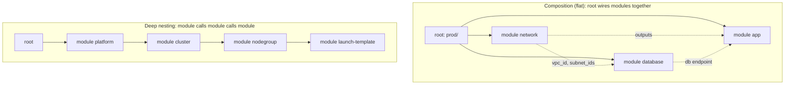

# Terraform Modules

> Part of the [Terraform notes](./terraform.md). Previous: [Providers & Internals](./terraform-providers-and-internals.md). Next: [CLI Reference](./terraform-cli-reference.md).

A **module** is just a directory of `.tf` files. Every config is a module. The directory you run `terraform` in is the **root module**, and anything it calls with a `module` block is a **child module**. You design modules the way you design functions: inputs (variables), outputs, and hidden internals.

---

## 1. Calling a module

```hcl
module "vpc" {
  source  = "terraform-aws-modules/vpc/aws"   # registry module
  version = "~> 5.8"                           # ONLY for registry sources

  name = "prod"
  cidr = "10.0.0.0/16"
  azs  = ["us-east-1a", "us-east-1b", "us-east-1c"]

  # meta-arguments work on modules too
  # count / for_each / depends_on / providers
}

resource "aws_instance" "app" {
  subnet_id = module.vpc.private_subnets[0]     # consume outputs
}
```

After adding a module, or changing its `source` or `version`, run `terraform init` (or `terraform get`) to download it.

### Module sources

| Source | Example | Versioning |
|---|---|---|
| Local path | `./modules/vpc`, `../shared/iam` | Same commit as the caller. **Must start with `./` or `../`** |
| Public registry | `terraform-aws-modules/vpc/aws` | `version = "~> 5.8"` |
| Private registry | `app.terraform.io/acme/vpc/aws` | `version` |
| Git (HTTPS) | `git::https://github.com/acme/tf-modules.git//vpc?ref=v1.4.0` | `?ref=` tag, branch or **commit SHA** |
| Git (SSH) | `git::ssh://git@github.com/acme/tf-modules.git//vpc?ref=v1.4.0` | `?ref=` |
| GitHub shorthand | `github.com/acme/tf-modules//vpc?ref=v1.4.0` | `?ref=` |
| S3 / GCS | `s3::https://s3.amazonaws.com/acme-modules/vpc-1.4.0.zip` | The object key |
| HTTP archive | `https://example.com/vpc.zip` | URL |

- `//subdir` selects a subdirectory inside the repo.
- `?ref=main` is **not a pin**. It moves. Pin a tag, or better a commit SHA, for supply-chain safety.
- `version =` **only works for registry sources**. On git you get `Error: Invalid version constraint ... Cannot apply a version constraint to module "x" because it has a non Registry URL`.
- Modules are **not** in the lock file. Your pin is your only protection.

---

## 2. Anatomy of a well-built module

```text
modules/vpc/
├── README.md           # what/why, usage example, inputs/outputs table (terraform-docs generates it)
├── versions.tf         # required_version + required_providers (lower bounds), NO provider blocks
├── variables.tf        # typed, described, validated inputs
├── main.tf             # resources (split by concern if large)
├── outputs.tf          # described outputs
├── examples/
│   └── complete/main.tf   # runnable example (also used by tests)
└── tests/
    └── vpc.tftest.hcl     # terraform test (plan-level with mocks + optional apply-level)
```

### Worked example: a production-style VPC module

Everything below was checked: `terraform validate` against AWS provider 6.x, an offline `plan` (28 / 24 / 19 resources for `per_az` / `single` / `none` NAT modes), and `terraform test` with a mocked provider (4 of 4 pass).

**`modules/vpc/versions.tf`**
```hcl
terraform {
  required_version = ">= 1.9"
  required_providers {
    aws = {
      source  = "hashicorp/aws"
      version = ">= 5.0, < 7.0"
    }
  }
}
```

**`modules/vpc/variables.tf`**
```hcl
variable "name" {
  description = "Name prefix for all resources."
  type        = string
  validation {
    condition     = can(regex("^[a-z][a-z0-9-]{1,30}$", var.name))
    error_message = "name must be lowercase alphanumeric/dashes, 2-31 chars."
  }
}

variable "cidr_block" {
  description = "VPC CIDR, e.g. 10.0.0.0/16."
  type        = string
  validation {
    condition     = can(cidrnetmask(var.cidr_block))
    error_message = "cidr_block must be a valid IPv4 CIDR."
  }
}

variable "azs" {
  description = "Availability zones to use (2-6)."
  type        = list(string)
  validation {
    condition     = length(var.azs) >= 2 && length(var.azs) <= 6
    error_message = "Provide 2 to 6 AZs."
  }
}

variable "nat_gateway_mode" {
  description = "none | single | per_az"
  type        = string
  default     = "single"
  validation {
    condition     = contains(["none", "single", "per_az"], var.nat_gateway_mode)
    error_message = "nat_gateway_mode must be none, single or per_az."
  }
}

variable "tags" {
  description = "Extra tags for all resources."
  type        = map(string)
  default     = {}
}
```

**`modules/vpc/main.tf`**
```hcl
locals {
  az_index = { for i, az in var.azs : az => i }

  # /16 → public /20s at netnum 0..5, private /20s at 8..13
  public_cidrs  = { for az, i in local.az_index : az => cidrsubnet(var.cidr_block, 4, i) }
  private_cidrs = { for az, i in local.az_index : az => cidrsubnet(var.cidr_block, 4, i + 8) }

  nat_azs = (
    var.nat_gateway_mode == "per_az" ? var.azs :
    var.nat_gateway_mode == "single" ? [var.azs[0]] : []
  )

  tags = merge(var.tags, { Module = "vpc" })
}

resource "aws_vpc" "this" {
  cidr_block           = var.cidr_block
  enable_dns_support   = true
  enable_dns_hostnames = true
  tags                 = merge(local.tags, { Name = var.name })
}

resource "aws_internet_gateway" "this" {
  vpc_id = aws_vpc.this.id
  tags   = merge(local.tags, { Name = var.name })
}

resource "aws_subnet" "public" {
  for_each                = local.public_cidrs
  vpc_id                  = aws_vpc.this.id
  availability_zone       = each.key
  cidr_block              = each.value
  map_public_ip_on_launch = true
  tags                    = merge(local.tags, { Name = "${var.name}-public-${each.key}", Tier = "public" })
}

resource "aws_subnet" "private" {
  for_each          = local.private_cidrs
  vpc_id            = aws_vpc.this.id
  availability_zone = each.key
  cidr_block        = each.value
  tags              = merge(local.tags, { Name = "${var.name}-private-${each.key}", Tier = "private" })
}

resource "aws_eip" "nat" {
  for_each = toset(local.nat_azs)
  domain   = "vpc"
  tags     = merge(local.tags, { Name = "${var.name}-nat-${each.key}" })
}

resource "aws_nat_gateway" "this" {
  for_each      = toset(local.nat_azs)
  allocation_id = aws_eip.nat[each.key].id
  subnet_id     = aws_subnet.public[each.key].id
  tags          = merge(local.tags, { Name = "${var.name}-${each.key}" })
  depends_on    = [aws_internet_gateway.this]
}

resource "aws_route_table" "public" {
  vpc_id = aws_vpc.this.id
  tags   = merge(local.tags, { Name = "${var.name}-public" })
}

resource "aws_route" "public_internet" {
  route_table_id         = aws_route_table.public.id
  destination_cidr_block = "0.0.0.0/0"
  gateway_id             = aws_internet_gateway.this.id
}

resource "aws_route_table_association" "public" {
  for_each       = aws_subnet.public
  subnet_id      = each.value.id
  route_table_id = aws_route_table.public.id
}

resource "aws_route_table" "private" {
  for_each = local.private_cidrs
  vpc_id   = aws_vpc.this.id
  tags     = merge(local.tags, { Name = "${var.name}-private-${each.key}" })
}

resource "aws_route" "private_nat" {
  for_each               = length(local.nat_azs) > 0 ? aws_route_table.private : {}
  route_table_id         = each.value.id
  destination_cidr_block = "0.0.0.0/0"
  # per_az → own AZ's NAT; single → the one NAT
  nat_gateway_id = aws_nat_gateway.this[var.nat_gateway_mode == "per_az" ? each.key : local.nat_azs[0]].id
}

resource "aws_route_table_association" "private" {
  for_each       = aws_subnet.private
  subnet_id      = each.value.id
  route_table_id = aws_route_table.private[each.key].id
}
```

**`modules/vpc/outputs.tf`**
```hcl
output "vpc_id" {
  description = "VPC ID."
  value       = aws_vpc.this.id
}

output "public_subnet_ids" {
  description = "Map of AZ => public subnet ID."
  value       = { for az, s in aws_subnet.public : az => s.id }
}

output "private_subnet_ids" {
  description = "Map of AZ => private subnet ID."
  value       = { for az, s in aws_subnet.private : az => s.id }
}

output "nat_public_ips" {
  description = "NAT gateway public IPs (allowlist these with partners)."
  value       = [for e in aws_eip.nat : e.public_ip]
}
```

**`modules/vpc/tests/vpc.tftest.hcl`** (runs with no AWS account, thanks to `mock_provider`)
```hcl
mock_provider "aws" {}

variables {
  name       = "test"
  cidr_block = "10.0.0.0/16"
  azs        = ["us-east-1a", "us-east-1b"]
}

run "single_nat_by_default" {
  command = plan
  assert {
    condition     = length(aws_nat_gateway.this) == 1
    error_message = "expected exactly one NAT gateway"
  }
  assert {
    condition     = aws_subnet.private["us-east-1b"].cidr_block == "10.0.144.0/20"
    error_message = "unexpected private CIDR"
  }
}

run "per_az_nat" {
  command = plan
  variables {
    nat_gateway_mode = "per_az"
  }
  assert {
    condition     = length(aws_nat_gateway.this) == 2
    error_message = "expected one NAT per AZ"
  }
}

run "rejects_bad_cidr" {
  command = plan
  variables {
    cidr_block = "10.0.0.0/33"
  }
  expect_failures = [var.cidr_block]
}

run "rejects_one_az" {
  command = plan
  variables {
    azs = ["us-east-1a"]
  }
  expect_failures = [var.azs]
}
```

```text
$ terraform test
  run "single_nat_by_default"... pass
  run "per_az_nat"... pass
  run "rejects_bad_cidr"... pass
  run "rejects_one_az"... pass
Success! 4 passed, 0 failed.
```

**Calling it:**
```hcl
module "vpc" {
  source           = "./modules/vpc"
  name             = "prod"
  cidr_block       = "10.20.0.0/16"
  azs              = ["us-east-1a", "us-east-1b", "us-east-1c"]
  nat_gateway_mode = "per_az"
  tags             = { Environment = "prod" }
}

resource "aws_instance" "app" {
  for_each  = module.vpc.private_subnet_ids     # one per AZ, keyed by AZ name
  subnet_id = each.value
  # ...
}
```

Design decisions worth copying:
- **Everything is keyed by AZ name** (`for_each` over maps). Adding a fourth AZ adds resources, and nothing shifts.
- **The mode is a validated enum** (`none|single|per_az`), not two booleans that can contradict each other.
- **Outputs are maps keyed by AZ**, so callers can `for_each` over them directly.
- **No provider block, and lower-bound provider versions** (`>= 5.0, < 7.0`).
- Explicit `depends_on` only where the dependency is real but hidden (NAT needs the IGW attached).

---

## 3. Designing inputs and outputs

### Inputs
- **Type everything.** `type = any` pushes errors into the middle of the module, where they're confusing.
- **Describe everything.** `terraform-docs` turns descriptions into the README.
- **Validate at the boundary.** Catch `10.0.0.0/33` in the variable, not as an AWS 400 error halfway through an apply.
- **Use `optional()` with defaults** in object variables instead of 30 flat variables.
- **Sensible secure defaults.** Encryption on, public access off, deletion protection on. Callers opt *out*.
- **Don't expose every argument of every resource.** A module that passes through 80 variables is a worse version of the resource. Expose what varies between your use cases.
- **Accept IDs, not names to look up**, when the caller already has them. That avoids hidden data source lookups.

### Outputs
- Output **IDs and ARNs** that callers need for wiring, plus anything needed for other teams (NAT IPs, endpoint DNS).
- Prefer **maps keyed by meaningful keys** to lists.
- You *can* output a whole resource object (`value = aws_vpc.this`). It's convenient, but it couples callers to the provider schema.
- Mark derived secrets `sensitive = true`.

---

## 4. Composition: flat beats deep



- **The root module wires modules together** and passes outputs to inputs. This is dependency injection.
- Child modules shouldn't create the things they depend on, or look them up with hard-coded data sources. Accept `vpc_id` as an input.
- Keep nesting to **one or two levels**. Every level adds a layer of variables to thread through, and makes `moved` blocks and debugging harder.

### Module types worth knowing
- **Resource modules**: wrap one concept with good defaults (`s3-bucket`, `rds`, `iam-role`).
- **Infrastructure/service modules**: compose resource modules into a full unit (`web-service` = ALB + ECS service + IAM + alarms).
- **Root modules / stacks**: per environment. These hold backend config, providers and module calls, and almost no resources.

---

## 5. `for_each`, `count` and `depends_on` on modules

```hcl
variable "services" {
  type = map(object({
    image    = string
    cpu      = optional(number, 256)
    replicas = optional(number, 2)
  }))
}

module "service" {
  source   = "./modules/ecs-service"
  for_each = var.services

  name     = each.key
  image    = each.value.image
  cpu      = each.value.cpu
  replicas = each.value.replicas
  vpc_id   = module.vpc.vpc_id
}

output "service_urls" {
  value = { for k, m in module.service : k => m.url }
}
```

Addresses become `module.service["api"].aws_ecs_service.this`.

`depends_on = [module.x]` on a module makes **every** resource and data source in it wait for **everything** in `module.x`, and it defers the data sources to apply time. Prefer passing specific outputs as inputs, because that creates precise edges.

---

## 6. Versioning and releasing modules

- **SemVer tags:** `v1.4.0`. Breaking change = major (renamed or removed variable, changed key scheme, resource address change without `moved`).
- **Put `moved` blocks inside the module** when you rename resources internally. Callers who upgrade then get moves instead of destroys.
- **CHANGELOG.md**, with upgrade notes.
- **Monorepo of modules:** tag per module (`vpc/v1.4.0`), or put each module in its own repo (required for the public registry, which uses the naming `terraform-<PROVIDER>-<NAME>`).
- **Private registry:** HCP Terraform, Terraform Enterprise, GitLab, Artifactory, Spacelift, or plain git tags.
- Automate the boring parts: `terraform-docs markdown table . > README.md`, `tflint`, `checkov`, `terraform test` in CI, and release-please or semantic-release for tags.

---

## 7. Public registry modules: use them, but carefully

The `terraform-aws-modules/*` modules (vpc, eks, rds, s3-bucket, iam) are high quality and widely used. Before you adopt one:
- **Pin exact or minor versions.** Read the changelog before you bump, because major versions often change resource addresses.
- They expose hundreds of variables. Wrap them in a thin internal module with **your** defaults and policies, so teams don't each make their own choices.
- Run `plan` after any version bump and look for replacements.

---

## 8. Anti-patterns

| Anti-pattern | Why it hurts | Instead |
|---|---|---|
| `provider` blocks inside a child module | Can't `for_each` the module, can't remove it cleanly | Providers in the root. `configuration_aliases` for multiples |
| A "god module" that makes the whole environment | Huge blast radius, slow plans, everything coupled | Separate root modules per layer |
| A wrapper that passes through every argument | No added value, just maintenance | Use the resource directly, or expose only what varies |
| `?ref=main` / no version pin | Upstream change breaks prod silently | Tag or SHA, `version = "x.y.z"` |
| `count` for lists of named things in modules | Index shift destroys resources | `for_each` keyed by name |
| Hard-coded data lookups inside modules (`data "aws_vpc" { tags = {Name="prod"} }`) | Hidden coupling, breaks in other environments | Inputs |
| Deep nesting (4+ levels) | Hard to debug, refactor and test | Flat composition |
| Environment logic inside the module (`if var.env == "prod"`) | Module knows about your org layout | Expose the knob (`multi_az = true`) and let the root decide |
| No outputs ("just look it up") | Consumers resort to data lookups or remote_state | Output what callers need |

---

## 9. Testing modules

| Layer | Tool | Speed | Catches |
|---|---|---|---|
| Format/lint | `terraform fmt -check`, `tflint` | Seconds | Style, deprecated syntax, wrong instance types |
| Security static | `checkov`, `trivy config` (was tfsec) | Seconds | Public buckets, missing encryption |
| Unit (plan + mocks) | `terraform test` with `mock_provider`, `command = plan` | Seconds, no cloud | Logic: counts, CIDRs, validation, naming |
| Integration | `terraform test` with `command = apply` against a sandbox account, or Terratest (Go) | Minutes, costs money | Real API behaviour, IAM, connectivity |
| Policy | OPA/Conftest on `terraform show -json`, Sentinel | Seconds | Org rules on the plan |

Deeper coverage: [Terraform Testing Frameworks](../IaC%20Testing%20and%20Policy%20as%20Code/terraform-testing-frameworks.md), [Linting](../IaC%20Testing%20and%20Policy%20as%20Code/linting-and-static-analysis.md), [Policy as Code](../IaC%20Testing%20and%20Policy%20as%20Code/policy-as-code-with-opa-and-conftest.md).

### `terraform test` cheat sheet (1.6+, mocks 1.7+)

```hcl
# tests/*.tftest.hcl
variables { name = "test" }                 # file-level defaults

provider "aws" { region = "us-east-1" }     # real provider for apply tests

mock_provider "aws" {                       # or a mock (no API calls)
  alias = "fake"
  mock_resource "aws_vpc" {
    defaults = { id = "vpc-12345678" }      # control computed values
  }
  mock_data "aws_availability_zones" {
    defaults = { names = ["us-east-1a", "us-east-1b"] }
  }
}

override_resource {                         # override one specific resource
  target = aws_nat_gateway.this
  values = { id = "nat-123" }
}

run "setup" {
  module { source = "./tests/fixtures/setup" }   # helper module, e.g. create a random suffix
}

run "creates_vpc" {
  command   = apply                         # default; plan = no resources created
  providers = { aws = aws.fake }
  variables { cidr_block = "10.1.0.0/16" }
  assert {
    condition     = output.vpc_id == "vpc-12345678"
    error_message = "mock id not propagated"
  }
}

run "uses_previous_run" {
  variables { vpc_id = run.creates_vpc.vpc_id }   # chain runs
  expect_failures = [var.vpc_id]                  # negative tests
}
```

Runs execute **in order and share state** within a file. Real resources created by `apply` runs are **destroyed at the end**, in reverse order. If teardown fails, those resources are leaked, so look at the output.

Next: [CLI Reference →](./terraform-cli-reference.md)
