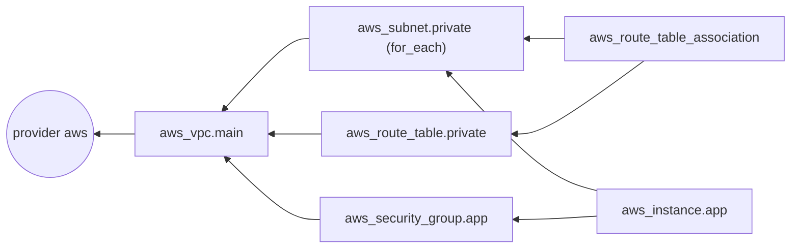
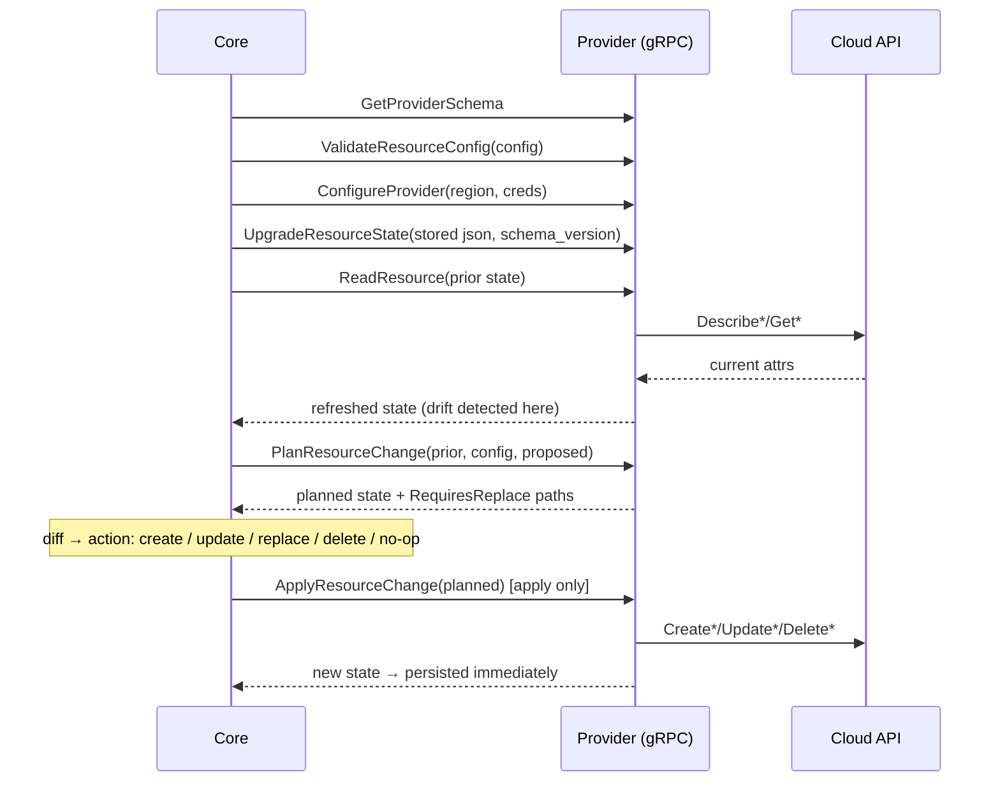

# Terraform Providers & Internals

> Part of the [Terraform notes](./terraform.md). Previous: [State Deep Dive](./terraform-state-deep-dive.md). Next: [Modules](./terraform-modules.md).

---

## 1. Declaring providers

```hcl
terraform {
  required_version = ">= 1.9, < 2.0"

  required_providers {
    aws = {
      source  = "hashicorp/aws"          # = registry.terraform.io/hashicorp/aws
      version = "~> 6.0"
    }
    kubernetes = {
      source  = "hashicorp/kubernetes"
      version = ">= 2.30, < 3.0"
    }
    datadog = {
      source  = "DataDog/datadog"        # partner provider
      version = "~> 3.40"
    }
    internal = {
      source  = "registry.acme.corp/platform/internal"   # private registry
      version = "1.2.3"
    }
  }
}
```

**The source address** has the form `[HOSTNAME/]NAMESPACE/TYPE`, and the hostname defaults to `registry.terraform.io`. The **local name** (the map key, e.g. `aws`) is what you use in `provider "aws"` blocks and in resource type prefixes.

Provider tiers on the registry:
- **Official**: published by HashiCorp (`hashicorp/aws`)
- **Partner**: published and maintained by the vendor (`DataDog/datadog`)
- **Community**: anyone can publish these. Read the source before using one

### Version constraint syntax

| Constraint | Means |
|---|---|
| `= 1.2.3` / `1.2.3` | Exactly this version |
| `>= 1.2` | 1.2 or newer, **including 2.x and 3.x** (risky for providers) |
| `~> 1.2` | `>= 1.2, < 2.0` (any 1.x from 1.2) |
| `~> 1.2.3` | `>= 1.2.3, < 1.3.0` (patch versions only) |
| `>= 1.2, < 1.5` | Range |
| `!= 1.4.1` | Exclude a broken release |

Recommendations:
- **Root modules:** `~> MAJOR.MINOR` (for example `~> 6.12`), plus the lock file for exact pinning.
- **Reusable modules:** use a *lower bound only*, or a wide range (`>= 5.0, < 7.0`), so callers can pick the version. A module that pins exactly breaks every caller that needs a different version.

---

## 2. The dependency lock file (`.terraform.lock.hcl`)

```hcl
# This file is maintained automatically by "terraform init".
provider "registry.terraform.io/hashicorp/local" {
  version     = "2.9.1"                 # exact version selected
  constraints = "~> 2.5"                # what the config asked for
  hashes = [
    "h1:OZGJN0LSSat5QIxZPxDXtVr4XpHb2oG7cVKJhSqBFIE=",   # hash of the unpacked package (this platform)
    "zh:25606c7a5e30...",                                # hashes of the official zip for EVERY platform
    ...
  ]
}
```

- **Commit it.** It's what makes `init` reproducible: everyone and every CI job gets the same provider build, checksum-verified. That's supply-chain protection.
- `terraform init` uses the locked version, even if a newer one matches the constraint.
- `terraform init -upgrade` picks the newest version allowed by the constraints and **rewrites** the lock file. Do this in a deliberate PR.
- It covers **providers only**. Modules aren't locked, so pin module versions explicitly (`version = "5.8.1"` or `?ref=v1.4.0`).

### The "checksum mismatch" problem across operating systems

A developer on a Mac (`darwin_arm64`) runs init, and the lock file gets `h1:` hashes for darwin only. CI on Linux then fails:
```text
Error: Failed to install provider
  the current package for registry.terraform.io/hashicorp/aws 6.x doesn't match any of the checksums
  previously recorded in the dependency lock file
```
The fix is to record hashes for every platform you use:
```bash
terraform providers lock -platform=linux_amd64 -platform=linux_arm64 -platform=darwin_arm64 -platform=darwin_amd64
```

---

## 3. Configuring providers

```hcl
provider "aws" {
  region = var.region

  # Auth: NEVER hardcode access_key/secret_key. Let the SDK credential chain find it:
  #   env AWS_ACCESS_KEY_ID/AWS_SECRET_ACCESS_KEY/AWS_SESSION_TOKEN → AWS_PROFILE/shared config →
  #   SSO cache → web identity (OIDC in CI, IRSA in k8s) → ECS task role → EC2 instance profile
  assume_role {
    role_arn     = "arn:aws:iam::${var.account_id}:role/terraform-deployer"
    session_name = "terraform"
    external_id  = var.external_id          # if required by the role's trust policy
  }

  allowed_account_ids = [var.account_id]    # refuses to run against the wrong account — cheap safety

  default_tags {
    tags = {
      ManagedBy   = "terraform"
      Environment = var.environment
      Repo        = "acme/infra"
    }
  }

  # Retries and endpoints (LocalStack, VPC endpoints)
  max_retries = 10
  # endpoints { s3 = "http://localhost:4566" }
}
```

- **`allowed_account_ids`** (or `forbidden_account_ids`) is one of the best-value lines in any AWS config. It stops "I had the wrong `AWS_PROFILE` set and applied dev changes to prod".
- **`default_tags`** puts tags on every taggable resource. If a resource's `tags` overlaps with `default_tags`, the resource value wins. Some resources (ASG-launched instances, for example) need `propagate_at_launch` or tag specifications separately.
- A provider block **can't use `count`** (OpenTofu 1.9+ allows `for_each` on providers). Provider configs can refer to variables, locals and data sources, but they shouldn't depend on resources that are created in the same apply.

---

## 4. Multiple provider configurations (aliases)

### Multi-region

```hcl
provider "aws" {
  region = "us-east-1"
}
provider "aws" {
  alias  = "us_west_2"
  region = "us-west-2"
}

resource "aws_s3_bucket" "dr" {
  provider = aws.us_west_2
  bucket   = "acme-dr"
}

# CloudFront certs MUST be in us-east-1 — classic alias use
resource "aws_acm_certificate" "cdn" {
  provider          = aws            # default (us-east-1)
  domain_name       = "cdn.acme.com"
  validation_method = "DNS"
}
```

(AWS provider 6.0+ also adds a **per-resource `region` argument** for many resources, which saves you an alias for each region.)

### Multi-account

```hcl
provider "aws" {
  alias  = "network"
  region = "us-east-1"
  assume_role { role_arn = "arn:aws:iam::111111111111:role/terraform" }
}
provider "aws" {
  alias  = "app"
  region = "us-east-1"
  assume_role { role_arn = "arn:aws:iam::222222222222:role/terraform" }
}

# Share a Transit Gateway from network account to app account
resource "aws_ram_resource_share" "tgw" {
  provider = aws.network
  name     = "tgw"
}
resource "aws_ram_resource_share_accepter" "tgw" {
  provider  = aws.app
  share_arn = aws_ram_principal_association.tgw.resource_share_arn
}
```

### Passing providers into modules

```hcl
# child module declares what it needs
# modules/dns-delegation/versions.tf
terraform {
  required_providers {
    aws = {
      source                = "hashicorp/aws"
      version               = ">= 5.0"
      configuration_aliases = [aws.parent, aws.child]   # module expects two configs
    }
  }
}
# inside the module: provider = aws.parent / aws.child

# root
module "delegation" {
  source = "./modules/dns-delegation"
  providers = {
    aws.parent = aws.network
    aws.child  = aws.app
  }
}
```

Rules:
- Modules **inherit the default (unaliased) provider** automatically. Aliased ones must be passed explicitly.
- **Never put `provider` blocks inside reusable modules.** A module with its own provider block can't be used with `count`/`for_each`/`depends_on`, and you can't remove it from config without errors (`Provider configuration not present`). Configure providers in the root and pass them down.

---

## 5. How Terraform works internally

### The graph



Terraform builds a **directed acyclic graph** (DAG):
- **Nodes:** resources (expanded per instance), data sources, providers, variables, locals, outputs, module calls.
- **Edges:** references (`aws_subnet.private` → `aws_vpc.main` because of `vpc_id = aws_vpc.main.id`), `depends_on`, and provider usage.

To build it, Terraform:
1. Parses all config into modules.
2. Adds nodes for everything in config **and** everything in state (state-only nodes are orphans to destroy).
3. Adds edges from references, then runs **transitive reduction** to remove redundant edges.
4. **Expands** `count`/`for_each`/module instances, once they're known.
5. Checks for **cycles**. `Error: Cycle: aws_security_group.a, aws_security_group.b` usually means two security groups refer to each other inline. Fix it by moving the rules into separate rule resources.
6. **Walks** the graph: a node runs once all of its dependencies are done, with up to `-parallelism` (default 10) running at once.
7. **Destroys run in reverse:** dependents are destroyed before what they depend on. With `create_before_destroy`, the ordering is changed so the new object exists before the old one goes.

```bash
terraform graph | dot -Tsvg > graph.svg          # visualize (needs graphviz)
terraform graph -type=plan-destroy               # destroy ordering
```

Real output for a small config:
```text
digraph G {
  rankdir = "RL";
  "local_file.inv" -> "random_pet.node";
  "terraform_data.trigger" -> "random_pet.node";
}
```

### How a plan is computed, per resource instance



Points that come up in interviews and debugging:
- The **provider** decides what "forces replacement" (`RequiresReplace`). Core just shows it.
- **"Provider produced inconsistent final plan"** or **"inconsistent result after apply"** are **provider bugs**: what the provider promised during planning didn't match what it returned. Report them upstream. A second apply often works around it.
- **Computed attributes** (`id`, `arn`) are unknown during planning.
- **Optional+computed** attributes (the API picks a default if you don't set one) cause the classic "perpetual diff" when the API normalises your value (lower-cases it, reorders JSON, adds a trailing dot to DNS names). Fix it by writing the normalised form.

### The plugin protocol

The trace logs show what really happens:
```text
[DEBUG] provider: starting plugin: path=.terraform/providers/registry.terraform.io/hashicorp/local/2.9.1/darwin_arm64/terraform-provider-local_v2.9.1_x5
[DEBUG] provider: plugin started: ... pid=10386
[DEBUG] provider: waiting for RPC address
```
- Each provider is a **separate OS process** (`_x5` means plugin protocol version 5, and protocol 6 is the newer one).
- Core and provider talk **gRPC over a local socket**, using HashiCorp's `go-plugin`.
- Providers are written in Go with the **Terraform Plugin Framework** (current) or **SDKv2** (legacy).
- That's why providers version on their own, why a provider crash gives you `Plugin did not respond` / `rpc error`, and why `TF_LOG=TRACE` shows gRPC calls.

### Parallelism and API throttling

```bash
terraform apply -parallelism=30     # faster for many independent resources
terraform apply -parallelism=2      # if you hit API rate limits (ThrottlingException, 429)
```
Plans for big states are slow because **every resource is refreshed** with API calls. The fixes are smaller states, `-refresh=false` (for a quick look only, never for the apply plan), or `-target` (only in emergencies).

---

## 6. Provider installation: mirrors, caches and air gaps

```hcl
# ~/.terraformrc  (Windows: %APPDATA%/terraform.rc) or TF_CLI_CONFIG_FILE
plugin_cache_dir = "$HOME/.terraform.d/plugin-cache"   # share downloads across projects

provider_installation {
  network_mirror {
    url     = "https://tf-mirror.acme.corp/providers/"
    include = ["registry.terraform.io/*/*"]
  }
  filesystem_mirror {
    path    = "/opt/terraform/providers"
    include = ["registry.acme.corp/*/*"]
  }
  direct {
    exclude = ["registry.terraform.io/*/*"]    # force everything public through the mirror
  }
}
```

```bash
# Build an offline mirror for an air-gapped network
terraform providers mirror -platform=linux_amd64 /opt/terraform/providers
```

Env equivalent: `TF_PLUGIN_CACHE_DIR=$HOME/.terraform.d/plugin-cache`. It speeds CI up a lot when combined with caching that directory between runs.

Credentials for private registries or HCP go in `credentials "app.terraform.io" { token = "..." }` in the CLI config, or `TF_TOKEN_app_terraform_io=...`.

---

## 7. Debugging

```bash
TF_LOG=DEBUG terraform plan                 # TRACE > DEBUG > INFO > WARN > ERROR
TF_LOG_CORE=ERROR TF_LOG_PROVIDER=TRACE terraform plan   # only provider chatter (API requests!)
TF_LOG_PATH=./tf.log TF_LOG=TRACE terraform apply
```

With `TF_LOG_PROVIDER=DEBUG`, the AWS provider logs the **full HTTP requests and responses** to AWS. This is the fastest way to see exactly which API call returned `AccessDenied`, and which action needs to go in the IAM policy.

| Symptom | Likely cause | Look at |
|---|---|---|
| `AccessDenied` / `UnauthorizedOperation` | Missing IAM action | `TF_LOG_PROVIDER=DEBUG`, decode with `aws sts decode-authorization-message` |
| `no valid credential sources found` | Credential chain empty | `aws sts get-caller-identity` with the same env |
| Plan hangs | Waiting on a lock, prompting for input, or a slow API | `-input=false`, `-lock-timeout`, `TF_LOG=DEBUG` |
| `Plugin did not respond` | Provider crashed | `crash.log`, provider issue tracker, try another version |
| Perpetual diff | API normalisation, or a conflicting resource (inline vs separate rules) | Compare `state show` with config |
| `Provider produced inconsistent result` | Provider bug | Upgrade the provider, retry, report it |

---

## 8. Writing your own provider (overview)

You'd write one when an internal API needs to be managed declaratively.

```bash
git clone https://github.com/hashicorp/terraform-provider-scaffolding-framework
# implement: provider.go (schema+configure), resource_x.go (Schema, Create, Read, Update, Delete, ImportState)
go build -o terraform-provider-acme
```

```hcl
# ~/.terraformrc — use local build without publishing
provider_installation {
  dev_overrides {
    "acme.corp/platform/acme" = "/Users/me/go/bin"
  }
  direct {}
}
```

The key contract is that `Read` must faithfully report reality (and return "gone" on a 404), and `Create`/`Update` must return state that matches what was planned. Most "inconsistent result" bugs come from breaking that contract.

Next: [Modules →](./terraform-modules.md)
