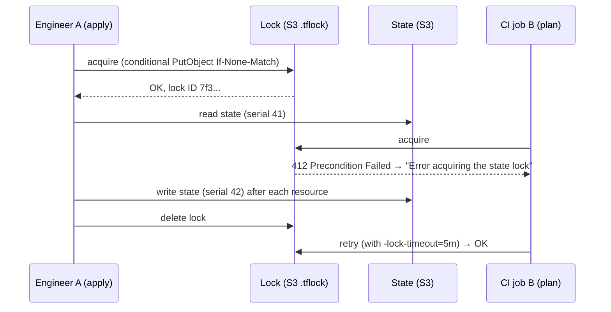

# Terraform State Deep Dive

> Part of the [Terraform notes](./terraform.md). Previous: [Meta-Arguments & Lifecycle](./terraform-meta-arguments-and-lifecycle.md). Next: [Providers & Internals](./terraform-providers-and-internals.md).

If you master state, you master Terraform. Nearly every scary Terraform incident turns out to be a state problem: a lost state, a corrupted state, a state that disagrees with reality, two people writing the same state, or secrets leaking from state.

---

## 1. Why state exists

Terraform needs state for four reasons:

1. **Mapping.** `aws_instance.web` in code ↔ `i-0abc123` in AWS. Most APIs have no reliable way to say "find the thing Terraform made for this block". Tags aren't universal, and names aren't unique.
2. **Metadata.** Dependency order for **deletes**. Once you remove a resource from code, the only record of what depended on it is in state.
3. **Performance.** Cached attributes. With `-refresh=false`, Terraform can plan huge configs without calling the API for each resource.
4. **Ownership.** Terraform manages *exactly* the objects in its state and nothing else. That's why it will never delete a bucket it didn't create.

---

## 2. What's inside (real state, v4 format)

```bash
terraform state pull | jq 'del(.resources[].instances[].attributes)'
```

```json
{
  "version": 4,                                   // state FORMAT version
  "terraform_version": "1.15.8",                  // last binary that wrote it
  "serial": 11,                                   // increments on every write
  "lineage": "319e70bc-63a6-370a-7e5c-e097fa0e18ce", // unique id of THIS state's history
  "outputs": { "keys": { "value": ["prod-0", "prod-1"], "type": ["list", "string"] } },
  "resources": [
    {
      "mode": "managed",                          // or "data"
      "type": "random_pet",
      "name": "node",
      "provider": "provider[\"registry.terraform.io/hashicorp/random\"]",
      "instances": [
        {
          "index_key": "prod-0",                  // for_each key / count index
          "schema_version": 0,                    // provider resource schema version (for upgrades)
          "attributes": { "id": "prod-destined-turtle", "length": 2, "prefix": "prod" },
          "sensitive_attributes": [],
          "identity_schema_version": 0,           // resource identity (1.12+)
          "dependencies": ["terraform_data.x"]    // used for destroy ordering
        }
      ]
    }
  ],
  "check_results": [ ... ]
}
```

| Field | Why it matters |
|---|---|
| `serial` | Terraform refuses to push a state with a **lower** serial than the remote one, which protects against stale overwrites |
| `lineage` | Terraform refuses to push a state with a **different** lineage, so you can't overwrite prod state with dev state by mistake |
| `terraform_version` | Newer binaries can read older states, but an old binary may refuse a state written by a newer one. Upgrades go one way |
| `schema_version` | When a provider changes a resource schema, it upgrades the stored attributes during refresh |
| `attributes` | **Everything**, including passwords, private keys and connection strings, **in plaintext** |
| `status: "tainted"` | Appears on an instance whose create or provisioner failed, so it gets replaced next apply |

---

## 3. Local vs remote state

Local state (`terraform.tfstate` in the working directory) is fine for learning. It's wrong for teams because:
- no locking (two applies at once corrupt it)
- it lives on one laptop (lose the laptop, lose the mapping)
- secrets sit unencrypted on disk
- people commit it to Git, and now the secrets are in Git history forever

### Backends compared

| Backend | Locking | Encryption | Notes |
|---|---|---|---|
| `s3` | **`use_lockfile = true`** (S3 conditional writes, 1.10+). DynamoDB `dynamodb_table` is **deprecated** | SSE-S3 / SSE-KMS (`kms_key_id`) | The AWS default. Turn on bucket versioning |
| `gcs` | Built in | Google-managed or CMEK | Versioning recommended |
| `azurerm` | Built in (blob lease) | Storage encryption | Can authenticate with OIDC/MSI |
| `remote` / `cloud` block | Built in | Managed | HCP Terraform / Terraform Enterprise. Also runs the plans |
| `kubernetes` | Lease | Secret (base64 only) | Size limit (1 MB secret) |
| `pg` | Advisory locks | DB-level | Postgres |
| `http` | Optional | Depends | GitLab-managed Terraform state uses this |
| `consul` | Built in | ACLs | Legacy |
| `local` | Local file lock only | None | Default |

### S3 backend: the production setup

The bucket that holds state is **bootstrapped separately**, usually by a tiny config with local state, or by hand or CloudFormation once per account:

```hcl
# bootstrap/main.tf  (apply once; keep its state somewhere safe or import later)
resource "aws_s3_bucket" "tfstate" {
  bucket = "acme-tfstate-123456789012-us-east-1"
  lifecycle { prevent_destroy = true }
}

resource "aws_s3_bucket_versioning" "tfstate" {
  bucket = aws_s3_bucket.tfstate.id
  versioning_configuration { status = "Enabled" }      # your "undo" for state
}

resource "aws_s3_bucket_server_side_encryption_configuration" "tfstate" {
  bucket = aws_s3_bucket.tfstate.id
  rule {
    apply_server_side_encryption_by_default {
      sse_algorithm     = "aws:kms"
      kms_master_key_id = aws_kms_key.tfstate.arn
    }
    bucket_key_enabled = true
  }
}

resource "aws_s3_bucket_public_access_block" "tfstate" {
  bucket                  = aws_s3_bucket.tfstate.id
  block_public_acls       = true
  block_public_policy     = true
  ignore_public_acls      = true
  restrict_public_buckets = true
}

resource "aws_s3_bucket_policy" "tls_only" {
  bucket = aws_s3_bucket.tfstate.id
  policy = jsonencode({
    Version = "2012-10-17"
    Statement = [{
      Sid       = "DenyInsecureTransport"
      Effect    = "Deny"
      Principal = "*"
      Action    = "s3:*"
      Resource  = [aws_s3_bucket.tfstate.arn, "${aws_s3_bucket.tfstate.arn}/*"]
      Condition = { Bool = { "aws:SecureTransport" = "false" } }
    }]
  })
}
```

Each stack then uses:
```hcl
terraform {
  backend "s3" {
    bucket       = "acme-tfstate-123456789012-us-east-1"
    key          = "prod/network/terraform.tfstate"   # one key per stack
    region       = "us-east-1"
    encrypt      = true
    kms_key_id   = "alias/tfstate"
    use_lockfile = true                               # writes <key>.tflock next to the state
  }
}
```

The lock file needs these IAM permissions: `s3:GetObject`, `s3:PutObject` and `s3:DeleteObject` on `<key>.tflock`, plus `s3:ListBucket` on the bucket.

### Backend blocks can't use variables

```hcl
backend "s3" {
  bucket = var.bucket     # ERROR: Variables may not be used here.
}
```

The backend is initialised **before** variables are evaluated. Use **partial configuration** instead:

```hcl
# versions.tf
terraform {
  backend "s3" {}           # empty — filled at init
}
```
```hcl
# backends/prod.s3.tfbackend
bucket       = "acme-tfstate-prod"
key          = "network/terraform.tfstate"
region       = "us-east-1"
use_lockfile = true
```
```bash
terraform init -backend-config=backends/prod.s3.tfbackend
terraform init -backend-config="key=network/terraform.tfstate"   # or key=value pairs
```

(OpenTofu 1.8+ *does* allow variables and locals in backend blocks, as long as they're known at init. This is one of its notable differences from Terraform.)

### Changing or migrating backends

```bash
# edit backend block (local → s3, or bucket A → bucket B), then:
terraform init -migrate-state      # copies state to the new backend (asks to confirm)
terraform init -reconfigure        # use new backend config, IGNORE existing state (no copy)
```

`-reconfigure` with a new, empty backend makes Terraform think nothing exists, so the next plan wants to **create everything** again. Use it on purpose or not at all.

---

## 4. Locking



```text
Error: Error acquiring the state lock
Lock Info:
  ID:        7f3c2a1e-...
  Path:      acme-tfstate/prod/network/terraform.tfstate
  Operation: OperationTypeApply
  Who:       runner@gha-1234
  Version:   1.15.8
  Created:   2026-10-18 09:12:03 UTC
```

What to do:
1. **Find the holder.** Is that CI job still running? Is someone's apply still going?
2. If it's really still running, **wait** (`-lock-timeout=10m` in CI).
3. If the process died (killed runner, Ctrl+C twice, laptop closed), then `terraform force-unlock 7f3c2a1e-...`.
4. **Never** `force-unlock` a lock held by a live process. Two writers will corrupt the state.

Don't use `-lock=false` against shared state.

---

## 5. `terraform state` subcommands

All the commands that modify state write a timestamped backup first (for local state). With remote state, **pull a backup yourself first**:

```bash
terraform state pull > backup-$(date +%Y%m%d-%H%M%S).tfstate
```

| Command | What it does | When |
|---|---|---|
| `state list [-id=ID] [ADDR]` | List addresses | "What's in here?" `terraform state list module.vpc` |
| `state show ADDR` | Show one instance's attributes | Debugging, finding IDs |
| `state mv SRC DST` | Rename an address (in the same state, or `-state-out` to another) | Refactoring. **Prefer `moved` blocks** |
| `state rm ADDR` | Forget an object (**doesn't delete it** in the cloud) | Hand ownership to another state, or stop managing. **Prefer `removed` blocks** |
| `state pull` | Print the remote state | Backups, inspection with `jq` |
| `state push FILE` | Overwrite the remote state | Disaster recovery only. Checks serial and lineage (`-force` skips the checks, which is dangerous) |
| `state replace-provider A B` | Change the provider source address | Forks and registry moves, e.g. `-/aws` → `hashicorp/aws`, or a private mirror |
| `state identities` (1.12+) | Show resource identities | Import by identity |
| `untaint ADDR` / `taint ADDR` | Clear or set the tainted flag | `taint` is **deprecated**, use `apply -replace=ADDR` |

```bash
terraform state list
terraform state show 'aws_subnet.private["us-east-1a"]'
terraform state mv 'aws_instance.web' 'module.compute.aws_instance.web'
terraform state mv 'aws_instance.web[0]' 'aws_instance.web["a"]'
terraform state rm 'aws_iam_role.legacy'
terraform state list -id=i-0abc123        # which address owns this real ID?
```

### Declarative alternatives (reviewable in a PR, safe in CI)

```hcl
moved {                                   # 1.1+  instead of state mv
  from = aws_instance.web
  to   = module.compute.aws_instance.web
}

removed {                                 # 1.7+  instead of state rm
  from = aws_iam_role.legacy
  lifecycle { destroy = false }           # forget, keep the real object
}

import {                                  # 1.5+  instead of terraform import
  to = aws_s3_bucket.logs
  id = "acme-logs"
}
```

Verified in the lab: a `moved` block shows `# random_pet.node["dev-0"] has moved to random_pet.renamed` in the plan, and `removed` with `destroy = false` gives `0 to destroy` while the object leaves state. Details are in [Production → Refactoring](./terraform-production-and-troubleshooting.md#1-refactoring-without-destroying-anything).

---

## 6. Importing existing infrastructure

### The `import` block workflow (1.5+, recommended)

```hcl
# imports.tf
import {
  to = aws_s3_bucket.logs
  id = "acme-legacy-logs"
}

import {
  for_each = var.legacy_buckets         # for_each on import (1.7+)
  to       = aws_s3_bucket.legacy[each.key]
  id       = each.value
}
```

```bash
# 1) Let Terraform WRITE the resource config for you
terraform plan -generate-config-out=generated.tf
#    → generated.tf contains resource "aws_s3_bucket" "logs" { ... every attribute ... }

# 2) Clean generated.tf: remove computed/default noise, use variables, move into proper files
# 3) Plan until it shows: "1 to import, 0 to add, 0 to change, 0 to destroy"
terraform plan
# 4) Apply — the import is recorded in state
terraform apply
# 5) Delete the import blocks (or keep them; they're no-ops once imported)
```

The goal is an import plan with **zero changes**. Any `~` update means your code doesn't match reality yet, and applying would *modify* the live resource.

### Legacy CLI import

```bash
terraform import aws_s3_bucket.logs acme-legacy-logs
terraform import 'aws_instance.web["a"]' i-0abc123
terraform import module.vpc.aws_vpc.this vpc-0123
```

You have to write the resource block **first**. It can't be reviewed in a PR, it changes state immediately, and it handles one resource at a time.

### Import ID formats vary by resource

Check the "Import" section at the bottom of each resource's docs page:
- `aws_instance`: `i-0abc`
- `aws_iam_role_policy_attachment`: `role-name/arn:aws:iam::aws:policy/ReadOnlyAccess`
- `aws_security_group_rule`: `sg-123_ingress_tcp_443_443_0.0.0.0/0`
- `aws_route53_record`: `Z123_www.example.com_A`

### Bulk import tools
- **`terraform query`** (1.14+) with `list` blocks: discover existing resources through providers that support list resources, and generate import blocks.
- **Terraformer** and **former2**: older third-party generators.
- `aws resourcegroupstaggingapi get-resources` combined with a script that writes `import` blocks.

---

## 7. Drift

Drift means reality no longer matches state, because someone clicked in the console, an autoscaler changed something, or another tool touched it.

```bash
terraform plan                        # shows drift as "Objects have changed outside of Terraform" + the fix-up diff
terraform plan -refresh-only          # ONLY show what changed outside; propose updating state to match
terraform apply -refresh-only         # accept reality into state (doesn't touch infra)
terraform plan -detailed-exitcode     # exit 0 = no changes, 1 = error, 2 = changes → use in drift cron jobs
```

| Situation | Action |
|---|---|
| Someone changed a setting by hand and it's wrong | `terraform apply` puts the code's value back |
| The manual change is right | Update the code to match, then plan should show no changes |
| Something else legitimately owns the attribute (autoscaling, k8s labels) | `lifecycle { ignore_changes = [...] }` |
| A resource was deleted by hand | `plan` shows it will be recreated. If you *want* it gone, remove it from code |
| Unmanaged resources created next to yours | Terraform can't see them. Use `import`, or detect them with AWS Config, Cloud Custodian, or driftctl-style tools |

`terraform refresh` (the standalone command) is **deprecated**, because it updates state with no review. Use `apply -refresh-only`, which shows you the changes first.

More detail: [Drift Detection & Continuous Validation](../IaC%20Testing%20and%20Policy%20as%20Code/drift-detection-and-continuous-validation.md).

---

## 8. Secrets in state

These all end up **in state in plaintext**:
- `random_password.x.result`
- `tls_private_key.x.private_key_pem`
- `aws_db_instance.password` (unless you use `manage_master_user_password = true` or `password_wo`)
- `data.aws_secretsmanager_secret_version.x.secret_string`
- `aws_iam_access_key.secret`
- Kubeconfig and client certificates from EKS/GKE/AKS resources

`sensitive = true` **only hides values from CLI output.** It doesn't encrypt anything in state.

Defences, in order:
1. **Don't let Terraform see the secret at all.** Let the service generate and store it: RDS `manage_master_user_password = true` (Secrets Manager), IAM roles instead of access keys, IRSA or workload identity.
2. **Ephemeral resources + write-only arguments** (1.10/1.11+). The value never reaches state.
3. **Encrypt state at rest** (SSE-KMS), with a KMS key policy that limits who can decrypt it.
4. **Restrict state access.** Read access to state is effectively read access to every secret in it. Separate state buckets or prefixes per environment, with IAM per pipeline role.
5. **OpenTofu** offers client-side **state encryption** (1.7+), so even the backend storage only sees ciphertext.
6. Never commit state, plan files (`tfplan` holds the same data) or `terraform output -json` dumps.

---

## 9. Splitting state and sharing data between states

### Why split
- **Blast radius.** A bad apply to "app" can't touch the VPC.
- **Speed.** Plan time grows with the number of resources, because each one is refreshed.
- **Lock contention.** Teams don't block each other.
- **Permissions.** The networking team owns `network/`, and app teams can't change it.
- **Lifecycle.** The VPC changes yearly, the app deploys hourly.

A typical split, by layer and environment:
```text
prod/
  00-bootstrap/   state bucket, KMS, CI roles
  10-network/     VPC, subnets, TGW, DNS zones
  20-data/        RDS, ElastiCache, S3 data buckets
  30-platform/    EKS cluster, node groups, IRSA
  40-apps/        per-service resources (SQS, IAM, DynamoDB)
```

### Reading another state's outputs

**Option A: `terraform_remote_state`**
```hcl
data "terraform_remote_state" "network" {
  backend = "s3"
  config = {
    bucket = "acme-tfstate-prod"
    key    = "prod/network/terraform.tfstate"
    region = "us-east-1"
  }
}

resource "aws_instance" "app" {
  subnet_id = data.terraform_remote_state.network.outputs.private_subnet_ids[0]
}
```
Downside: the consumer needs **read access to the whole state file**, secrets included, and it's coupled to the producer's backend layout.

**Option B: provider data sources (usually better)**
```hcl
data "aws_vpc" "main" {
  tags = { Name = "prod-main" }
}
data "aws_subnets" "private" {
  filter {
    name   = "vpc-id"
    values = [data.aws_vpc.main.id]
  }
  tags = { Tier = "private" }
}
```

**Option C: publish to a parameter store.** The producer writes `aws_ssm_parameter "/prod/network/vpc_id"` and consumers read `data "aws_ssm_parameter"`. That gives you an explicit contract, fine-grained IAM, and no state access.

HCP Terraform has `tfe_outputs` and Stacks for the same thing.

### Moving resources between states

```bash
# Old way (two states, both local copies)
terraform -chdir=old state pull > old.tfstate
terraform -chdir=new state pull > new.tfstate
terraform state mv -state=old.tfstate -state-out=new.tfstate 'module.db' 'module.db'
terraform -chdir=old state push ../old.tfstate
terraform -chdir=new state push ../new.tfstate
```

```hcl
# Modern way (no state surgery):
# 1) In OLD config:
removed {
  from = module.db
  lifecycle { destroy = false }
}
# 2) In NEW config:
import {
  to = module.db.aws_db_instance.this
  id = "prod-db"
}
# Apply OLD (forgets), then apply NEW (adopts). Plan both first.
```

---

## 10. State disaster recovery runbooks

### "State was overwritten or corrupted"
1. **Stop all pipelines** for that stack.
2. S3 versioning: list the versions and find the last good one (look at `serial` and the timestamp).
   ```bash
   aws s3api list-object-versions --bucket acme-tfstate-prod --prefix prod/network/terraform.tfstate
   aws s3api get-object --bucket acme-tfstate-prod --key prod/network/terraform.tfstate \
     --version-id <GOOD_VERSION_ID> restored.tfstate
   ```
3. Check it: `jq '.serial, .lineage, (.resources|length)' restored.tfstate`.
4. Push it back. Its serial is now *lower* than the current one, so you have to either bump `serial` in the JSON above the current value, or use `terraform state push -force restored.tfstate` (**only** after confirming nobody else is writing).
5. Run `terraform plan` and check it shows only real drift since that version.

### "State is lost entirely, no backup"
The resources still exist. Only the mapping is gone. Rebuild it:
1. Write or keep the config.
2. Add `import` blocks for every resource. Use `-generate-config-out` for anything you lack config for.
3. Plan until it shows zero changes, then apply.
This is painful at scale, which is why **versioning plus `prevent_destroy` on the state bucket** isn't optional.

### "Resource deleted outside Terraform, plan errors on refresh"
Most providers treat a 404 on refresh as "gone" and plan to recreate it. If a provider errors instead, run `terraform state rm ADDR` and then re-apply or import.

### "Apply crashed halfway"
State holds everything that finished. Check the lock (force-unlock if the process is dead), then `plan` again. Look for tainted resources (`terraform state list` combined with `state show`, or `"status": "tainted"` in the pulled JSON) and decide whether to replace or `untaint` them.

### "`Error: state snapshot was created by Terraform v1.16, which is newer than current v1.15`"
Someone applied with a newer binary. **Upgrade your binary.** You can't downgrade state safely. Prevent it next time with `required_version` and a pinned version in CI.

---

## 11. State best practices checklist

- [ ] Remote backend with locking (`use_lockfile = true` for S3)
- [ ] Bucket versioning, encryption (KMS), public access block, TLS-only policy, `prevent_destroy`
- [ ] One state per environment per layer. Never one state for everything
- [ ] Least-privilege IAM on state paths. Dev pipelines can't read prod state
- [ ] `*.tfstate` and `*.tfplan` in `.gitignore`
- [ ] `moved`/`removed`/`import` blocks instead of `state mv`/`rm`/`import` CLI
- [ ] `terraform state pull > backup` before any manual surgery
- [ ] Never `force-unlock` a live lock, never `push -force` casually
- [ ] Secrets kept out of state where possible (managed passwords, ephemeral, write-only)
- [ ] `required_version` pinned so everyone writes the same state format
- [ ] Scheduled drift detection (`plan -detailed-exitcode` → alert on exit 2)

Next: [Providers & Internals →](./terraform-providers-and-internals.md)
