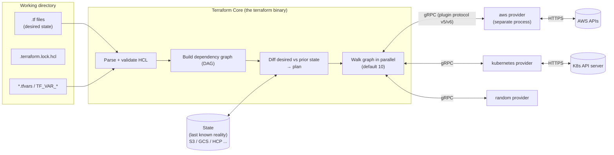
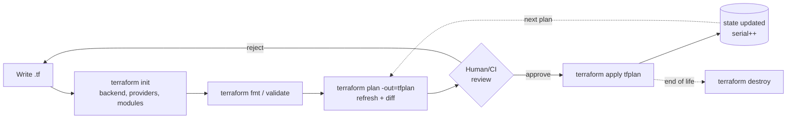

# 🛠️ Terraform: Zero to Mastery

Terraform is HashiCorp's declarative Infrastructure-as-Code tool. You describe the end state in HCL, and Terraform works out which API calls take the real world from its current state to that end state. These notes start with what Terraform is and work up to how it runs internally, state surgery, refactoring live infrastructure, CI/CD and production failure modes.

The examples were checked on **Terraform v1.15.8**. When a feature only exists from a certain version on, that version is given (for example "1.5+"). **OpenTofu** (the open-source fork) differences are called out where they matter.

## Learning path

| # | Note | What you'll learn |
|---|---|---|
| 1 | **Fundamentals & Architecture** (this page) | What IaC is, why Terraform exists, core vs providers, the core workflow, what really happens in `init`/`plan`/`apply`, files in a working directory, installing and version pinning, your first config |
| 2 | [HCL Language Deep Dive](./terraform-hcl-language.md) | Blocks, types and type constraints, `optional()`, variables and precedence, validation, locals, outputs, every expression type, `for` expressions, splats, `dynamic` blocks, conditionals, unknown values, the functions you really use, templates, `sensitive` and `ephemeral` |
| 3 | [Meta-Arguments & Lifecycle](./terraform-meta-arguments-and-lifecycle.md) | `count` vs `for_each` (and why indexes bite you), `depends_on`, `provider`, every `lifecycle` option, preconditions/postconditions, `check` blocks, provisioners and why to avoid them, `terraform_data`, data sources and when they get read |
| 4 | [State Deep Dive](./terraform-state-deep-dive.md) | What state holds (real JSON), why it exists, serial/lineage, backends (S3 native locking, GCS, azurerm, HCP), locking, every `terraform state` subcommand, import (CLI and `import` blocks), drift, `-refresh-only`, secrets in state, splitting state, `terraform_remote_state` vs data sources, disaster recovery |
| 5 | [Providers & Internals](./terraform-providers-and-internals.md) | Provider requirements, version constraints, `.terraform.lock.hcl`, aliases and multi-region/multi-account, assume role, the dependency graph (DAG), how plan is computed, the gRPC plugin protocol, parallelism, mirrors and air-gapped installs, `TF_LOG` debugging |
| 6 | [Modules](./terraform-modules.md) | Root vs child modules, module sources, versioning, designing inputs and outputs, composition vs nesting, passing providers, `for_each` on modules, registry publishing, anti-patterns, a full worked module |
| 7 | [CLI Reference](./terraform-cli-reference.md) | Every command and the flags that matter: `-target`, `-replace`, `-out`, `-var`, `-detailed-exitcode`, `-chdir`, `-json`, plan files, `console`, `graph`, `fmt`, env vars |
| 8 | [Environments, Workflows & CI/CD](./terraform-environments-and-cicd.md) | Workspaces vs directories vs Terragrunt, repo layouts, GitHub Actions with OIDC, plan-on-PR/apply-on-merge, Atlantis, HCP Terraform, Spacelift, secrets handling, `terraform test`, policy as code |
| 9 | [Production Patterns & Troubleshooting](./terraform-production-and-troubleshooting.md) | Refactoring with `moved`/`removed`/`import`, zero-downtime replacement, blast radius, a table of real errors and fixes, state recovery runbooks, upgrades, OpenTofu vs Terraform, the gotchas that cause outages |
| 10 | [Hands-on Labs](./terraform-hands-on-labs.md) | 12 labs you can run locally with **no cloud account**, plus AWS labs: for_each, refactoring, state surgery, tests with mocks, drift, a reusable module, a CI pipeline |
| 11 | [Interview Q&A](../Interview%20Questions/06-terraform-and-iac-qna.md) | Junior → Senior questions |

Existing project notes: [Sample Project (ALB + EC2 + RDS)](./sample-project.md) · [Learn Log (DevOps Directive course)](./learnlog.md) · [course-files/](./course-files) · [Terraform Testing Frameworks](../IaC%20Testing%20and%20Policy%20as%20Code/terraform-testing-frameworks.md) · [Linting & static analysis](../IaC%20Testing%20and%20Policy%20as%20Code/linting-and-static-analysis.md) · [Policy as code](../IaC%20Testing%20and%20Policy%20as%20Code/policy-as-code-with-opa-and-conftest.md) · [Drift detection](../IaC%20Testing%20and%20Policy%20as%20Code/drift-detection-and-continuous-validation.md) · [CloudFormation](./cloud-formation.md) · [Pulumi](./pulumi.md)

**How to study this:** read 1 → 4 in order, because everything else rests on the state model. Do the matching lab after each note. Notes 5 → 9 can be read in any order once you've written a few configs.

---

## 1. What problem Terraform solves

There are three ways to create cloud resources:

| Approach | Example | Problem |
|---|---|---|
| Console (ClickOps) | Clicking through the AWS console | Can't be repeated or reviewed, there's no history, and dev and prod drift apart |
| Imperative scripts | `aws ec2 run-instances ...` in bash | You have to handle "already exists", ordering, updates and deletes yourself. Running it twice creates two of everything |
| **Declarative IaC** | Terraform, CloudFormation, Pulumi | You describe the end state, and the tool works out create/update/delete and the order |

The key property is **idempotency with convergence**. You can run `terraform apply` a hundred times. If the real world already matches the code, nothing happens. If someone deleted a security group by hand, Terraform recreates it. If you remove a resource from the code, Terraform destroys it.

### Imperative vs declarative, concretely

```bash
# Imperative: you own the "how"
if ! aws s3api head-bucket --bucket my-logs 2>/dev/null; then
  aws s3api create-bucket --bucket my-logs --region us-east-1
fi
aws s3api put-bucket-versioning --bucket my-logs --versioning-configuration Status=Enabled
# ...and what if versioning must be turned OFF later? Another branch. Delete? Another script.
```

```hcl
# Declarative: you own the "what"
resource "aws_s3_bucket" "logs" {
  bucket = "my-logs"
}

resource "aws_s3_bucket_versioning" "logs" {
  bucket = aws_s3_bucket.logs.id
  versioning_configuration { status = "Enabled" }   # change to "Suspended" → Terraform updates it
}
# Delete both blocks → Terraform deletes them.
```

### Where Terraform fits among IaC tools

| Category | Tools | Job |
|---|---|---|
| **Provisioning** | Terraform, OpenTofu, CloudFormation, Pulumi, Bicep, Crossplane | Create cloud resources: networks, clusters, databases, DNS, IAM |
| Configuration management | Ansible, Chef, Puppet, Salt | Configure what's *inside* a server: packages, files, services |
| Server templating | Packer, Dockerfile | Build immutable images (AMIs, containers) |
| Orchestration | Kubernetes, Nomad, ECS | Run and schedule workloads on that infrastructure |

The usual pipeline looks like this: **Packer** builds an AMI → **Terraform** creates the VPC, ASG and EKS cluster using that AMI → **Helm/Argo CD** deploys the apps onto the cluster. Ansible is still used when you have long-lived VMs that need configuring.

### Terraform vs the alternatives

| | Terraform / OpenTofu | CloudFormation | Pulumi | Crossplane |
|---|---|---|---|---|
| Language | HCL (declarative DSL) | YAML/JSON | TS, Python, Go, C#, Java | Kubernetes YAML (CRDs) |
| Clouds | Any (thousands of providers) | AWS only | Any (many bridge Terraform providers) | Any |
| State | You manage it (backend) | AWS manages it | Pulumi Cloud or self-managed backend | Kubernetes etcd |
| Drift correction | Only when you run plan/apply | Drift detection, no auto-fix | On `up` | **Continuous** reconcile loop |
| Rollback on failure | None. Partial apply stays in place | Automatic stack rollback | None | Keeps reconciling |
| Licence | Terraform: BSL 1.1 (since 1.6, Aug 2023). OpenTofu: MPL 2.0 | Proprietary service | Apache 2.0 | Apache 2.0 |

> **Interview point:** Terraform does **not** roll back a failed apply. If 7 of 10 resources were created before an error, those 7 exist and are recorded in state. You fix the error and apply again, and Terraform carries on from where it stopped. CloudFormation behaves differently: by default it rolls the whole stack back.

---

## 2. Architecture



**Terraform Core** is the single `terraform` binary. It knows nothing about AWS. It parses HCL, evaluates expressions, builds the graph, reads and writes state, and computes diffs.

**Providers** are separate executables, downloaded during `init` into `.terraform/providers/`. Core launches each provider as a child process and talks to it over **gRPC**. A provider:
- publishes a **schema** (which resource types exist and which attributes each one has, and whether those attributes are required, optional or computed)
- validates config
- **plans** changes (Core asks: "here's the prior state and the desired config, what will the new state be?")
- **applies** them by calling the real API
- **reads** current values (refresh)

That's why the AWS provider can be upgraded without upgrading Terraform, and why anyone can write a provider for any API (GitHub, Datadog, Cloudflare, PagerDuty, even a pizza-ordering API).

**State** is Terraform's record of which real object belongs to which resource address (`aws_instance.web` ↔ `i-0abc123`), along with each object's last-known attributes. Without state, Terraform couldn't tell "create a new instance" apart from "this instance already exists". See [State Deep Dive](./terraform-state-deep-dive.md).

### The three "states" in every plan

| Name | Source | Meaning |
|---|---|---|
| **Configuration** (desired) | Your `.tf` files | What you want |
| **Prior state** | State file | What Terraform believes exists, from the last apply |
| **Refreshed state** (actual) | Provider `Read` calls during plan | What really exists right now |

`plan` = refresh (prior → actual) → diff (actual vs desired) → proposed actions.

---

## 3. The core workflow



### What each step really does

**`terraform init`** (safe to run again at any time)
1. Reads the `terraform {}` block: `required_version`, `required_providers` and `backend`.
2. **Backend init:** configures where state lives. If you changed backends, it offers to migrate the state.
3. **Module install:** downloads every `module` source into `.terraform/modules/`.
4. **Provider install:** resolves version constraints. If `.terraform.lock.hcl` exists it uses the exact locked versions and verifies their checksums. If not, it picks the newest version that matches and *writes* the lock file. Providers are downloaded to `.terraform/providers/`.

**`terraform plan`**
1. Loads config, variables and state, and **acquires the state lock** (if the backend supports locking).
2. **Refresh:** calls `Read` on every resource in state to see the real world (you can skip this with `-refresh=false`).
3. Builds the graph and walks it. For each resource, the provider's `PlanResourceChange` returns the proposed new state, including whether a change needs **replacement** (attributes marked `ForceNew`).
4. Prints the actions: `+` create, `~` update in place, `-/+` destroy then create, `+/-` create then destroy, `-` destroy, `<=` read a data source, plus "has moved to" and "will no longer be managed".
5. Releases the lock. A plan never changes real infrastructure **and never writes state** (since 0.15.4). The refreshed values live only inside the plan.

**`terraform apply`**
1. With no plan file, it plans again and asks for confirmation. With a saved plan file, it applies **exactly** that plan. If state has changed since the plan was made, it refuses with "Saved plan is stale".
2. Walks the graph: independent resources run in parallel (`-parallelism=10` by default), and dependent ones wait.
3. After **each** resource finishes, state is updated, so a crash part-way through keeps the progress made so far.
4. On error: resources that already succeeded stay in state, and the one that failed may be marked **tainted** (created but in an unknown condition), so it gets replaced next time.

**`terraform destroy`** is the same as `terraform apply -destroy`: a plan where every resource is deleted, walked in **reverse** dependency order.

### Reading plan output

```text
Terraform will perform the following actions:

  # aws_instance.web must be replaced
-/+ resource "aws_instance" "web" {
      ~ ami                          = "ami-0aaa" -> "ami-0bbb" # forces replacement
      ~ id                           = "i-0123" -> (known after apply)
      ~ public_ip                    = "54.1.2.3" -> (known after apply)
        tags                         = { "Name" = "web" }
        # (24 unchanged attributes hidden)
    }

  # aws_security_group.web will be updated in-place
  ~ resource "aws_security_group" "web" {
      ~ description = "old" -> "new"
    }

Plan: 1 to add, 1 to change, 1 to destroy.
```

- `# forces replacement` tells you which attribute changed and is immutable on the API side. **Always search the plan for this before approving.**
- `(known after apply)` is an **unknown value**: the provider can only learn it once the object exists, such as IDs, IPs and ARNs.
- `-/+` destroys first and then creates, so there's downtime. `+/-` creates first (`create_before_destroy`).

---

## 4. Files in a working directory

```text
my-infra/
├── versions.tf           # terraform {} block: required_version, required_providers, backend
├── providers.tf          # provider "aws" { ... } configurations
├── variables.tf          # input variable declarations
├── main.tf               # resources (or split: network.tf, compute.tf, iam.tf)
├── outputs.tf            # output values
├── locals.tf             # local values (optional)
├── terraform.tfvars      # variable VALUES, auto-loaded (don't commit secrets)
├── prod.auto.tfvars      # also auto-loaded
├── .terraform.lock.hcl   # COMMIT THIS — pins provider versions + checksums
├── .terraform/           # DO NOT COMMIT — downloaded providers & modules, backend config cache
├── terraform.tfstate     # local state (only if no remote backend) — DO NOT COMMIT
└── terraform.tfstate.backup
```

Terraform loads **every `*.tf` file in the directory** (it doesn't look in subdirectories) and merges them into one module. File names are a convention for people only. Terraform doesn't care which resource lives in which file, and the order of blocks doesn't matter.

`.gitignore`:
```gitignore
.terraform/
*.tfstate
*.tfstate.*
crash.log
crash.*.log
*.tfplan
tfplan
override.tf
override.tf.json
*_override.tf
*_override.tf.json
# Usually ignore *.tfvars if they hold secrets; commit non-secret env tfvars deliberately
```

**Override files** (`override.tf`, `*_override.tf`) are merged *on top of* the matching blocks instead of being added as new ones. They exist for local hacks, but they make code hard to reason about, so avoid them.

---

## 5. Installing and pinning Terraform

```bash
# macOS
brew tap hashicorp/tap && brew install hashicorp/tap/terraform

# Linux (apt)
wget -O- https://apt.releases.hashicorp.com/gpg | sudo gpg --dearmor -o /usr/share/keyrings/hashicorp.gpg
echo "deb [signed-by=/usr/share/keyrings/hashicorp.gpg] https://apt.releases.hashicorp.com $(lsb_release -cs) main" \
  | sudo tee /etc/apt/sources.list.d/hashicorp.list
sudo apt update && sudo apt install terraform

# Multiple versions per project (recommended): tfenv or mise/asdf
brew install tfenv
tfenv install 1.15.8 && tfenv use 1.15.8
echo "1.15.8" > .terraform-version        # tfenv auto-switches per directory

# OpenTofu
brew install opentofu        # binary is `tofu`, same commands
```

Enable tab completion with `terraform -install-autocomplete`. A common alias is `alias tf=terraform`.

Pin the version in code so a teammate using an older binary can't upgrade your state format by accident:
```hcl
terraform {
  required_version = ">= 1.9, < 2.0"
}
```

---

## 6. Your first real config (no cloud needed)

This runs anywhere, because the `local` and `random` providers don't need any credentials.

```hcl
# versions.tf
terraform {
  required_version = ">= 1.9"
  required_providers {
    random = { source = "hashicorp/random", version = "~> 3.6" }
    local  = { source = "hashicorp/local",  version = "~> 2.5" }
  }
}

# main.tf
variable "name" {
  type    = string
  default = "world"
}

resource "random_pet" "suffix" {
  length = 2
}

resource "local_file" "hello" {
  filename = "${path.module}/hello.txt"
  content  = "Hello, ${var.name}! id=${random_pet.suffix.id}\n"
}

output "file" {
  value = local_file.hello.filename
}
```

```bash
terraform init          # downloads random + local, writes .terraform.lock.hcl
terraform plan          # 2 to add
terraform apply         # type yes
cat hello.txt
terraform apply -var name=alice   # local_file must be REPLACED (content forces new) — random_pet unchanged
rm hello.txt && terraform plan    # drift! file gone → plan shows 1 to add
terraform destroy
```

What this teaches you:
- **Implicit dependency:** `local_file.hello` refers to `random_pet.suffix.id`, so Terraform creates the pet first. There's no `depends_on`.
- **Replacement:** `local_file` can't edit content in place, so the provider marks `content` as ForceNew.
- **Drift:** deleting the file by hand is noticed on the next refresh.

### The same in AWS

```hcl
terraform {
  required_version = ">= 1.9"
  required_providers {
    aws = { source = "hashicorp/aws", version = "~> 6.0" }
  }
  backend "s3" {
    bucket       = "acme-tfstate-prod"
    key          = "network/terraform.tfstate"
    region       = "us-east-1"
    encrypt      = true
    use_lockfile = true          # S3-native locking (1.10+). DynamoDB locking is deprecated.
  }
}

provider "aws" {
  region = "us-east-1"
  default_tags {
    tags = { ManagedBy = "terraform", Repo = "acme/infra" }
  }
}

data "aws_availability_zones" "available" {
  state = "available"
}

resource "aws_vpc" "main" {
  cidr_block           = "10.0.0.0/16"
  enable_dns_hostnames = true
  tags                 = { Name = "main" }
}

resource "aws_subnet" "private" {
  for_each          = { for i, az in slice(data.aws_availability_zones.available.names, 0, 3) : az => i }
  vpc_id            = aws_vpc.main.id
  availability_zone = each.key
  cidr_block        = cidrsubnet(aws_vpc.main.cidr_block, 4, each.value)   # 10.0.0.0/20, 10.0.16.0/20, ...
  tags              = { Name = "private-${each.key}" }
}

output "subnet_ids" {
  value = { for az, s in aws_subnet.private : az => s.id }
}
```

Every feature used here (`for_each`, `cidrsubnet`, `default_tags`, the backend) is explained in the notes that follow.

---

## 7. Mental models that make you good at Terraform

1. **State is the source of truth for *ownership*. Code is the source of truth for *intent*.** Most painful incidents come from the two disagreeing: someone renamed a resource (the address changed), or someone edited state.
2. **The resource address is the identity.** `aws_instance.web` and `aws_instance.app` are two different things to Terraform, even with identical arguments. Renaming one in code means destroy plus create, unless you add a `moved` block.
3. **Everything is a graph.** References create edges. Terraform runs whatever it can in parallel, and the order your code is written in has no effect.
4. **Plan is a contract.** Save it (`-out`), review it, apply that exact file. "Plan looked fine, apply did something else" happens when people apply without a saved plan.
5. **Unknown values flow.** If something is only known after apply, everything derived from it is unknown too, and some constructs (such as `for_each` keys) won't accept unknowns.
6. **Small states, clear boundaries.** One giant state means slow plans, big blast radius and lock contention. Split by lifecycle and by owning team.
7. **Terraform only manages what's in its state.** It won't delete things it didn't create, and it won't notice resources someone created by hand next to yours.

---

## 8. One-page cheat sheet

```bash
terraform init [-upgrade] [-reconfigure] [-migrate-state] [-backend-config=prod.hcl]
terraform fmt -recursive [-check]
terraform validate
terraform plan -out=tfplan [-var-file=prod.tfvars] [-target=ADDR] [-replace=ADDR] [-refresh-only] [-destroy]
terraform show tfplan                      # human
terraform show -json tfplan | jq           # machine (policy checks)
terraform apply tfplan
terraform apply -auto-approve -var 'x=1'   # no saved plan (avoid in prod)
terraform destroy [-target=ADDR]
terraform output [-json] [-raw NAME]
terraform console                          # REPL for expressions
terraform state list | show ADDR | mv A B | rm ADDR | pull | push
terraform import ADDR ID                   # prefer `import {}` blocks (1.5+)
terraform plan -generate-config-out=gen.tf # write HCL for import blocks
terraform force-unlock LOCK_ID
terraform workspace list | new | select | delete
terraform providers [lock -platform=linux_amd64 -platform=darwin_arm64]
terraform graph | dot -Tsvg > graph.svg
terraform test                             # *.tftest.hcl (1.6+)
TF_LOG=DEBUG TF_LOG_PATH=tf.log terraform plan
```

Next: [HCL Language Deep Dive →](./terraform-hcl-language.md)
