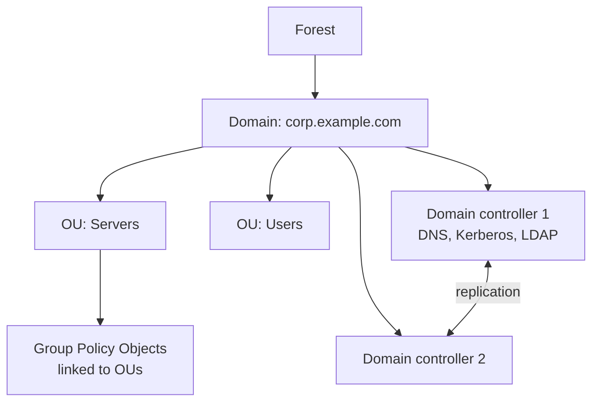
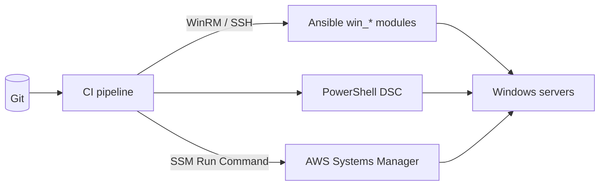

# Windows Administration for DevOps — Complete Notes

> Linux equivalents live in [`scripting/linux-cmds.md`](../scripting/linux-cmds.md). Interview prep: [Windows, Proxy, VAPT & Jira Q&A](../Interview%20Questions/22-windows-proxy-vapt-jira-qna.md).

## 1. Beginner

### CMD vs PowerShell
- **cmd.exe**: legacy shell with text output. Still everywhere for quick commands (`ipconfig`, `ping`, `netstat`).
- **PowerShell** (Windows PowerShell 5.1 built in; **PowerShell 7+** cross-platform as `pwsh`): object-based pipeline, so commands output objects you can filter, sort, and select. This is what you automate with.
- Cmdlets are `Verb-Noun` (`Get-Service`, `Restart-Service`). Use `Get-Help <cmd> -Examples` and `Get-Command *service*` to discover them.

### Linux ⇄ Windows command cheat sheet
| Task | Linux | CMD | PowerShell |
|---|---|---|---|
| List files | `ls -la` | `dir` | `Get-ChildItem` (`ls`, `gci`) |
| Read a file / tail | `cat`, `tail -f` | `type` | `Get-Content file -Tail 50 -Wait` |
| Search text | `grep` | `findstr` | `Select-String -Pattern "error"` |
| Processes | `ps aux`, `top` | `tasklist` | `Get-Process \| Sort CPU -Desc \| Select -First 10` |
| Kill process | `kill -9 PID` | `taskkill /PID 1234 /F` | `Stop-Process -Id 1234 -Force` |
| Services | `systemctl status x` | `sc query x` / `net start` | `Get-Service x`, `Restart-Service x` |
| Service startup type | `systemctl enable` | `sc config x start= auto` | `Set-Service x -StartupType Automatic` |
| IP config | `ip a` | `ipconfig /all` | `Get-NetIPAddress` |
| DNS lookup | `dig`, `nslookup` | `nslookup` | `Resolve-DnsName host` |
| Flush DNS cache | `resolvectl flush-caches` | `ipconfig /flushdns` | `Clear-DnsClientCache` |
| Test a port | `nc -zv host 443` | — | `Test-NetConnection host -Port 443` |
| Listening ports | `ss -tulpn` | `netstat -ano` | `Get-NetTCPConnection -State Listen` |
| Trace route | `traceroute` | `tracert`, `pathping` | `Test-NetConnection host -TraceRoute` |
| Routing table | `ip route` | `route print` | `Get-NetRoute` |
| ARP | `ip neigh` | `arp -a` | `Get-NetNeighbor` |
| System info | `uname -a`, `hostnamectl` | `systeminfo` | `Get-ComputerInfo` |
| Disk usage | `df -h` | `wmic logicaldisk get size,freespace` (deprecated) | `Get-PSDrive -PSProvider FileSystem`, `Get-Volume` |
| Logs | `journalctl` | `eventvwr.msc` | `Get-WinEvent -LogName System -MaxEvents 50` |
| Scheduled jobs | `cron` | `schtasks /query` | `Get-ScheduledTask` |
| Users / groups | `id`, `useradd` | `net user`, `net localgroup administrators` | `Get-LocalUser`, `Add-LocalGroupMember` |
| Permissions | `chmod`/`chown` | `icacls C:\app` | `Get-Acl` / `Set-Acl` |
| Copy/sync files | `rsync` | `robocopy src dst /MIR` | `Copy-Item -Recurse` |
| Env vars | `export X=1` | `set X=1` / `setx X 1` | `$env:X = "1"` |
| Remote shell | `ssh` | — | `Enter-PSSession host` (WinRM), or OpenSSH `ssh` |

### Key ports & services
| Port | Service |
|---|---|
| 3389 | **RDP** (Remote Desktop). Never open to the internet |
| 5985 / 5986 | **WinRM** HTTP / HTTPS (PowerShell remoting, Ansible) |
| 445 | SMB file sharing |
| 22 | OpenSSH Server (optional feature on Windows Server 2019+) |
| 53 / 88 / 389 / 636 | DNS / Kerberos / LDAP / LDAPS (Active Directory) |

---

## 2. Intermediate

### Monitoring performance & logs
- **Task Manager** (`taskmgr`) and **Resource Monitor** (`resmon`) for per-process CPU/disk/network and file handles. **Performance Monitor** (`perfmon`) for counters and Data Collector Sets (long-running captures).
- PowerShell counters:
```powershell
Get-Counter '\Processor(_Total)\% Processor Time','\Memory\Available MBytes' -SampleInterval 5 -MaxSamples 12
Get-Process | Sort-Object WS -Descending | Select-Object -First 10 Name,Id,CPU,@{n='MemMB';e={[int]($_.WS/1MB)}}
```
- **Event Viewer** logs: *System* (drivers, services, reboots), *Application* (app crashes), *Security* (logons: event ID **4624** success, **4625** failure, **4740** lockout). Other useful IDs: **7036** service state change, **6005/6006** event log start/stop (boot/shutdown), **1074** who initiated a restart, **41** unexpected reboot.
```powershell
Get-WinEvent -FilterHashtable @{LogName='System'; Level=2; StartTime=(Get-Date).AddHours(-24)}   # errors, last 24h
Get-WinEvent -FilterHashtable @{LogName='Security'; Id=4625} -MaxEvents 20                       # failed logons
```

### Routine maintenance
- **Windows Update**: WSUS or SCCM/Intune in enterprises, AWS **Systems Manager Patch Manager** in the cloud; `Get-HotFix` lists installed patches. Patch in waves (dev → staging → prod) and schedule reboots.
- **Disk cleanup**: temp folders, `C:\Windows\SoftwareDistribution\Download`, IIS logs (`C:\inetpub\logs\LogFiles`; set a retention task); `cleanmgr`; `Dism /Online /Cleanup-Image /StartComponentCleanup`.
- **System file repair**: `sfc /scannow`, then `DISM /Online /Cleanup-Image /RestoreHealth`. Disk check: `chkdsk C: /f` (needs a reboot for the system drive).
- **Time sync** (critical for Kerberos/AD and TLS): `w32tm /query /status`, `w32tm /resync`.
- **Group Policy**: `gpupdate /force`, `gpresult /r` (which policies applied).
- **Firewall**: `Get-NetFirewallProfile`, `New-NetFirewallRule -DisplayName "App 8080" -Direction Inbound -Protocol TCP -LocalPort 8080 -Action Allow`, or `netsh advfirewall`.

### IIS (Windows web server) basics
- Sites → bindings (IP/port/hostname/cert) → **application pools** (worker process `w3wp.exe`, isolated identity).
- `iisreset` (restarts all of IIS, heavy), `Restart-WebAppPool -Name MyPool` (lighter), `Get-Website`, `C:\Windows\System32\inetsrv\appcmd list apppool`.
- Logs in `C:\inetpub\logs\LogFiles`; 503 usually means a stopped app pool (check its identity password / crash in Event Viewer).

### Active Directory essentials



Domain controllers provide authentication (Kerberos/NTLM), DNS, and Group Policy. Users, groups, and computers live in OUs. Useful commands: `Get-ADUser jdoe -Properties *`, `Unlock-ADAccount`, `nltest /dsgetdc:corp.local` (find a DC), `whoami /groups`. Many "can't log in" or "service account failing" issues are expired passwords, lockouts, or time skew.

---

## 3. Advanced: Windows in a DevOps toolchain

### Automation



- **PowerShell scripts** with `Set-StrictMode -Version Latest`, `$ErrorActionPreference = 'Stop'`, and `try/catch`, plus Pester for tests.
- **Ansible for Windows**: connects over **WinRM** (or SSH) and uses `ansible.windows.*` modules (`win_service`, `win_package`, `win_updates`, `win_feature`, `win_copy`, `win_regedit`, `win_shell`).
```yaml
# inventory vars
ansible_connection: winrm
ansible_winrm_transport: ntlm          # or kerberos / credssp
ansible_port: 5986
ansible_winrm_server_cert_validation: ignore   # lab only; validate in prod
---
- hosts: windows
  tasks:
    - ansible.windows.win_feature: { name: Web-Server, state: present }
    - ansible.windows.win_service: { name: W3SVC, state: started, start_mode: auto }
    - ansible.windows.win_updates: { category_names: [SecurityUpdates], reboot: true }
```
- **Jenkins Windows agents**: run the agent as a service, use `bat`/`powershell` steps in the Jenkinsfile, and watch for path-length limits and file locks (antivirus scanning the workspace).
- **Configuration as code**: PowerShell DSC, Ansible, or Chocolatey/winget for packages.

### Windows on AWS
- Use **SSM Session Manager / Fleet Manager** for access without opening RDP; SSM **Run Command** to run PowerShell at scale; **EC2Launch v2** for first-boot config; get the Administrator password via the key pair, or better, AD/SSM.
- Licensing is included in the instance price (or BYOL on dedicated hosts). Windows instances cost more and boot more slowly than Linux.

### Windows containers / EKS
- Windows containers must match the host OS build (Server 2019 vs 2022 base images: `mcr.microsoft.com/windows/servercore`, `nanoserver`).
- EKS supports **Windows managed node groups**. A Linux node group is still required for CoreDNS and other system pods. Schedule Windows workloads with `nodeSelector: kubernetes.io/os: windows` (plus taints so Linux pods don't land there).
- Limitations: no privileged containers (HostProcess containers instead), different networking (VPC CNI Windows support), and larger images.

### Troubleshooting scenarios
| Problem | Steps |
|---|---|
| Server slow / high CPU | Task Manager/`Get-Process` sorted by CPU → which process; perfmon counters; Event Viewer for errors; check Windows Update/Defender scans running |
| Disk full on C: | `Get-ChildItem C:\ -Recurse -ErrorAction SilentlyContinue \| Sort Length -Desc \| Select -First 20`; clean logs/temp/WinSxS; extend the EBS volume + `Resize-Partition` |
| Service won't start | `Get-Service x`, Event Viewer System log (7000/7009/7023), service account password expired, dependency service stopped, port already in use (`netstat -ano \| findstr :8080` → PID → `tasklist /FI "PID eq 1234"`) |
| Can't RDP | SG/NACL/Windows Firewall 3389, RDP enabled, user in "Remote Desktop Users", NLA/credential issues; fall back to SSM Session Manager or EC2 Serial Console |
| App can't reach a URL | `Test-NetConnection host -Port 443`, `Resolve-DnsName`, proxy settings (`netsh winhttp show proxy` for system services vs user IE/Edge proxy), certificate trust (`certlm.msc`) |
| Unexpected reboot | Event IDs 41, 1074, 6008; Windows Update history; `Get-HotFix` |
