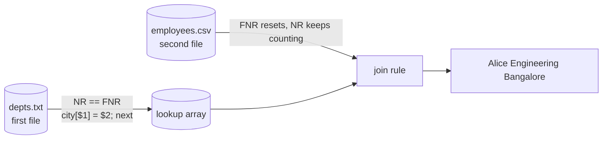

# AWK: Beginner → Moderate → Advanced → Master

> awk is a small programming language built for one job: **reading text line by line, splitting each line into fields, and acting on the ones you care about.** In DevOps it's the tool you reach for when `grep` finds the lines but you need to *compute* something from them: counts, sums, percentiles, joins or reports.

**Before you start:** create the sample files from the [Text-Processing Lab](text-processing-lab.md). Every example and exercise below uses them, and every answer shown was run on GNU awk 5.2.

**Related:** [grep in depth](grep-mastery.md) · [sed in depth](sed-mastery.md) · [Bash scripting](bash-scripting.md)

---

## Table of Contents

- [Level 0: The Mental Model](#level-0-the-mental-model)
- [Level 1: Beginner](#level-1-beginner)
- [Level 2: Moderate](#level-2-moderate)
- [Level 3: Advanced](#level-3-advanced)
- [Level 4: Master (gawk)](#level-4-master-gawk)
- [Pitfalls That Bite in Production](#pitfalls-that-bite-in-production)
- [Portability: gawk vs mawk vs macOS awk](#portability-gawk-vs-mawk-vs-macos-awk)
- [Exercises with Answers](#exercises-with-answers)
- [One-Liner Cheat Sheet](#one-liner-cheat-sheet)

---

## Level 0: The Mental Model

Every awk program is a list of **pattern { action }** rules:

```
awk 'pattern { action }  pattern { action } ...' file...
```

awk runs this loop for you:

```
run BEGIN blocks                     ← before any input is read
for each input record (line):
    split it into fields $1..$NF
    for each rule, top to bottom:
        if pattern is true → run action
run END blocks                       ← after the last line
```

Three rules explain 90% of awk:

1. **No pattern** means "every line": `awk '{print $1}'`
2. **No action** means "print the line": `awk '$9 == 404'` works like a grep on a column.
3. **Variables need no declaration.** An unset variable is `""` in string context and `0` in number context, so `count++` and `sum += $3` just work.

```
$0  = the whole current line
$1  = first field, $2 = second ... $NF = last field
NF  = number of fields on this line
NR  = record number (line count so far, across all files)
```

```bash
echo "alpha beta gamma" | awk '{print NF, $1, $NF, $0}'
# 3 alpha gamma alpha beta gamma
```

---

## Level 1: Beginner

### 1.1 Printing fields

```bash
awk '{print $1}' access.log                 # IPs
awk '{print $1, $9}' access.log             # IP and status: the comma inserts OFS (a space)
awk '{print $1 $9}' access.log              # no comma = string concatenation: "192.168.1.10200"
awk '{print $1 " -> " $9}' access.log       # concatenation with literal text
awk '{print $NF}' access.log                # last field (response time)
awk '{print $(NF-1)}' access.log            # second to last field: parentheses required
awk '{print NR": "$0}' app.log              # number every line
```

### 1.2 Field separators: `-F`

By default fields are split on **runs of spaces and tabs**, and leading whitespace is ignored. Change that with `-F`:

```bash
awk -F: '{print $1, $7}' users.txt          # /etc/passwd style
awk -F, '{print $2}' employees.csv          # CSV (simple; quoted commas are a Level 4 topic)
awk -F'\t' '{print $3}' data.tsv            # tab-separated
awk -F'[=,]' '{print $2}' file              # FS is a regex: split on "=" OR ","
awk -F' *= *' '{print $1 "|" $2}' app.conf  # "key = value" with optional spaces
```

### 1.3 Patterns: choosing which lines

```bash
awk '/ERROR/' app.log                       # regex anywhere in the line
awk '!/DEBUG/' app.log                      # NOT matching
awk '$3 == "ERROR"' app.log                 # exact field match
awk '$9 >= 500' access.log                  # numeric comparison on a field
awk '$7 ~ /^\/api/' access.log              # field matches regex  (~ is "matches")
awk '$7 !~ /\.(png|css|js)$/' access.log    # field does NOT match
awk 'NR == 1' employees.csv                 # just the header
awk 'NR > 1' employees.csv                  # skip the header
awk 'NR >= 5 && NR <= 8' access.log         # line range by number
awk '$9 == 404 || $9 == 403' access.log     # boolean logic: && || !
awk 'length($0) > 120' access.log           # long lines
awk 'NF' messy.txt                          # non-empty lines (NF==0 is false)
```

**Range pattern** `start, end` matches from the first line matching `start` through the next line matching `end`, inclusive:

```bash
awk '/10:01:15/, /10:01:40/' access.log     # a time window in a log
awk '/^\[database\]/, /^$/' app.conf        # one INI section
```

### 1.4 BEGIN and END

```bash
awk 'BEGIN {print "IP,STATUS"} {print $1 "," $9}' access.log      # add a header
awk 'END {print NR}' app.log                                      # count lines (like wc -l)
awk '{bytes += $10} END {print bytes}' access.log                 # sum a column → 61336
awk '{s += $NF} END {print s/NR}' access.log                      # average
awk 'BEGIN {print 2^10, 7/2, 7%3, int(7/2)}'                      # awk as a calculator → 1024 3.5 1 3
```

`BEGIN` runs before any input is read, so `$0`, `$1` and `NR` mean nothing there yet. A program with *only* a BEGIN block doesn't read input at all.

### 1.5 printf for aligned output

`print` is quick; `printf` gives you control. It does **not** add a newline, so you add `\n` yourself.

```bash
awk -F, 'NR>1 {printf "%-10s %8d\n", $2, $4}' employees.csv
# Alice        120000
# Bob           95000
```

| Format | Meaning |
|---|---|
| `%s` / `%-10s` | string / left-aligned in 10 chars |
| `%d` / `%5d` | integer / right-aligned in 5 |
| `%.2f` / `%8.3f` | float with 2 decimals / width 8, 3 decimals |
| `%x` `%o` `%e` | hex, octal, scientific |
| `%%` | a literal `%` |

### 1.6 Quoting from the shell

Always wrap awk programs in **single quotes**, so the shell leaves `$1` alone. Never splice shell variables into the program text; pass them with `-v` (Level 2).

```bash
awk '{print $1}' f      # ✅ awk sees $1
awk "{print $1}" f      # ❌ the shell replaces $1 (probably with nothing) before awk runs
```

---

## Level 2: Moderate

### 2.1 Built-in variables you'll use constantly

| Variable | Meaning | Default |
|---|---|---|
| `FS` | input field separator (same as `-F`) | whitespace |
| `OFS` | output field separator, placed between `print` args | `" "` |
| `RS` | input record separator | `"\n"` |
| `ORS` | output record separator, appended after each `print` | `"\n"` |
| `NR` | record number across all input | |
| `FNR` | record number **within the current file** | |
| `NF` | number of fields in current record | |
| `FILENAME` | current input file name | |
| `SUBSEP` | separator used in `a[i,j]` keys | `"\034"` |
| `ENVIRON` | array of environment variables | |
| `RSTART`, `RLENGTH` | set by `match()` | |

```bash
awk -F: -v OFS=, '{print $1, $3, $6}' users.txt    # convert passwd → CSV
awk 'BEGIN {ORS = " "} {print $1} END {printf "\n"}' depts.txt   # join lines: "Engineering Sales Security"
awk 'FNR == 1 {print "==>", FILENAME}' access.log app.log        # header per file
awk 'BEGIN {print ENVIRON["HOME"]}'
```

### 2.2 Rebuilding `$0`: the `$1=$1` trick

When you **assign to any field**, awk rebuilds `$0` by joining fields with `OFS`. Assigning a field to itself forces that rebuild:

```bash
awk -F: -v OFS=' | ' '{$1 = $1; print}' users.txt
# root | x | 0 | 0 | root | /root | /bin/bash

echo "  lots   of    space  " | awk '{$1 = $1; print}'   # squeeze whitespace → "lots of space"
awk '{$2 = "-"; print}' access.log                        # blank out a column
awk '{$NF = ""; print}' access.log                        # drop the last column (leaves a trailing OFS)
awk '{NF--; print}' access.log                            # drop last column cleanly (gawk/mawk; POSIX-undefined)
```

### 2.3 Passing shell values in: `-v`

```bash
T=0.5
awk -v t="$T" '$NF > t {print $NF, $7}' access.log       # requests slower than $T seconds

awk -v ip="10.0.0.5" '$1 == ip' access.log               # filter by a variable
awk -v pat="^/api" '$7 ~ pat' access.log                 # a dynamic regex from a string
LIMIT=3 awk 'NR <= ENVIRON["LIMIT"]' app.log             # read it from the environment instead
```

> `-v` processes escape sequences (`\n`, `\t`) in the value. If the value may contain backslashes (Windows paths, regexes), pass it with `ENVIRON` instead, because that reads it raw.

### 2.4 Control flow

awk's syntax is C-like:

```bash
awk '{
    if ($9 >= 500)      level = "SERVER_ERR"
    else if ($9 >= 400) level = "CLIENT_ERR"
    else                level = "OK"
    print level, $7
}' access.log

awk '{for (i = 1; i <= NF; i++) if ($i ~ /^latency=/) print $i}' app.log   # loop over fields
awk 'BEGIN {i = 0; while (i < 3) print i++}'
awk '{print ($9 < 400 ? "ok" : "fail"), $7}' access.log                     # ternary
```

Flow keywords:

| Keyword | Effect |
|---|---|
| `next` | stop processing this line and go to the next one (skips remaining rules) |
| `exit [code]` | stop reading input; **END still runs**; `exit` inside END ends for real |
| `break` / `continue` | loop control |
| `nextfile` | skip the rest of the current file (gawk, mawk and BWK awk) |

### 2.5 Associative arrays: the heart of awk

Arrays are hash maps keyed by strings. They are what turn awk from a filter into an analytics engine.

```bash
# COUNT: requests per IP
awk '{hits[$1]++} END {for (ip in hits) print hits[ip], ip}' access.log | sort -rn
# 5 10.0.0.5
# 3 203.0.113.9
# ...

# SUM: bytes per status code
awk '{bytes[$9] += $10} END {for (s in bytes) print s, bytes[s]}' access.log

# AVERAGE: per endpoint (two arrays: sum and count)
awk '{sum[$7] += $NF; n[$7]++}
     END {for (p in sum) printf "%-18s %.3f\n", p, sum[p]/n[p]}' access.log | sort -k2 -rn
# /api/orders        2.730
# /api/users         0.575

# DEDUPE without sorting, keeping first-seen order (the most famous awk idiom)
awk '!seen[$1]++ {print $1}' access.log
```

**How `!seen[$1]++` works:** the first time a key appears, `seen[$1]` is 0, so `!0` is true and the line prints. Then `++` makes it 1, and every later occurrence evaluates `!1`, which is false.

Array operations:

```bash
if ("10.0.0.5" in hits) ...       # test membership WITHOUT creating the key
if (hits["x"] == "") ...          # ❌ this reference CREATES hits["x"]
delete hits["10.0.0.5"]           # remove one key
delete hits                       # clear the whole array (gawk, mawk and BWK awk all support it)
n = split("a:b:c", parts, ":")    # n=3, parts[1]="a" ... (arrays from split are 1-indexed)
```

> **`for (k in arr)` order is unspecified.** Pipe to `sort` for stable output, or use gawk's `PROCINFO["sorted_in"]` (Level 4).

### 2.6 Processing two files: the `NR == FNR` join



`NR` counts across all files; `FNR` resets per file. So `NR == FNR` is true **only while reading the first file**. That is the standard way to load a lookup table and then use it:

```bash
# depts.txt:      Engineering Bangalore
# employees.csv:  1,Alice,Engineering,120000,2019-03-15
awk 'NR == FNR {city[$1] = $2; next}      # 1st file: build the map, skip other rules
     FNR > 1   {print $2, $3, city[$3]}'  depts.txt FS=, employees.csv
# Alice Engineering Bangalore
# Carol Sales Mumbai
```

Note the `FS=,` **between the file names**: a `var=value` argument is applied just before awk opens the next file, so each file gets its own separator.

Other two-file patterns:

```bash
awk 'NR == FNR {skip[$1]; next} !($1 in skip)' blocklist.txt access.log   # anti-join: lines whose IP is NOT in the blocklist
awk 'NR == FNR {a[$0]; next} $0 in a' file1 file2                         # intersection of lines
```

> **Edge case:** if the first file is **empty**, `NR == FNR` stays true for the second file too. When that matters, use `FILENAME == ARGV[1]` instead.

### 2.7 String functions (POSIX)

| Function | Returns / does |
|---|---|
| `length(s)` | length of s (`length` alone = `length($0)`) |
| `substr(s, start, len)` | substring; **positions start at 1** |
| `index(s, t)` | position of literal t in s, or 0 |
| `split(s, arr, sep)` | splits into arr, returns count |
| `sub(re, repl, target)` | replace **first** match in target (default `$0`); returns 0/1 |
| `gsub(re, repl, target)` | replace **all** matches; returns count |
| `match(s, re)` | position of match, sets `RSTART` and `RLENGTH` |
| `sprintf(fmt, ...)` | printf into a string |
| `tolower(s)` / `toupper(s)` | case conversion |

```bash
awk '{print substr($4, 2, 11)}' access.log                  # "[18/Oct/2026:10:00:01" → "18/Oct/2026"
awk '{print substr($4, 14, 5)}' access.log                  # → "10:00"  (hour:minute)
awk '{split($6, m, "\""); print m[2]}' access.log           # "\"GET" → GET
awk '{gsub(/"/, ""); print $6}' access.log                  # strip quotes from the whole line, then fields re-split
awk 'match($0, /latency=[0-9]+/) {print substr($0, RSTART+8, RLENGTH-8)}' app.log   # 120, 950 ...
awk '{n = gsub(/o/, "0"); print n}' <<< "foo boo"           # gsub returns count: 4
```

In a `sub`/`gsub` replacement, **`&` means "the matched text"**. Write `\\&` for a literal ampersand:

```bash
echo "port 8080" | awk '{gsub(/[0-9]+/, "[&]"); print}'      # port [8080]
```

**Field re-splitting:** if you modify `$0` (for example with `gsub` on `$0`), awk **re-splits fields**. If you modify a field, awk **rebuilds `$0`**. Keep that two-way coupling in mind.

### 2.8 Formatted reports

```bash
awk -F, 'NR > 1 {n[$3]++; s[$3] += $4}
END {
    printf "%-12s %5s %10s\n", "DEPT", "COUNT", "AVG"
    for (d in n) printf "%-12s %5d %10.0f\n", d, n[d], s[d]/n[d]
}' employees.csv
# DEPT         COUNT        AVG
# Sales            2      66000
# Security         2     126500
# Engineering      3     106667
```

---

## Level 3: Advanced

### 3.1 User-defined functions

```awk
function name(param1, param2,    local1, local2) {
    ...
    return value
}
```

awk has **no local variable declaration**. The convention is to declare extra parameters you never pass. The extra spaces before them signal "these are locals". Scalars are passed by value; **arrays are passed by reference**.

```bash
awk '
function human(b) {
    if (b >= 1048576) return sprintf("%.1fM", b/1048576)
    if (b >= 1024)    return sprintf("%.1fK", b/1024)
    return b "B"
}
{ tot[$1] += $10 }
END { for (ip in tot) print ip, human(tot[ip]) }' access.log | sort
# 10.0.0.5 8.7K
# 172.16.0.7 40.5K
# 192.168.1.10 10.0K
```

Recursion works:

```bash
awk 'function fact(n) { return n <= 1 ? 1 : n * fact(n-1) } BEGIN { print fact(10) }'   # 3628800
```

### 3.2 Writing to files and commands

```bash
awk '{print > ("out/status_" $9 ".log")}' access.log      # split a log into one file per status
awk '{print >> "all.log"}' access.log                     # append
awk '{print $1 | "sort -u"}' access.log                   # pipe output into a command
awk '{print "ERR:", $0 > "/dev/stderr"}' app.log          # write to stderr
```

Rules:
- **Parenthesise** a concatenated file name: `print > "a" $1` is ambiguous across implementations, while `print > ("a" $1)` is not.
- `>` truncates the file **once**, on first open; later prints in the same run append. It is *not* re-truncated each line.
- Each distinct file or command stays **open** until awk exits. With thousands of keys you'll hit "too many open files", so `close(name)` the ones you're done with.
- `close()` on a pipe **waits for the command to finish**. That matters for ordering (see the next section).

### 3.3 Ordering output from a pipe: `close()`

```bash
awk '{c[$1]++} END {for (ip in c) print c[ip], ip | "sort -rn"; print "TOTAL", NR}' access.log
```

The `sort` process only prints when its input closes, which happens when awk **exits**. So `TOTAL` can appear *before* the sorted rows. On macOS awk it does:

```
TOTAL 15
5 10.0.0.5
...
```

Fix: close the pipe explicitly, which flushes it and waits for sort to finish:

```bash
awk '{c[$1]++}
END {
    cmd = "sort -rn"
    for (ip in c) print c[ip], ip | cmd
    close(cmd)                      # sort finishes and prints here
    print "TOTAL", NR
}' access.log
```

Always keep the command string in a variable. `close()` must receive **exactly** the same string you opened.

### 3.4 `getline`: reading input yourself

| Form | Reads from | Sets |
|---|---|---|
| `getline` | next line of current input | `$0`, `NF`, `NR`, `FNR` |
| `getline var` | next line of current input | `var`, `NR`, `FNR` |
| `getline < file` | a file | `$0`, `NF` |
| `getline var < file` | a file | `var` |
| `cmd \| getline` | a command's output | `$0`, `NF`, `NR` |
| `cmd \| getline var` | a command's output | `var` |

It returns `1` (got a line), `0` (EOF) or `-1` (error). **Always loop on `> 0`.** A plain `while (getline < f)` loops forever when the file doesn't exist, because `-1` is truthy.

```bash
# read a whole file in BEGIN
awk 'BEGIN { while ((getline line < "depts.txt") > 0) n++; close("depts.txt"); print n }'   # 3

# capture a command's output
awk 'BEGIN { "date +%s" | getline now; close("date +%s"); print now }'

# join a line with the one after it
awk '/connection timeout/ { getline nxt; print $0 " || " nxt; next } 1' app.log
```

> Most of the time you **don't need getline**. The `NR == FNR` pattern (2.6) is cleaner for lookup files. Reach for getline when you need data from a command, or a line-ahead read.

`system(cmd)` runs a command and returns its exit status. Its output goes straight to stdout and is not captured:

```bash
awk '{ if (system("test -d " $6) != 0) print $1, "home missing" }' FS=: users.txt
```

> ⚠️ Building shell commands from input data is **command injection** waiting to happen. A field containing `; rm -rf ~` will run. Only do this with trusted input.

### 3.5 Record separators: paragraph mode and friends

`RS = ""` is **paragraph mode**: records are separated by one or more blank lines, and newline always acts as a field separator too.

```bash
printf 'host: web-1\nstatus: up\nzone: a\n\nhost: db-1\nstatus: down\nzone: b\n\nhost: web-2\nstatus: down\nzone: a\n' > hosts.txt

awk 'BEGIN {RS = ""; FS = "\n"} /status: down/ {sub(/host: /, "", $1); print $1}' hosts.txt
# db-1
# web-2
```

```bash
awk 'BEGIN {RS = ","} {print NR, $0}' <<< "a,b,c"     # any single character as a separator
awk 'BEGIN {ORS = "\n\n"} 1' file                    # double-space a file
```

### 3.6 Multi-dimensional arrays (POSIX style)

`a[i, j]` is really `a[i SUBSEP j]`: one flat key built from two parts.

```bash
# status codes per IP
awk '{n[$1, $9]++} END {for (k in n) {split(k, p, SUBSEP); print p[1], p[2], n[k]}}' access.log | sort
# 10.0.0.5 200 2
# 10.0.0.5 401 1
# 203.0.113.9 404 3

if ((ip, code) in n) ...        # membership test needs the parentheses
```

Transpose a matrix:

```bash
printf '1 2 3\n4 5 6\n' | awk '
{ for (i = 1; i <= NF; i++) m[NR, i] = $i; if (NF > cols) cols = NF }
END {
    for (i = 1; i <= cols; i++) {
        row = m[1, i]
        for (j = 2; j <= NR; j++) row = row " " m[j, i]
        print row
    }
}'
# 1 4
# 2 5
# 3 6
```

### 3.7 State machines: parsing structured text

awk keeps variables between lines, so you can track where you are in a file:

```bash
# INI → flat key=value with section prefix
awk -F' *= *' '
/^\[/        { sec = substr($0, 2, length($0) - 2); next }   # [database] → database
/^#/ || !NF  { next }                                         # skip comments and blank lines
             { print sec "." $1 "=" $2 }' app.conf
# server.host=0.0.0.0
# database.port=5432 ...

# get one value from a section
awk -v sec=database -v key=port -F' *= *' '
/^\[/ { cur = $0; gsub(/[][]/, "", cur); next }
cur == sec && $1 == key { print $2; exit }' app.conf
# 5432
```

**Indentation-aware YAML extraction** (container name → image). A naive `/- name:/` would also catch the `env` entries:

```bash
awk '
/^ *containers:/ { match($0, /^ */); ind = RLENGTH; inside = 1; next }
inside           { match($0, /^ */); if (RLENGTH <= ind) inside = 0 }
inside && /^ *- name:/ { match($0, /^ */); if (RLENGTH == ind + 2) name = $3 }
inside && /image:/     { print name, $2 }' deployment.yaml
# web registry.example.com/web:1.4.2
# sidecar registry.example.com/proxy:0.9.1
```

> For anything beyond quick extraction, use `yq` for YAML and `jq` for JSON. awk is fine for one-off reads, not for round-trip edits of nested structures.

### 3.8 Remember previous lines / sliding windows

```bash
awk '/ERROR/ {print "before:", prev} {prev = $0}' app.log       # the line before each match

# moving average of the last 3 response times (a ring buffer via NR % 3)
awk '{w[NR % 3] = $NF; if (NR >= 3) printf "%s %.3f\n", NR, (w[0]+w[1]+w[2]) / 3}' access.log

# print N lines BEFORE a match (like grep -B2) using a ring buffer
awk -v n=2 '/CARD_DECLINED/ {for (i = NR-n; i < NR; i++) if (i > 0) print buf[i % n]; print} {buf[NR % n] = $0}' app.log
```

### 3.9 Standalone awk scripts

Once a program grows past one line, put it in a file:

```awk
#!/usr/bin/awk -f
# top.awk — top N IPs.  Usage: ./top.awk -v n=5 access.log
BEGIN { if (n == "") n = 3 }
{ c[$1]++ }
END {
    cmd = "sort -rn | head -" n
    for (k in c) print c[k], k | cmd
    close(cmd)
}
```

```bash
chmod +x top.awk && ./top.awk -v n=2 access.log
awk -f top.awk -v n=2 access.log          # equivalent
```

`ARGV`/`ARGC` hold the command-line arguments. You can rewrite them in BEGIN to add or drop input files (`ARGV[ARGC++] = "extra.log"`, or `delete ARGV[1]`).

### 3.10 Type coercion: strings vs numbers

awk decides at runtime whether a comparison is numeric or string:

- **Field values** and `-v` values that *look* numeric are "strnum" and compare **numerically**.
- **String constants** (`"10"`) compare **as strings**.
- If either side is a real string, the comparison is a **string** comparison.

```bash
echo "10 9" | awk '{print ($1 < $2)}'          # 0  → numeric: 10 < 9 is false
awk 'BEGIN {a = "10"; b = "9"; print (a < b)}' # 1  → string: "1" sorts before "9"
awk 'BEGIN {print ("10"+0 < "9"+0)}'           # 0  → +0 forces numeric
awk 'BEGIN {x = 5; print (x "")}'              # x "" forces string
```

Practical rules: **`+0` to force a number** (`$5+0 > 80` for `"85%"` gives 85), and **`""` concatenation to force a string**.

```bash
df -h | awk 'NR > 1 && $5+0 > 80 {print $6, $5}'     # disk alert: "85%"+0 → 85
```

---

## Level 4: Master (gawk)

GNU awk (`gawk`) adds features that remove the need for most helper pipes. Everything in this section is **gawk-only** unless noted. In scripts, check for it with `command -v gawk`.

### 4.1 Real CSV: `FPAT`

`-F,` breaks on `"Smith, John"`. `FPAT` defines what a **field looks like** rather than what separates fields:

```bash
cat > quoted.csv <<'EOF'
id,name,title,salary
1,"Smith, John","Engineer, Platform",98000
2,Jane Doe,SRE,105000
3,"O""Brien, Pat",,72000
EOF

gawk -v FPAT='([^,]*)|("([^"]|"")*")' 'NR > 1 {
    name = $2; gsub(/^"|"$/, "", name); gsub(/""/, "\"", name)
    print NF, name, $4
}' quoted.csv
# 4 Smith, John 98000
# 4 Jane Doe 105000
# 4 O"Brien, Pat 72000
```

gawk 5.3+ also has `gawk --csv`, which handles quoting (including embedded newlines) for you. Check with `gawk --version`. For heavy CSV work, `mlr` (Miller) or `csvkit` are better tools.

### 4.2 `gensub()`: regex replace with backreferences

`sub`/`gsub` can't reference capture groups. `gensub(re, repl, how [, target])` can, and it **returns** the result instead of modifying in place:

```bash
gawk '{print gensub(/([0-9]{4})-([0-9]{2})-([0-9]{2})/, "\\3/\\2/\\1", 1)}' app.log | head -1
# 18/10/2026 10:00:01 INFO  [auth] user=alice ...
```

`how` is `"g"` for all matches or a number N for the Nth match.

### 4.3 `match()` with a capture array

```bash
# every key=value on a line → a JSON-ish object
gawk '{
    line = $0; out = ""
    while (match(line, /([a-z]+)=([^ ]+)/, m)) {
        out = out (out ? ", " : "") "\"" m[1] "\": \"" m[2] "\""
        line = substr(line, RSTART + RLENGTH)
    }
    if (out) print "{" out "}"
}' app.log | head -2
# {"user": "alice", "action": "login", "status": "ok", "latency": "120ms"}
# {"table": "orders", "latency": "950ms"}
```

`m[0]` is the whole match, `m[1]` and up are the groups, and `m[1, "start"]` / `m[1, "length"]` give positions.

### 4.4 Sorted traversal: `PROCINFO["sorted_in"]`, `asort`, `asorti`

```bash
gawk '{c[$1]++} END {PROCINFO["sorted_in"] = "@val_num_desc"; for (ip in c) print c[ip], ip}' access.log
# 5 10.0.0.5
# 3 203.0.113.9 ...
```

| Value | Order |
|---|---|
| `@ind_str_asc` / `@ind_str_desc` | by key, as string |
| `@ind_num_asc` / `@ind_num_desc` | by key, as number |
| `@val_num_asc` / `@val_num_desc` | by value, as number |
| `@val_str_asc` ... | by value, as string |
| `"myfunc"` | your own comparator `function myfunc(i1, v1, i2, v2)` |

`n = asort(src, dest)` sorts **values** into `dest[1..n]`. `n = asorti(src, dest)` sorts **keys**.

### 4.5 Percentiles (p50 / p95) per endpoint

This needs arrays of arrays (4.6) and asort:

```bash
gawk '
{ t[$7][++n[$7]] = $NF }
function pct(arr, cnt, p,    r) { r = cnt * p / 100; return arr[(r == int(r)) ? r : int(r) + 1] }   # nearest-rank
END {
    PROCINFO["sorted_in"] = "@ind_str_asc"
    for (ep in t) {
        cnt = asort(t[ep], s)
        printf "%-14s n=%d p50=%s p95=%s max=%s\n", ep, cnt, pct(s, cnt, 50), pct(s, cnt, 95), s[cnt]
    }
}' access.log | grep /api
# /api/login     n=2 p50=0.198 p95=0.230 max=0.230
# /api/orders    n=3 p50=2.310 p95=5.001 max=5.001
# /api/users     n=2 p50=0.540 p95=0.610 max=0.610
```

Portable alternative without gawk: `awk '{print $NF}' access.log | sort -n | awk '{a[NR]=$1} END {print a[int(NR*0.95 + 0.999)]}'`

### 4.6 True arrays of arrays

```bash
gawk '{r[$7][$9]++}
END {
    PROCINFO["sorted_in"] = "@ind_str_asc"
    for (ep in r) { printf "%s:", ep; for (s in r[ep]) printf " %s=%d", s, r[ep][s]; print "" }
}' access.log | grep api
# /api/login: 200=1 401=1
# /api/orders: 200=1 500=1 502=1
```

Test sub-arrays with `isarray(x)`. `length(r[ep])` gives the size of a sub-array.

### 4.7 Time: `systime`, `strftime`, `mktime`

```bash
gawk 'BEGIN {print systime()}'                                   # epoch now
gawk 'BEGIN {print strftime("%Y-%m-%dT%H:%M:%SZ", 0, 1)}'        # 1970-01-01T00:00:00Z (3rd arg 1 = UTC)
gawk 'BEGIN {print mktime("2026 10 18 10 00 00")}'               # "YYYY MM DD HH MM SS" → epoch

# seconds between each IP's first and last request
gawk '
BEGIN { split("Jan Feb Mar Apr May Jun Jul Aug Sep Oct Nov Dec", mn); for (i in mn) mon[mn[i]] = i }
function epoch(ts,    p) { split(ts, p, /[\[\/: ]/); return mktime(p[4] " " mon[p[3]] " " p[2] " " p[5] " " p[6] " " p[7], 1) }
{ e = epoch($4); if (!($1 in first)) first[$1] = e; last[$1] = e }
END { PROCINFO["sorted_in"] = "@ind_str_asc"; for (ip in first) printf "%-14s span=%ds\n", ip, last[ip] - first[ip] }' access.log
# 10.0.0.5       span=236s
# 172.16.0.7     span=201s
```

### 4.8 In-place editing, file hooks, and more

```bash
# -i inplace: edit files like sed -i (bump the web image patch version 1.4.2 → 1.4.3)
gawk -i inplace '/image: .*web:/ {split($2, a, ":"); split(a[2], v, "."); sub(a[2] "$", v[1] "." v[2] "." v[3] + 1)} {print}' deployment.yaml
#   -v inplace::suffix=.bak keeps a backup

# BEGINFILE / ENDFILE: per-file hooks; also lets you skip unreadable files instead of dying
gawk 'BEGINFILE {if (ERRNO) {print "skip", FILENAME > "/dev/stderr"; nextfile}}
      ENDFILE   {print FILENAME, FNR}' access.log nope.txt app.log
# skip nope.txt
# access.log 15
# app.log 13

gawk 'BEGIN {IGNORECASE = 1} /error/ {n++} END {print n}' app.log    # case-insensitive matching everywhere
gawk 'BEGIN {RS = "[0-9]+"} {print $0, "sep=" RT}' <<< "a1b22c"      # regex RS; RT holds the actual separator text
gawk 'BEGIN {print and(300, 0xFF), or(1, 4), lshift(1, 10)}'        # bitwise: 44 5 1024
gawk -M 'BEGIN {print 2^100}'                                        # arbitrary precision (if built with MPFR)
gawk --lint -f script.awk file                                       # warn about dubious constructs
gawk --pretty-print=out.awk -f script.awk                            # reformat a script
gawk --profile=prof.out -f script.awk big.log                        # per-line execution counts
@include "lib.awk"                                                   # (inside a script) reuse function libraries
```

### 4.9 Capstone: a full log report script

```awk
#!/usr/bin/gawk -f
# report.awk — summarise an access log.  Usage: gawk -f report.awk access.log
{
    total++
    bytes += $10
    ips[$1]++
    if ($9 >= 500)      err5++
    else if ($9 >= 400) err4++
    if ($9 == 404)      notfound[$1]++
    if ($NF > slow_t) { slow_t = $NF; slow_ep = $7 }
}
END {
    printf "Requests      : %d\n", total
    printf "Bytes served  : %d\n", bytes
    printf "4xx / 5xx     : %d / %d (%.1f%% errors)\n", err4, err5, 100 * (err4 + err5) / total
    printf "Slowest       : %s (%.3fs)\n", slow_ep, slow_t
    print  "Top 3 IPs     :"
    PROCINFO["sorted_in"] = "@val_num_desc"
    for (ip in ips) { if (++shown > 3) break; printf "  %-15s %d\n", ip, ips[ip] }
    print  "Suspicious (>=3 404s):"
    for (ip in notfound) if (notfound[ip] >= 3) printf "  %s\n", ip
}
```

```
Requests      : 15
Bytes served  : 61336
4xx / 5xx     : 5 / 2 (46.7% errors)
Slowest       : /api/orders (5.001s)
Top 3 IPs     :
  10.0.0.5        5
  203.0.113.9     3
  192.168.1.10    3
Suspicious (>=3 404s):
  203.0.113.9
```

### 4.10 Performance

- awk is usually I/O bound. For multi-GB logs, **mawk** is often 2–5× faster than gawk on simple field work. Debian and Ubuntu ship it as the default `awk`.
- `LC_ALL=C awk ...` avoids multibyte locale handling and speeds up regex and string functions when you only need ASCII.
- Filter early: `grep -F 'POST' huge.log | awk ...` is often faster than letting awk regex-test every line.
- Avoid `getline`/`system()` per line, because each call forks a process.
- Don't keep every line in memory unless you must. Aggregate as you go (sums and counts, not raw lists).

---

## Pitfalls That Bite in Production

| Pitfall | Symptom | Fix |
|---|---|---|
| Double-quoting the program | `$1` becomes empty / shell vars leak in | Single-quote the program, pass values with `-v` |
| `for (k in a)` order | Output order changes between runs/versions | `\| sort`, or gawk `PROCINFO["sorted_in"]` |
| `if (a[k] == "")` | Silently creates key `k`, inflating `length(a)` | `if (k in a)` |
| `while (getline < f)` | Infinite loop when `f` is missing (returns -1) | `while ((getline line < f) > 0)` |
| String vs number compare | `"10" < "9"` is true | Force with `+0` |
| Field-number drift | User agents with spaces shift `$NF-x` positions | Count from the **end** (`$NF`), or split on `"` first |
| Unclosed pipe/file | Output out of order; "too many open files" | `close(cmd)` |
| `print > "a" $1` | Ambiguous parse across awks | `print > ("a" $1)` |
| CSV with quoted commas | Fields split in the wrong place | gawk `FPAT` / `--csv`, or `mlr` |
| Windows line endings | Last field is `"200\r"` and `== 200` fails | `{sub(/\r$/, "")}` first, or `dos2unix` |
| Under `set -e`, an awk that "finds nothing" | awk exits 0 (it's not grep), so no failure is signalled | Use `exit 1` in END yourself when needed |

```bash
# make awk behave like grep's exit status: 0 if found, 1 if not
awk '/CARD_DECLINED/ {found = 1} END {exit !found}' app.log && echo "payment declines present"
```

---

## Portability: gawk vs mawk vs macOS awk

| Feature | POSIX awk | gawk | mawk 1.3.4 | macOS (BWK) awk |
|---|---|---|---|---|
| `-v`, `BEGIN/END`, arrays, `sub/gsub/match/split/sprintf` | ✅ | ✅ | ✅ | ✅ |
| `delete arr` (whole array), `nextfile`, `fflush()`, `length(arr)` | only recent POSIX (2024); universally supported in practice | ✅ | ✅ | ✅ |
| regex `{n,m}` intervals | ✅ | ✅ | ✅ (recent) | ✅ (recent) |
| `gensub`, `match(s, re, arr)` | ❌ | ✅ | ❌ | ❌ |
| `FPAT`, `--csv` | ❌ | ✅ | ❌ | `--csv` in 2nd-edition BWK |
| `PROCINFO["sorted_in"]`, `asort`, `asorti` | ❌ | ✅ | ❌ | ❌ |
| arrays of arrays `a[i][j]` | ❌ | ✅ | ❌ | ❌ |
| `strftime`, `mktime`, `systime` | ❌ | ✅ | ✅ | ❌ |
| `-i inplace`, `BEGINFILE`, `IGNORECASE`, `@include` | ❌ | ✅ | ❌ | ❌ |
| bitwise `and()`, `or()` | ❌ | ✅ | ❌ | ❌ |

**Rule:** if a script is meant to run anywhere (CI images, Alpine/busybox, macOS laptops), stick to POSIX features. If you need gawk, call `gawk` explicitly so it fails fast instead of misbehaving.

---

## Exercises with Answers

Run them in `~/textlab` (see the [lab setup](text-processing-lab.md)). Try each one before opening the answer.

### 🟢 Beginner

**B1.** Print the IP address and HTTP status of every request in `access.log`.
<details><summary>Answer</summary>

```bash
awk '{print $1, $9}' access.log
# 192.168.1.10 200
# 10.0.0.5 401 ...
```
</details>

**B2.** Print only the requests that returned **404**.
<details><summary>Answer</summary>

```bash
awk '$9 == 404' access.log
```
No action means print the whole line. All three 404s come from `203.0.113.9`.
</details>

**B3.** Print the **line numbers** of lines in `app.log` that contain `ERROR`.
<details><summary>Answer</summary>

```bash
awk '/ERROR/ {print NR}' app.log
# 3 4 7 11  (one per line)
```
</details>

**B4.** Print each user's name and login shell from `users.txt`.
<details><summary>Answer</summary>

```bash
awk -F: '{print $1, $NF}' users.txt
# root /bin/bash
# daemon /usr/sbin/nologin ...
```
</details>

**B5.** Count the lines in `app.log` without using `wc`.
<details><summary>Answer</summary>

```bash
awk 'END {print NR}' app.log      # 13
```
</details>

**B6.** List employees earning **more than 100000**, skipping the header.
<details><summary>Answer</summary>

```bash
awk -F, 'NR > 1 && $4 > 100000 {print $2, $4}' employees.csv
# Alice 120000
# Eve 135000
# Frank 105000
# Grace 118000
```
Without `NR > 1` the header line would be compared too, and `"salary" > 100000` is a *string* comparison that happens to be true.
</details>

**B7.** Print the total number of bytes served (column 10).
<details><summary>Answer</summary>

```bash
awk '{bytes += $10} END {print bytes}' access.log     # 61336
```
</details>

**B8.** Print lines 5 to 8 of `access.log`, showing only the line number and path.
<details><summary>Answer</summary>

```bash
awk 'NR >= 5 && NR <= 8 {print NR": "$7}' access.log
# 5: /images/logo.png
# 6: /wp-admin.php
# 7: /.env
# 8: /api/orders
```
</details>

**B9.** Print the users whose shell is exactly `/bin/bash`.
<details><summary>Answer</summary>

```bash
awk -F: '$7 == "/bin/bash" {print $1}' users.txt      # root, alice
```
</details>

**B10.** Print every request between `10:01:15` and `10:01:40` (inclusive), showing the timestamp and path.
<details><summary>Answer</summary>

```bash
awk '/10:01:15/, /10:01:40/ {print $4, $7}' access.log
# [18/Oct/2026:10:01:15 /images/logo.png
# [18/Oct/2026:10:01:22 /wp-admin.php
# [18/Oct/2026:10:01:23 /.env
# [18/Oct/2026:10:01:40 /api/orders
```
</details>

**B11.** Print the employee table as aligned columns: name left-aligned in 10 characters, salary right-aligned in 8.
<details><summary>Answer</summary>

```bash
awk -F, 'NR > 1 {printf "%-10s %8d\n", $2, $4}' employees.csv
```
</details>

**B12.** Print the average response time (last field) of all requests to 3 decimals.
<details><summary>Answer</summary>

```bash
awk '{s += $NF} END {printf "%.3f\n", s/NR}' access.log     # 0.675
```
</details>

### 🟡 Moderate

**I1.** Count requests per IP, highest first.
<details><summary>Answer</summary>

```bash
awk '{hits[$1]++} END {for (ip in hits) print hits[ip], ip}' access.log | sort -rn
# 5 10.0.0.5
# 3 203.0.113.9
# 3 192.168.1.10
# 3 172.16.0.7
# 1 192.168.1.22
```
</details>

**I2.** Total bytes per status code, sorted by status.
<details><summary>Answer</summary>

```bash
awk '{bytes[$9] += $10} END {for (s in bytes) print s, bytes[s]}' access.log | sort
# 200 59745
# 201 512
# 304 0 ...
```
</details>

**I3.** Average response time per endpoint, slowest first, 3 decimals.
<details><summary>Answer</summary>

```bash
awk '{sum[$7] += $NF; n[$7]++} END {for (p in sum) printf "%-18s %.3f\n", p, sum[p]/n[p]}' access.log | sort -k2 -rn
# /api/orders        2.730
# /api/users         0.575
# /api/users/7       0.300 ...
```
</details>

**I4.** Count `app.log` lines per log level.
<details><summary>Answer</summary>

```bash
awk '{c[$3]++} END {for (l in c) print l, c[l]}' app.log | sort
# DEBUG 2
# ERROR 4
# INFO 5
# WARN 2
```
</details>

**I5.** Print the unique IPs **in the order they first appear** (no `sort`).
<details><summary>Answer</summary>

```bash
awk '!seen[$1]++ {print $1}' access.log
# 192.168.1.10
# 10.0.0.5
# 172.16.0.7
# 203.0.113.9
# 192.168.1.22
```
</details>

**I6.** Convert `users.txt` to CSV with the header `username,uid,home`, keeping only real users (UID ≥ 1000).
<details><summary>Answer</summary>

```bash
awk -F: -v OFS=, 'BEGIN {print "username,uid,home"} $3 >= 1000 {print $1, $3, $6}' users.txt
# username,uid,home
# alice,1000,/home/alice
# bob,1001,/home/bob
# deploy,1002,/home/deploy
```
</details>

**I7.** A shell variable `T=0.5` holds a threshold. Print the response time and path of every request slower than `$T`.
<details><summary>Answer</summary>

```bash
T=0.5
awk -v t="$T" '$NF > t {print $NF, $7}' access.log
# 0.540 /api/users
# 2.310 /api/orders
# 0.610 /api/users
# 0.880 /api/orders
# 5.001 /api/orders
```
</details>

**I8.** Join `employees.csv` with `depts.txt` to print each employee's name, department and city.
<details><summary>Answer</summary>

```bash
awk 'NR == FNR {city[$1] = $2; next} FNR > 1 {print $2, $3, city[$3]}' depts.txt FS=, employees.csv
# Alice Engineering Bangalore
# Bob Engineering Bangalore
# Carol Sales Mumbai ...
```
`FS=,` placed between the file names switches the separator just before the second file is read.
</details>

**I9.** For every `[auth]` line in `app.log`, print the `user` and `status` values (from the `key=value` pairs).
<details><summary>Answer</summary>

```bash
awk '/\[auth\]/ {
    for (i = 5; i <= NF; i++) { split($i, kv, "="); f[kv[1]] = kv[2] }
    print f["user"], f["status"]
}' app.log
# alice ok
# bob failed
# carol ok
# bob failed
# alice ok
```
</details>

**I10.** Print the full line of the slowest request, with its time in front.
<details><summary>Answer</summary>

```bash
awk 'NR == 1 || $NF > max {max = $NF; line = $0} END {print max, line}' access.log
# 5.001 10.0.0.5 ... "GET /api/orders HTTP/1.1" 502 0 ...
```
`NR == 1 ||` seeds `max`, so the program also works when every value is negative.
</details>

**I11.** Produce a report with a header: department, headcount, average salary.
<details><summary>Answer</summary>

```bash
awk -F, 'NR > 1 {n[$3]++; s[$3] += $4}
END {printf "%-12s %5s %10s\n", "DEPT", "COUNT", "AVG"; for (d in n) printf "%-12s %5d %10.0f\n", d, n[d], s[d]/n[d]}' employees.csv
```
</details>

**I12.** Print `users.txt` with ` | ` between fields instead of `:`.
<details><summary>Answer</summary>

```bash
awk -F: -v OFS=' | ' '{$1 = $1; print}' users.txt
# root | x | 0 | 0 | root | /root | /bin/bash
```
Without `$1 = $1`, awk prints the original `$0` and OFS never takes effect.
</details>

**I13.** Print the numeric latency (no `latency=` and no `ms`) of every `[auth]` line.
<details><summary>Answer</summary>

```bash
awk '/\[auth\]/ && match($0, /latency=[0-9]+/) {print substr($0, RSTART + 8, RLENGTH - 8)}' app.log
# 120 80 95 85 10
```
</details>

**I14.** Print the 10 most common words in `app.log` (case-insensitive).
<details><summary>Answer</summary>

```bash
awk '{for (i = 1; i <= NF; i++) w[tolower($i)]++} END {for (k in w) print w[k], k}' app.log | sort -rn | head
```
</details>

### 🟠 Advanced

**A1.** Write a function `human(bytes)` that returns `K`/`M` units, and use it to print the total traffic per IP.
<details><summary>Answer</summary>

```bash
awk '
function human(b) {
    if (b >= 1048576) return sprintf("%.1fM", b/1048576)
    if (b >= 1024)    return sprintf("%.1fK", b/1024)
    return b "B"
}
{tot[$1] += $10}
END {for (ip in tot) print ip, human(tot[ip])}' access.log | sort
# 10.0.0.5 8.7K
# 172.16.0.7 40.5K
# 192.168.1.10 10.0K
# 192.168.1.22 210B
# 203.0.113.9 459B
```
</details>

**A2.** Split `access.log` into one file per status code under `out/` (for example `out/status_404.log`).
<details><summary>Answer</summary>

```bash
mkdir -p out && awk '{print > ("out/status_" $9 ".log")}' access.log && wc -l out/*
#  6 out/status_200.log
#  3 out/status_404.log ...
```
For high-cardinality keys, call `close()` on each file after writing (and switch to `>>`), or you'll hit the open-file limit.
</details>

**A3.** Draw a requests-per-minute histogram with `#` bars.
<details><summary>Answer</summary>

```bash
awk '{c[substr($4, 14, 5)]++}
END {for (k in c) {bar = sprintf("%*s", c[k], ""); gsub(/ /, "#", bar); print k, bar, c[k]}}' access.log | sort
# 10:00 #### 4
# 10:01 #### 4
# 10:02 #### 4
# 10:03 ### 3
```
`sprintf("%*s", n, "")` makes n spaces, which `gsub` turns into `#`.
</details>

**A4.** Using `hosts.txt` (blank-line separated records, created in section 3.5), print the hostnames whose status is `down`.
<details><summary>Answer</summary>

```bash
awk 'BEGIN {RS = ""; FS = "\n"} /status: down/ {sub(/host: /, "", $1); print $1}' hosts.txt
# db-1
# web-2
```
</details>

**A5.** For each `ERROR` line, print the line that came **before** it.
<details><summary>Answer</summary>

```bash
awk '/ERROR/ {print "before:", prev} {prev = $0}' app.log
```
Order matters: the `prev = $0` rule must come *after* the print rule.
</details>

**A6.** Transpose rows and columns of `printf '1 2 3\n4 5 6\n'`.
<details><summary>Answer</summary>

See section 3.6. Output is `1 4 / 2 5 / 3 6`.
</details>

**A7.** Print IPs sorted by request count, then a `TOTAL` line that is **guaranteed** to come last, using a single awk program.
<details><summary>Answer</summary>

```bash
awk '{c[$1]++} END {cmd = "sort -rn"; for (ip in c) print c[ip], ip | cmd; close(cmd); print "TOTAL", NR}' access.log
```
Without `close(cmd)`, `sort` only emits when awk exits, and on several awks `TOTAL` comes out first.
</details>

**A8.** Count requests per **(IP, status)** pair using POSIX multi-dimensional arrays.
<details><summary>Answer</summary>

```bash
awk '{n[$1, $9]++} END {for (k in n) {split(k, p, SUBSEP); print p[1], p[2], n[k]}}' access.log | sort
# 10.0.0.5 200 2
# 10.0.0.5 401 1
# 10.0.0.5 500 1
# 10.0.0.5 502 1
# 203.0.113.9 404 3 ...
```
</details>

**A9.** From `deployment.yaml`, print each **container** name with its image, without picking up the `env` entries' `- name:` lines.
<details><summary>Answer</summary>

See the indentation-aware program in section 3.7:
```
web registry.example.com/web:1.4.2
sidecar registry.example.com/proxy:0.9.1
```
</details>

**A10.** Print a 3-request moving average of response time.
<details><summary>Answer</summary>

```bash
awk '{w[NR % 3] = $NF; if (NR >= 3) printf "%s %.3f\n", NR, (w[0]+w[1]+w[2]) / 3}' access.log | head -3
# 3 0.147
# 4 0.323
# 5 0.247
```
</details>

**A11.** Flatten `app.conf` into `section.key=value` lines, ignoring comments and blank lines.
<details><summary>Answer</summary>

```bash
awk -F' *= *' '/^\[/ {sec = substr($0, 2, length($0) - 2); next} /^#/ || !NF {next} {print sec "." $1 "=" $2}' app.conf
# server.host=0.0.0.0
# server.port=8080 ...
# cache.ttl=300
```
</details>

**A12.** Write a shell function `ini_get FILE SECTION KEY` that uses awk and exits 1 if the key isn't found.
<details><summary>Answer</summary>

```bash
ini_get() {
  awk -v sec="$2" -v key="$3" -F' *= *' '
    /^\[/ {cur = $0; gsub(/[][]/, "", cur); next}
    cur == sec && $1 == key {print $2; found = 1; exit}
    END {exit !found}' "$1"
}
ini_get app.conf database port      # 5432
ini_get app.conf database nope || echo "missing"
```
</details>

**A13.** Explain why `echo "10 9" | awk '{print ($1 < $2)}'` prints `0` but `awk 'BEGIN {a="10"; b="9"; print (a < b)}'` prints `1`.
<details><summary>Answer</summary>

Fields that look numeric are *strnum* and compare numerically (10 < 9 is false). String constants are strings, so the comparison is lexical, and `"1"` sorts before `"9"`. Force numeric comparison with `a+0 < b+0`.
</details>

**A14.** Print the 2 lines before each `CARD_DECLINED` line, plus the line itself (like `grep -B2`), without `grep`.
<details><summary>Answer</summary>

```bash
awk -v n=2 '/CARD_DECLINED/ {for (i = NR-n; i < NR; i++) if (i > 0) print buf[i % n]; print} {buf[NR % n] = $0}' app.log
```
</details>

### 🔴 Master (gawk)

**M1.** Parse `quoted.csv` (section 4.1) correctly and print each name (unquoted) and salary.
<details><summary>Answer</summary>

```bash
gawk -v FPAT='([^,]*)|("([^"]|"")*")' 'NR > 1 {name = $2; gsub(/^"|"$/, "", name); gsub(/""/, "\"", name); print name, $4}' quoted.csv
# Smith, John 98000
# Jane Doe 105000
# O"Brien, Pat 72000
```
</details>

**M2.** Rewrite the dates in `app.log` from `2026-10-18` to `18/10/2026`.
<details><summary>Answer</summary>

```bash
gawk '{print gensub(/([0-9]{4})-([0-9]{2})-([0-9]{2})/, "\\3/\\2/\\1", 1)}' app.log
```
</details>

**M3.** Turn every `app.log` line that has `key=value` pairs into a JSON-like object.
<details><summary>Answer</summary>

See section 4.3. Output starts `{"user": "alice", "action": "login", "status": "ok", "latency": "120ms"}`.
</details>

**M4.** Count requests per IP, sorted by count descending, **without** an external `sort`.
<details><summary>Answer</summary>

```bash
gawk '{c[$1]++} END {PROCINFO["sorted_in"] = "@val_num_desc"; for (ip in c) print c[ip], ip}' access.log
```
</details>

**M5.** Print p50, p95 and max response time per `/api` endpoint.
<details><summary>Answer</summary>

See section 4.5:
```
/api/login     n=2 p50=0.198 p95=0.230 max=0.230
/api/orders    n=3 p50=2.310 p95=5.001 max=5.001
/api/users     n=2 p50=0.540 p95=0.610 max=0.610
/api/users/42  n=1 p50=0.020 p95=0.020 max=0.020
/api/users/7   n=1 p50=0.300 p95=0.300 max=0.300
```
</details>

**M6.** Print a nested breakdown, `endpoint: status=count ...`, using true arrays of arrays.
<details><summary>Answer</summary>

See section 4.6.
</details>

**M7.** For each IP, print the number of seconds between its first and last request.
<details><summary>Answer</summary>

See section 4.7:
```
10.0.0.5       span=236s
172.16.0.7     span=201s
192.168.1.10   span=184s
192.168.1.22   span=0s
203.0.113.9    span=88s
```
</details>

**M8.** Bump the **patch** version of the `web` image in `deployment.yaml` in place (1.4.2 → 1.4.3), and leave the sidecar alone.
<details><summary>Answer</summary>

```bash
gawk -i inplace '/image: .*web:/ {split($2, a, ":"); split(a[2], v, "."); sub(a[2] "$", v[1] "." v[2] "." v[3] + 1)} {print}' deployment.yaml
grep image deployment.yaml
#           image: registry.example.com/web:1.4.3
#           image: registry.example.com/proxy:0.9.1
```
Using `sub()` on `$0` (not reassigning `$2`) preserves the YAML indentation. Rebuilding `$0` from fields would collapse it.
</details>

**M9.** Print the line count of each file given on the command line, and skip missing files with a warning instead of aborting.
<details><summary>Answer</summary>

```bash
gawk 'BEGINFILE {if (ERRNO) {print "skip", FILENAME > "/dev/stderr"; nextfile}} ENDFILE {print FILENAME, FNR}' access.log nope.txt app.log
```
</details>

**M10. Capstone.** Write `report.awk`, which prints total requests, bytes, 4xx/5xx counts with error %, the slowest endpoint, the top 3 IPs, and IPs with ≥3 404s (possible scanners).
<details><summary>Answer</summary>

See section 4.9. The script and its exact output are there.
</details>

---

## One-Liner Cheat Sheet

```bash
awk 'NF'                               # drop blank lines
awk '!a[$0]++'                         # dedupe lines, keep order
awk '{print NF ? $NF : ""}'            # last field, safe on blank lines
awk 'NR % 2'                           # odd lines
awk 'END {print}'                      # last line (like tail -1)
awk 'NR == 10 {print; exit}'           # 10th line, and stop reading early
awk '{$1 = ""; print substr($0, 2)}'   # everything except field 1
awk '{print length, $0}' | sort -n     # sort lines by length
awk '{a[NR] = $0} END {for (i = NR; i; i--) print a[i]}'   # reverse a file (like tac)
awk -v OFS='\t' '{$1 = $1} 1'          # whitespace → tabs
awk '{s += $1} END {print s / NR}'     # mean
awk 'max == "" || $1 > max {max = $1} END {print max}'      # max
awk '{print > ($1 ".txt")}'            # split by first column
awk 'length > 80'                      # lines longer than 80 chars
awk -F: '$3 == 0 {print $1}' /etc/passwd                    # users with UID 0 (security check)
ps aux | awk 'NR > 1 {m[$1] += $6} END {for (u in m) printf "%s %.0f MB\n", u, m[u]/1024}'   # RSS per user
kubectl get pods -A --no-headers | awk '$4 != "Running" && $4 != "Completed"'                # unhealthy pods
docker ps --format '{{.Names}} {{.Status}}' | awk '$2 != "Up"'                              # stopped containers
ss -tn | awk 'NR > 1 {split($5, a, ":"); c[a[1]]++} END {for (ip in c) print c[ip], ip}' | sort -rn | head   # connections per peer
```

---

[Github](https://github.com/aadarsh-nagrath) | [Twitter](https://twitter.com/aadarsh_nagrath)
