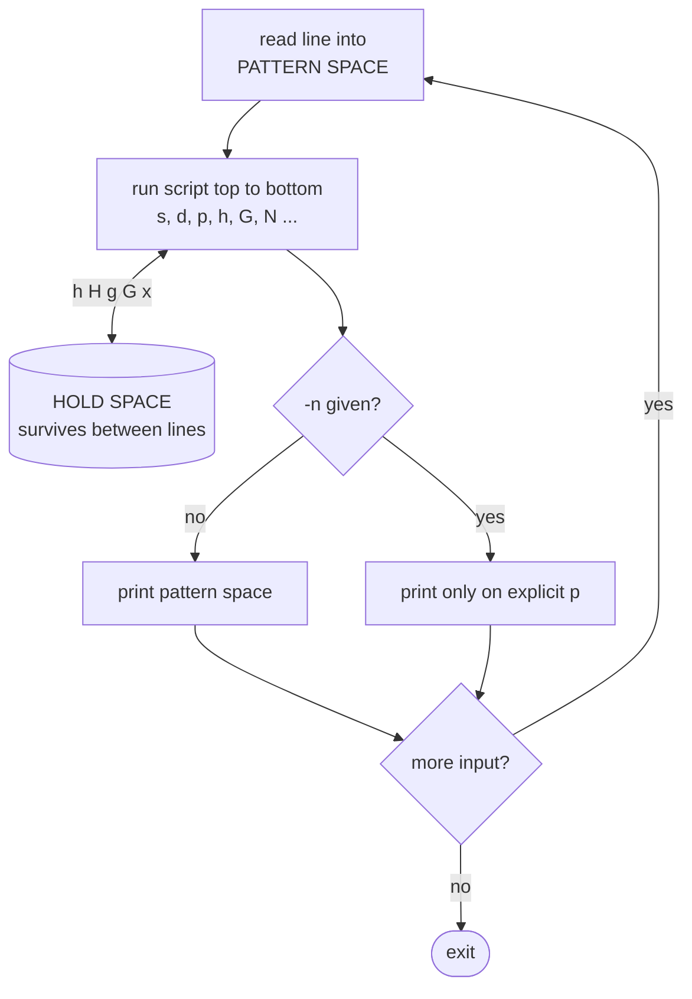
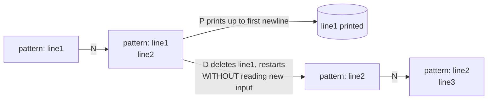

# SED: Beginner → Moderate → Advanced → Master

> `sed` is a **stream editor**. It reads text one line at a time, applies an editing script, and writes the result. In DevOps it's the go-to for **automated edits**: changing a config value in a Dockerfile step, bumping an image tag in CI, masking secrets before logs are shipped, and rewriting files in place across a repo.

**Before you start:** create the sample files from the [Text-Processing Lab](text-processing-lab.md). Every example below was run on **GNU sed 4.9**. BSD/macOS differences are flagged with 🍎.

**Related:** [grep in depth](grep-mastery.md) · [awk in depth](awk-mastery.md) · [Bash scripting](bash-scripting.md)

---

## Table of Contents

- [Level 0: The Mental Model](#level-0-the-mental-model)
- [Level 1: Beginner](#level-1-beginner)
- [Level 2: Moderate](#level-2-moderate)
- [Level 3: Advanced (hold space and multi-line)](#level-3-advanced-hold-space-and-multi-line)
- [Level 4: Master](#level-4-master)
- [Pitfalls That Bite in Production](#pitfalls-that-bite-in-production)
- [GNU vs BSD (macOS) sed](#gnu-vs-bsd-macos-sed)
- [sed or awk?](#sed-or-awk)
- [Exercises with Answers](#exercises-with-answers)
- [One-Liner Cheat Sheet](#one-liner-cheat-sheet)

---

## Level 0: The Mental Model



sed has two buffers:

- **Pattern space**: the current line, which is what commands operate on.
- **Hold space**: a scratch buffer that persists between lines. It starts empty.

The cycle, for every input line:

```
1. read the next line into pattern space (newline stripped)
2. run the script top to bottom; each command can be limited by an ADDRESS
3. at the end of the script, print pattern space (unless -n), and add the newline back
4. clear pattern space and go to 1  (hold space is NOT cleared)
```

A sed script is a list of `[address[,address]]command`:

```bash
sed '3d'             # address=3,           command=d (delete)
sed '/ERROR/p'       # address=/ERROR/,     command=p (print)
sed '2,5s/a/b/'      # address=lines 2-5,   command=s (substitute)
sed 's/a/b/'         # no address = every line
```

`-n` turns off the automatic print in step 3, so **only explicit `p` commands produce output**. `-n` plus `p` is how sed acts like grep.

---

## Level 1: Beginner

### 1.1 Substitution: `s/regex/replacement/flags`

```bash
sed 's/localhost/db.internal/' app.conf         # first match on each line
sed 's/e/E/g' depts.txt                         # g = every match on the line
sed 's/e/E/2' depts.txt                         # only the 2nd match on each line
sed 's/error/WARN/I' app.log                    # I = case-insensitive (GNU)
sed -n 's/^port = //p' app.conf                 # p = print lines where a substitution happened
sed 's/debug = true/debug = false/w changed.txt' app.conf   # w = also write changed lines to a file
```

**Any character can be the delimiter.** Pick one that isn't in your data, so you don't drown in backslashes:

```bash
sed 's/\/home\//\/srv\/home\//' users.txt       # ❌ "leaning toothpick syndrome"
sed 's|/home/|/srv/home/|' users.txt            # ✅
sed 's#/home/#/srv/home/#' users.txt            # ✅
```

### 1.2 Printing and deleting lines

```bash
sed -n '5p' app.log              # line 5
sed -n '3,6p' app.log            # lines 3-6
sed -n '$p' app.log              # last line
sed -n '/ERROR/p' app.log        # like grep ERROR
sed '/DEBUG/d' app.log           # like grep -v DEBUG
sed '1d' employees.csv           # drop the CSV header
sed '/^$/d' messy.txt            # delete empty lines
sed '/^[[:space:]]*$/d' file     # delete blank lines, including whitespace-only ones
sed -E '/^(#|$)/d' app.conf      # strip comments and empty lines (show the "real" config)
sed 3q app.log                   # print the first 3 lines, then QUIT (like head -3, stops reading)
```

### 1.3 Addresses

| Address | Matches |
|---|---|
| `5` | line 5 |
| `$` | last line |
| `/re/` | lines matching regex |
| `\%re%` | regex with a custom delimiter (`%` here), handy for paths |
| `3,7` | lines 3 through 7 |
| `/start/,/end/` | from a line matching start through the next line matching end |
| `5,$` | line 5 to end of file |
| `addr!` | **NOT** that address |

```bash
sed -n '/^\[database\]/,/^$/p' app.conf      # print one INI section
sed '/^#/!s/true/TRUE/' app.conf             # substitute only on non-comment lines
sed -n '\%/bin/bash%p' users.txt             # custom delimiter for a regex address
```

### 1.4 In-place editing: `-i`

```bash
sed -i 's/^port = 8080$/port = 9090/' app.conf          # GNU: edit file directly
sed -i.bak 's/^port = 8080$/port = 9090/' app.conf      # keep app.conf.bak (works on GNU and BSD)
sed -i '' 's/a/b/' file                                 # 🍎 BSD/macOS: empty suffix is required
```

> **Habit:** run the command **without `-i`** first, check the output, then add `-i`. `-i` has no undo.

### 1.5 Multiple commands

```bash
sed -e 's/true/yes/' -e 's/false/no/' app.conf     # multiple -e
sed 's/true/yes/; s/false/no/' app.conf            # semicolons
sed -f script.sed app.conf                         # from a file (Level 3)
```

### 1.6 Whitespace cleanup

```bash
sed 's/[[:space:]]*$//' messy.txt          # trailing whitespace
sed 's/^[[:space:]]*//' messy.txt          # leading whitespace
sed -E 's/^[[:space:]]+|[[:space:]]+$//g' messy.txt   # both ends
sed -E 's/ +/ /g' file                     # squeeze runs of spaces
sed 's/\t/    /g' file                     # tabs → 4 spaces (GNU understands \t; 🍎 BSD does not)
sed 's/\r$//' file                         # CRLF → LF  (a Windows file breaking your bash script)
```

---

## Level 2: Moderate

### 2.1 Regex flavours: BRE vs ERE

By default sed uses **Basic Regular Expressions (BRE)**, where `+ ? ( ) { } |` are **literal** unless backslashed. `-E` switches to **Extended (ERE)**, where they are operators. ERE is easier to read; use it.

| Meaning | BRE (default) | ERE (`-E`) |
|---|---|---|
| one or more | `a\+` (GNU) | `a+` |
| optional | `a\?` (GNU) | `a?` |
| group | `\(ab\)` | `(ab)` |
| alternation | `a\|b` (GNU) | `a\|b` → write `a|b` |
| interval | `a\{2,3\}` | `a{2,3}` |

```bash
sed 's/\(user\)=\([a-z]*\)/\2@\1/' app.log       # BRE
sed -E 's/(user)=([a-z]*)/\2@\1/' app.log        # ERE: same thing, readable
```

### 2.2 Backreferences and `&`

- `\1`..`\9` mean "what group N captured".
- `&` means "the whole match".

```bash
sed -E 's/^([^ ]+) ([^ ]+)/\2 \1/' depts.txt           # swap two words → "Bangalore Engineering"
sed -E 's/[0-9]+/[&]/g' app.conf                       # wrap every number: port = [8080]
sed -E -n 's/.*code=([A-Z_]+).*/\1/p' app.log          # extract a value → CARD_DECLINED, TIMEOUT
sed -n 's/.*<title>\(.*\)<\/title>.*/\1/p' page.html   # text between tags
```

> Only `\1`–`\9` exist. `\11` means "group 1, then the character 1". That is exactly what you want in `s#(web:)[0-9.]+#\11.5.0#` (group 1 + `1.5.0`), but it surprises people.

To insert a literal `&` or `\` in the replacement, escape it: `\&`, `\\`.

### 2.3 Case conversion (GNU)

| Escape | Effect |
|---|---|
| `\U` | uppercase until `\E` or end |
| `\L` | lowercase until `\E` |
| `\u` / `\l` | upper/lowercase only the next character |
| `\E` | stop case conversion |

```bash
sed -E 's/user=([a-z]+)/user=\U\1/' app.log             # user=ALICE
sed -E 's/\[([a-z]+)\]/[\u\1]/' app.log                 # [auth] → [Auth]
sed -E 's/^([^=]+) = (.*)$/\U\1\E=\2/' app.conf         # "port = 8080" → "PORT=8080" (env-file style)
```

🍎 BSD sed doesn't support these. On macOS, `echo x | sed 's/x/\U&/'` prints `Ux`.

### 2.4 Insert, append, change

```bash
sed '/^port = 5432/a timeout = 30' app.conf        # a: append a line AFTER the match
sed '/^\[cache\]/i # cache settings' app.conf      # i: insert a line BEFORE the match
sed '/^password/c password = ********' app.conf    # c: replace the whole line
sed '1i HEADER' file                               # insert at the top of the file
sed '$a FOOTER' file                               # append at the end of the file
```

The one-line form (`a text`) is GNU. The portable POSIX form, which 🍎 also requires, puts the text on the next line after a backslash:

```bash
sed '1i\
HEADER' file
```

### 2.5 Ranges and section-aware edits

This is how you change a value **only inside one section** of a config file. It's the most useful sed pattern in ops:

```bash
# app.conf has "port" in [server] AND [database]; change only the database one
sed '/^\[database\]/,/^\[/ s/^port = .*/port = 6543/' app.conf
# port = 8080      ← untouched
# port = 6543

# print one key from one section
sed -n '/^\[database\]/,/^\[/{/^user/p}' app.conf          # user = admin

# delete from a marker to end of file
sed '/^\[cache\]/,$d' app.conf
```

`{ ... }` groups commands under one address. Addresses can nest inside the braces.

GNU address extensions:

```bash
sed -n '1~2p' file          # first~step: lines 1, 3, 5 ... (odd lines)
sed -n '0~3p' file          # every 3rd line
sed -n '/two/,+2p' file     # the match plus the next 2 lines
sed -n '/two/,~4p' file     # from the match up to the next line number that's a multiple of 4
sed '0,/ERROR/s//FIRST/' f  # only the FIRST match in the whole file (0,/re/ lets the match be on line 1)
```

Portable "odd lines": `sed 'n;d'`. `n` prints the current line and loads the next, and `d` deletes that one.

### 2.6 Other everyday commands

| Command | Does |
|---|---|
| `=` | print the current line number |
| `l` | print the line "visibly" (`\t`, `$` at end): a debugging aid |
| `y/abc/xyz/` | transliterate characters (like `tr`) |
| `q` / `Q` | quit after printing / quit **without** printing (GNU) |
| `r file` | append the contents of file after the current line |
| `w file` | write the pattern space to file |
| `n` | print the pattern space (unless `-n`), then load the next line |

```bash
sed -n '/ERROR/{=;p}' app.log                # line number + line, like grep -n
sed = depts.txt | sed 'N;s/\n/\t/'           # number lines, like cat -n
sed -n 'l' messy.txt                         # reveal tabs and trailing spaces
echo "hello" | sed 'y/abcdefghijklmnopqrstuvwxyz/ABCDEFGHIJKLMNOPQRSTUVWXYZ/'
sed -n '/ERROR/{p;q}' app.log                # first ERROR only, then stop reading (fast on huge files)
sed '/name: LOG_LEVEL/{n;s/"debug"/"info"/}' deployment.yaml   # edit the line AFTER a match
```

### 2.7 Using shell variables safely

Use **double quotes** to let the shell expand variables. The value then becomes *part of the sed program*, so special characters in it matter:

```bash
PORT=7000
sed "s/^port = 8080$/port = $PORT/" app.conf      # ✅ fine: digits only

NEW="/opt/a&b"
sed "s/^host = .*/host = $NEW/" app.conf
# sed: -e expression #1, char 22: unknown option to `s'   ← the "/" in $NEW ended the s command
# and even with a different delimiter, the "&" would be replaced by the match!
```

Escape the value before splicing it in:

```bash
esc_repl() { printf '%s' "$1" | sed -e 's/[\/&]/\\&/g'; }       # for the REPLACEMENT side
esc_re()   { printf '%s' "$1" | sed -e 's/[]\/$*.^[]/\\&/g'; }  # for the REGEX side

sed "s/^host = 0.0.0.0/host = $(esc_repl "$NEW")/" app.conf     # host = /opt/a&b
sed -n "/$(esc_re "0.0.0.0")/p" app.conf                        # "." matched literally
```

> A value containing a **newline** still breaks the command. For arbitrary data, awk's `-v`/`ENVIRON`, or a real templating tool (`envsubst`, `yq`, `jinja`), is safer.

---

## Level 3: Advanced (hold space and multi-line)

### 3.1 The multi-line commands

How `N`, `P` and `D` slide a two-line window down the file:



| Command | Does |
|---|---|
| `h` / `H` | copy / append pattern space → hold space |
| `g` / `G` | copy / append hold space → pattern space |
| `x` | swap pattern and hold space |
| `N` | append `\n` + next line to the pattern space |
| `P` | print up to the first newline of the pattern space |
| `D` | delete up to the first newline, then restart the cycle **without reading new input** if anything remains |
| `:label` | define a label |
| `b label` | branch (jump) to label; `b` alone jumps to the end of the script |
| `t label` | branch if a substitution succeeded since the last input line or `t` |
| `T label` | branch if NO substitution succeeded (GNU) |

Once `N` has joined lines, `\n` in a regex matches the embedded newline.

### 3.2 Classic multi-line idioms, explained

**Join all lines into one** (CSV of lines):

```bash
sed ':a;N;$!ba;s/\n/,/g' depts.txt
# Engineering Bangalore,Sales Mumbai,Security Pune
```
- `:a` is a label. `N` appends the next line. `$!ba` means "if not the last line, jump to a".
- At the last line, every line is in the pattern space, so replace all `\n` with `,`.
- 🍎 BSD can't use `;` after a label. Write `sed -e :a -e '$!N; s/\n/,/; ta' file` instead, which works everywhere.

**Reverse a file** (like `tac`):

```bash
sed -n '1!G;h;$p' depts.txt
```
- On every line except the first, `G` appends the hold space (all previous lines) after the current one.
- `h` saves the result back to the hold space. `$p` prints it at the end.

**Squeeze repeated blank lines into one** (like `cat -s`):

```bash
sed '/^$/N;/^\n$/D' messy.txt
```
On an empty line, read the next one. If the pattern space is now two empty lines, `D` deletes the first and re-runs, so a run of blanks collapses to one.

**Delete trailing blank lines at end of file:**

```bash
sed -e :a -e '/^\n*$/{$d;N;ba' -e '}' messy.txt
```

**Print the line before each match** (`grep -B1`):

```bash
sed -n '/CARD_DECLINED/{x;p;x;p};h' app.log
```
Every line is saved with `h`. On a match, swap to print the saved previous line, swap back, then print the match.

**Remove consecutive duplicate lines** (like `uniq`):

```bash
printf 'a\na\nb\nb\nb\nc\na\n' | sed '$!N; /^\(.*\)\n\1$/!P; D'
# a b c a
```
With two lines in the pattern space, print the first only if it differs from the second. Then `D` drops the first and loops.

**Join continuation lines** (Dockerfile, shell scripts with trailing `\`):

```bash
sed -e :a -e '/\\$/N; s/\\\n//; ta' Dockerfile
# RUN apt-get update &&     apt-get install -y curl     git
```

**Join pairs of lines:**

```bash
sed '$!N;s/\n/ /' file          # lines 1+2, 3+4, ...
sed '1~3{N;N;s/\n/ | /g}' file  # GNU: groups of 3
```

### 3.3 Loops with `t`: repeat until nothing changes

**Thousands separators:** each pass inserts one comma, and `t` loops while a substitution happened:

```bash
printf '1234567\n987\nsalary 120000 USD\n' | sed -E ':a;s/([0-9])([0-9]{3})($|[^0-9])/\1,\2\3/;ta'
# 1,234,567
# 987
# salary 120,000 USD
```

**`t` as if/else.** `t` with no label jumps to the end of the script when the previous `s` succeeded:

```bash
sed -E '/\[auth\]/!d; s/status=failed/& <-- ALERT/; t; s/$/ (ok)/' app.log
# ... status=ok latency=120ms (ok)
# ... status=failed <-- ALERT latency=80ms
```

### 3.4 sed script files

Past two or three commands, use a file with comments:

```sed
# sanitize.sed — make app.conf safe to paste into a ticket
/^#/d                              # drop comments
/^$/d                              # drop blank lines
s/^\(password *= *\).*/\1********/ # mask secrets
/^\[server\]/,/^\[/{
  s/^debug = .*/debug = false/     # force debug off, only in [server]
}
```

```bash
sed -f sanitize.sed app.conf
```

You can also make it executable with `#!/usr/bin/sed -f` on line 1. Use `#!/usr/bin/sed -nf` when you need `-n`.

### 3.5 Paragraph-level grep

Print the blank-line separated **records** that contain a pattern:

```bash
sed -e '/./{H;$!d;}' -e 'x;/status: down/!d;' hosts.txt
```
Non-empty lines accumulate in hold space (`H`) and are deleted from output. On a blank line, or at EOF, `x` swaps the whole paragraph in, and it's deleted unless it matches. (The output starts with a blank line from the swap.)

---

## Level 4: Master

### 4.1 Managed blocks: idempotent config edits

The pattern behind tools like Ansible's `blockinfile`: replace everything **between markers** with fresh content, and leave the rest of the file alone. You can run it any number of times and get the same result.

```bash
# hosts.cfg:
# keep
# # BEGIN managed
# old1
# old2
# # END managed
# keep2

sed -i -e '/# BEGIN managed/,/# END managed/{//!d}' \
       -e '/# BEGIN managed/r new.txt' hosts.cfg
```

- `{//!d}`: the **empty regex `//` reuses the last regex used**, which here is whichever range end just matched. So `//!d` deletes every line in the range *except* the two marker lines.
- `r new.txt` queues the file's contents for output after the BEGIN marker.

### 4.2 "Ensure line present" (idempotent)

sed has no "if not found anywhere, add" in a single pass, so combine it with grep:

```bash
grep -q '^max_conn' app.conf || sed -i '/^\[database\]/a max_conn = 100' app.conf
# run it twice → still only one max_conn line
```

### 4.3 First match only, and stopping early

```bash
sed '0,/ERROR/s//FIRST_ERROR/' app.log     # GNU: replace only the first ERROR in the whole file
sed -n '/ERROR/{p;q}' app.log              # print the first ERROR and stop reading: O(position), not O(file)
sed '/^---$/Q' multi-doc.yaml              # GNU Q: print up to (not including) the first "---" and stop
```

### 4.4 GNU power flags

| Flag | Use |
|---|---|
| `-E` | ERE (also `-r` on GNU) |
| `-n` | no auto-print |
| `-i[SUF]` | in place, optional backup suffix |
| `-s` | treat files as **separate** (so `$` and line numbers are per file) |
| `-z` | NUL-separated "lines", so the whole file is one record when it has no NULs |
| `-u` | unbuffered (for `tail -f \| sed`) |
| `--follow-symlinks` | with `-i`, edit the link target instead of replacing the symlink with a regular file |
| `--posix` | disable GNU extensions, to test portability |
| `--debug` | annotate execution (GNU 4.6+) |

```bash
sed -s -n '1p' depts.txt users.txt app.log           # first line of EACH file
sed -z 's/\n/,/g; s/,$/\n/' depts.txt                # join lines, no label loop needed
find . -name '*.yaml' -print0 | xargs -0 sed -i 's/v1beta1/v1/'   # safe with spaces in names
tail -f app.log | sed -u 's/ERROR/\x1b[31mERROR\x1b[0m/'         # live red highlighting
echo hello | sed --debug 's/l/L/'                    # see each step of the cycle
```

> ⚠️ Without `--follow-symlinks`, `sed -i` on a symlink **replaces the link with a regular file**. This silently breaks setups that rely on symlinked configs, for example `/etc/nginx/sites-enabled/*`.

### 4.5 Repo-wide refactors

```bash
# preview: which files would change?
grep -rlZ 'registry.old.io' --include='*.yaml' . | xargs -0 sed -n 's/registry\.old\.io/registry.new.io/gp'

# apply, keeping backups
grep -rlZ 'registry.old.io' --include='*.yaml' . | xargs -0 sed -i.bak 's/registry\.old\.io/registry.new.io/g'

# in a git repo, prefer git ls-files: it respects .gitignore and handles odd names
git ls-files -z '*.yaml' | xargs -0 sed -i 's/registry\.old\.io/registry.new.io/g'
git diff --stat      # review, then commit or `git checkout -- .`
```

Note the **escaped dots**. An unescaped `.` matches any character, so `registry.old.io` would also match `registryXoldYio`.

### 4.6 The `e` and `s///e` commands (GNU): avoid them

GNU sed can execute shell commands (`e`, `s/.../.../e`). If any part of the input is untrusted, that's arbitrary command execution. Some hardened builds use `--sandbox`, which disables `e`, `r` and `w`. Treat these like `eval`.

---

## Pitfalls That Bite in Production

| Pitfall | Symptom | Fix |
|---|---|---|
| `sed -i` on macOS | `sed: 1: "file": invalid command code` | `sed -i '' ...` or use `-i.bak` everywhere |
| Unescaped `.` `*` `[` `/` in a pattern | Matches too much, or `unknown option to 's'` | Escape, or `esc_re` above |
| `&` in a replacement from a variable | Replaced by the match text | `esc_repl`, or `\&` |
| Greedy `.*` | `s/".*"/X/` eats from the first quote to the **last** | `"[^"]*"` (sed has no lazy `.*?`) |
| BRE vs ERE confusion | `s/a+/b/` doesn't match "aaa" | `-E`, or `\+` in GNU BRE |
| `-i` on a symlink | Symlink replaced by a file | `--follow-symlinks` |
| `-i` without testing | Corrupted file, no undo | Dry run first, `-i.bak`, or use git |
| CRLF files | `$` anchor "fails", `^M` in output | `sed 's/\r$//'` first |
| `sed 's/\n/,/'` | Does nothing, because sed strips the newline from each line | `N` loop, or `-z`, or `tr '\n' ','` |
| Editing structured data (JSON/YAML) | Breaks on reorderings and nesting | `jq` / `yq`; use sed only for simple, known shapes |

---

## GNU vs BSD (macOS) sed

| Feature | GNU | BSD/macOS |
|---|---|---|
| `-i` with no suffix | `sed -i 's/a/b/' f` | `sed -i '' 's/a/b/' f` |
| `-E` | ✅ (also `-r`) | ✅ |
| `\+ \? \|` in BRE | ✅ | ❌ (use `-E`) |
| `\t` `\n` in the replacement | ✅ | ❌ (`\n` in a regex is fine) |
| `\U \L \u \l \E` | ✅ | ❌ |
| one-line `a text` / `i text` / `c text` | ✅ | ❌ (needs `a\` + newline) |
| `;` after a label or branch: `:a;N;ba` | ✅ | ❌ (use separate `-e`) |
| `first~step`, `addr,+N`, `0,/re/` | ✅ | ❌ |
| `Q`, `T`, `e`, `F`, `z` commands | ✅ | ❌ |
| `I` flag (case-insensitive) | ✅ | ✅ (recent macOS) |
| `-z`, `-s`, `-u`, `--debug`, `--follow-symlinks` | ✅ | ❌ (macOS has `-l` for line buffering) |

**Portable strategy:** `brew install gnu-sed` and use `gsed` locally, or run scripts in a Linux container. In CI, scripts run on GNU anyway.

---

## sed or awk?

| Task | Better tool |
|---|---|
| Replace text, delete or insert lines, edit in place | **sed** |
| Anything involving columns/fields | **awk** |
| Arithmetic, counting, aggregation | **awk** |
| Section-aware edit in an INI file | sed range (simple) or awk (complex) |
| Multi-line joins | sed (`N`/`D`) if short; awk for readable logic |
| Logic that needs variables or if/else | **awk** (sed's hold space is one buffer and `t`/`b` are gotos) |

If your sed script has more than two labels, rewrite it in awk. The next person to read it will thank you.

---

## Exercises with Answers

Run them in `~/textlab` (see the [lab setup](text-processing-lab.md)). Recreate the lab after exercises that use `-i`.

### 🟢 Beginner

**SB1.** Replace `localhost` with `db.internal` in `app.conf` (print only, don't modify the file).
<details><summary>Answer</summary>

```bash
sed 's/localhost/db.internal/' app.conf
```
</details>

**SB2.** What's the difference between `sed 's/e/E/'` and `sed 's/e/E/g'` on `depts.txt`?
<details><summary>Answer</summary>

Without `g`, only the first `e` on each line is replaced (`EnginEering Bangalore`). With `g`, every `e` is (`EnginEEring BangalorE`).
</details>

**SB3.** Print only lines 3 to 6 of `app.log`.
<details><summary>Answer</summary>

```bash
sed -n '3,6p' app.log
```
</details>

**SB4.** Show `app.conf` without comment lines or empty lines.
<details><summary>Answer</summary>

```bash
sed -E '/^(#|$)/d' app.conf
# or portable BRE: sed -e '/^#/d' -e '/^$/d' app.conf
```
</details>

**SB5.** Use sed (not grep) to print only `ERROR` lines.
<details><summary>Answer</summary>

```bash
sed -n '/ERROR/p' app.log
```
</details>

**SB6.** Print the last line of `app.log`.
<details><summary>Answer</summary>

```bash
sed -n '$p' app.log
```
</details>

**SB7.** Change `/home/` to `/srv/home/` in `users.txt` without escaping any slashes.
<details><summary>Answer</summary>

```bash
sed 's|/home/|/srv/home/|' users.txt
```
</details>

**SB8.** Remove trailing whitespace (spaces and tabs) from `messy.txt`. Verify it with `cat -A`.
<details><summary>Answer</summary>

```bash
sed 's/[[:space:]]*$//' messy.txt | cat -A      # every line now ends right at "$"
```
</details>

**SB9.** Prefix every line of `depts.txt` with `> ` (quote style).
<details><summary>Answer</summary>

```bash
sed 's/^/> /' depts.txt
```
</details>

**SB10.** Change `port = 8080` to `port = 9090` **in place**, keeping a backup, and confirm the database port wasn't touched.
<details><summary>Answer</summary>

```bash
sed -i.bak 's/^port = 8080$/port = 9090/' app.conf
grep -n '^port' app.conf app.conf.bak
# app.conf:4:port = 9090
# app.conf:9:port = 5432
# app.conf.bak:4:port = 8080
```
Anchoring with `^...$` stops it from matching `port = 80800` or `export = 8080`.
</details>

**SB11.** Print the first 3 lines of `app.log` and stop reading the file.
<details><summary>Answer</summary>

```bash
sed 3q app.log
```
</details>

**SB12.** Print only the `[database]` section of `app.conf`.
<details><summary>Answer</summary>

```bash
sed -n '/^\[database\]/,/^$/p' app.conf
```
`[` is special in regex, so escape it as `\[`.
</details>

### 🟡 Moderate

**SI1.** Swap the two words on each line of `depts.txt`.
<details><summary>Answer</summary>

```bash
sed -E 's/^([^ ]+) ([^ ]+)/\2 \1/' depts.txt
# Bangalore Engineering ...
```
</details>

**SI2.** Wrap every number in `app.conf` in square brackets.
<details><summary>Answer</summary>

```bash
sed -E 's/[0-9]+/[&]/g' app.conf
# host = [0].[0].[0].[0]
# port = [8080]
```
</details>

**SI3.** Change `port` to `6543` **only in the `[database]` section**.
<details><summary>Answer</summary>

```bash
sed '/^\[database\]/,/^\[/ s/^port = .*/port = 6543/' app.conf
```
</details>

**SI4.** Add a line `timeout = 30` right after `port = 5432`.
<details><summary>Answer</summary>

```bash
sed '/^port = 5432/a timeout = 30' app.conf
# portable:
sed '/^port = 5432/a\
timeout = 30' app.conf
```
</details>

**SI5.** Insert the comment `# cache settings` above the `[cache]` header.
<details><summary>Answer</summary>

```bash
sed '/^\[cache\]/i # cache settings' app.conf
```
</details>

**SI6.** Replace the whole `password` line with `password = ********`.
<details><summary>Answer</summary>

```bash
sed '/^password/c password = ********' app.conf
# or keep the key's formatting: sed -E 's/^(password *= *).*/\1********/' app.conf
```
</details>

**SI7.** Uppercase the username in every `user=...` (`user=alice` → `user=ALICE`).
<details><summary>Answer</summary>

```bash
sed -E 's/user=([a-z]+)/user=\U\1/' app.log      # GNU only
```
</details>

**SI8.** In `users.txt`, replace only the **2nd** `:` on each line with `|`. Then replace the 3rd and every later one.
<details><summary>Answer</summary>

```bash
sed 's/:/|/2' users.txt     # root:x|0:0:root:/root:/bin/bash
sed 's/:/|/3g' users.txt    # root:x:0|0|root|/root|/bin/bash   (GNU)
```
</details>

**SI9.** Print only the odd-numbered lines of `depts.txt`, in two different ways.
<details><summary>Answer</summary>

```bash
sed -n '1~2p' depts.txt     # GNU step address
sed 'n;d' depts.txt         # portable
```
</details>

**SI10.** Print everything from the **first** `ERROR` line to the end of `app.log`.
<details><summary>Answer</summary>

```bash
sed -n '/ERROR/,$p' app.log     # 11 lines
```
</details>

**SI11.** Bump the `web` image to `1.5.0` in `deployment.yaml` without touching the sidecar.
<details><summary>Answer</summary>

```bash
sed -E 's#(image: .*/web:)[0-9.]+#\11.5.0#' deployment.yaml
#           image: registry.example.com/web:1.5.0
#           image: registry.example.com/proxy:0.9.1
```
`\11.5.0` means group 1 followed by `1.5.0`. sed backreferences are single-digit.
</details>

**SI12.** Number the lines of `depts.txt` using sed only (like `cat -n`).
<details><summary>Answer</summary>

```bash
sed = depts.txt | sed 'N;s/\n/\t/'
```
</details>

**SI13.** `NEW="/opt/a&b"`. Why does `sed "s/^host = .*/host = $NEW/" app.conf` fail, and how do you fix it?
<details><summary>Answer</summary>

The `/` in `$NEW` closes the `s` command early, which gives `unknown option to 's'`. And even with another delimiter, `&` would expand to the matched text. Escape the value first:
```bash
esc_repl() { printf '%s' "$1" | sed -e 's/[\/&]/\\&/g'; }
sed "s/^host = 0.0.0.0/host = $(esc_repl "$NEW")/" app.conf      # host = /opt/a&b
```
</details>

**SI14.** Extract only the error `code=` values from `app.log`.
<details><summary>Answer</summary>

```bash
sed -E -n 's/.*code=([A-Z_]+).*/\1/p' app.log
# CARD_DECLINED
# TIMEOUT
```
</details>

**SI15.** Change `"debug"` to `"info"` **only** on the line right after `name: LOG_LEVEL` in `deployment.yaml`.
<details><summary>Answer</summary>

```bash
sed '/name: LOG_LEVEL/{n;s/"debug"/"info"/}' deployment.yaml
```
`n` moves to the next line inside the block, so the substitution applies there.
</details>

**SI16.** Convert `app.conf` key/value lines to env-file style: `port = 8080` → `PORT=8080`.
<details><summary>Answer</summary>

```bash
sed -E -n 's/^([^=#[]+) = (.*)$/\U\1\E=\2/p' app.conf
# HOST=0.0.0.0
# PORT=8080
# DEBUG=true ...
```
</details>

### 🟠 Advanced

**SA1.** Join all lines of `depts.txt` into one comma-separated line, using a portable command and a GNU-only command.
<details><summary>Answer</summary>

```bash
sed -e :a -e '$!N; s/\n/,/; ta' depts.txt     # portable (works on macOS)
sed ':a;N;$!ba;s/\n/,/g' depts.txt            # GNU
sed -z 's/\n/,/g; s/,$/\n/' depts.txt         # GNU -z
# Engineering Bangalore,Sales Mumbai,Security Pune
```
</details>

**SA2.** Reverse the order of lines (like `tac`), and explain each command.
<details><summary>Answer</summary>

```bash
sed -n '1!G;h;$p' depts.txt
```
`1!G`: on every line except the first, append the hold space (previous lines, reversed) after the current line. `h`: store that as the new hold space. `$p`: print at the end.
</details>

**SA3.** Collapse runs of blank lines in `messy.txt` into a single blank line.
<details><summary>Answer</summary>

```bash
sed '/^$/N;/^\n$/D' messy.txt
```
</details>

**SA4.** Delete all trailing blank lines at the end of `messy.txt`, keeping the internal ones.
<details><summary>Answer</summary>

```bash
sed -e :a -e '/^\n*$/{$d;N;ba' -e '}' messy.txt
```
When a line is blank, keep appending lines while they're blank. If you reach EOF that way, delete them all. Otherwise the block ends and the lines print normally.
</details>

**SA5.** Print each `CARD_DECLINED` line together with the line before it.
<details><summary>Answer</summary>

```bash
sed -n '/CARD_DECLINED/{x;p;x;p};h' app.log
```
</details>

**SA6.** Collapse backslash-continued lines in a Dockerfile `RUN` into one line.
<details><summary>Answer</summary>

```bash
sed -e :a -e '/\\$/N; s/\\\n//; ta' Dockerfile
```
</details>

**SA7.** Add thousands separators to every number: `1234567` → `1,234,567`.
<details><summary>Answer</summary>

```bash
printf '1234567\n987\nsalary 120000 USD\n' | sed -E ':a;s/([0-9])([0-9]{3})($|[^0-9])/\1,\2\3/;ta'
```
Each pass inserts the rightmost comma that's still missing, and `ta` repeats until nothing changes.
</details>

**SA8.** Remove **consecutive** duplicate lines (like `uniq`) using sed.
<details><summary>Answer</summary>

```bash
sed '$!N; /^\(.*\)\n\1$/!P; D'
```
</details>

**SA9.** Write `sanitize.sed`, which removes comments and blank lines, masks the password, and sets `debug = false` only in `[server]`.
<details><summary>Answer</summary>

See section 3.4. Run it with `sed -f sanitize.sed app.conf`.
</details>

**SA10.** Make sure `max_conn = 100` exists under `[database]`. Running the command twice must not add a second copy.
<details><summary>Answer</summary>

```bash
grep -q '^max_conn' app.conf || sed -i '/^\[database\]/a max_conn = 100' app.conf
```
</details>

**SA11.** For `[auth]` lines only, append ` <-- ALERT` after `status=failed`, and add ` (ok)` at the end of every other auth line. Use one sed command.
<details><summary>Answer</summary>

```bash
sed -E '/\[auth\]/!d; s/status=failed/& <-- ALERT/; t; s/$/ (ok)/' app.log
```
`t` with no label jumps to the end of the script when the previous substitution succeeded, which gives you an if/else.
</details>

**SA12.** Replace only the **first** `ERROR` in the whole file (not the first on each line).
<details><summary>Answer</summary>

```bash
sed '0,/ERROR/s//FIRST_ERROR/' app.log        # GNU
```
The empty regex `//` reuses `/ERROR/`.
</details>

### 🔴 Master

**SM1.** Write an idempotent "managed block" update: replace everything between `# BEGIN managed` and `# END managed` in `hosts.cfg` with the contents of `new.txt`, keeping the markers.
<details><summary>Answer</summary>

```bash
printf 'keep\n# BEGIN managed\nold1\nold2\n# END managed\nkeep2\n' > hosts.cfg
printf 'new1\nnew2\n' > new.txt
sed -i -e '/# BEGIN managed/,/# END managed/{//!d}' -e '/# BEGIN managed/r new.txt' hosts.cfg
cat hosts.cfg
# keep
# # BEGIN managed
# new1
# new2
# # END managed
# keep2
```
</details>

**SM2.** Print the blank-line separated records in `hosts.txt` whose status is `down`.
<details><summary>Answer</summary>

```bash
sed -e '/./{H;$!d;}' -e 'x;/status: down/!d;' hosts.txt
```
</details>

**SM3.** Print the first line of **each** of `depts.txt`, `users.txt` and `app.log` with one sed invocation.
<details><summary>Answer</summary>

```bash
sed -s -n '1p' depts.txt users.txt app.log
```
Without `-s`, sed treats all the files as one stream, so you'd only get the first line of the first file.
</details>

**SM4.** Write `esc_re` and `esc_repl` shell functions so that any string can be used safely as a sed regex or replacement. Show that `0.0.0.0` then matches only literally.
<details><summary>Answer</summary>

See section 2.7.
</details>

**SM5.** Explain why `sed -i 's/x/y/' /etc/nginx/sites-enabled/site.conf` might "break" nginx config management, and give the fix.
<details><summary>Answer</summary>

`sites-enabled/*` are usually symlinks into `sites-available/`. GNU `sed -i` writes a temporary file and renames it over the **symlink**, which turns it into a regular file. The real file in `sites-available` stays unchanged, and later edits to it are no longer picked up. Fix: `sed -i --follow-symlinks ...`, or edit the target path directly.
</details>

**SM6.** Replace `registry.old.io` with `registry.new.io` in every tracked `*.yaml` file in a git repo. File names may contain spaces, and you need a review step.
<details><summary>Answer</summary>

```bash
git ls-files -z '*.yaml' | xargs -0 sed -i 's/registry\.old\.io/registry.new.io/g'
git diff --stat
```
</details>

**SM7.** Use `--debug` to watch how `s/l/L/` handles `hello`, and explain why only one `l` changes.
<details><summary>Answer</summary>

```bash
echo hello | sed --debug 's/l/L/'
```
The debug output shows `regex[0] = 2-3 'l'` and then `PATTERN: heLlo`. Without the `g` flag, `s` stops after the first match.
</details>

**SM8.** Highlight `ERROR` in red in a live `tail -f`, with no output buffering delay.
<details><summary>Answer</summary>

```bash
tail -f app.log | sed -u 's/ERROR/\x1b[31m&\x1b[0m/g'
```
</details>

---

## One-Liner Cheat Sheet

```bash
sed -n '10,20p'                      # print a line range
sed -n '/start/,/end/p'              # print a block
sed '/re/d'                          # grep -v
sed -n '/re/{p;q}'                   # first match, then stop
sed '1d'                             # drop a header
sed '$d'                             # drop the last line
sed 's/[[:space:]]*$//'              # trim trailing whitespace
sed 's/\r$//'                        # dos2unix
sed '/^$/N;/^\n$/D'                  # squeeze blank lines
sed -n '1!G;h;$p'                    # tac
sed -e :a -e '$!N; s/\n/,/; ta'      # join lines with commas (portable)
sed 's/^/    /'                      # indent by 4
sed -E 's/"[^"]*"/"***"/g'           # mask every quoted string
sed -E 's/(password|token|secret)=[^ ]*/\1=***/Ig'   # mask secrets in logs (GNU)
sed -i '/^#\?PermitRootLogin/c PermitRootLogin no' /etc/ssh/sshd_config   # hardening edit
sed -i "s/^version: .*/version: ${VERSION}/" Chart.yaml                    # CI version bump
sed -E '/web:/s#(image: [^:]+):.*#\1:'"$TAG"'#' deployment.yaml          # set the web image tag from a variable
kubectl get pods --no-headers | sed -n '/CrashLoopBackOff/p'
```

---

[Github](https://github.com/aadarsh-nagrath) | [Twitter](https://twitter.com/aadarsh_nagrath)
